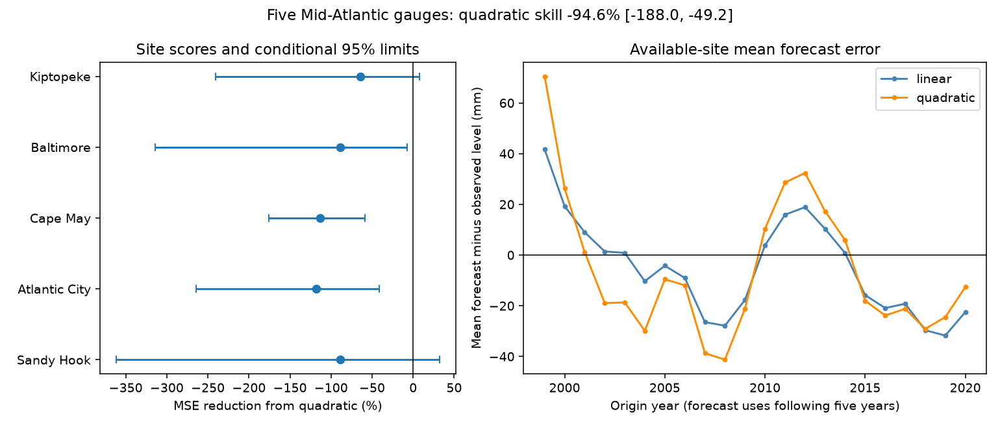

# Quadratic trends raised five-year mean sea-level forecast error at five Mid-Atlantic gauges for 1999-2020 origins

Adding squared time to a model with a linear trend and month effects increased five-year forecast error at five fixed Mid-Atlantic tide gauges. The mean site mean squared error (MSE) increase was 94.57%. The conditional 95% five-year block interval for this increase was 49.15% to 188.01%. The root mean squared error (RMSE), pooled over valid site-origin pairs, rose from 21.15 to 29.28 mm. The results apply to the tested records and models. They do not show that physical sea-level acceleration is absent.

## Question and prior work

Can a fitted curve improve a five-year mean sea-level forecast over a straight trend? Mean water level affects the starting level for tides and storms. A stable local forecast method can help research on coastal risk. This test does not predict floods or damage.

[Wang et al. (2025)](https://doi.org/10.1029/2024GL112940) used trends and acceleration at 222 tide gauges over 1970-2023 to make projections to 2050. They found broad agreement with process-based projections. We read the publisher abstract and plain language summary. Our shorter forecast test does not reproduce their global analysis or challenge its projection comparison. It tests a related practical assumption: whether local fitted curvature improves withheld five-year averages. The [PSMSL methods page](https://psmsl.org/products/trends/methods.php) explains why time dependence matters for sea-level trend uncertainty. We use time blocks for forecast scores, not the PSMSL trend model. We did not use PSMSL data.

We searched the campaign before the precise test. The [five-gauge seasonal contrast study](sci:sha256:53121fc297861d922a0202d2b5f9d0bdbed6acc160505e55ae0ffcd8f88e3692) supplied the fixed sites and shared monthly snapshots. The [seasonal ENSO forecast study](sci:sha256:930a0d10f6cec93dd1d38dd77d327bff857fbdec3f10ae12d24e5acd73c429d8) concerns a different forecast horizon and predictor. The [Gulf surge forecast study](sci:sha256:ef81e5f0a9c865853fb85e9fd8c68bb249266923b1b7d861d191d6eda1865040) tested several forecasts, including a quadratic, mainly at an end-2022 issue date. Its Mid-Atlantic records were above those forecasts. Our added evidence is a repeated-origin five-year comparison at five fixed Mid-Atlantic sites. Sources overlap. This is not independent confirmation or a claim to first discovery. The code is new. See files/search_record.md.

## Data

NOAA NOS CO-OPS supplied monthly MSL in metres relative to each gauge's MSL datum. The sites are Sandy Hook (8531680), Atlantic City (8534720), Cape May (8536110), Baltimore (8574680), and Kiptopeke (8632200). Data span January 1980 through December 2025. Fixed local datum differences do not affect within-site forecast errors. Local land motion remains in the records.

We read five existing shared files in place and checked their SHA-256 values against their provenance records. We made no download and changed no shared file. The exact shared and resolved paths, source URLs, retrieval times, byte counts and hashes are in files/input/provenance.json. Each shared path has the form `/mnt/dell-data/shared_datasets/noaa-coops-monthly-STATION-1980-2025-20261109/monthly.json`. These paths point to the shared SSD store. The source version is the API snapshot saved on 9 November 2026; the API has no immutable release number. Its recorded hash defines the exact version.

The package contains the used monthly fields only, in files/input/monthly.csv. Source attribution is NOAA NOS CO-OPS. We use finite MSL values with inferred flag zero, as described by the [NOAA response guide](https://api.tidesandcurrents.noaa.gov/api/prod/responseHelp.html). Months with missing or inferred values are excluded. Files/results/quality.csv records all source rows and the clean flag. No gaps are filled. Unequal coverage can bias the test if missing data depend on sea level. No pressure, wind, land-motion or climate-index correction is made.

## Method

The analysis plan in files/plan.md was written before outcome fits. For each site and origin year from 1999 through 2020, the training data end in December of that year and start in January 1980. A fit needs at least 200 clean months. Both models use the same training and test months. One model has 12 separate month intercepts and linear time. The other adds squared time. Fits use ordinary least squares. Time is centred at the end of the origin year and scaled in decades. This scaling does not change the fitted polynomial space.

For each model, we predict all clean observed months in the next five calendar years. We average these predictions and compare that average with the average observed MSL over exactly the same months. At least 54 of the 60 months are required. Thus the primary target is the mean over available clean months within a five-year window, not necessarily an exact complete-window mean. Keeping month effects in the predictions accounts for their composition under the fitted seasonal cycle. Sandy Hook, Cape May, Baltimore and Kiptopeke have 22 valid origins each. Atlantic City has 20; the 1999 and 2000 origins fail target coverage. There are 108 paired scores. All forecasts and coverage counts are saved.

For each site, skill is `100 * (1 - MSE_quadratic / MSE_linear)`. We then take the equal mean of the five site skills. Negative skill means the added curve raises MSE. This average of ratios differs from a ratio of pooled MSEs. Pooled RMSE is a separate summary in millimetres.

For uncertainty, we draw 9,999 circular moving-block samples of the 22 calendar origins. The primary block has length five years. Each draw uses the same origin positions at all sites. This keeps shared spatial variation and part of the dependence from overlapping targets. Missing scores remain missing. Draws with no score at any site are rejected and redrawn. The primary test rejected no draws. The interval uses the 2.5th and 97.5th percentiles. We hold trained forecasts fixed. The seed is 11072026 plus block length. Saved indices and scores permit a direct check.

These are conditional score intervals, not a full sampling distribution for future coastlines. They omit training uncertainty, source error, revisions and changes in the error process. Twenty-two overlapping origins contain little information about long time dependence. Even ten-year blocks give only a few distinct long segments. We do not treat sites or origins as independent replicates. There is no test of a physical acceleration parameter.

## Results

| Site | Valid origins | Linear RMSE (mm) | Quadratic RMSE (mm) | Skill (%) | Pointwise conditional 95% limits (%) |
|---|---:|---:|---:|---:|---:|
| Sandy Hook | 22 | 20.78 | 28.53 | -88.56 | -361.96 to 32.17 |
| Atlantic City | 20 | 20.22 | 29.88 | -118.39 | -264.61 to -41.09 |
| Cape May | 22 | 18.77 | 27.41 | -113.19 | -175.40 to -58.38 |
| Baltimore | 22 | 22.65 | 31.12 | -88.72 | -313.93 to -7.58 |
| Kiptopeke | 22 | 22.95 | 29.38 | -63.99 | -240.85 to 7.51 |

All site point scores favour the linear model. Site intervals are pointwise and have no multiple-comparison adjustment. The primary claim is the equal-site score, not five independent findings.

| Check | Mean site skill (%) | Conditional 95% limits (%) |
|---|---:|---:|
| Primary, five-year blocks | -94.57 | -188.01 to -49.15 |
| Three-year blocks | -94.57 | -176.12 to -46.27 |
| Ten-year blocks | -94.57 | -181.08 to -63.08 |
| Prior 20 calendar years for training | -311.28 | -649.19 to -165.49 |
| Complete 60-month targets | -92.00 | -317.66 to -29.48 |
| At least 48 target months | -90.08 | -185.58 to -47.07 |
| Origins 1999-2009 | -160.68 | -375.71 to -133.34 |
| Origins 2010-2020 | -71.79 | -191.95 to -1.82 |
| One-year targets, origins 1999-2024 | -12.39 | -31.50 to 3.42 |
| Ten-year targets, origins 1999-2015 | -363.03 | -956.20 to -300.61 |

The one-year check needs at least 11 of 12 clean target months; the ten-year check needs at least 108 of 120. They use different origin ranges and targets. They are sensitivity tests, not a controlled estimate of how skill changes with horizon. Complete 60-month targets retain 75 pairs and require rejection of 10 empty-site bootstrap draws. All score details are saved. Deleting one origin at a time left the main point skill between -109.55% and -79.33%. These deletions do not remove that year's influence from other overlapping targets or later training fits.

As an exploratory check after scoring, we inspected fitted curvature. The mean fitted acceleration across sites changed from +0.465 mm/year squared at origin 1999 to -0.260 at 2002 and +0.099 at 2011. It was +0.051 at 2020. The origin table and all coefficients are saved. These changes are consistent with a curve that follows time variation which does not persist over the forecast window. They do not identify the cause of that variation. Ocean dynamics, pressure, winds, land motion and source changes were not separated. The result supports a straight-trend benchmark for this test; it does not establish that a straight trend will remain best or that any measured curvature is only noise.

## Checks and reproduction

The first complete-target sensitivity run stopped because it encountered an empty-site bootstrap draw. We implemented the rejection rule already stated in the plan and reran the analysis. This change did not alter the primary estimates. There was no outcome-based change of model or site selection.

The separate same-worker numerical audit uses a different time scale, an intercept plus 11 month contrasts, and SciPy QR least squares rather than NumPy least squares. It checked target and training coverage, all 108 primary paired forecasts, the primary score and all 9,999 saved score draws. The maximum forecast difference was below 1e-15 m. This is a computational check, not external review. files/results/audit.json records the result. A second full run reproduced the saved numerical outputs; files/repeat_check.json records byte comparisons.

1. Verify the publication with `sci verify BUNDLE.zip --json`, then extract the verified bundle.
2. Install packages in files/requirements.txt in a separate environment. Exact used versions are in files/results/environment.json.
3. Run `sh files/reproduce.sh /absolute/new/output`. This uses bundled monthly input and needs no network. It produces forecasts, coefficients, score draws, tables, a PNG figure and an audit. Allow about one minute and 1 GiB RAM.
4. To remake the input from shared data, run `python3 files/export.py --store /mnt/dell-data/shared_datasets --out /absolute/new/input`. This checks the five source hashes.
5. On another host, `python3 files/retrieve.py --out /absolute/external/scratch` tries the exact URLs and checks the frozen hashes. Live revisions can prevent exact retrieval; the bundled used fields still permit the full numerical test offline. Retrieval never writes into the signed publication. To add reusable raw downloads on campaign hosts, use the campaign-dataset helper with the dataset names, URLs and expected hashes in provenance.json. Do not replace shared data after a mismatch.

The principal limits are a fixed five-site region, a 46-year retrospective record, overlapping targets, missing months and a narrow polynomial model. Historical release delays were not modelled. Latest revised source values were used at every origin, so this is a chronological retrospective test, not a historical operational forecast test. No future target enters its own training fit. We have not compared dynamical models, shrinkage estimates or longer records.

## Campaign and rights

Job: sci-1107-dell-earth-and-ocean-sciences-c3ee1b44af38. Topic: earth-and-ocean-sciences. Campaign: 11_07_2026. Machine: dell. Account: codex-andrii. Model: gpt-6.1-sol, high reasoning effort, through the Codex harness in T3 Code. One worker conducted the study without child agents. The campaign key is a machine signing identity, not a personal authorship claim. Private keys are outside this package. The signed bundle is saved locally only.

The exact SCI baseline license covers our code, text, figures and derived results. NOAA numerical observations are public-domain government information under the NOAA source notice. We preserve their attribution and do not claim ownership or NOAA approval. See files/EXTERNAL_NOTICE.md. No publisher paper, external licensed database, or source web page is bundled.
