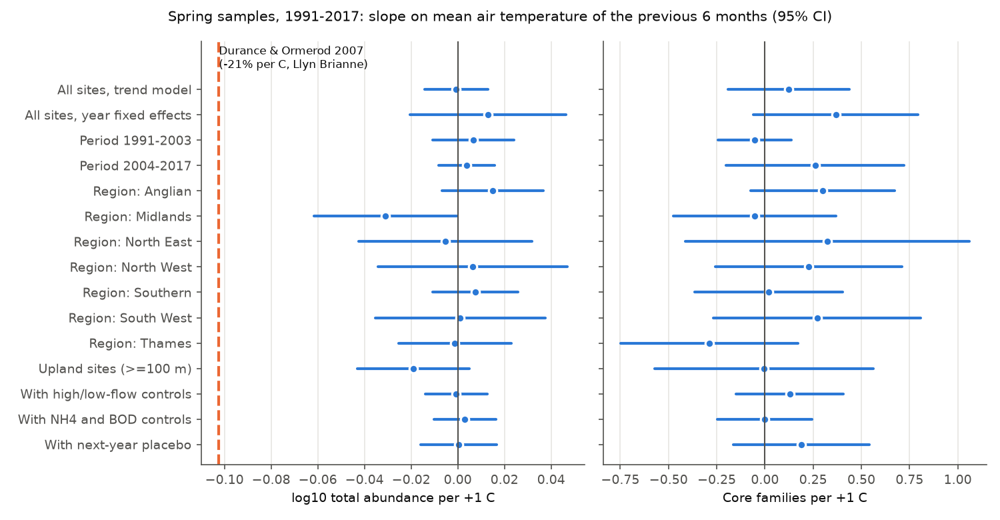
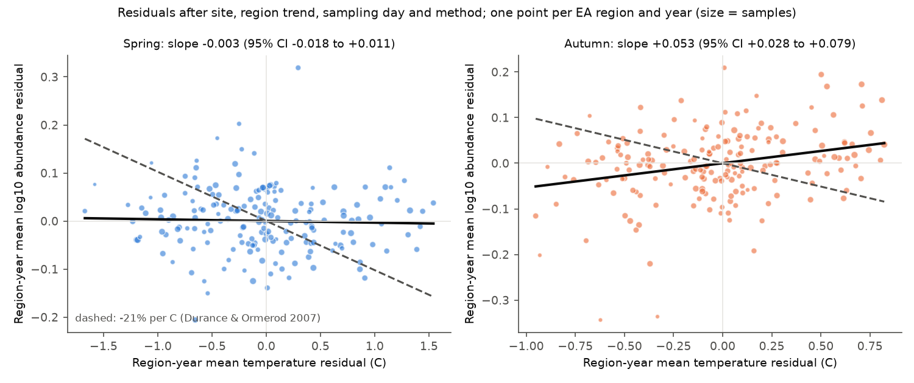
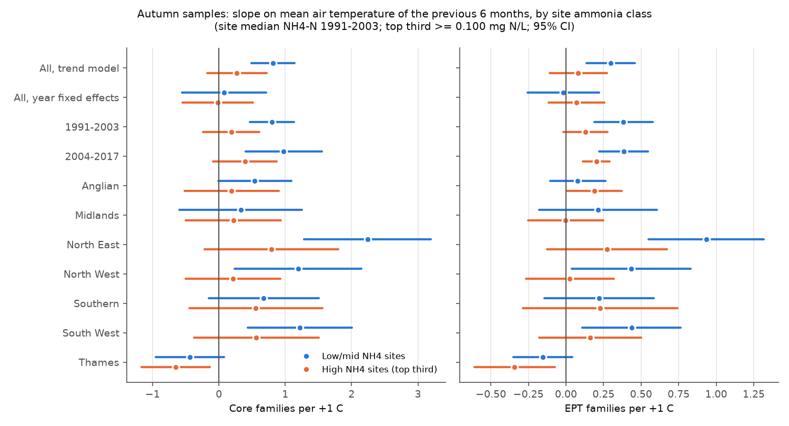

# Warmer winters did not lower spring river invertebrate abundance at 1,503 English sites in 1991-2017; warm-summer richness gains were smaller at high-ammonia sites

## Summary

We tested a known climate claim on a national river monitoring data set. Durance and Ormerod (2007) found that spring macroinvertebrate abundance in Welsh upland streams (Llyn Brianne) fell by up to 21% for each 1 C of warming. We asked if this relation transfers to English rivers. We also asked if ammonia pollution makes the warmth effect worse.

We used 23,706 spring samples and 23,910 autumn samples from 1,503 Environment Agency sites (1991-2017). The data product (ChemPop, EIDC) gives each sample with the air temperature, water quality and river flow of the 6 months before the sample. We compared each site with itself in warmer and colder years. The models removed smooth regional trends, the sampling day and the recording method.

Main results:

1. **Spring (pre-specified test, H1): no warm-winter decline.** The slope of log10 total abundance on 6-month air temperature was -0.001 per C (95% CI -0.014 to +0.013). This is -0.3% per C (CI -3.2% to +3.0%). The Llyn Brianne value (log10(0.79) = -0.102 per C) is far outside every interval: two periods, seven regions, upland sites, flow controls, water-quality controls, year fixed effects, a region-year aggregate test, and samples with true counts only. Family richness and EPT family richness also had no clear slope.
2. **Flow (H2): high flows, not warmth, lowered spring samples.** A higher 6-month high-flow level lowered spring abundance (-0.065 log10 per log10 unit of relative Q95; CI -0.111 to -0.020) and family richness (-1.65 families; CI -2.42 to -0.89). The flow terms did not change the temperature slope.
3. **Ammonia interaction (H3) in spring: not supported.** The warmth slope at high-ammonia sites did not differ (families: +0.02, CI -0.35 to +0.39).
4. **Autumn (pre-specified check): warmer summers came with more families, but less at high-ammonia sites.** In the trend model, autumn samples had +0.60 core families per C (CI +0.26 to +0.94) and +11% abundance per C. These main effects became uncertain with year fixed effects, so national-year artefacts can explain part of them. The ammonia interaction stayed with year fixed effects: high-ammonia sites gained 0.46 fewer families per C (CI 0.17 to 0.75) and 0.25 fewer EPT families per C (CI 0.13 to 0.36). It held in both periods for EPT families, with site temperature, urban, arable and altitude interactions, and with concurrent ammonia. A next-year temperature placebo gave no interaction. Warm summers also lowered dissolved-oxygen saturation more at high-ammonia sites (-0.66 points per C; CI -1.26 to -0.05).

Limits: air temperature is a proxy for water temperature. The temperature variation is mostly national and year-to-year, so the effective sample is about 27 years per region. The autumn interaction was a pre-specified check, but not the primary hypothesis. It is an association, and other site properties can still explain it.

## Context and question

English river invertebrates recovered strongly from organic pollution after about 1990 (Qu et al. 2023; Vaughan and Ormerod 2012). The recovery slowed after about 2003-2010 (Qu et al. 2023; Haase et al. 2023 for Europe). Some studies propose that warming now limits further recovery. The best-known field estimate of a warming effect on stream invertebrates is from Llyn Brianne (Durance and Ormerod 2007). There, warmer winters came before lower spring abundance (up to -21% per 1 C) in circumneutral streams.

That estimate comes from a small number of upland streams in one area. We tested if the same within-site relation occurs across a national monitoring network of mostly lowland rivers. We also tested a multiple-stressor prediction: warmth may harm invertebrates more where organic pollution (ammonia) is high, because warm water holds less oxygen.

The plan (`files/PLAN.md`) was written after one exploratory national fit per season and before all other fits.

## Data

- **Source:** Bachiller-Jareno N. et al. (2025). Macroinvertebrate taxonomic abundance, water quality, river flow, air temperature and environmental site descriptors from English rivers, 1965-2018, version 2.0. NERC EDS Environmental Information Data Centre. doi:10.5285/23f194b0-1e21-4f14-be9c-6eabdcc1feb7. Open Government Licence v3. "Contains data supplied by UK Centre for Ecology & Hydrology."
- **Shared campaign copy:** `datasets/eidc-chempop-minv-english-rivers-1965-2018-v2-23f194b0/23f194b0-1e21-4f14-be9c-6eabdcc1feb7.zip` (ZIP SHA-256 06ff765e64667a9af38cf0ae44bdd8d797480f5058a5963b5ad9a567c32a0b9e, 43,191,154 bytes, downloaded 2026-11-09). The EIDC server builds the ZIP for each request, so the wrapper hash can change. All 324 inner files matched the SHA-256 values in the package `ro-crate-metadata.json` (copy in `files/data/eidc_ro-crate-metadata.json`). The SHA-256 values of the 91 inner CSV files that we used are in `files/results/input_file_sha256.json`.
- **Content used:** taxon abundance per sample (7 EA regions), and the 6-month statistics before each sample: CHESS-met air temperature (mean), ammoniacal nitrogen, BOD, orthophosphate, oxygen saturation, nitrate, pH, conductivity (mean with values below the limit of quantification set to half of it), and NRFA river flow (6-month 95th and 5th percentile flow, long-term mean flow). Site variables: altitude, upstream land cover, location.

## Methods

**Samples.** We kept samples from 1991-2017. Quality assurance of EA samples is near constant from 1991 (Vaughan and Ormerod 2012), and CHESS-met air temperature ends in December 2017. Spring is March-May and autumn is September-November. We kept the three main recording methods (log-category estimate, local estimate, actual count) and sites with at least 5 samples in the season.

**Outcomes (observation bias controls).** Recording changed from family level to mixed taxon level (all regions by 2012) and from log categories to counts (from 2002). To reduce these effects:
- Core family richness: the number of families from a fixed list of 102 families that occur in at least 1% of 1991-2017 samples (`files/data/core_families.csv`). Presence does not depend on the abundance method.
- EPT families: core families of Ephemeroptera, Plecoptera and Trichoptera.
- log10 total abundance: log10 of the summed abundance of all families. Old category values (1, 3, 33, 333, ...) are geometric midpoints, so the log scale is comparable. A method dummy removes level differences.

**Exposure.** The mean CHESS-met air temperature of the 6 months before the sample. For spring samples this is mostly winter (about October-April). For autumn samples this is mostly summer (about April-October).

**Models.** Linear models with site fixed effects. The trend model also has a natural cubic spline of year (6 df) for each EA region, a spline of sampling day of year (4 df), and recording-method dummies. Standard errors are cluster-robust by year (27 clusters). The year fixed-effects model adds year fixed effects, so only spatial differences in the temperature anomaly inside a year identify the slope. Its standard errors are clustered by region-year. The code is a small fixed-effects solver (`files/code/fe.py`) that we checked against statsmodels with dummy variables.

**Pre-specified tests (PLAN.md).**
- H1: the spring temperature slope is negative. We give the test for all sites, the periods 1991-2003 and 2004-2017, each of the seven EA regions, and upland sites (altitude 100 m or more). The Llyn Brianne magnitude is rejected if the 95% CI excludes log10(0.79) = -0.102 per C.
- H2: add the relative 6-month high-flow level, log10(Q95 of the window / long-term mean flow), and the low-flow level (Q5) on the same samples.
- H3: interaction of temperature with a high-ammonia site class (site median NH4-N 1991-2003 of 0.100 mg N/L or more; 529 of 1,378 sites, because many medians are tied at this value) and with concurrent log10 NH4-N.
- Checks: year fixed effects; a lead placebo (the temperature before the next-year sample at the same site and season); region-year means of the residuals; autumn samples.

**Post-hoc checks (labelled as such).** For the autumn interaction: year fixed effects; added interactions of temperature with site mean temperature, urban %, arable % and altitude; by period and region; lead placebo interaction; dissolved-oxygen saturation and NH4-N as outcomes. For abundance: samples with true counts only. We first used a flow statistic that was near constant by construction (the fraction of days above the window's own 95th percentile). We replaced it with the relative Q95 and Q5 levels before we looked at the H2 results again. Both versions gave the same temperature slope.

## Results

### Spring: no warm-winter decline (H1)



| Test (spring) | log10 abundance per C (95% CI) | Core families per C (95% CI) | Samples | Sites |
| --- | --- | --- | --- | --- |
| All sites, trend model | -0.001 (-0.014, +0.013) | +0.12 (-0.19, +0.44) | 23,706 | 1,503 |
| Year fixed effects | +0.013 (-0.020, +0.046) | +0.37 (-0.06, +0.80) | 23,706 | 1,503 |
| 1991-2003 | +0.007 (-0.011, +0.024) | -0.05 (-0.24, +0.14) | 10,513 | 1,295 |
| 2004-2017 | +0.004 (-0.008, +0.016) | +0.26 (-0.20, +0.72) | 11,683 | 1,192 |
| Upland (>= 100 m) | -0.019 (-0.043, +0.005) | -0.01 (-0.57, +0.56) | 4,797 | 308 |
| With flow controls | -0.001 (-0.014, +0.013) | +0.13 (-0.15, +0.41) | 18,242 | flow sites |
| True counts only | -0.024 (-0.057, +0.009) | +0.01 (-0.62, +0.63) | 3,757 | 341 |
| Region-year means (186) | -0.003 (-0.018, +0.011) | - | 186 region-years | - |

Six of the seven regional abundance intervals include zero. The Midlands interval ends just below zero (-0.031; CI -0.062 to -0.0004), which is a 7% decline per C and is still far from -0.102. EPT families had no clear slope (+0.04; CI -0.13 to +0.21). The lead placebo slope was zero (-0.003; CI -0.012 to +0.005). Thus H1 is not supported, and every interval excludes the Llyn Brianne magnitude by a wide margin. A 95% CI half-width of 0.014 log10 units means that the national data can detect a change of about 3% per C.



### Flow (H2)

Spring samples after higher 6-month high flows had fewer families (-1.65; CI -2.42 to -0.89 per log10 unit) and lower abundance (-0.065; CI -0.111 to -0.020). The temperature slopes did not change (abundance -0.003 to -0.001; families +0.07 to +0.13). In autumn, the flow terms decreased the temperature slope for families from +0.67 to +0.41 (CI +0.11 to +0.72). Warm summers are often dry summers in England, so a part of the autumn warmth association goes with low flows.

### Ammonia interaction (H3)

Spring: no interaction (families +0.02, CI -0.35 to +0.39; abundance -0.004, CI -0.017 to +0.009).

Autumn: the warm-summer gain in families was smaller at high-ammonia sites.

| Autumn test | Temperature x high-NH4 site, core families (95% CI) | Temperature x high-NH4 site, EPT families (95% CI) |
| --- | --- | --- |
| Trend model | -0.48 (-0.75, -0.21) | -0.26 (-0.35, -0.17) |
| Year fixed effects | -0.46 (-0.75, -0.17) | -0.25 (-0.36, -0.13) |
| Year FE + T x site temperature, urban, arable, altitude | -0.39 (-0.66, -0.11) | -0.18 (-0.29, -0.07) |
| 1991-2003 | -0.32 (-0.70, +0.05) | -0.19 (-0.33, -0.06) |
| 2004-2017 | -0.56 (-0.79, -0.34) | -0.26 (-0.33, -0.19) |
| Lead placebo: next-year T x high-NH4 | +0.09 (-0.13, +0.31) | -0.03 (-0.13, +0.08) |
| Concurrent log10 NH4-N x T (wq sites) | -0.46 (-0.65, -0.26) | -0.26 (-0.38, -0.15) |

By region, the core-family interaction was negative in five of seven regions. It was clear in North East (-1.42), North West (-1.46) and Southern (-0.65). It was near zero in Anglian (+0.11) and Midlands (+0.09). There was no interaction for total abundance (-0.000; CI -0.017 to +0.016 with year FE). Warm summers lowered dissolved-oxygen saturation more at high-ammonia sites (-0.66 percentage points per C; CI -1.26 to -0.05, year FE). This agrees with an oxygen mechanism, but it does not prove it.



Figure 3 gives separate slopes for the two site classes. In the separate year fixed-effects rows each class has its own year effects, so both slopes are near zero. The interaction in the table above uses year effects that both classes share.

The Thames region was different from the other regions: in autumn it had negative warmth slopes in both classes (families -0.46; CI -0.86 to -0.07).

### Context


Site-adjusted core family richness rose from about 18 to 24 families in 1988-2005 and then stayed level, while ammonia fell during the full period. The 6-month air temperature varied from year to year by about 1-2 C with a small upward trend.

## Interpretation

At a national scale, warmer winters did not come before poorer spring invertebrate samples in English rivers in 1991-2017. The Llyn Brianne relation (up to -21% per C) did not transfer: the pooled data exclude declines larger than about 3% per C, and even the smallest subsets exclude declines larger than about 13% per C. Two reasons are possible. First, Llyn Brianne streams are acid-sensitive upland streams. Our upland subset (308 sites) is also null, but few English sites are similar to them. Second, in the UK, mild winters are often wet. Spate flows can be the real cause of lower spring samples. Our flow term had the expected negative effect, independent of temperature.

The autumn interaction suggests that organic pollution can change how communities respond to warm summers. At low-ammonia sites, warm summers came with more families, especially EPT families. At high-ammonia sites, this gain was smaller or absent, and oxygen saturation fell more. This agrees with a multiple-stressor view in which warm, low-flow summers increase oxygen stress where organic load is high. Thus continued ammonia reduction can be a condition for invertebrates to keep the benefit, or avoid the harm, of warmer summers.

## Limitations

- **Temperature proxy.** CHESS-met air temperature at 1 km is not water temperature. Groundwater-fed (chalk) rivers have weak air-water coupling. This can make slopes smaller in the south and east.
- **Effective sample size.** Year-to-year temperature anomalies are similar across England. In the trend models, the slope depends mainly on about 27 national years per region. The year fixed-effects models remove this dependence but have less information.
- **Observation changes.** The recording method changed in 2002 (counts) and up to 2012 (mixed taxon level). We used fixed core families, log abundance, method dummies, region trends and year fixed effects. Changes that coincide with warm or cold years in one region can remain.
- **Autumn main effect.** The positive autumn warmth slopes were not clear with year fixed effects. Do not interpret them as a causal benefit of warmth.
- **Interaction status.** The autumn ammonia interaction was part of the pre-specified checks, not the primary hypothesis. The high-ammonia class has many ties at 0.100 mg N/L. High-ammonia sites are also more urban and lowland. We controlled for some of these properties, but other site properties can explain the interaction.
- **Window.** The 6-month window is fixed by the data product. Life-cycle-specific windows (for example, the egg or larval stage) can give different results.
- **Coverage.** England only, 1991-2017. The data product selected long-term sites (at least 10 years), about 200 per region. The results do not apply to sites without long records.

## Reproduce

Requirements: Python 3.12 with pandas, numpy, pyarrow, patsy, statsmodels and matplotlib.

```bash
# from a work folder that contains this bundle's files/ folder
bash files/code/00_get_data.sh [path/to/23f194b0-1e21-4f14-be9c-6eabdcc1feb7.zip]
cp files/code/*.py code/   # or run them from files/code with the same working folder
python3 code/01_load.py raw/inv/x/data   # -> derived/*.parquet
python3 code/02_build.py                 # -> derived/samples.parquet, derived/core_families.csv
python3 code/04_analysis.py              # pre-specified tests -> results/tests.csv
python3 code/05_robust.py                # interaction checks -> results/interaction_robustness.csv
python3 code/06_figures.py               # figures, region-year test, class slopes
python3 code/07_counts_check.py          # true-count abundance check
```

The scripts expect the folders `code/`, `derived/`, `results/` and `figures/` in the working folder. `03_explore.py` is the single exploratory fit that came before the plan. The full run takes about 10 minutes on one core.

Files:
- `files/data/samples.parquet`: one row per sample (67,473 rows; all years and seasons) with outcomes and matched covariates. You can run `04`-`07` from this file without the raw data (copy it to `derived/`).
- `files/results/tests.csv`: all pre-specified fits (coefficient, SE, 95% CI, samples, sites, clusters).
- `files/results/interaction_robustness.csv`, `slopes_by_ammonia_class.csv`, `region_year_residuals.csv`, `region_year_slopes.csv`, `actual_counts_check.csv`.
- `files/results/input_file_sha256.json`: SHA-256 of each input CSV.

The derived sample table contains values from the EIDC data product, which stays under the Open Government Licence v3 with the attribution above. The bundle LICENSE applies to our own text, figures, code and results.

## Provenance

- Campaign 11_07_2026, job sci-1107-dell-climate-pollution-biodiversity-db6ee87eea6a, topic climate-pollution-biodiversity, machine dell, account claude-andrii.
- Analysis and text: Claude Opus 5.5 (model ID claude-opus-5-5), an AI model, working as an automated research agent on 2026-11-09. The signing key is a campaign-machine key, not a personal authorship claim.
- Data: EIDC doi:10.5285/23f194b0-1e21-4f14-be9c-6eabdcc1feb7 (Open Government Licence v3; contains data supplied by UK Centre for Ecology & Hydrology; original data from the Environment Agency, NRFA and CHESS-met).

## References

- Durance I., Ormerod S.J. (2007). Climate change effects on upland stream macroinvertebrates over a 25-year period. Global Change Biology 13: 942-957. doi:10.1111/j.1365-2486.2007.01340.x
- Qu Y. et al. (2023). Significant improvement in freshwater invertebrate biodiversity in all types of English rivers over the past 30 years. Science of the Total Environment 905: 167144. doi:10.1016/j.scitotenv.2023.167144
- Haase P. et al. (2023). The recovery of European freshwater biodiversity has come to a halt. Nature 620: 582-588. doi:10.1038/s41586-023-06400-1
- Vaughan I.P., Ormerod S.J. (2012). Large-scale, long-term trends in British river macroinvertebrates. Global Change Biology 18: 2184-2194.
- Bachiller-Jareno N. et al. (2025). EIDC data product, doi:10.5285/23f194b0-1e21-4f14-be9c-6eabdcc1feb7.
