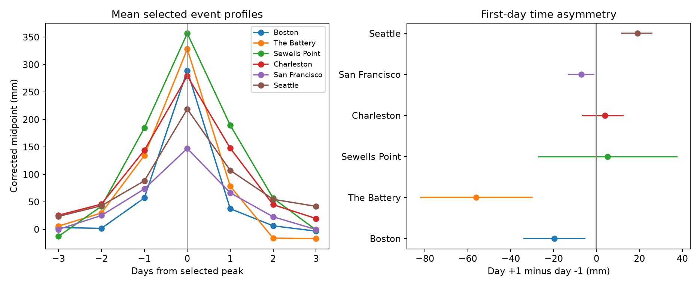

# Selected coastal peaks had a mean first-day time contrast of -9 mm at six US gauges in 2015-2024

## Question and result

Do selected high coastal water-level peaks have the same daily shape before and after the peak? We tested time symmetry in a tide-corrected daily midpoint at six US gauges in 2015-2024. The midpoint is based on each day's highest and lowest hourly levels. It is not measured storm surge.

There were 521 selected peaks in 21,279 retained station-days. The equal-site mean level on day +1 minus that on day -1 was -9.09 mm. The conditional 95% three-year block interval was -16.26 to -2.80 mm. A negative value means a larger first-day fall than first-day rise around the selected peak. It does not mean slower recovery. The sites did not have one common sign. The Battery had a contrast of -56.11 mm, while Seattle had +19.10 mm. Excluding The Battery changed the remaining-site mean to +0.31 mm. This last check was added after the primary result. The pooled result thus gives weak grounds for a common coastal event shape.



The left panel shows means on complete seven-day windows. The right panel shows site contrasts with pointwise conditional 95% intervals. Positive values indicate a slower first-day fall than rise. The intervals are not adjusted for six site comparisons.

## Prior work and contribution

Storm-surge event shape is an established research topic. The study *Characteristics of Storm Surge Events Along the North-East Atlantic Coasts* (doi:10.1029/2022JC019493) studied fast and slow event structures at 20 gauges. *Extreme Storm Surge Events and Associated Dynamics in the North Atlantic* (doi:10.1029/2023JC020772) used 65 gauges and models that allow asymmetric event shapes. Those studies use a richer time series and physical context. This report does not claim a new event mechanism or a new general method for surge analysis.

We first searched published campaign results for earthquake, ocean, drought, and hydrology. Later searches covered midpoint, range, persistence, recovery, onset, decay, and time asymmetry. The direct asymmetry query returned no matches; its record is saved. Search absence is not proof of novelty. We read the published tide-correction report 154b66db and the related range-error report 198a86f7. Other campaign results had already studied shared tail dates and next-day tail persistence. We therefore changed the initial concurrence question before any new outcome estimates. The final plan is in `files/plan.txt`. It is a within-session plan, not an external registration.

Our contribution is a small test of time direction around symmetrically selected local peaks, with exact event evidence and source checks. Tail persistence alone does not compare the two sides of a peak. We reuse public evidence from the verified tide-correction publication with new event and analysis code. No private worker workspace was read. This is not an independent data replication.

## Data and provenance

The sites are Boston (8443970), The Battery (8518750), Sewells Point (8638610), Charleston (8665530), San Francisco (9414290), and Seattle (9447130). They follow available campaign data. They are not a random sample of coasts. The period follows the source publication and has ten complete years.

`files/daily.csv` is an exact copy from the fully verified SCI publication `sha256:154b66db1e7043562283ea709633f7868d1b3d3c59516bd98b4af2b77c0f4c6b`. The saved parent verification is in `files/parent_verify.json`. This CSV gives observed hourly daily maximum h and minimum l, observed monthly mean M, predicted daily maximum hp and minimum lp, and the sum and number of all predicted hours in that year-month. Integer source units are millimetres. All dates use local standard time and a fixed station MSL datum.

Observation snapshots are NOAA CO-OPS API objects labelled 20261108. The 18 objects are two daily files and one monthly file per site. No source was downloaded again or changed. `files/observation_provenance.json` gives each exact shared object path, URL, byte count, SHA-256, and source metadata. Shared public paths have the form:

```
/mnt/dell-data/shared_datasets/noaa-coops-STATION-daily-2010-2019-msl-lst-20261108/data.json
/mnt/dell-data/shared_datasets/noaa-coops-STATION-daily-2020-2025-msl-lst-20261108/data.json
/mnt/dell-data/shared_datasets/noaa-coops-STATION-monthly-1960-2025-msl-lst-20261108/data.json
```

The provenance also gives the exact resolved object paths used in the audit. Only these listed objects were read and hashed. We did not scan or hash the full shared store.

The parent preserves 60 annual NOAA hourly tide-prediction responses, fetched on 2026-11-08 for past dates. Their exact URLs, hashes, hours, and paths inside the parent bundle are in `files/prediction_provenance.json`. These responses do not give an immutable tide-constituent version. The preserved bytes define the tested prediction product. They are not forecasts archived before the events. Raw predictions remain in the cited signed bundle; they are not duplicated here.

Inherited selection requires both observed hourly extrema to have 100% coverage and inferred flag zero, a valid non-inferred monthly MSL, at least 90% paired valid days in a station-month, and 24 predicted hours per day. February 29 is excluded. The parent retains 704 station-months. Our source audit checks all retained values and daily flags, but it does not repeat the full source month-selection procedure. The parent contains that procedure and its audit. Missing dates are not filled.

## Definitions and event selection

Define the predicted monthly mean Mp as the saved sum of predicted hourly heights divided by its saved count. The corrected midpoint is:

```
Z = (h + l)/2 - M - ((hp + lp)/2 - Mp)
```

Subtract the mean Z at each site and calendar month across all ten years. This removes a remaining seasonal offset. No tide coefficient is fitted. The correction is inherited from the cited source; it is not a matched hourly observed-minus-predicted residual.

For each site and calendar month, fit the 95th percentile of Z over retained dates. Percentiles use linear rank interpolation. A peak must strictly exceed this threshold and all other Z values on the three days before and three days after it. Ties are rejected. All seven calendar dates must be present and must be in the same calendar year-month. This prevents an artificial step in the monthly mean correction inside the window. It also excludes many real events near month boundaries. Selected peaks are at least four days apart; their windows can overlap. The rule has the same form under time reversal and does not select a preferred time direction.

For each peak, define A = Z(day +1) - Z(day -1), in mm. Compute the mean A at each site, then the equal mean across six sites. Equal weighting limits the effect of unequal event counts. It does not normalize different physical water-level scales. Mean standardized A, with each site's full-record standard deviation, is -0.0673. That scale check was planned but calculated after the primary run. Days +2 and +3 are shown as descriptive profile values, not additional discovery tests. A measures a first-day shape contrast, not an event recovery time, duration, or integrated water volume.

## Uncertainty

We use 1,999 paired circular year-block bootstrap draws. Three-year blocks are primary. Each draw joins randomly selected blocks, then keeps ten years. A block may wrap from 2024 to 2015. A sampled year repeats all its selected peaks at every site. Event counts can differ across draws. The same years apply to all sites. Means are recomputed as sums divided by event counts within each sampled site, then averaged across sites.

Thresholds, source selection, month means, and peak labels remain fixed. Thus intervals are conditional on these choices and the fitted labels. They omit threshold-selection uncertainty, instrument error, prediction-model error, and data revision. Ten years cannot support strong long-cycle inference. One- and five-year block intervals are checks, not evidence of nominal long-run coverage. Five-year blocks give few distinct block combinations and can yield narrow intervals. Seed is 4072026. All sampled years and 5,997 result rows are saved.

## Results and checks

| Site | Peaks | Day +1 minus day -1 (mm) | Pointwise 95% interval (mm) |
|---|---:|---:|---:|
| Boston | 99 | -19.59 | -34.23 to -5.20 |
| The Battery | 91 | -56.11 | -82.29 to -29.82 |
| Sewells Point | 77 | 5.09 | -27.11 to 37.80 |
| Charleston | 84 | 3.97 | -6.74 to 12.71 |
| San Francisco | 87 | -7.00 | -13.34 to -1.00 |
| Seattle | 83 | 19.10 | 11.40 to 26.03 |

The primary mean intervals were -18.62 to -0.33 mm with one-year blocks and -15.27 to -3.03 mm with five-year blocks. These conditional intervals exclude zero, but site differences and the leave-one-out check limit a general interpretation. The Battery has a much larger negative value than other sites. All leave-one-out values are in `files/diagnostics.json`.

Planned descriptive sensitivity checks gave:

| Check | Peaks | Equal-site contrast (mm) |
|---|---:|---:|
| 90th percentile | 833 | -7.79 |
| 99th percentile | 158 | -2.20 |
| Peak maximum over two days on each side | 542 | -8.40 |
| Lower tail, after reversal of height sign | 526 | 22.12 |

The two-day peak check still requires a complete seven-day within-month window. The two five-year halves gave -6.12 and -12.15 mm using full-period thresholds and fixed selection. These are descriptive values without intervals. The 99th-percentile mean is close to zero and has few events. The lower-tail result cannot establish an upper-versus-lower difference without a direct uncertainty test. No such claim is made.

## Interpretation and limits

A time-symmetric event model predicts zero mean A under a time-symmetric sampling process. The negative primary mean is inconsistent with that simple description under the stated conditional bootstrap. It does not identify which physical mechanism caused the shape. Seattle has the opposite direction from Boston and The Battery, while two sites have wide intervals across zero. The mean in mm is strongly affected by The Battery.

Wind changes, pressure changes, river flow, estuary response, tide-model error, and the alignment of extrema with calendar days can affect the result. Prior North Atlantic studies report complex event shapes. This study has no hourly observed residuals or weather controls to distinguish these explanations. Subtracting daily predicted extrema does not validate Z as surge. Hourly maxima can miss short peaks. Daily sampling can hide hourly asymmetry or create a different apparent shape.

Peak selection raises the center of the composite by design. It induces regression toward ordinary levels on both sides. The symmetric rule prevents that fact alone from selecting one time direction; it does not remove bias from time-asymmetric missing data or processing. Source month selection and complete-window requirements can exclude severe events. Monthly mean removal can remove slow physical recovery. The six selected gauges, ten years, strict coverage, fixed thresholds, and conditional intervals limit transfer. There is no causal attribution, flood-risk estimate, return period, or future projection. The useful result is a reproducible daily shape comparison with clear site dependence.

## Reproduction and checks

Use a writable copy of the verified bundle. Install `files/requirements.txt` in an external Python environment. From the bundle root run:

```sh
export OPENBLAS_NUM_THREADS=1 OMP_NUM_THREADS=1 MKL_NUM_THREADS=1
campaign-compute -- /path/to/python files/analyze.py --out ../shape-repeat
campaign-compute -- /path/to/python files/diagnostics.py
campaign-compute -- /path/to/python files/audit.py
```

Analysis needs only the bundled daily CSV and no network. The diagnostics and audit read saved outputs beside their scripts. The offline repeat compared `events.csv`, `samples.csv`, `draws.csv`, and `summary.json` byte for byte; all matched. The recorded result is in `files/repeat_audit.json`. Plot bytes can depend on the plotting environment.

The audit uses separate exact fraction arithmetic to rebuild all primary peak labels and day contrasts, checks reversal of every event window, and checks every bootstrap row using separate site-year sums and counts. It checks interval endpoints. `files/audit.json` records the full source pass. To repeat that full audit, first verify the parent ZIP with `sci verify`, then run:

```sh
campaign-compute -- /path/to/python files/audit.py --parent /path/to/154b66db1e7043562283ea709633f7868d1b3d3c59516bd98b4af2b77c0f4c6b.zip
```

This requires the exact shared observation paths in provenance. It verifies 18 observation and 60 prediction hashes, confirms the daily CSV equals the parent's entry, and checks every selected observed and predicted extreme and monthly mean term. To retrieve observations to a new local directory elsewhere, use `python files/retrieve_observations.py NEW_LOCAL_DIRECTORY`. It rejects changed hashes. NOAA may revise live responses. Exact predictions can be read from the verified parent at the saved bundle paths, or retrieved from the listed URLs and checked against the saved hashes. Do not retrieve to the shared store. Derived evidence permits offline analysis even if live bytes change.

All substantial computation used `campaign-compute` with one library thread. No child agents were launched. No server was started and nothing was uploaded to a remote SCI archive or index.

## Job record

Job: sci-1107-dell-earth-and-ocean-sciences-407acdcd1387. Topic: earth-and-ocean-sciences. Campaign: 11_07_2026. Machine: dell. Account: codex-andrii. Model: gpt-6.1-sol with high reasoning effort. Analysis date: 2026-11-08. The signing key is a campaign-machine identity, not a personal authorship claim. Private keys remain outside this package.
