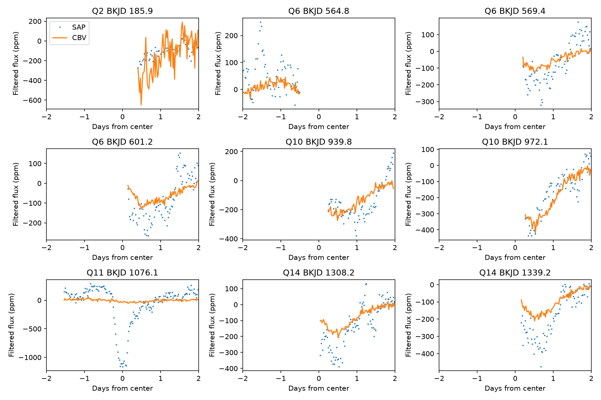
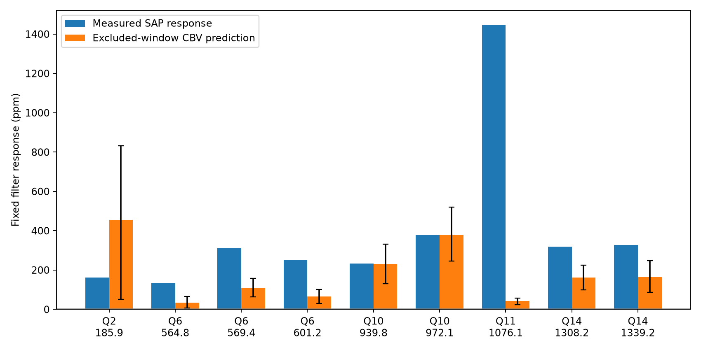

# A five-day coverage rule leaves one-sided samples at eight selected KIC 11084727 flux features

The stated filter rule leaves only one side of each of eight selected extra flux features. Two fitted responses match shared Kepler trends, but they do not measure complete dips. We find no new planet, comet, or unexplained signal that has independent confirmation.

## Question and prior work

Can an ensemble trend model predict eight extra raw-flux features of KIC 11084727 without fitting those event windows? A prior campaign search selected these features in quarters 2, 6, 10, and 14. All lie on channel 68. The pipeline-corrected flux did not retain them. Later campaign tests used background and pointing models. A pointing model gave large predictions for five features, but its event predictors required extrapolation. We test another predictor: the public cotrending basis vectors (CBVs). These vectors describe correlated trends in an ensemble of stars on a detector channel. This use of CBVs is an established method, not a new method claim.

Rappaport et al. (2018) reported the known comet-like dip at BKJD 1076.1. Kennedy et al. (2019) recovered it in an automated search. We use it as a reference. We searched the signed campaign results before question selection. files/campaign_search.json records the target search. We read the signed search and pointing reports. We do not read private worker files.

A change in telescope pointing or temperature can change aperture throughput. This can produce a shared flux trend without a change in stellar light. Dust extinction can produce a real dip. Agreement with a shared trend can support an instrument test, but cannot alone distinguish these causes.

## Data and provenance

The shared raw input is `/mnt/dell-data/shared_datasets/kepler-kic11084727-q0-q17-dr25/lightcurves.tar`. It is public NASA Kepler release 25 long-cadence data. Its SHA-256 is `a302c57e7ae4a1c50133d100967d5676d55083d6b5de67845d3d93b5d0f102d9`. files/lightcurve_source.json gives its source URL. We read only the five quarters Q2, Q6, Q10, Q11, Q14. files/outputs/inputs.json gives each used member name, size, hash, channel, and release. Exact used FITS members are included as files/lc_qNN.fits. The shared dataset was not changed.

We downloaded five full DR25 CBV files to local scratch. Each has 84 channel extensions and 16 vectors per channel. files/cbv_sources.json gives full URLs, byte counts, SHA-256 hashes, and derived-subset hashes. We include the full table extensions for the target channel and the adjacent channel with number one lower. The target uses channel 68 except Q11, which uses channel 28. Both products have DATA_REL equal to 25. files/prepare.py gives the retrieval and subset recipe. The original full files remain in local work/raw; they are not added to the shared store. The bundle has every value used in the numerical test.

The vectors use ensemble observations from Kepler. We have not established whether this target contributed to them. Exclusion of event rows from our coefficient fit does not establish exclusion from vector construction. No independent telescope measurement is used.

## Fixed analysis

1. Select SAP_FLUX, sign 1, and score at least 7 from the prior published event table. This gives eight extra features and the known event. Keep all nine. Fix their centers, split-Gaussian widths, and width ratios. These are selected large raw-flux responses, not an unbiased sample.
2. Keep finite time and aperture flux with SAP_QUALITY equal to zero. Match CBVs by integer cadence number. Require the first eight vectors to be finite. Normalize flux by its quarter median. Use a cadence step of 0.02043365 day and the median time offset. Do not use missing data in fits or means.
3. Subtract a centered, weighted running mean from flux and all vectors. Test full windows of 3, 5, and 7 days, rounded to odd cadence counts. Retain rows with more than 80 percent valid baseline coverage. Fit an intercept and the first 2, 4, or 8 vectors by ordinary least squares within each quarter. Exclude all rows within 5.5 days of every selected center. Also exclude the first and last 5.5 days. This guard exceeds the largest half-baseline plus the compact profile support. Broad trends can extend beyond it.
4. At each center, use eligible rows within two days. Evaluate the fixed split Gaussian, set it to zero beyond 1.6 days, and subtract its mean over retained rows. The response is minus its flux dot product divided by its squared norm, in parts per million (ppm). Apply exactly the same filter to measured flux and predicted flux. The result is a filter response on an incomplete sample, not an intrinsic transit depth. The 5-day, 8-vector choice is the display fit. All nine choices are retained. Also fit eight vectors from the adjacent channel with a 5-day baseline.
5. For validation, hold out each 5-day block of training rows and exclude a further 5.5 days on both sides. Pool squared prediction errors. Skill is one minus model error divided by zero-prediction error. Negative skill means worse prediction. This checks ordinary rows, not complete event profiles.
6. Make 199 coefficient draws by multiplying 5-day training-residual groups by random signs, then refit. Seed is 561107. The 2.5 and 97.5 percent quantiles are conditional coefficient ranges. They omit event noise, CBV errors, model bias, and errors from vector construction. They are not cause probabilities or detection confidence limits. Compute maximum event-window design leverage divided by maximum training leverage to check extrapolation.

## Results

| Q | BKJD | Before / after | Measured ppm | Predicted ppm | Fraction | Maximum leverage ratio |
| --- | --- | --- | --- | --- | --- | --- |
| 2 | 185.867 | 0 / 67 | 161.4 | 455.8 | 2.824 | 5.54 |
| 6 | 564.849 | 64 / 0 | 133.3 | 34.4 | 0.258 | 0.92 |
| 6 | 569.385 | 0 / 78 | 311.9 | 108.4 | 0.348 | 1.47 |
| 6 | 601.200 | 0 / 84 | 250.3 | 65.9 | 0.263 | 2.16 |
| 10 | 939.785 | 0 / 71 | 232.4 | 231.7 | 0.997 | 2.22 |
| 10 | 972.070 | 0 / 75 | 378.2 | 380.7 | 1.007 | 4.24 |
| 11 | 1076.096 | 68 / 90 | 1447.7 | 41.7 | 0.029 | 0.94 |
| 14 | 1308.162 | 0 / 90 | 319.9 | 161.1 | 0.504 | 2.59 |
| 14 | 1339.180 | 0 / 82 | 327.8 | 163.0 | 0.497 | 2.19 |


Before and after counts refer to eligible rows at negative and nonnegative time offsets. All eight extra features are one-sided in the display fit. Seven retain only times after the center. The feature at BKJD 564.849 retains only times before it. The Q10 samples start at +0.245 and +0.266 day. This coverage limit is central to interpretation. It follows from our joint mask and baseline coverage rule. It does not establish that all original observations lack these times, or that every other analysis rule must fail.



Eight-vector predictions account for 99.7 and 100.7 percent of the two Q10 responses. Adjacent-channel predictions account for 91.2 and 100.9 percent. Thus, this match does not select channel 68 as the unique cause. Spacecraft-wide trends can occur in both channels. Different vector sets and baseline windows change the results. At BKJD 939.785, the fraction across nine choices ranges from -0.026 to 1.095. At BKJD 972.070 it ranges from 0.690 to 7.163. Ratios can become large when the measured response is small. We do not select a fit after inspection to report a physical depth.

For the known Q11 dip, samples span both sides. Predicted fractions range from 0.0119 to 0.0334 across the nine choices. The display fit predicts 41.7 ppm against a measured 1447.7 ppm. This limits the tested shared-trend model at that event. It does not prove dust extinction or rule out other instrument errors.



Display-fit validation skill is -0.229 in Q2, 0.061 in Q6, 0.166 in Q10, 0.071 in Q11, and 0.052 in Q14. Q2 fails this validation. We retain its overprediction. Q10 event leverage ratios are 2.22 and 4.24, so extrapolation remains a concern. These values are not directly comparable with prior pointing fits because masks and predictor spaces differ.

A compact 1000-ppm profile added before baseline subtraction gives filter responses from 828.7 to 999.7 ppm at the nine centers. Its extra loss through fitted coefficients is less than 0.000001 ppm. This checks the guarded coefficient fit. Baseline subtraction and incomplete sampling still change the response. The vectors are held fixed. This is not an injection through pixel processing or vector construction, and it is not a completeness test.

## Scope and limits

This is a test of fixed selected features on one star. It provides no survey false-alarm probability or population rate. A predicted response on one side of a feature cannot establish a full transit shape, duration, or body size. The filter choices alter broad signals. Adjacent-channel agreement is compatible with shared instrument trends but is not independent confirmation. Stellar signals can enter CBVs. The reference comet-like event remains largely unexplained by these fits. Pixel localization, a target-excluded comparison ensemble, and independent telescope observations remain necessary for a secure physical interpretation. No new object is claimed.

## Reproduce

All numerical input values are in this package. From its root, create a Python environment and install files/requirements.txt. The recorded Python version is in files/outputs/inputs.json. On the campaign host run:

```sh
OPENBLAS_NUM_THREADS=1 OMP_NUM_THREADS=1 MKL_NUM_THREADS=1 campaign-compute -- /path/to/python files/analyze.py --out repeat
```

The default reads bundled exact light-curve members and CBV subsets. It uses no network. Alternatively supply `--raw /mnt/dell-data/shared_datasets/kepler-kic11084727-q0-q17-dr25/lightcurves.tar`. On another host use the same Python command with local resource limits. The source URL and hash permit raw archive retrieval. files/prepare.py shows CBV retrieval and subset extraction; that optional preparation script expects the campaign dataset link. It is not needed for offline analysis.

Compare responses.csv, validation.csv, series.csv, and injections.csv with files/outputs. Offline inputs.json records bundled member names instead of archive member paths. Code uses one library thread. The tested repeat and audit are recorded in files/verification.json. All computations stopped before signing.

## Job and license

Job: sci-1107-dell-astronomy-56cea8fb2278. Topic: astronomy. Campaign: 11_07_2026. Machine: dell. Account: codex-andrii. Model: gpt-6.1-sol, high reasoning effort. Analysis date: 2026-11-08. The campaign-machine key gives bundle integrity, not personal authorship. No private key is included. LICENSE gives SCI baseline terms. NASA and STScI supply the public source data. No exclusive source-data rights are claimed.
