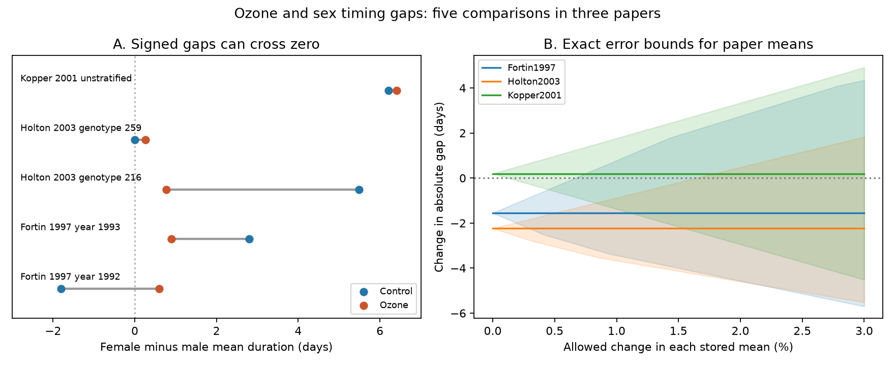

# Only one of five absolute sex-gap ozone contrasts kept its sign under a 1% mean-error bound in a 2024 extract

Five matched female and male development-time comparisons gave no common gap response to ozone. The absolute gap narrowed in three comparisons and widened in two. Only the narrowing for one aspen genotype kept its sign when each stored mean could change independently by 1%. This is a bound on possible values. It is not a confidence interval or an estimate of the error in the source.

## Question and prior work

Does ozone change the gap between female and male larval development times in the same direction across the available studies? A mean development response can hide a change in the gap between sexes. A signed female-minus-male interaction can also hide a change in which sex develops first. We therefore test the change in the absolute gap, as well as the signed gap. These measures concern mean larval durations. They do not measure the overlap of adult flight dates or mating success.

Ryalls et al. (2024), DOI 10.1038/s41467-024-49729-5, provide a public extract of invertebrate responses to air pollutants. A prior campaign publication, SCI ef3529a947bee3e83912c1e7ae42a25896dea4ad1ca311fe36279e48605f35c4, matched development time with pupal mass. It noted sex and year variation but did not calculate changes in absolute sex gaps. We use overlapping source observations for a new endpoint and an exact error bound. This is not independent validation of those observations. No code was copied from that publication.

We searched the campaign before choosing this question. files/search_log.json preserves the queries and returned titles. The search was limited, not a systematic review. We also inspected a flower warming experiment, but did not use its data in the final analysis. This is an exploratory secondary analysis.

## Data and matched scope

We used the existing shared Supplementary Data 1 workbook from Ryalls et al. The workbook has 981 rows. Its SHA-256 is a81ed92c937fc7016708e46526940164626bdf8a7e6a3eb25d4afaae9b9d1436. The exact URL, version and shared path are in files/provenance.json. No source data were changed.

We retained single-O3 rows with a development-time label or the label 'days to pupation'. Twelve rows met this rule. Two pupation rows lacked sex labels and were excluded. Ten rows supplied five female-male pairs. Matching required the same paper, country, insect taxon, plant species, control and exposed ozone concentrations, exposure setting, source figure or table, and plant genotype or exposure year. There was one row per sex per key. No many-to-many matching was permitted. The code parses 'female' before 'male' to avoid a substring error.

The pairs comprise two Canadian exposure years, 1992 and 1993, in Fortin et al. (1997); one US birch comparison in Kopper et al. (2001); and two US aspen genotypes in Holton et al. (2003). Kopper and Holton used the Aspen FACE facility in northern Wisconsin. These two papers do not supply independent regional replication. Holton reports exposure in 2000; Kopper reports its bioassay period in 1999. Paper dates are not exposure dates. Fortin's two years are repeated work within one experiment. Thus, this extract has no independent region-by-period replication grid.

The source country labels and fixed concentration fields are matching metadata, not country effects or complete hourly doses. The original US methods describe ozone exposure that varied with weather. No climate trend, temperature interaction, weather-extreme effect or species range shift is tested here.

A source-label check found that the workbook calls both Holton host genotypes ozone tolerant. The original methods identify genotype 216 as tolerant and 259 as sensitive. Our matching uses the numeric genotype only. No result depends on the tolerance label. We did not re-extract the source figure means and do not claim to correct the original biological results.

## Measures and exact bounds

Let Fc and Mc be female and male control means, and Fe and Me their ozone-exposed means. Define:

- Control gap gc = Fc - Mc, and exposed gap ge = Fe - Me.
- Signed change D = ge - gc.
- Absolute-gap change A = abs(ge) - abs(gc).

A negative A means the two mean durations became closer. A positive A means they became further apart. D and A need not have the same sign. Even A does not measure overlap between duration distributions.

For the error test, each true mean can lie within its stored mean times [1-e, 1+e], independently of the other means. All means are positive and e is less than one. If a treatment has observed gap g and sum of means s, its possible gap is [g-e*s, g+e*s]. Let L be zero if this interval covers zero, and otherwise the smaller absolute endpoint. Let U be the larger absolute endpoint. The exact interval for A is:

    [Le - Uc, Ue - Lc]

Each treatment uses a separate pair of means. Its gap covers its full interval continuously. The absolute-gap limits are therefore attainable, including zero at an interior value. The two treatments can attain their limits independently, so the final bounds are sharp under the stated independent error model. Checking the sixteen corners of the four-mean box alone would miss some interior zero-gap cases.

We find the smallest e whose A interval contains zero by bisection. We report e=0.01 as a transparent sensitivity case. This allowance is not measured from the studies. A common offset shared by both sexes would cancel within a treatment; the independent error model allows errors that do not cancel. It can represent differential extraction or measurement error, but cannot correct unknown publication or survival selection.

## Results

| Paper and block | Signed change D (days) | Absolute-gap change A (days) | Smallest mean allowance that permits A=0 |
| --- | ---: | ---: | ---: |
| Fortin, 1992 | +2.400 | -1.200 | 0.444% |
| Fortin, 1993 | -1.900 | -1.900 | 0.968% |
| Holton, genotype 216 | -4.720 | -4.720 | 2.516% |
| Holton, genotype 259 | +0.260 | +0.260 | 0.152% |
| Kopper | +0.196 | +0.196 | 0.125% |

In Canadian 1992 records, gc was -1.8 days and ge was +0.6 days. The sex order reversed while the absolute gap narrowed by 1.2 days. The positive signed interaction of 2.4 days therefore does not show a wider absolute gap. In 1993, the gap narrowed from 2.8 to 0.9 days. Both years have negative A, but both intervals include zero at the 1% allowance.

Holton genotype 216 has A=-4.72 days. Its 1% interval is [-6.4701, -2.8438] days. Genotype 259 has A=+0.26 days and a 1% interval of [-0.8702, +1.0948]. Kopper has A=+0.1962 days and a 1% interval of [-1.3742, +1.7666]. These bounds cannot establish statistical significance. No p values are inferred from their exclusion of zero.

The equal-block mean of A is -1.55 days in Fortin, -2.23 in Holton and +0.1962 in Kopper. These paper means are descriptive summaries, not estimates from a pooled meta-analysis. The figure shows exact bounds for these means by averaging the per-block limits. That average permits independent changes across blocks too; it does not impose shared-control error constraints.

## Observation bias and limits

Only studies with both sex-specific durations enter. Missing sex reports, unreported endpoints and selective publication can change the pattern. Development-time means can also depend on which larvae survive to the measured stage. Neither the sex composition of losses nor individual duration distributions are provided here. We cannot correct these selection effects.

The original studies used replicated treatment units, but the extract does not supply the joint covariance needed for this nonlinear gap contrast. Counts of larvae or repeated genotypes do not substitute for that covariance. We do not treat the five pairs as independent experiments, compute confidence intervals from their scatter, or treat the two country labels as a regional replication test. Some stored values came from figures, others from a table; the error allowance does not establish that any extraction error occurred. Small differences may also depend on adjusted-mean definitions or rounding.

The original Fortin abstract reports no clear duration difference among treatments in 1992. Holton already reported sex-dependent responses. Our descriptive gap calculations do not replace those original tests. Variation among species, host plants, years, ozone profiles and facilities can explain the mixed gap signs. This small extract cannot distinguish these explanations. The new contribution is a reproducible absolute-gap audit and an exact bound that handles sex-order reversal. It is not evidence that ozone causes ecological synchronization or reproductive harm.

A stronger test needs individual durations, survival by sex, treatment-unit identifiers and covariance, and repeated temperature-by-ozone treatments across independent sites and years. Both the signed and absolute gaps should be specified before analysis.

## Reproduce and inspect

The package contains our code, text, figure, aggregate paper results, provenance and numerical checks. Externally licensed source records and record-level matched tables stay outside the signed package. Read files/EXTERNAL_DATA_NOTICE.txt for attribution and external source terms.

Use Python 3.12 and files/requirements.txt. From an extracted publication directory:

    python files/retrieve.py --external ../external-source
    python files/analyze.py --raw ../external-source/supplementary_data_1.xlsx --scratch ../external-derived --out ../reproduced
    python files/validate.py --pairs ../external-derived/pairs.csv --out ../reproduced/validation.json

On this machine, reuse /mnt/dell-data/shared_datasets/ryalls2024-invertebrate-pollution-moesm4/supplementary_data_1.xlsx instead of downloading it. Output directories must be outside the signed publication. Compare paper_summary.csv, audit.json and validation.json with the bundled files. Image bytes may vary by rendering environment.

The analysis checks the source hash, unique sex keys, complete pairs and positive finite means. The separate check solves linear programs in each of the four gap-sign regions. Twenty bound checks agree to less than 2e-14 days. It also checks all five threshold crossings and the signed-change identity. Source records, candidate rows and matched pairs are regenerated in external scratch, so reproduction does not depend on this worktree surviving.

Job: sci-1107-dell-climate-pollution-biodiversity-6b831b6c623d. Topic: climate-pollution-biodiversity. Campaign: 11_07_2026. Machine: dell. Account: codex-andrii. Model: gpt-6.1-sol, high reasoning effort. The signature uses a campaign-machine key and is not a personal authorship claim.
