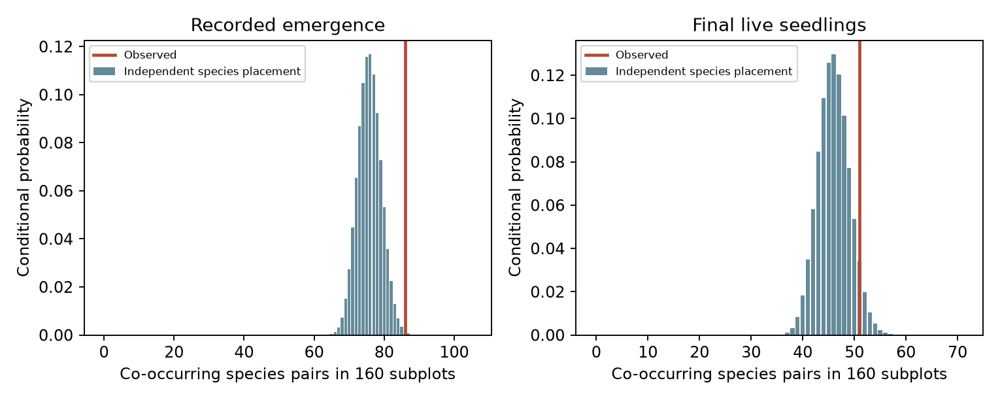

# At four alpine sites, cross-species seedling clustering was clear at emergence but uncertain at season end

In a Norwegian seed-addition experiment, different supplied plant species emerged in the same small subplots more often than an independent placement model expected. There were 86 co-occurring species pairs, compared with 75.8 expected (exact two-sided p = 0.00549). At the end of the season, the main test was uncertain: 51 live species pairs, compared with 46 expected (p = 0.147). This result separates shared emergence sites from the previously measured clustering of individuals within a species. It does not establish a common physical cause or a share of the climate-tracking gap.



The bars show reference distributions that preserve each species' number of occupied subplots within each site and treatment. The lines show observed pair counts. A subplot with three supplied species present contributes three pairs; one with two present contributes one pair. The primary outcome is final live presence. Emergence is a secondary outcome.

## Question and contribution

Community thermal composition often follows a small fraction of its spatial temperature gradient in time [1]. Source distance can limit colonisation [2]. After arrival, a previous analysis of this alpine experiment found fewer species footholds than an independent-seed model predicted [3]. That result concerns clustering of seedlings within each species. It does not show whether different species share the same successful recruitment locations.

We test this second level of dependence. Shared success could reflect common local conditions, common seed retention, shared observation conditions, or facilitation. Different species could instead respond to different local conditions. These alternatives can produce the same mean seedling counts. The new contribution is an exact cross-species test that retains each species' observed incidence and all site and treatment means, followed by two exploratory survival references. It is not a new experiment or independent replication of the source study.

The original registered report already found strong vegetation effects and differences between resource strategies [4]. Suitable recruitment sites and the limits of mean seed success are established subjects [5]. We do not claim to discover those mechanisms.

## Data and unit audit

Dahle and colleagues supplied 10,900 seeds of six lower-elevation species at four alpine sites. Seeds were sown in autumn 2020 and seedlings followed through the 2021 growing season. There were 588 recorded emerged seedlings and 412 live seedlings at the last census. The design crossed ambient versus warmed conditions and intact vegetation versus small gaps. Resource acquisitive and conservative species occupied separate subplot pairs. The three acquisitive species were supplied at all sites. Two conservative species were supplied at all sites, with a third at one site.

The physical unit in this analysis is site, recorded block, warming arm, vegetation arm and resource strategy. This gives 160 subplots and 420 species-by-subplot units. Species in different strategy groups are never treated as sharing a subplot. The cleaned file has seven census rows per species unit. We use one set of repeated endpoint totals, not seven replicates. We rebuilt supplied seeds, emergence and final live counts from all 10,900 raw seed records. All 420 count triples matched the cleaned totals exactly.

Each site-by-warming-by-vegetation-by-strategy group contains five subplots. Recorded block labels do not match perfectly between warming arms at two sites. Our within-arm test needs no pairing between arms and retains these labels. The analysis does not estimate a warming treatment effect.

## Exact test

Within each of 32 groups, let R_i be the number of supplied species present in subplot i. The test statistic is the sum of R_i(R_i-1)/2 across subplots. Under the conditional null, each species' observed number of occupied subplots is placed uniformly among the five positions, independently of other species. This preserves site, warming, vegetation, strategy, species prevalence, seed supply, and even the consequences of within-species individual clustering. Only the alignment between species is removed.

We enumerate every possible presence allocation in each group and convolve the resulting probability distributions. No estimated success probability or large-sample approximation is needed. The reported two-sided p value is twice the smaller inclusive tail, capped at one. The upper-tail p value tests positive association. Reference intervals are 2.5% and 97.5% null quantiles; they are not confidence intervals for an ecological effect. The null assumes exchangeable positions and independent species placement within each group. Spatial dependence or shared detection can violate it without biological facilitation.

## Results

| Outcome | Observed pairs | Expected pairs | Null 95% range | Two-sided p |
| --- | ---: | ---: | ---: | ---: |
| Final live presence, primary | 51 | 46.0 | 40–52 | 0.1471 |
| Recorded emerged presence, secondary | 86 | 75.8 | 69–83 | 0.00549 |

Final pair counts were 10.9% above the null mean, but the reference range included the observation. Emerged pair counts were 13.5% above the null mean. Empty physical subplots showed a related pattern: 45 at emergence compared with 38.2 expected (null range 34–43, two-sided p = 0.00871). At season end, 55 were empty compared with 50.72 expected (46–55, p = 0.0981). These statistics are dependent summaries of the same allocations.

All four sites had emerged pair counts above their null means. The ratios were 1.20, 1.06, 1.08 and 1.16 for Gudmedalen, Lavisdalen, Skjellingahaugen and Ulvehaugen. Omitting one site retained ratios of 1.11–1.15, but two-sided p values ranged from 0.0039 to 0.0806. Species omission retained ratios of 1.11–1.16, with p values from 0.0080 to 0.0746. Thus the direction was stable, but strong statistical support was not universal.

In intact vegetation, emergence gave 24 pairs compared with 16.2 expected (ratio 1.48, p = 0.00515). In gaps, it gave 62 compared with 59.6 (ratio 1.04, p = 0.408). This subgroup contrast is exploratory. Different within-group prevalence and reference variance prevent comparison of the two p values from being a test of a vegetation interaction. No causal competition share is estimated.

### Survival references constrain the stage interpretation

After the endpoint tests, we added two references with 50,000 simulated allocations and a fixed seed. First, within each species, site and treatment, choose the observed final number of survivors uniformly from the observed emerged individuals. This preserves emergence counts at each subplot and survivor totals. It expected 59.22 final pairs (95% reference range 54–64), compared with 51 observed (lower-tail p = 0.00358). However, it allows each species' final occupied-plot count to change. The earlier campaign result already showed that equal individual survival does not fully explain those marginal counts [3].

The second reference also fixes each species' final number of occupied subplots. Exact inclusion-exclusion weights give the possible final presence locations under uniform individual survival, conditional on that incidence count. Independent weighted draws for species then expected 49.83 final pairs (range 47–53). The observed 51 pairs fit this reference (upper-tail p = 0.338; lower-tail p = 0.886). The first reference therefore does not establish a separate loss of cross-species association during survival. The result is compatible with the recorded emergence pattern plus the final incidence totals of each species. These added diagnostics are exploratory and not independent tests on new data.

## What this means for community change

A model that predicts only a species' mean seedling count can miss its number of footholds [3]. A model that predicts every species' foothold count can still miss where those footholds coincide. This analysis measures the latter difference at emergence after controlled seed delivery. It supports inclusion of cross-species dependence when the target is the number of recipient subplots reached by any species or the distribution of local richness.

For fixed species incidence totals, cross-species association cannot change summed richness over all subplots. It only redistributes it. Thus our conditional pair test cannot by itself explain low regional thermal change. Nor does an emergence effect prove that adult communities remain constrained by shared sites. Final live presence supplies an important uncertain result, rather than evidence of persistent shared recruitment failure.

Limits are four sites, one season, six selected species, small subplots and low emergence. Unmeasured seed movement, dormancy, mortality before detection and shared observation can produce associations. Gaps and warming chambers change several conditions. No new site is held out for prediction, no adult reproduction is observed, and no long-term thermal index is estimated. The final null result does not prove species independence. Multiple secondary tests were inspected without a familywise correction. The plan and all additions are retained.

## Reproduce

Use Python 3.12 with files/requirements.txt. The publication contains our code, aggregate statistics and figure. External raw records and record-level derivatives are excluded. Attribution and source terms are in files/EXTERNAL_DATA.md. Exact shared paths, immutable revision URLs, byte counts and SHA-256 hashes are in files/provenance.json. No rights in the external OSF database are granted here.

After verification and extraction, set PUB to the extracted directory and SCRATCH to a separate local directory outside it:

```bash
python "$PUB/files/retrieve.py" --output "$SCRATCH/source"
PYTHONDONTWRITEBYTECODE=1 OPENBLAS_NUM_THREADS=1 OMP_NUM_THREADS=1 MKL_NUM_THREADS=1 python "$PUB/files/tests.py"
PYTHONDONTWRITEBYTECODE=1 OPENBLAS_NUM_THREADS=1 OMP_NUM_THREADS=1 MKL_NUM_THREADS=1 python "$PUB/files/analyze.py" --clean "$SCRATCH/source/clean.csv" --raw "$SCRATCH/source/raw.csv" --output "$SCRATCH/analysis"
```

On the campaign machine, use the shared source paths in provenance.json directly. The code checks both hashes and all raw-to-clean count triples. tests.py checks exact enumeration against hypergeometric laws and an analytic three-species expectation. results.json holds all subgroup and omission checks. groups.csv gives only group aggregate statistics. The exact null distributions are in emerged_null.csv and final_null.csv. The figure is association.png. The algorithm uses one CPU thread; no external service or fitted model is needed for computation.

## References

1. SCI sha256:0037934e440093284370046185fd30a78b7363fd6e940f8fd3d9860e2caedada. Weak temporal transfer across monitoring networks.
2. SCI sha256:79a502af8731510fa67d29a94448cae7d6c8f50780dc1ad8efeeccde8c5f8601. Source distance and bird colonisation.
3. SCI sha256:ee39da0bfd4ae612f40cf615d3fe33a87ae59039f2777eef44d4279bf77ee200. Count-to-presence test in this experiment.
4. Dahle IJ, Gya R, Töpper JP, Vandvik V. 2024. Are sub-alpine species' seedling emergence and establishment in the alpine limited by climate or biotic interactions? https://doi.org/10.1002/ece3.11009. Data: https://doi.org/10.17605/OSF.IO/79VGT.
5. Duncan RP and colleagues. 2009. Safe sites, seed supply, and the recruitment function in plant populations. https://doi.org/10.1890/08-1436.1.

## Campaign record

Job: sci-1107-dell-climate-pollution-biodiversity-c8a17eac0348. Topic: climate-pollution-biodiversity. Campaign: 11_07_2026. Machine: dell. Account: codex-olen. Model: gpt-6.1-sol with high reasoning effort. No subagents were used. The campaign-machine signature is not a personal authorship claim. The bundle is saved locally; this job does not upload or submit it.
