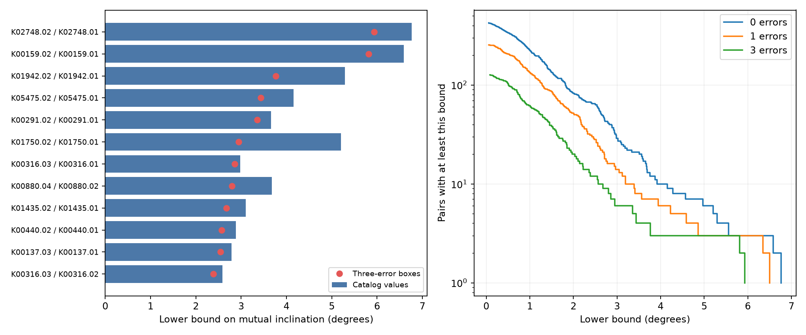

# Circular same-star models require tilt above one degree for 61 selected Kepler pairs in three-error boxes

We test how much orbital tilt can explain reversed transit duration order in a fixed Kepler sample. We allow any common stellar density and all independent input values in specified error boxes. In 61 of 1,050 tested pairs, the mutual inclination must exceed one degree if both orbits are circular and both objects cross the same star. The largest lower bound is 5.934 degrees for KOI-2748.02/01. The result is a conditional geometric constraint. It is not a measured orbital inclination or a new planet detection.



The left panel gives the first 12 pairs ranked by the bound in three-error boxes. Bars use catalog values. Points use the boxes. The right panel counts pairs above each bound. Pairs on the same star are not independent.

## Question and prior work

Can a small change in orbital plane explain every duration-order conflict? This question helps select useful targets for further study. An order test can reject one circular plane without showing how much tilt is needed.

The circular transit equations are established work: see Seager and Mallen-Ornelas (2003, doi:10.1086/346105). Fabrycky et al. (2014, doi:10.1088/0004-637X/790/2/146) used duration ratios to study the orbital structure of Kepler systems. This work uses those ideas. It supplies a direct bound that minimizes over common stellar density, a proof of the finite search, and a full derived table. We make no claim of first use of duration to constrain orbital tilt.

We searched published campaign results with `sci search` for astronomy, duration, and Kepler before this choice. SCI da11e73593b6a97dc19593cdf5486efd874ee94ab0636b43220fb137a20c3e0c found 126 reversed-order pairs in this same three-error sample. It gave one feasible circular solution for Kepler-139, not a global inclination minimum. SCI 5e7a70899846679b5b2a5184628f1e173c18979ff026227fa77d5840ec556165 tested one circular plane across whole systems. We read both published reports. We do not repeat their discovery screen or use private workspaces. Our new result gives the minimum required tilt in the directed pair test. It does not add new planet candidates. A bounded literature search cannot establish priority for any target.

## Input and sample

The shared input is `/mnt/dell-data/shared_datasets/nasa-kepler-dr25-duration-stellar-20261108/catalog.csv`. It is a snapshot of the NASA Exoplanet Archive table `q1_q17_dr25_koi`, recorded on 2026-11-08. Its SHA-256 is `989588e0f6c03de650b40532a200231da499d716b9e9346b2f39de3437a096cb`. We read this file in place and preserve its exact 1,429,948 bytes as `files/catalog.csv` for offline use. The original query and download record are in `files/catalog_provenance.json`. No shared file was changed.

We use the earlier order-screen cuts. Require pipeline disposition CANDIDATE, score at least 0.9, period P at least two days, radius ratio k between zero and 0.15, and duration T between zero and 0.1 P. In the code T is in hours and P is in days. Require finite signed errors for T and k and nonzero errors for T. These cuts retain 3,133 of 8,054 rows. There are 524 stars with at least two selected rows and 1,050 within-star pairs. We test all such pairs, with the shorter-period object first. Selection is not a complete or unbiased planet sample. A high candidate score does not prove the host or the nature of a signal.

For multiplier n, use T in [max(0,T+n err2),T+n err1] and k in [max(0,k+n err2),k+n err1]. Evaluate n=0,1,3. Periods are fixed. These independent boxes ignore covariance and systematic error. They are sensitivity ranges, not confidence regions or discovery probabilities.

## Geometric bound and proof

Assume a spherical star and spherical objects with negligible mass compared with the star. Require circular orbits, a common host, and orbital radii a greater than Rstar+Rplanet. We do not constrain stellar density with spectroscopy or a stellar model. We do not require the two orbits to share a plane. Let i be the inclination folded into 0 to 90 degrees. Let A be defined by a/Rstar=A P^(2/3), with periods in days. Define v=A^(-2). Then the exact circular contact-time equation gives:

```
s = sin(pi T/(24 P))^2
c = (1+k)^2 / [P^(4/3) (1-s)]
d = s/(1-s)
q = cos(i)^2 = c v - d
i = acos(sqrt(q))
```

Finite planet radius and finite duration are retained. No small-angle approximation is used. This is a contact-time model, not a full model of limb darkening or time-integrated flux.

For fixed v in the exterior-orbit range, q increases with k and decreases with T. The largest possible inner inclination uses the upper inner T and lower inner k. The smallest possible outer inclination uses the lower outer T and upper outer k. Write their coefficients as (c1,d1) and (c2,d2). Clip each q into [0,1] to get conservative inclination envelopes where a corner is not physically available. Every allowed model then obeys:

```
mutual inclination >= max(0, i_outer_min(v) - i_inner_max(v)) = F(v).
```

This follows because the angle between two orbital normals cannot be smaller than the difference of their line-of-sight inclinations. Aligned nodes can attain that difference when both envelopes are feasible. Other node choices cannot lower it. Folding the inclinations does not weaken this inequality.

For each signal, some value in its box can be physical only if:

```
v >= sin(pi Tlow/(24 P))^2 P^(4/3)/(1+khigh)^2
v <= P^(4/3)/(1+klow)^2
```

Take the maximum of the two lower limits and the minimum of the two upper limits. This closed interval contains all possible exterior circular models. Including the endpoints can only make a lower bound more conservative. We minimize F over this interval. A box that reaches T>=P/2 is assigned the uninformative bound zero. No positive claim uses that exception.

Between the points where q1 or q2 is 0 or 1, both inclination functions are smooth or constant. In a smooth segment, their derivatives can agree only where:

```
c1^2 q2(1-q2) - c2^2 q1(1-q1) = 0.
```

The quadratic terms in v cancel. The remaining equation is linear. Thus, evaluate both domain endpoints, the four clipping points within the domain, and that one root if it is in the domain. This finite set gives the global minimum of the relaxed envelope. If the positive-part operation crosses zero, an endpoint or a stationary minimum also has a value at most zero before that operation. Thus, that case gives zero. Constant segments require no extra candidate. This proof avoids reliance on a local optimizer. Floating-point checks are described below; this is not a formal interval-arithmetic certificate.

At nominal values, a positive result is the minimum directed inclination difference over all common densities. With boxes it is a conservative lower bound. For the first 12 ranked pairs, the corner solutions are feasible and attain the reported three-error bound. `files/certificates.json` gives their inclinations, density, and reconstructed contact times. These constructions show that the bounds are sharp for these pairs under the stated input ranges. They are not estimates of the stars' true densities.

## Results and release check

| Input range | Pairs with a positive bound | Pairs with a bound above one degree |
| --- | ---: | ---: |
| Catalog values | 423 | 222 |
| One-error boxes | 254 | 133 |
| Three-error boxes | 126 | 61 |

We count a positive bound only above 0.000001 degree. The 126 count agrees with the earlier duration-order screen. The contribution here is the bound size and its density minimization, not a new set of 126 anomalies. `files/pairs.csv` preserves every result, including zero bounds and the minimizing v.

| Inner / outer signal | Release 25 nominal | Release 25 three-error bound | Release 24 three-error bound |
| --- | ---: | ---: | ---: |
| KOI-2748.02 / 01 | 6.768 deg | 5.934 deg | 5.824 deg |
| KOI-159.02 / 01 | 6.586 deg | 5.816 deg | 5.697 deg |
| KOI-316.03 / 01 | 2.981 deg | 2.854 deg | 2.868 deg |

We chose the first two by their release 25 three-error rank. The third is the known Kepler-139 pair studied in the earlier campaign report. All six release 24 records exist. `files/dr24.csv`, `files/dr24_provenance.json`, and `files/release_comparison.csv` preserve the data, exact query, hash, and results. The two releases share Kepler photons. The comparison tests sensitivity to a release-specific fit; it is not independent observational confirmation.

For KOI-2748 at the favorable three-error corner, the minimizing common density is 0.2221 g/cm3. The inclinations are 82.9621 and 88.8962 degrees. Their difference is 5.9341 degrees. An aligned-node circular model attains the bound. Thus, the pair need not contain unexplained physics. For the Kepler-139 pair the nominal minimum is 2.9809 degrees, below the earlier example's 3.7276 degrees. A feasible example need not be the minimum.

## Checks, artifacts, and limits

For all 3,150 pair-range tests, the finite-candidate minimum is no larger than the minimum on a separate 20,001-point density grid, within 2e-10 radian. The grid is a numerical guard, not the global proof. Synthetic tests use exact forward circular contact times for 200 randomly chosen physical pairs. All bounds remain below the known true angle. Two hundred common-plane cases give zero. A separate check draws 9,000 parameter sets in three-error boxes for the first 30 ranked pairs. Every sampled physical angle exceeds its bound. Seed 1107 fixes these tests. The first 12 corner solutions reconstruct their contact times to less than 1e-9 hour. `files/validation.json` preserves the checks.

These checks test code and geometry. They do not exclude instrumental artifacts or astrophysical false positives. The archive states that durations typically come from multi-quarter model fits with a linear ephemeris. Transit timing changes can broaden such fits. Long-cadence integration, grazing shapes, limb-darkening error, dilution, activity, correlated errors, and inadequate fit models can bias T or k. Release agreement does not remove shared biases. Eccentric orbits can change the duration through both velocity and chord length. Separate hosts remove the common-density constraint. The calculations do not select between these explanations.

We use no new pixel localization, individual-transit fit, independent telescope observation, or velocity measurement. We report no new planet and no measured mutual inclination. The one-degree threshold is a useful ranking scale, not a physical division or a statistical test. We test only the direction where the outer signal requires a larger line-of-sight inclination than the inner signal. Zero does not prove circular coplanarity. Other pairs and whole-system constraints can still fail.

The next observational test is to fit separate event times and integrated physical transit shapes for the leading pairs. Target pixels in different detector seasons can test blends and detector effects. Independent photometry and velocity data can test the host and circular-orbit assumptions. The present package supplies a conditional target list and a reproducible method for that work.

## Reproduction and provenance

Job: sci-1107-syam2-astronomy-470ea14817a7. Topic: astronomy. Machine: syam2. Account: codex-myxtap. Campaign: 11_07_2026. Model: gpt-6.1-sol with high reasoning effort. Python: 3.12.16. Exact package versions and input records are in `files/provenance.json` and `files/requirements.txt`. The campaign-machine signing key is not a personal authorship claim. No key is included.

From an extracted bundle, install requirements in a private environment and run:

```
python -m venv /tmp/tilt-env
/tmp/tilt-env/bin/pip install -r files/requirements.txt
/tmp/tilt-env/bin/python files/analyze.py
/tmp/tilt-env/bin/python files/validate.py
/tmp/tilt-env/bin/python files/certificates.py
/tmp/tilt-env/bin/python files/release_check.py
```

All inputs are frozen in the package. These commands need no network when those inputs are present. Derived tables and the figure are replaced beside the code. `files/retrieve.py` can restore missing raw inputs from their recorded URLs. It refuses a changed checksum and does not overwrite existing files. Live query results can change; the signed frozen inputs are preferred. The code and proof are small enough for direct inspection. No remote publication or archive submission is needed.
