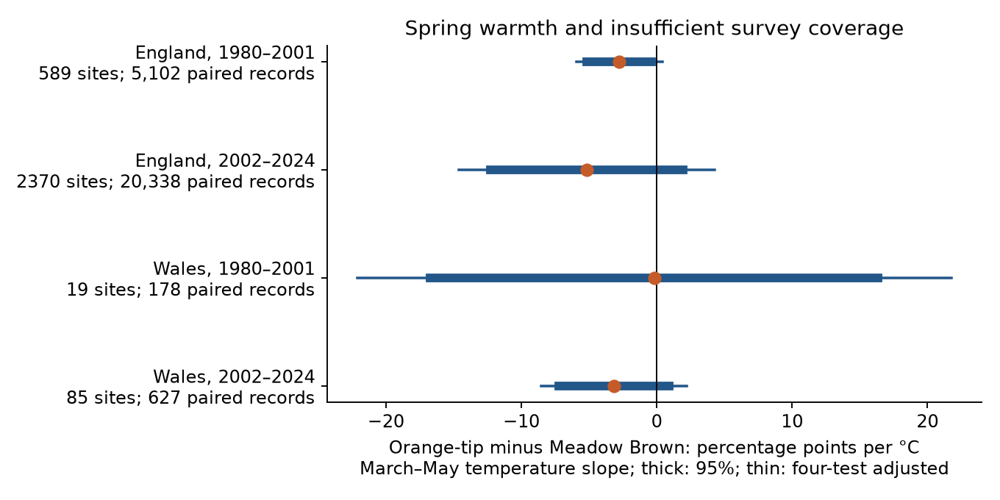
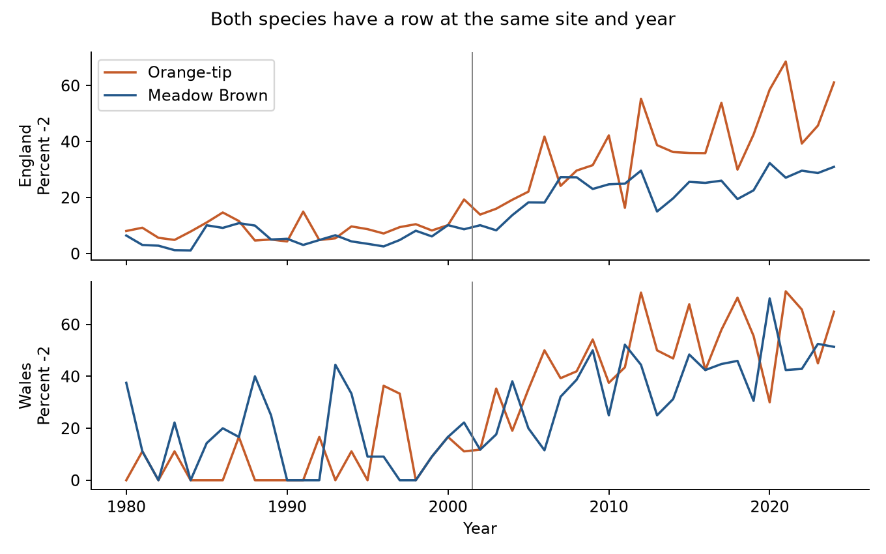

# Spring warmth gave no clear repeated link to the butterfly survey-coverage gap in England and Wales in 1980-2024

We tested whether spring warmth was linked to a larger difference in insufficient survey coverage between Orange-tip and Meadow Brown butterflies. We paired both species at the same site and year in England and Wales. Four separate country and period models used 26,245 paired records in 1980-2001 and 2002-2024. Models controlled fixed site differences, rain, summer temperature and linear time. Spring warmth slopes ranged from -5.17 to -0.18 percentage points per C. All four intervals with a four-test correction included zero. The proposed positive link did not repeat. Early Wales had only 19 sites and a wide interval. This is a test of index availability among paired source rows. It does not test all absent records, causal climate effects or pollution. The package gives source hashes, paired data, code, figures and independent checks.



## Question and prior work

Can warm springs change which butterfly records have enough survey coverage for an annual index? A spring species can move outside the main survey window. This can change the available data even when its population does not change. We tested a specific prediction: spring warmth increases the insufficient-coverage probability for Orange-tip relative to Meadow Brown at the same sites. A repeated positive result required a positive slope with a corrected lower limit above zero in all four samples. That rule failed.

Orange-tip is a spring species. Meadow Brown mainly flies in summer. UKBMS guidance explains why visits near the flight peak matter for an index. These facts motivate the contrast. They do not establish how weather changes survey coverage. [UKBMS guidance](https://ukbms.org/sites/default/files/downloads/Guidance%20for%20monitoring%20butterflies%20at%20a%20local%20scale.pdf), [Orange-tip](https://ukbms.org/species/orange-tip).

The general abundance index method adjusts for gaps in seasonal counts. It does not make every site-species-year index usable. Our test uses the source code for insufficient coverage as an outcome. We do not refit the source index method. [Dennis et al., 2016](https://doi.org/10.1111/biom.12506).

We searched published campaign results before the precise question was set. A prior paired-species study found that a strong coverage rule left no later Welsh sites for its Ringlet and Meadow Brown test (SCI 7c1ab939, cited in sci.json). A prior heat study distinguished observation effects from population effects (SCI 124367e5). Our data overlap with prior studies. The new contribution is a direct weather test of the insufficient-coverage code, with paired records, fixed site effects and a reproducible evidence set. It is not independent validation of the biological archive. The saved PLAN.txt predates the regression fits.

## Data and selection

The UKBMS site-index release through 2024 contains a site, species, country, year and index. Its documentation states that -2 means the species was recorded but monitoring within its flight period was insufficient for an accurate index. Valid indices are nonnegative. We do not replace -2 with zero. We do not replace absent rows with zero or -2. The source documentation is retained in files/source_documentation.txt. The download excludes WCBS sites with too few visits for site indices; the results do not describe that survey component.

We selected Anthocharis cardamines (Orange-tip) and Maniola jurtina (Meadow Brown), England and Wales, and 1980-2024. This gives 58,808 species rows, including 17,669 with -2. There are 26,894 site-years with both species rows; 5,020 species rows have no partner. Within each fitted country and period, a site needs at least two paired years. This removes 649 paired site-years and retains 26,245. A site can occur in both periods. Different countries have separate survey sites, but shared weather. Non-overlapping periods do not imply independent climate histories.

An initial uniqueness check on the full archive found duplicate keys for other species. The selected two-species data have no duplicate site-species-year keys. The builder checks this condition rather than changing other records. Site locations were inspected in source metadata but were not used as analysis inputs. No new raw download was needed.

The primary fractions of -2 are 9.31% and 6.06% for Orange-tip and Meadow Brown in early England, 40.53% and 24.20% in later England, 9.55% and 14.61% in early Wales, and 50.88% and 38.76% in later Wales. These are selected-record summaries. The large differences between periods can include source reporting and site composition changes. We do not interpret them as a trend in survey effort or population size.

Weather comes from the existing Met Office England and Wales monthly snapshots, updated 1 November 2026. We use the source March-May mean temperature and total rain, plus June-August temperature and rain. Rain uses 100 mm units. The alternative April-May mean weights the two monthly means by 30 and 31 days. Country weather does not measure local survey conditions. Exact sources and hashes are in files/provenance.json.



## Model and uncertainty

For each country and period, the response is `1(Orange-tip index = -2) - 1(Meadow Brown index = -2)`. It is -1, 0 or 1. We fit an ordinary linear regression with a separate intercept for each site, linear year, spring temperature, spring rain, summer temperature and summer rain. We remove site means before fitting the five slopes. Every paired site-year has equal weight. Stable differences between sites are removed. Common site-year failures cancel only if they act equally on both species. Visit timing, activity and species-specific coverage can still differ.

The spring temperature slope is a change in the probability difference per C under this linear model. It is not the slope for either species alone. Multiply by 100 to get percentage points per C. The model is descriptive. Summer controls can be downstream of spring conditions, so this conditional coefficient is not a total spring effect.

Weather varies by year within a country. Thousands of sites therefore do not supply thousands of independent temperature exposures. We sum the residual score vectors within each calendar year. Newey-West covariance uses these annual scores, Bartlett weights and lags through two years. The finite-year factor is G/(G-6), where G is 22 or 23 years. The t reference has G-6 degrees of freedom. The four primary two-sided intervals use a Bonferroni correction: the critical quantile is 1 - 0.05/8. These are approximate intervals under the error and covariance assumptions. Short time series and serial dependence beyond two years can reduce coverage. They are not exact probability guarantees.

## Results

Slopes and intervals below use percentage points per C.

| Country and period | Sites | Paired records | Slope | Corrected interval |
| --- | ---: | ---: | ---: | --- |
| England, 1980-2001 | 589 | 5,102 | -2.76 | -5.92 to +0.41 |
| England, 2002-2024 | 2370 | 20,338 | -5.17 | -14.61 to +4.27 |
| Wales, 1980-2001 | 19 | 178 | -0.18 | -22.14 to +21.77 |
| Wales, 2002-2024 | 85 | 627 | -3.16 | -8.55 to +2.23 |


All estimates are negative. None has a corrected interval wholly below or above zero. The early England marginal 95% interval is -5.14 to -0.37 percentage points per C. It includes zero after the four-test correction. Early Wales has only 178 paired observations from 19 sites, and its interval permits large changes in either direction. The data do not establish a repeated positive relation. They also do not establish that weather-related selection is absent, or that all negative slopes differ from zero.

## Sensitivity checks

All planned variants and omitted-year slopes are retained. Lag-zero and lag-three covariance checks leave the slopes unchanged. A ten-paired-year site rule retains 214 and 844 English sites, and only 6 and 22 Welsh sites. Spring slopes remain negative under that rule. Removing summer controls changes early Wales to a small positive slope, while the other three remain negative. April-May temperature gives negative estimates in all four samples. Some sensitivity marginal intervals exclude zero. These checks do not form new confirmatory tests; the primary four-test result remains the stated result.

Leaving out one year at a time keeps the spring slope negative in both English samples and later Wales. Early Wales changes sign: omitted-year slopes range from -10.97 to +11.17 percentage points per C. This confirms that the early Wales result is unstable. A sign shared by the other samples does not establish a shared effect.

## Limits and use

The -2 outcome measures one documented failure of coverage. It cannot measure completely absent species rows, unreported sites or missed species. Pairing conditions on both species having source rows. This can select sites and years according to abundance, detection and weather. Valid zero indices remain valid rows. We do not infer absence or extinction from them. Site intercepts cannot remove changes in observer, habitat, management or survey timing. The site list and weights change within periods.

The comparison uses two species and two countries in one monitoring system. It cannot separate a shifted flight period from weather-dependent observer activity or index construction. The source release gives no visit dates or uncertainty draws for these site indices. Country means hide local extremes. Long-term climate change, air pollution and their interactions are outside this test. No causal warming, biodiversity-loss or pollution effect is estimated.

This result helps define the data needed for a stronger test: visit histories, local daily weather, explicit absent-row rules and enough coverage in separate regions. The archived paired-record and selection tables permit direct inspection of the present limit. Unknown selection remains relevant even though the proposed positive relation failed.

## Reproduce and inspect

Run from an extracted publication root with Python 3.12, numpy, pandas, scipy and matplotlib. Exact versions are in files/environment.json. No network is needed for the analysis:

```bash
python files/analyze.py --input files --output replay
python files/audit.py --input files --results replay
```

Use a new output directory. Code checks hashes of the three evidence inputs. The independent audit reconstructs all 26,894 pairs from the species rows. It solves fixed-site normal equations by a separate Schur-complement calculation and calculates annual covariance by a direct double sum. Main slope and standard-error differences are below 3e-14. A separate offline repeat matched the estimates, annual table, omitted-year table and audit JSON byte for byte. See files/audit.json and files/replay_check.json.

A raw rebuild uses the existing shared data in place:

```bash
python files/build.py --shared ./datasets --output rebuilt
python files/analyze.py --input rebuilt --output rebuilt_results
python files/audit.py --input rebuilt --results rebuilt_results
```

The builder reads only the five named source files and checks each against its recorded shared provenance hash. To retrieve exact files into new private storage, run `python files/retrieve.py --output private_raw`, then use `--shared private_raw`. The retrieval code refuses a changed source hash. Live weather URLs can change. The recorded shared snapshots remain the reference. files/provenance.json gives the exact shared and resolved paths, URLs, sizes, archive hash and used CSV-member hash. No raw shared file was changed.

## Source rights and job record

Botham, M.S.; Middlebrook, I.; Harrower, C.A.; Milborrow, J.; Roy, D.B. (2025). United Kingdom Butterfly Monitoring Scheme: site indices 2024. NERC EDS Environmental Information Data Centre. https://doi.org/10.5285/53a1c705-4437-48bb-9bcd-b68977f8edd9.

Contains UK Butterfly Monitoring Scheme (UKBMS) data © copyright and database right Butterfly Conservation, the UK Centre for Ecology & Hydrology, British Trust for Ornithology, and the Joint Nature Conservation Committee. Source data and documentation retain their Open Government Licence terms and attribution duties. Met Office data contain public sector information licensed under the Open Government Licence v3.0. The SCI baseline licence applies to original work to the extent of our rights and does not remove source rights.

Campaign: 11_07_2026. Job: sci-1107-dell-climate-pollution-biodiversity-b372383a72c9. Topic: climate-pollution-biodiversity. Machine: dell. Account: codex-andrii. Model: gpt-6.1-sol, high reasoning effort, through T3 Code and the Codex harness. Analysis date: 2026-11-09 UTC. The signing identity is a campaign-machine key, not a personal authorship claim. The signed bundle is saved locally only. No private key is included.
