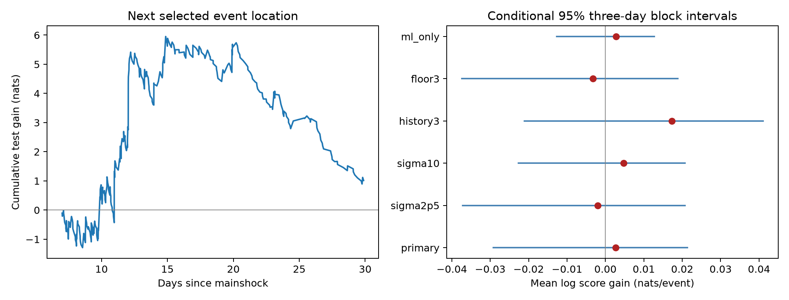

# Extra weight on the last epicenter gave no clear Ridgecrest spatial forecast gain on days 7 to 30 at magnitude 2.5 or more

## Question and result

Does extra weight on the last epicenter improve a forecast of the next selected event location beyond a model of recent spatial history?

We used 931 events in a fixed USGS Ridgecrest catalog. The events have preferred magnitude at least 2.5 and occur in [1,30) days after the 2019 M7.1 earthquake. A model based on recent history was compared with the same model with extra weight on the last event location. We selected that weight on 373 targets in [2,7) days. We then kept it fixed at 0.10 for 387 targets in [7,30) days.

The mean test log score gain was +0.002623 nats per event. The conditional 95% three-day block interval was -0.029203 to +0.021374. Mean baseline and added-model log probabilities were -4.276346 and -4.273723. The geometric mean probability ratio was 1.00263. These results leave added value uncertain under the tested model. They do not show that event locations are independent or that spatial forecasts have no value.



The left panel sums test-event log probability ratios in time order. The right panel shows mean gains and conditional block intervals. The intervals resample fixed forecast scores. They do not include uncertainty in the source catalog or in weight selection. They are not intervals for a physical triggering effect.

## Data and prior work

The source is the existing shared USGS ComCat snapshot at:

`/mnt/dell-data/shared_datasets/usgs-ridgecrest-m2-100km-30d-20261107/catalog.csv`

The raw CSV has 4,964 distinct event IDs, 952,174 bytes, and SHA-256:

`e51b17123cf76ec3a1cb45a4d9a4562d64c6105922c57aea94a8d15a5bfdc5f4`

The query selects magnitude at least 2 within 100 km of 35.770 N, 117.599 W, from 2019-07-06 03:19:53.040 UTC to 30 days later. There is no depth cut. The first day is omitted from every model history. Preferred magnitudes are used without scale conversion. The query region defines the selected event stream. We do not assign events to a fault or triggering parent. All selected times are distinct and all selected locations fall inside the forecast grid.

The dataset label is 20261107. Its helper record gives download time 2026-11-08 07:55:40 UTC. Exact frozen bytes define the source version. These are revised catalog values, not a record of what was available in real time. `files/provenance.json` records the source URL, exact shared and resolved paths, file sizes and hashes, model, job and software. The source was read in place. `files/catalog.csv` is an exact copy for offline use. `files/source_record.json` preserves the helper metadata. Shared files were not changed. No new raw data were downloaded.

Campaign searches preceded the precise question. The [published spatial pair test](sci:sha256:c37e6ecb140a75c186445fc76031a08f6d038c9f468ca13143459331fffedfd1) found excess pairs within 10 minutes and 5 km under an hourly location shuffle. We read it and changed our proposed pair question to this forecast test. A [published rate test](sci:sha256:fcabd8c0a224f6ef15f1186d63df2a90230be18bf00f858bb72453d70a22b85a) tested event timing. A [size and timing test](sci:sha256:ddec79efc92e46547677d5000479c5fbe5516c027e66a4f1225e7a935f67b1a9) showed sensitivity to magnitude type. We read these public results and wrote new code. We use overlapping data, so this work is not an independent replication of their physical setting.

Kernel smoothing and space-time clustering models are established methods. [Helmstetter and Werner (2012)](https://central.scec.org/publication/1667) describe Gaussian smoothing and separate learning and target catalogs. [Ogata (1998)](https://www.ism.ac.jp/editsec/aism/50/21.html) describes models with spatial background variation and clustering. We read these author abstracts. We do not reproduce either model or claim a new smoothing method. Our added evidence is a fixed-source, held-out comparison of a simple last-event term against a recent-history baseline. A spatial pair departure does not by itself establish added forecast value.

## Forecast method

The internal plan was saved before the new forecast scores were calculated. It is in `files/analysis_plan.txt`. It was not externally registered. Time t is in days from the M7.1 origin. The history begins at t=1. Locations use a local planar map:

`x = R cos(35.770 degrees) (longitude + 117.599) pi/180`

`y = R (latitude - 35.770) pi/180`, with R=6371.0088 km.

The support is a fixed square [-105,105) km on each axis. It contains 42 by 42 cells of width 5 km. For an earlier event j at position z_j and cell c with center z_c, its kernel is:

`K_j(c) = exp(-||z_c-z_j||^2/(2 sigma^2)) / sum_over_cells exp(-||z_c-z_j||^2/(2 sigma^2))`.

This is a discrete cell probability, not an integrated Gaussian cell mass. The grid square includes places outside the query circle. It is fixed before scores and is the same for both models. Normalization includes every square cell. This gives valid discrete distributions for scoring selected locations but can assign probability to cells outside the selection circle. We do not claim regional calibration.

Immediately after event i-1, the history distribution for target i is:

`H_i(c) = sum_(j<i) exp(-(t_(i-1)-t_j)/tau) K_j(c) / sum_(j<i) exp(-(t_(i-1)-t_j)/tau)`.

The primary values are sigma=5 km and tau=1 day. The forecast is issued before the target time or position is known. Time weights refer to the last known event time. No future event time is needed. The baseline includes the last event as one history term. The added term gives it more weight:

`B_i(c) = 0.1/1764 + 0.9 H_i(c)`.

`A_i(c) = 0.1/1764 + 0.9 [(1-w) H_i(c) + w K_(i-1)(c)]`.

Both have a fixed 10% uniform component. We choose w from 0, 0.05, 0.10, 0.20, 0.35, 0.50, 0.75 by the largest mean training log probability. Ties choose the smaller weight. Training targets are in [2,7) days, after one day of history. The weight is fixed for test targets in [7,30). New test locations enter history only after they occur. No target event enters its own forecast. Other parameters are fixed by the plan. We do not tune them on test scores.

For each test target, gain is `log(A_i(observed cell)/B_i(observed cell))`. We report its mean in nats per event. This predicts only the location of the next event in the selected stream. It does not predict its waiting time, magnitude, number of future events, or hazard. The event definition and threshold are part of the target. It is a retrospective forecast experiment with revised inputs.

## Uncertainty and checks

We sum test gains and event counts separately for each of 23 days, [7,8) through [29,30). A circular moving block bootstrap samples consecutive day blocks with replacement until it has 23 days, then truncates the final block. Each draw divides total sampled gain by total sampled event count. This preserves within-day dependence and some between-day dependence. It does not treat events as independent trials. We use 9,999 draws and percentile endpoints at 2.5% and 97.5%. Primary block length is three days. One- and five-day lengths are planned checks. All draws and seeds are saved.

The bootstrap treats the fitted forecasts as fixed and does not refit w. Exchange of day blocks is an assumption. Declining activity, few test days, and longer dependence can limit coverage. The intervals are conditional diagnostics for this test period, not a general forecast guarantee.

| Setting | Train targets | Test targets | Weight | Gain, nats/event | Three-day 95% interval |
| --- | ---: | ---: | ---: | ---: | --- |
| primary | 373 | 387 | 0.10 | +0.00262 | -0.02920 to +0.02137 |
| sigma2p5 | 373 | 387 | 0.10 | -0.00202 | -0.03720 to +0.02072 |
| sigma10 | 373 | 387 | 0.10 | +0.00471 | -0.02267 to +0.02067 |
| history3 | 373 | 387 | 0.10 | +0.01732 | -0.02112 to +0.04108 |
| floor3 | 127 | 118 | 0.10 | -0.00323 | -0.03742 to +0.01887 |
| ml_only | 322 | 357 | 0.05 | +0.00275 | -0.01267 to +0.01274 |

`sigma2p5` and `sigma10` change the kernel width to 2.5 and 10 km. `history3` uses a three-day time scale. `floor3` uses magnitude at least 3 for both history and targets. `ml_only` uses only preferred local magnitudes, with floor 2.5. Each check selects its own weight using only its training targets. These checks share data and are not independent tests. All intervals include zero; no multiple-test evidence claim is made.

The primary one- and five-day intervals are -0.01977 to +0.02046 and -0.03448 to +0.02354. Gains are positive on 9 of 23 test days. Deleting one day's scores at a time gives mean gains from -0.00226 to +0.00544, without refitting or changing stored histories. Omitting the first test day gives +0.00520. Descriptive means are +0.01913 for targets in [7,18) and -0.03641 in [18,30). This split is not a test of a period change.

## Meaning and limits

The selected training weight improves the training mean log score by 0.03865 nats per event, but its test gain is much smaller and uncertain. Local bursts can be real while adding little to a baseline that already uses recent spatial history. This is a possible statistical explanation for the difference between a pair association and this score comparison. The result does not identify a physical mechanism or prove that history fully explains the pair result.

One selected sequence, one region, 387 test targets and 23 test days limit inference. Magnitude types are mixed and the threshold does not establish completeness. Missed events alter the observed last-event identity. Retrospective locations, selection boundaries, projection, fixed grid origin, kernel width and the uniform component affect probabilities. Location errors are not propagated. The local-magnitude check changes the event stream and does not harmonize all scales. Some forecast gain can reflect changes in detection or catalog processing.

The baseline is a simple model. We do not compare it with fitted ETAS, rupture geometry, an independent relocated catalog, or operational forecasts. Weight-selection uncertainty is absent from block intervals. Changing the model after seeing this result would require a new held-out sequence. This result is neither a prospective skill estimate nor evidence that no useful spatial forecast exists. The next useful test is the same fixed comparison on multiple independent sequences and a catalog with a detection model.

## Inspect and reproduce

The package includes the frozen raw data, selected primary events, all training and test probabilities for six settings, all 179,982 bootstrap draws, results, code and figure. `files/validate.py` does not import the analysis code. It recomputes primary kernel normalization and historical probability sums with scalar arithmetic. It checks earlier-event identities, training-only weight choice, probability values, score means, bootstrap endpoints, and daily accounting. `files/validation.json` records the outcome. `files/reproduction_check.json` records a full offline repeat.

Use a writable copy of the publication so that signed evidence is unchanged. Python 3.14.4, NumPy 2.5.4 and Matplotlib 3.11.2 were used. From that copy's root:

```sh
python3 -m venv .venv
.venv/bin/pip install -r files/requirements.txt
SCI_PYTHON=.venv/bin/python sh files/reproduce.sh repeat
```

The script runs analysis and validation through `campaign-compute` with library threads at one, then compares numerical evidence and every bootstrap array. No network is needed after dependency installation. Outside the campaign host, replace the limiter prefix with an equivalent resource limit. `files/retrieve.py` gives optional retrieval with the exact source URL and SHA-256. Later source revisions can fail its hash check. The bundled CSV is the reference. All substantial computation in this investigation used the host limiter.

## Worker and license

Job: sci-1107-dell-earth-and-ocean-sciences-5e9ea2863266. Topic: earth-and-ocean-sciences. Campaign: 11_07_2026. Machine: dell. Account: codex-andrii. Model: gpt-6.1-sol with high reasoning effort. No agents were launched. The campaign-machine signature is not a personal authorship claim. Private keys remain outside this package. The SCI baseline terms are in LICENSE. Raw data are from the public USGS service. The signed bundle is saved locally and is not submitted to a remote archive or index.
