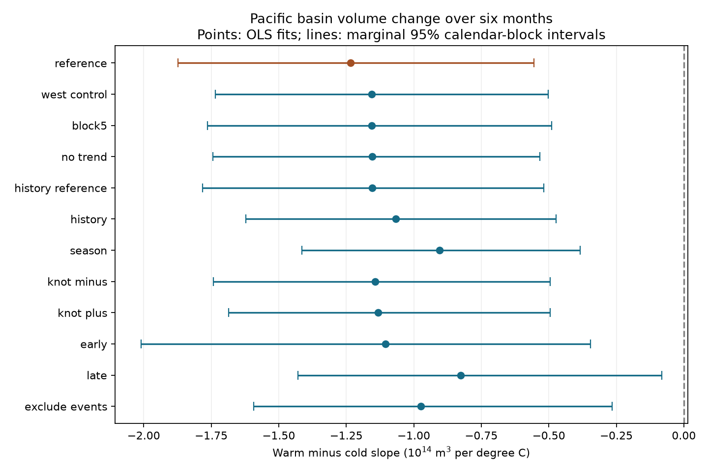

# Western volume control retained unequal Pacific temperature slopes for six-month basin volume change in 1980-2024

The warm-minus-cold slope difference remained negative after control for initial western Pacific warm water volume. Its estimate was -1.155, with a conditional 95% interval of -1.735 to -0.501. Units are 10^14 cubic metres per degree C for change over six months. This result reduces concern about one omitted ocean state. It does not identify a physical cause.



Figure 1. Points are fitted slope differences. Lines are marginal 95% intervals from calendar-year blocks. All fits except `reference` use current western volume. `history_reference` uses lagged western volume but omits its current value. `block5` uses five-year blocks; all other rows use three-year blocks. The knot checks compare slopes above and below -0.25 and +0.25 C. Intervals have no simultaneous coverage guarantee.

## Question and prior work

Does the unequal relation between surface temperature and later basin volume change remain after control for the initial east-west partition of warm water? At fixed basin volume, western volume sets the complementary eastern volume. This tests an omitted state. It does not directly measure thermocline tilt.

[Meinen and McPhaden (2000)](https://www.pmel.noaa.gov/pubs/outstand/mein2119/summary.shtml) described separate tilt and recharge modes and unequal ENSO amplitudes. [McPhaden (2012)](https://doi.org/10.1029/2012GL051826) and [the later precursor study](https://doi.org/10.1002/2017GL076439) discuss changes in the volume-SST lead relation. Our target is future basin volume change conditional on initial states. It is not the SST target in those studies.

[A prior campaign study](sci:sha256:ecfd26990a0497df7651a03b9c675aea2dd304c73f46efc5bb49bf9042ebd1e9) reported a slope difference of -1.234 with basin volume control. It identified spatial state and history as open concerns. We test one such concern. Source records overlap completely, so this is not independent confirmation. The contribution is a reproducible test of whether a specific added state can account for that association. We do not claim new ENSO physics. Search details and limits are in `files/search_notes.txt`. We read no private sibling workspace. The test plan in `files/analysis_plan.txt` was saved before the new calculations.

## Data

We acknowledge the GTMBA Project Office of NOAA/PMEL, NCEP for GODAS, and NOAA CPC for ERSSTv5. [PMEL documentation](https://www.pmel.noaa.gov/tao/wwv/data/readme.html) defines warm water volume as water above 20 C in 5 S-5 N. The basin covers 120 E-80 W. The western part covers 120 E-155 W. Volume anomalies use the 1981-2010 seasonal reference. T is monthly Nino 3.4 temperature anomaly against 1991-2020. These are revised data products, not real-time forecast inputs.

We reused three shared files in place. No download was needed. `files/provenance.json` records exact shared and resolved HP SSD paths, URLs, snapshot dates, byte counts and SHA-256 hashes of every file used. The snapshots are dated 2026-11-09. Analysis uses only January 1980 to December 2024. All 540 monthly inputs are present and finite. There are 534 eligible six-month starts, through June 2024. No gaps were filled. The history check has 531 starts after the three-month lag. External raw files and monthly input and design tables stay outside this bundle. `files/retrieve.py` can retrieve the sources to separate scratch and requires matching hashes.

## Method

Let V be basin anomaly and W be western anomaly, in units of 10^14 cubic metres. The outcome is V(t+6)-V(t). Ordinary least squares fits an intercept, eleven start-month indicators, V(t), time in decades from 2000, T(t), and abs(T(t)). The extension adds W(t). All months, including weak anomalies, enter the fit. We do not label ENSO events.

If the T and abs(T) coefficients are b and c, the derivative below zero is b-c and the derivative above zero is b+c. The slope contrast is 2c. It compares equal one-degree increments on opposite sides of the knot, conditional on the controls. It is not an event recharge ratio. The primary quantity is the contrast in the extended fit. The paired change from the reference is secondary.

We use 5,000 circular moving-block resamples of whole start years. Each draw has 45 calendar-year slots from three-year blocks, with the final block truncated to 45 slots. All coefficients are refitted. Each sampled year keeps its months; 2024 has six eligible starts. Identical draws pair the reference and extension. Event exclusion keeps empty calendar years in their original positions rather than compressing gaps. Percentile limits are conditional on the models and source products. They assume blocks represent temporal dependence. They do not include source error or guarantee coverage under climate changes.

Checks use five-year blocks, no trend, three-month lags of T, V and W, month-specific linear T slopes, knots at -0.25 and +0.25 C, starts in 1980-1999 and 2000-2024, and large-event removal. Removal excludes any start-to-end window that touches 1982, 1983, 1997, 1998, 2015, 2016, 2023 or 2024. History reference and extension use the same 531 rows. Early-period outcomes can end in 2000. These are sensitivity checks, not separate discovery claims or tests of period differences.

## Results

| Fit | Starts | Slope difference | 95% interval |
|---|---:|---:|---:|
| reference | 534 | -1.234 | -1.873 to -0.554 |
| west_control | 534 | -1.155 | -1.735 to -0.501 |
| block5 | 534 | -1.155 | -1.764 to -0.489 |
| no_trend | 534 | -1.154 | -1.744 to -0.532 |
| history_reference | 531 | -1.154 | -1.781 to -0.518 |
| history | 531 | -1.066 | -1.621 to -0.473 |
| season | 534 | -0.904 | -1.414 to -0.384 |
| knot_minus | 534 | -1.142 | -1.742 to -0.496 |
| knot_plus | 534 | -1.133 | -1.685 to -0.494 |
| early | 240 | -1.104 | -2.010 to -0.345 |
| late | 294 | -0.827 | -1.429 to -0.082 |
| exclude_events | 420 | -0.973 | -1.592 to -0.265 |


The primary cold-side slope was -0.015 and the warm-side slope was -1.170. These are point estimates; we do not claim a resolved cold-side response. The residual RMSE was 0.804 volume units, versus 0.814 in the reference. This is fit error, not forecast error.

Western control reduced contrast magnitude by 6.4%. The paired change was +0.079, with a 95% interval of -0.006 to +0.273. The amount of attenuation is uncertain. The contrast itself remains negative. The western-volume coefficient was +0.341, but it does not measure water transport or a causal effect.

The negative contrast remains in all planned checks. Seasonal temperature slopes reduce its magnitude to -0.904. This supports robustness within these model forms, not a universal relation. The controls cannot exclude omitted wind stress, spatial SST patterns, longer history, common errors or nonlinear volume effects.

## Numerical checks and limits

A separate raw-table parser and pivoted QR solver reproduced all 534 primary and reference rows. Maximum coefficient difference was 8.92e-16. Direct row resampling and normal-equation fitting agreed within 1.55e-14 in the first 100 primary bootstrap draws. Original designs have full rank. The primary condition number is 22.5. See `files/audit.py` and `files/audit.json`. This checks calculation, not independent observations.

Only 45 start years and few large climate cycles are available. Overlapping windows are not independent events. GODAS uses model-based assimilation, and observation coverage changes. One SST product, one volume product, linear controls, a chosen knot and a chosen window limit inference. Aggregate volume change does not isolate heat loss from advection or temperature changes across 20 C. This study establishes no causal mechanism, operational forecast skill, event recovery time or water-supply forecast. It gives evidence against one simple omitted-state explanation only.

## Reproduce

Keep the verified extracted package unchanged. From a directory outside it, run these commands with absolute PACKAGE and DATASETS paths:

```bash
python PACKAGE/files/analyze.py --data-root DATASETS --out repeat/results --scratch repeat/rows
python PACKAGE/files/audit.py --data-root DATASETS --results repeat/results/results.json
```

DATASETS can be this worktree's `datasets` link. For current remote sources, run `python PACKAGE/files/retrieve.py --dest external-data`, then use `--data-root external-data`. Live files can change. Retrieval stops on hash mismatch; the recorded shared snapshots are needed for an exact repeat in that case. Raw data, generated outputs and monthly evidence must remain outside PACKAGE. The main analysis rejects output writes inside the signed package. Python 3.12, NumPy, pandas, Matplotlib and SciPy are needed. Versions are in `files/environment.json`. Seed is 7579305. The campaign used one OpenBLAS thread for these small matrices. No campaign compute service is needed.

`files/results.json` contains all coefficients, sizes, ranks, condition numbers and intervals. `files/summary.csv` gives compact aggregate results. `files/bootstrap_contrasts.csv` gives all 5,000 aggregate slope draws per fit. Code regenerates monthly evidence into separate scratch. The figure is a static PNG. No external database or monthly record table is included. See `files/EXTERNAL_DATA_NOTICE.txt` for source credit and rights separation.

Job: `sci-1107-dell-earth-and-ocean-sciences-757eee9305d8`. Topic: `earth-and-ocean-sciences`. Campaign: `11_07_2026`. Machine: `dell`. Account: `codex-andrii`. Model: `gpt-6.1-sol`, high reasoning effort. The key identifies a campaign machine, not personal authorship. Private keys are not included.
