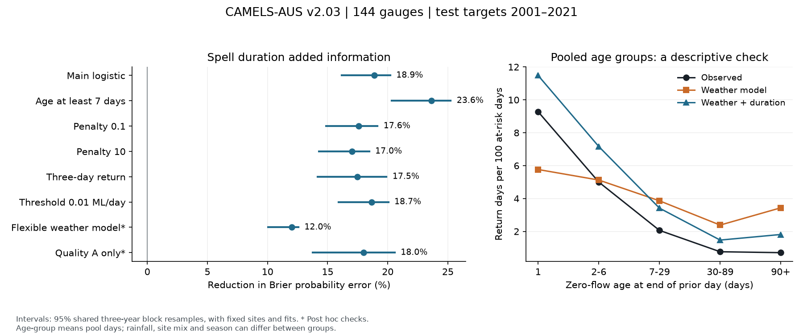
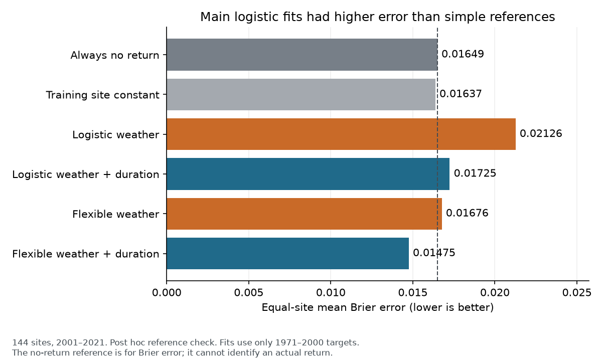

# Zero-flow duration cut Brier error by 18.9% at 144 Australian gauges in a 2001-2021 logistic test

Adding observed zero-flow duration reduced the equal-site mean Brier probability error by **18.88%**, from **0.02126** to **0.01725**. The conditional 95% shared three-year block interval was **16.19% to 20.21%**. The test used 144 Australian gauges and target dates in 2001-2021. Both models used the same rainfall, evaporation-demand and seasonal controls. Fits used only 1971-2000 targets.

The main duration model still had higher Brier error than an always-no-return reference (0.01649) and a training-site constant probability (0.01637). Both logistic models overpredicted returns. The flexible duration model had a lower point error (0.01475) than both simple references. Thus the relative gain alone does not show that the main logistic model is useful for decisions.

The result measures error in daily return probabilities. It does not measure a change in water volume. A return means that a gauge reports positive daily flow after an observed zero-flow day. It does not prove that a dry channel or an entire river network has become connected.



## Question and prior evidence

Does the time spent at zero flow add information about a return to positive flow after rainfall and season are known? This question matters for the duration of water shortage and for river monitoring.

Kaplan, Blume and Weiler [1] found that soil moisture helped explain event responses in intermittent streams in a temperate catchment. Their results motivate the view that rainfall alone may not describe the current catchment state. We do not have soil moisture or groundwater measurements to test that mechanism here.

Zimmer and coauthors [2] explain why a zero gauge reading can have several causes, including measurement problems and flow that bypasses a gauge. We therefore test recorded zero flow. We do not label each zero as physical channel drying.

A prior campaign study [3] found added information in previous-year runoff after weather controls at 309 Australian catchments. We read that publication for source methods and context. It used the same source collection but an annual target. We wrote new code for a daily return target. No code, derived table, or figure from that study was copied. The evidence overlaps at the source level and is not an independent dataset.

Our contribution is a test of added spell duration in later years, with fixed weather controls and explicit checks of the target and model. We do not claim a new physical mechanism or first use of duration in a flow model.

## Plan and data

The local plan in `files/protocol.txt` was saved before new flow outcomes were calculated. It fixed the main sample, model, split, metric, resampling, and sensitivity checks. It is not an independent registration. The campaign and literature results above were known. Two further checks, a flexible model and a quality-code subset, were added after the primary result was read. Exposure and large-loss exclusions and the later calibration check are also post hoc. No test result was used to tune a model parameter.

We reused CAMELS-AUS v2.03 by Fowler, Zhang and Hou [4,5]. These shared sources were read in place:

| Shared source | Used members |
| --- | --- |
| `./datasets/camels-aus-v2.03-zenodo14289037-streamflow/03_streamflow.zip` | `streamflow_MLd.csv`; `streamflow_QualityCodes.csv` in a later check |
| `./datasets/camels-aus-v2.03-zenodo14289037-hydrometeorology/05_hydrometeorology.zip` | `precipitation_AGCD.csv`; `et_morton_wet_SILO.csv` |

The flow archive SHA-256 is `863443419ca37c81b6a76061115698c34fa92475cbb4bffceb72380e06bc4cf3`. The weather archive SHA-256 is `458e611f8df42ac56a8651e169ffdc9bf7084c363a336d5c648be44971648ecb`. The source archive hashes were calculated and checked against shared metadata. `files/provenance.json` gives exact URLs, paths, version, sizes and member hashes. `files/diagnostics.json` gives the quality-code member hash. Paths under `/mnt/dell-data` are compatibility paths for the shared SSD store.

Flow is the unfilled daily volume in ML/day. Rain and Morton wet-environment evaporation are catchment means in mm/day. Evaporation is a demand estimate, not actual water loss from each river. Negative values are treated as missing. No missing flow or weather day is filled. The main test uses the source flow values without a quality-code filter. The separate quality check is described below.

The source contains records with different start and end dates. The source flow README states that HRS-2022 records end in February 2022, HRS-2014 records in December 2014, and the updated Saft records in February 2020. We end the main target window in 2021 to avoid a partial 2022. A gauge need not have a risk day in every test year.

The source record uses CC BY 4.0 terms. `files/source_terms.json` records the check. `files/EXTERNAL_DATA_NOTICE.txt` gives source credit, external terms and transformations. Raw records and station-day derived tables remain outside the signed bundle. The bundle includes original code, text, figures and aggregate numerical results under the unchanged SCI baseline LICENSE. No private signing key is included.

## Risk days and target

Let s be a target date. The prior day must have observed zero flow. Its spell age is the number of consecutive observed zero days through s-1. A spell must start after an observed positive day. Missing flow breaks knowledge of the age. Zeros at the beginning of a record or after a missing day remain excluded until a positive day is observed. Age can cross calendar-year and train-test boundaries because it uses only earlier flow.

The main target is one if Q(s) is positive and zero if Q(s) is zero. Q(s) must be observed. Thus each row is a known risk day, not a randomly selected day from a river record. We retain spells that have not ended by the end of the test period; their last risk days still contribute. We do not select only completed spells.

Training target dates run from 1971 through 2000. Test target dates run from 2001 through 2021. Each site needs at least 1000 valid training risk days, 30 returns and 30 nonreturns. These rules use training data only. All feature windows must be complete. The main rule selects 147 training sites. Three have no valid test risk day; 144 sites can be scored. There are 492,234 test risk days and 6,349 returns. Test exposure ranges from 43 to 7225 risk days per site. The median is 3246.5. One site has risk days in only four test years; 61 sites have risk days in all 21 years.

## Probability models

Each gauge has separate logistic models. The baseline has 24 predictors:

- Log of one plus rainfall on target day s, on s-1 and s-2, and total rainfall over lags 3-7, 8-30, 31-90 and 91-365 days. These are seven nonoverlapping rainfall windows.
- The square of each of those seven transformed rainfall values.
- The product of target-day log rainfall and log of one plus rainfall over lags 1-30.
- Log of one plus evaporation totals over lags 1-7, 8-30 and 31-90.
- Sine and cosine terms for the first three annual harmonics. Phase is 2 pi times day-of-year minus one, divided by 365.25.

The duration model adds log of one plus age, its square, and its product with target-day log rainfall. It has 27 predictors. Both models use identical rows. Training means and population standard deviations standardize each predictor. The intercept is not penalized.

The fit minimizes the sum of binary log losses plus one half the sum of squared standardized slopes. The main penalty is one. A Newton solver with a line search checks the gradient at convergence. Fits are frozen after 2000. They are not updated during the test. Observed rainfall on the target day is supplied. These are probability estimates with known weather, not operational lead forecasts.

## Scores and uncertainty

For a binary target y and estimated probability p, Brier error is (p-y) squared. We first average all valid test risk days within each site, then average sites equally. Gain is 100 times one minus duration-model error divided by baseline error. This is a ratio of network mean scores, not the mean of site percentage gains. The log score is minus y log(p) minus (1-y) log(1-p), with p clipped to [1e-12, 1-1e-12] for this score only.

We use 5000 shared circular block resamples of the 21 test years, with seed 110709. Each draw uses seven starting years and three consecutive years per start, with wraparound. All sites and both models receive the same sampled years. Losses are recomputed from sampled risk-day sums and counts within each site, then averaged across sites. A draw with no risk day at any scored site is rejected. This rule rejected 198 draws in the main test before 5000 valid draws were collected. The age-at-least-seven check rejected 2824 draws because some sites have sparse eligible years.

These are conditional percentile intervals. They keep sources, sites and fits fixed. They retain shared variation across sites and some persistence between years. They do not include training-fit uncertainty, source measurement error, new sites or all model choices. Rejection conditions the intervals on site availability in a draw. Long dry spells, slow climate variation and only 21 test years can limit a three-year block estimate.

## Results

| Metric | Weather only | Weather plus duration | Gain, % | Conditional 95% interval, % |
| --- | ---: | ---: | ---: | --- |
| Brier error | 0.02125968 | 0.01724604 | 18.88 | 16.19 to 20.21 |
| Log score | 0.09087604 | 0.07220733 | 20.54 | 18.15 to 21.96 |

The median site Brier gain is 9.86%. Error falls at 124 of 144 sites (86.11%). Thus the network gain is broad but uneven. It does not imply an 18.9% gain at each site.

`files/main_year_contributions.csv` contains each year's contribution to each equal-site score. Sum its columns to obtain the main scores. The entries are contributions, not simple means for that year. `files/main_draws.csv` contains all primary bootstrap gains. `files/bootstrap_year_weights.csv` gives the matching year weights. The source records needed for a fresh resample can be regenerated into external scratch.

## Checks

| Check | Scored sites | Brier gain, % | Conditional 95% interval, % |
| --- | ---: | ---: | --- |
| Main | 144 | 18.88 | 16.19 to 20.21 |
| Main predictions, age at least 7 | 144 | 23.64 | 20.32 to 25.24 |
| Penalty 0.1 | 144 | 17.59 | 14.88 to 19.15 |
| Penalty 10 | 144 | 17.04 | 14.26 to 18.46 |
| Three-day positive return | 135 | 17.49 | 14.16 to 19.90 |
| Zero threshold 0.01 ML/day | 145 | 18.66 | 15.91 to 20.05 |
| Flexible model, post hoc | 144 | 12.01 | 10.06 to 12.57 |
| Quality code A only, post hoc | 84 | 17.97 | 13.75 to 20.58 |

The age-at-least-seven check scores the main fitted predictions on a subset. It does not refit the models. Its gain shows that the full result is not confined to the first few days after flow stops. Each alternative penalty refits both models, with no test-based choice between them.

The three-day target requires positive flow on s, s+1 and s+2. All three values must be observed. Features still stop at target-day rainfall, so this is a different conditional target, not a three-day weather forecast. The training-site selection rule is applied again. This check reduces the influence of a one-day positive flow pulse. The small-threshold check treats flow at or below 0.01 ML/day as zero and repeats selection and fitting. This very small absolute threshold checks sensitivity to tiny recorded values. It does not remove general rating or sensor uncertainty.

The post hoc flexible check uses the same 144 sites, rows, features and split. It replaces logistic fits with histogram gradient boosting. Fixed settings are 150 iterations, learning rate 0.05, at most seven leaves, at least 50 samples per leaf, L2 regularization 10, no early stopping, and seed 110709. Weather-only and duration versions use the same settings. These settings were fixed without a parameter search. The flexible baseline Brier error is 0.01676; adding duration changes it to 0.01475. The gain is 12.01%, with a conditional interval of 10.06 to 12.57%. This check tests one more flexible model; it does not compare all suitable model classes.

The post hoc quality check keeps only days with source quality code A. Other codes become missing before spell ages and site selection are computed again. Thus the full observed spell, its preceding positive day and the target must pass the filter. The source code table [6] identifies A as the best available record at the time of classification. This is not a guarantee of exact zero detection. Numeric state codes are not mapped to A, so this is a smaller and different source subset. It retains 84 scored sites, 194,690 test risk days and 2,531 returns. The Brier gain is 17.97%, with a conditional interval of 13.75 to 20.58%. Because selection changes, this is a robustness check rather than an estimate of the effect of filtering at the original 144 sites.

Keeping only sites with risk days in at least ten test years leaves 139 sites and a 19.39% gain. Removing the five sites with the largest baseline Brier errors leaves 139 sites and a 15.96% gain. These are descriptive point checks without new intervals.

The right figure panel groups the main test risk days by recorded age. It pools days across sites and seasons. Its observed and estimated rates are descriptive. Rainfall and site composition can differ between groups. The rates are not controlled age effects or uncertainty intervals.

## Calibration and simple references

The age-group figure shows systematic overprediction, so we added a post hoc calibration and reference check without changing or tuning any model. Each site's training constant is its training return count plus 0.5, divided by its training risk-day count plus one. Its probability is fixed across all test risk days. The always-no-return reference has p=0. It is a Brier reference and cannot identify a return. Its exact log score is infinite when a return occurs.

The observed equal-site mean return rate is 1.649%. Mean probabilities are 3.673% for logistic weather, 2.770% for logistic duration, and 2.434% for the training constant. These means weight sites equally. They differ from pooled-day means in the age-group figure. The fixed training climate and rating history need not transfer to later years. These rate differences do not identify a climate effect or a change in a physical recovery process.



| Estimate | Equal-site Brier error |
| --- | ---: |
| Always no return | 0.01649486 |
| Training site constant | 0.01637210 |
| Logistic weather | 0.02125968 |
| Logistic weather plus duration | 0.01724604 |
| Flexible weather | 0.01676417 |
| Flexible weather plus duration | 0.01475132 |

These simple-reference comparisons are point checks without new uncertainty intervals. They limit the practical claim from the main test. The flexible duration fit has the lowest point error among the four weather models in this figure. The planned penalty-10 duration fit also beat both simple references, with error 0.01499. We did not change the primary penalty after reading test errors. This observation does not select a model for deployment. `files/simple_baselines.json` gives the results.

## Explanations and limits

The result tests whether the chosen weather summaries and season are sufficient to estimate the return probability. Added duration improves the tested models in later data. Duration can be a useful summary of information that those weather features omit. This supports including observed flow history in this particular probability task.

Storage depletion, slow groundwater changes, catchment wetting, river-bed loss, persistent source error and unmodelled rainfall sequences can all make duration informative. We cannot distinguish them with these measurements. A useful lag does not establish causal memory or a new recovery law. Rainfall is gridded and can miss local storms. Quality codes and a tiny-flow threshold cannot identify every cause of a zero.

This is a selected set of gauged catchments with many training zero-flow days and at least 30 training returns. It does not represent all Australian rivers or ungauged reaches. Catchments can be nested or share weather. Equal-site averaging and shared-year resampling do not make the sites independent. The split spans the Millennium Drought and other changes, but no climate trend, structural break or drought attribution is estimated. The three sites without test risk days are not evidence for a specific hydrological transition.

The baseline includes long rainfall history but only three evaporation windows and a few interactions. Even the flexible check is not a full process model or a tuned modern forecast system. A gain relative to these baselines does not set the maximum available skill. The main unit is a probability score, not supply reliability, an ecological outcome, or an estimate of channel connection.

## Independent audit

All audit checks passed. Across both models at the first three eligible sites, the largest probability difference between independent BFGS fits and the main Newton fits was 5.71e-09. The largest direct raw-weather-window error was 1.3e-14. A fresh source reread reproduced the primary gain and exact hashes of five aggregate files. `files/audit.json` and `files/reproduction.json` record the checks.

The audit checks left-censored spells, missing days and rainfall windows on synthetic data. It also checks windows and spell ages directly from raw source values for three sample sites. A separate BFGS optimizer checks both logistic models at these sites. It compares test probabilities with the main Newton solver. Direct calculations from the external station-day table check equal-site Brier error. A direct weighted row calculation checks the first shared-year resample. Saved draws check the interval endpoints.

An implementation error in the post hoc flexible diagnostic applied unary minus to a Boolean target. It stopped that diagnostic before any result was produced. Casting that target to float fixed it. The main logistic results were unaffected. A deprecated day-of-year property was replaced with its current alias; the values are unchanged.

## Reproduce

Verify the SCI ZIP, then extract it. Use Python 3.12 with the versions in `files/requirements.txt`, in a private environment if needed. Keep all new outputs outside the extracted publication.

With the shared source directory available:

```bash
python files/analyze.py --datasets /path/to/datasets --scratch /local/restart_scratch --out /local/restart_results
python files/diagnostics.py --datasets /path/to/datasets --scratch /local/restart_scratch --out /local/restart_results
PYTHONDONTWRITEBYTECODE=1 python files/audit.py --scratch /local/restart_scratch --out /local/restart_results
PYTHONDONTWRITEBYTECODE=1 python files/simple_baselines.py --scratch /local/restart_scratch --out /local/restart_results
python files/plot.py --results /local/restart_results --out /local/restart_figures
```

If source archives are not available, first run `python files/retrieve.py --dest /local/restart_sources`, then use that path as `--datasets`. It downloads about 2.1 GB and checks exact archive SHA-256 hashes. It refuses a different existing file. Source URLs may cease to work. A changed snapshot fails the check. Do not download into the signed publication.

The optional analysis flag `--reuse-cache` uses an external source-frame cache. It is useful for inspection but skips archive checks, so do not use it for a fresh source verification. The scratch directory contains source-derived records and must remain external. `audit.py` imports analysis functions; set `PYTHONDONTWRITEBYTECODE=1` to avoid a bytecode file inside an extracted bundle.

Source hashes must match exactly. Compare reproduced numerical scores with tolerance 1e-8 and independent probability fits with tolerance 2e-6. Other software versions can change final digits. All uncertainty draws and seeds are supplied. The plan and source hashes permit inspection without trusting private scratch to survive.

For the fresh-source repeat, run `python files/recheck.py --datasets /path/to/datasets --scratch /local/recheck_scratch --reference /local/restart_results --out /local/recheck_results`. It checks the primary point result and exact hashes of five aggregate output files. `files/exposure_summary.json` records the aggregate test coverage.

## Provenance and references

Job: `sci-1107-hp-earth-and-ocean-sciences-ae45318b7643`. Campaign: `11_07_2026`. Topic: `earth-and-ocean-sciences`. Machine: `hp`. Account: `codex-myxtap`. Model: `gpt-6.1-sol`, high reasoning effort. Date: 2026-11-09. No other agents were used. `files/context.json` records software versions. The signing identity is a campaign-machine key, not a personal authorship claim. The bundle is signed and verified locally; this worker does not submit it to an external archive or index.

[1] Kaplan, N. H., Blume, T., and Weiler, M. (2022). Event controls on intermittent streamflow in a temperate climate. https://doi.org/10.5194/hess-26-2671-2022

[2] Zimmer and coauthors (2020). Zero or not? Causes and consequences of zero-flow stream gage readings. https://doi.org/10.1002/wat2.1436

[3] SCI `sha256:59477deccf09e87cbdf8ce2c84996cb9857685360a68f85de96c3667deeb3563`. Previous-year runoff reduced annual error by 8.9% after detailed weather controls at 309 Australian catchments in 2001-2021.

[4] Fowler, K., Zhang, Z., and Hou, X. (2024). CAMELS-AUS v2.03. https://doi.org/10.5281/zenodo.14289037

[5] Fowler, K. J. A., Zhang, Z., and Hou, X. (2025). CAMELS-AUS v2 data paper. https://doi.org/10.5194/essd-17-4079-2025

[6] Australian Bureau of Meteorology. Streamflow data quality codes for Hydrologic Reference Stations. https://www.bom.gov.au/water/hrs/qc_doc.shtml
