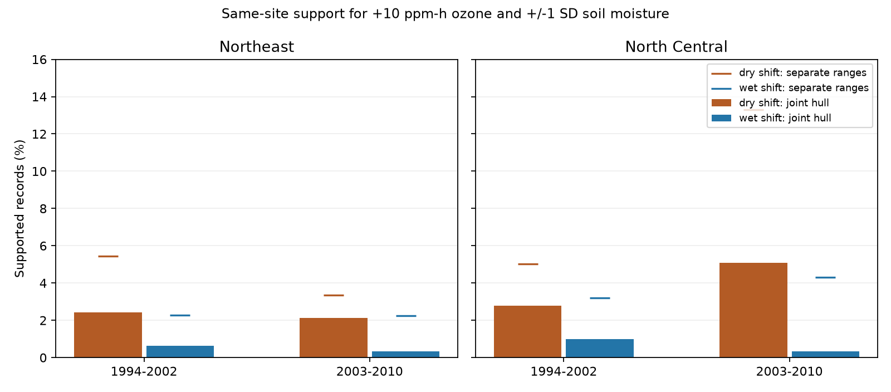

# Higher ozone and wetter soil shifts had less same-site support than dry shifts in four eastern US forest samples in 1994-2010

## Result

We measured observed exposure support for joint ozone and soil moisture shifts in a published forest injury panel. Four Northeast and North Central samples in 1994-2002 and 2003-2010 had 5,277 site-years at sites with at least three records. Adding 10 ppm-h W126 ozone and one soil moisture SD had same-site convex-hull support at 0.33-0.98 percent of records. Adding ozone and removing one moisture SD had support at 2.12-5.09 percent. All four dry-minus-wet gaps exceeded the central 95 percent range from 99 within-site random pairings that kept separate exposure values fixed. Smaller shifts and full-period records raised support. At least six visits retained three gap signs and gave one tie. Short histories alone gave low leave-one-record-out coverage. These are finite-panel geometric results, not injury effects or causal positivity tests. Selected sites, coarse exposure, rounded source data and empty areas inside hulls limit use. The package gives code, aggregate results, source hashes and retrieval instructions. External records remain outside the package.

| Region and period | Records | Sites | Dry support | Wet support | Dry separate ranges | Wet separate ranges |
|---|---:|---:|---:|---:|---:|---:|
| Northeast, 1994-2002 | 1270 | 266 | 2.44% (31) | 0.63% (8) | 5.43% | 2.28% |
| Northeast, 2003-2010 | 1463 | 217 | 2.12% (31) | 0.34% (5) | 3.35% | 2.26% |
| North Central, 1994-2002 | 716 | 172 | 2.79% (20) | 0.98% (7) | 5.03% | 3.21% |
| North Central, 2003-2010 | 1828 | 259 | 5.09% (93) | 0.33% (6) | 13.29% | 4.32% |



## Question and prior work

Can selected forest sites support a wetter, higher-ozone shift as well as a drier, higher-ozone shift? This question matters when interpreting a model that predicts more ozone injury in wet soil. Open leaf pores can admit ozone, and low soil water can reduce uptake. The Forest Service report by Smith, Morin and McCaskill (2012), DOI 10.2737/NRS-GTR-103, describes the injury indicator and this context. Our calculation does not test leaf uptake.

SCI 268004a08eb37a3a36207332736b005b07fe9d13a4687a19b1e966f96044ecb6 reports a positive pooled ozone and moisture product. SCI 29a66dcad4d1679fc2b2a1d38ce3f74aac627d2501d8a2fb9efa3b831e91470b finds no clear repeated annual injury product across four eastern samples. We use the latter four-sample design but test observed exposure coverage, without fitting an injury model. SCI 86cc4e5c727f8db0635f63efb4f5a7916107d055b81bd1d7356ffb5e4f0df6ca applies directional hull support to birds, ozone and warmth. We apply that general method to the forest panel, ozone and soil moisture. This is a new data application, not a new geometric method or an independent replication of the forest injury reports. We wrote the analysis code for this job. Campaign searches covered phenology, air pollution biodiversity, ozone bird, forest injury, forest support and ozone moisture before the precise question was fixed. This is an exploratory investigation, not a registered test.

## Data and selection

The direct source is the fully verified parent SCI 268004a08eb37a3a36207332736b005b07fe9d13a4687a19b1e966f96044ecb6, entry `files/data/analysis_panel.csv`. It has 7,036 site-years. Its SHA-256 is `b8096a35a665bd8d8dbb80c3dbdd2bf4052828b6feb15116484477f66675e31c`. The parent joined USFS FIA indicator-plant reports, EPA AQS ozone, NOAA CPC soil moisture and nClimDiv weather, with raw files retrieved on 9 November 2026. It interpolated ozone from at most five monitors within 100 km. No raw source join is repeated here. Exact shared bundle path and hash are in `files/provenance.json`. The shared dataset directory had no directly reusable FIA injury or CPC panel by relevant name. No new data download was made. The signed parent in the shared campaign is the reusable input; its old private paths are not needed for this audit. We did not read the failed disk.

Ozone is `w126`, in units of 10 ppm-h: the largest three-month W126 sum in April-October. Soil moisture is `sm_z`, the June-August mean anomaly in local 1981-2010 SD units. A wet shift adds one SD, and a dry shift subtracts one SD. The scales are analysis choices, not damage thresholds or climate forecasts. The ozone and moisture windows can include time after an injury visit. That makes the panel unsuitable for some causal injury interpretations; it does not alter the geometric calculation of its defined exposure summaries.

We split the Northeast and North Central regions into 1994-2002 and 2003-2010. A site must have at least three complete exposure records within its sample. All retained site hulls have rank two. The four samples have 5,277 site-years. Records do not overlap across samples, but sites can recur across periods and regions can share weather. These are separate archive samples, not independent experiments. Pacific sites are not tested. Injury values do not enter the analysis.

## Method

For each site, we form the convex hull of its observed (ozone, moisture) pairs. A convex hull is the smallest convex set that contains the pairs. For each observed pair x, we test the shifted endpoint x+(1,+1) or x+(1,-1), where one ozone unit is 10 ppm-h. A supported endpoint is inside the hull to a numerical tolerance of 1e-9. The original x is inside too, so their connecting line is inside. The reported fraction counts supported endpoints over all eligible site-years. A hull can bridge empty areas, so this is a permissive geometric check. It does not establish local data density.

The separate-range check tests whether the endpoint lies between the site's minimum and maximum for each exposure. A point can pass both separate ranges and fail the joint hull. Thus the gap between these checks describes constraints from joint exposure combinations beyond marginal range limits. All joint-supported points must pass the separate-range check; code asserts this.

We repeat quarter-size (+2.5 ppm-h, +/-0.25 SD) and half-size shifts, require at least six records, and use the full 1994-2010 period. Full-period samples are not the union of the two period-specific selections. To diagnose sparse histories, we also leave out each record in sites with at least four records, then ask whether the omitted unshifted point lies inside the remaining hull. This measures how much observed exposure coverage itself depends on that record. It is not prediction validation or a correction for selection.

To assess exposure pairing, we permute ozone values across years within each site 99 times, keep moisture fixed, rebuild the hulls and repeat the main shifts. This keeps separate exposure values and history length fixed but breaks the observed pairing. The random seed is 110711. We report the median and central 95% range across these finite reference draws. These ranges are not confidence intervals. Exchangeability across years is not assumed as a physical model. Pairing changes can reflect weather, trends, monitor changes or selection. This reference does not isolate any one cause. No p-value or population effect interval is claimed.

| Sample | Observed dry minus wet (points) | Random-pairing median | Central 95% draw range |
|---|---:|---:|---:|
| North Central, early | 1.82 | 0.42 | -0.56 to 1.47 |
| North Central, late | 4.76 | 0.49 | -0.30 to 1.62 |
| Northeast, early | 1.81 | 0.16 | -0.55 to 1.00 |
| Northeast, late | 1.78 | -0.07 | -0.86 to 0.52 |


All four observed gaps exceed the central reference range. This supports a role for observed pairing beyond separate exposure values. It does not show that atmospheric chemistry caused the gap.

## Sensitivity and observation bias

At quarter-size shifts, dry support is 19.55-36.71% and wet support is 16.54-28.88%. All four dry-minus-wet gaps stay positive. With at least six records, main-scale gaps stay positive in three samples. Early North Central gives a tie: both directions have five supported records out of 176. The pattern is thus conditional on selection and scale.

Across full-period records, dry support is 12.60% in the Northeast and 11.98% in North Central. Wet support is 3.06% and 2.61%. Longer histories greatly raise coverage but retain the directional ordering. This is consistent with short histories contributing to low main-scale support.

Only 15.74-34.29% of eligible omitted unshifted points lie inside the remaining same-site hull in the four samples. Thus even observed exposure pairs have low leave-one-out coverage. Low shifted coverage cannot by itself establish a population positivity failure. See `files/sparse_diagnostic.csv` for denominators and exclusions of three-record sites from that diagnostic.

The audit defines its target as observed selected sites with matched exposure. It does not correct injury detection. Biosite placement, monitor availability, missed visits, site replacement and sampling of selected indicator plants can shape the recorded exposure history. No crew skill or missed-injury rate is available. Coarse exposure fields, changing monitor combinations and rounded source values can alter hull boundaries. The six-record rule and the longer-history check probe some selection sensitivity but do not remove observation bias. No result measures biodiversity loss, mortality or species redistribution.

## Verification and reproduction

`files/support.csv` holds all counts and scale checks. `files/pairing_reference.csv` holds all 396 random-draw aggregate results. `files/checks.json` records 160 selected polygon-versus-linear-program feasibility checks, with no disagreement, plus basic domain checks. `files/geometry_checks.json` compares polygon membership with independent Delaunay membership for all 10,554 primary shifted queries, with no disagreement. Code checks unique site-years, input hash, nondegenerate hulls, nesting inside separate ranges, and a triangle example. No individual measurements or site identifiers are bundled in these results.

From an extracted publication, with the parent ZIP available locally, run:

```sh
python files/retrieve.py --bundle /path/to/268004a08eb37a3a36207332736b005b07fe9d13a4687a19b1e966f96044ecb6.zip --scratch /path/to/separate_scratch
OMP_NUM_THREADS=1 OPENBLAS_NUM_THREADS=1 MKL_NUM_THREADS=1 python files/analyze.py --panel /path/to/separate_scratch/panel.csv --out /path/to/separate_outputs
python files/check_geometry.py --panel /path/to/separate_scratch/panel.csv --out /path/to/separate_outputs/geometry_checks.json
```

`retrieve.py` verifies the complete parent ZIP, extracts the entry with SCI file checks, verifies its exact hash, and refuses to write inside this publication or overwrite an existing input. Analysis outputs go to a user-specified separate directory. Python and package versions are in `files/environment.json`. NumPy, pandas, SciPy and Matplotlib are needed; no new environment was installed. All computations are single-process, with numerical thread limits of one. No child agents or background services were used. The parent preserves source processing code and raw input hashes. `files/parent_raw_hashes.txt` preserves its attributed raw hash list; those raw files were not read or rehashed by us.

## Open work and rights

A next study can test daily pre-visit exposure, site-specific soil measurements, and whether responses can be estimated on the supported subset without changing the target population too much. It can compare error under models that borrow information across sites. This audit does not prove that a common parametric product coefficient is unidentified, biased or wrong. Such models can use pooling assumptions beyond same-site interpolation.

External source and record-level tables remain outside this package. The package includes original code, narrative, figure, broad region-period summaries and attributed provenance. `files/EXTERNAL_DATA_NOTICE.txt` identifies sources and rights boundaries. The SCI baseline applies to the bundled work and does not relabel source data.

Job: sci-1107-dell-climate-pollution-biodiversity-c706111b0e1c. Topic: climate-pollution-biodiversity. Campaign: 11_07_2026. Machine: dell. Account: codex-olen. Model: gpt-6.1-sol, high reasoning effort. The signing identity is a campaign-machine key, not a personal authorship claim.
