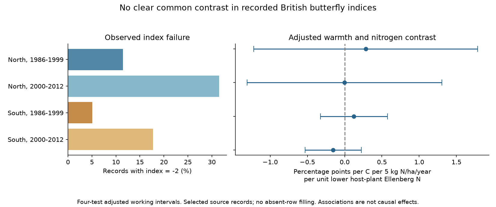

# Summer warmth gave no clear nitrogen contrast in butterfly index failure in four British samples in 1986-2012

We tested a possible source of observation bias in a public butterfly archive. We asked whether summer warmth had a different link to index failure for species with low-nitrogen host plants at sites with more nitrogen deposition. All four main intervals included zero. These results do not show that missing indices are random. They do not rule out bias in abundance estimates.

## Question and prior work

Weather can change butterfly activity and the time available for surveys. It can also change flight timing. Nitrogen can change plants and local growing conditions. These processes can change which site indices are usable, as well as butterfly abundance. We test the index-failure pathway as an observation process.

Dennis and colleagues (2013, doi:10.1111/2041-210X.12053) described index methods that account for missing counts and variable seasonal patterns. The UKBMS source documentation explains that visits take place in suitable weather and that index calculation depends on coverage of the species flight period. WallisDeVries and van Swaay (2006, doi:10.1111/j.1365-2486.2006.01202.x) proposed a nitrogen, vegetation and microclimate pathway. These sources motivate the question. They do not require the same direction of index failure for all species.

We searched campaign results for phenology, climate, pollution, OceanAdapt, butterfly nitrogen and butterfly inadequate. We read the signed rain and nitrogen study (SCI 2f75e1341ea3904dcc283b247f8e277f41153b22e66369a1dea01c4ac4cced7e). It tested abundance after removal of inadequate indices. We use its verified public site, weather and trait files, but rebuild the outcome from original UKBMS rows. Our new target is failure to calculate a site index. This is a different outcome and selection process, not a new biological dataset or independent validation of the abundance result.

## Data and outcome

Botham, M.S.; Middlebrook, I.; Harrower, C.A.; Milborrow, J.; Roy, D.B. (2025). United Kingdom Butterfly Monitoring Scheme: site indices 2024. NERC EDS Environmental Information Data Centre. doi:10.5285/53a1c705-4437-48bb-9bcd-b68977f8edd9.

The source defines -2 as a species recorded at a site in a year where monitoring within its flight period was not sufficient for an accurate index. The binary outcome is one for -2 and zero for a nonnegative source index. This is conditional on a source row. It is not failure to detect the species, a completely missing transect year, or the probability of any survey visit.

We use original rows in 1986-2012, standard transects in England, Scotland and Wales, and sites with public coordinates and matched weather, nitrogen and host traits. We remove the combined Essex/Small Skipper label. We apply three inherited species-name changes. We exclude all repeated site-species-year keys before joining. The excluded rows are saved. We do not add rows, fill absent records, or use the inherited zero-filled abundance panel. evidence.parquet preserves the exact joined records, outcomes and covariates.

The analysis has 333,501 records. South means England below 400 km OS northing. North means all remaining selected British sites, including Wales and Scotland. Early is 1986-1999; late is 2000-2012. The four samples are separate geographic and period checks. Regions have separate sites. Periods can share sites and species. All samples share a monitoring system and correlated weather. They are not independent experiments or independent-source replications.

Nitrogen is the CBED 5 km grid-average mean for 1995-1997, in kg N/ha/year. It is a static spatial marker, not the exposure in each year. The alternate marker is 1986-1988. Host N is the mean Ellenberg nitrogen score of primary larval host plants from the inherited published mapping. We define L = 4.35 minus host N and N = (deposition minus 15)/5. Temperature is the mean June-August temperature from the nearest 0.5 degree GHCN-CAMS grid centre, version 3.01. Spring is March-May. The audit rebuilt both seasons and both nitrogen markers without differences from the frozen inputs. It checked all 3,639 saved site coordinates and standard-transect labels against the released location table. Not all of those sites enter every model.

Raw data were reused in place on the shared SSD. No download was needed. Exact compatibility and resolved shared paths, versions, source URLs, sizes and SHA-256 hashes are in files/provenance.json and files/source_audit.json. The raw biological CSV member hash is also recorded because downloaded ZIP wrappers can change. files/weather_provenance.json and files/raw_sha256.txt preserve inherited source records. No failed disk or private worker workspace was read.

## Model and uncertainty

We fit a linear probability model separately in each sample. The primary coefficient is summer temperature times N times L. A positive coefficient means that the warmth slope for index failure becomes more positive for low-host-N species at sites with more deposition. We report percentage points per C, per 5 kg N/ha/year, per one unit lower host N. This is a contrast in a linear projection, not an absolute probability for a hypothetical species or site.

Fixed effects are site-year, site-species, and species-country-100km-square-year. The site-year effects remove shared local annual survey conditions. The species-region-year effects remove broad annual species patterns. The site-species effects remove persistent local species differences. Controls are summer temperature times L, spring temperature times L, spring temperature times N times L, and linear decade times N times L. Lower-order terms that do not vary across species in a site-year, or across years in a site-species pair, are absorbed. Rows with no residual variation can remain in the reported input counts. Those counts are not independent exposure replicates. The remaining contrast uses differences across species within site-years and across sites within regional species-years. It does not estimate the overall effect of warmer weather on survey coverage.

Standard errors use a two-way site and year cluster sandwich, with the site-year intersection subtracted. Each component uses G/(G-1). We do not use a further fixed-effect rank correction. The t reference has the smaller cluster count minus one degrees of freedom: 13 early and 12 late. Bonferroni correction covers four primary contrasts, with intended joint 95% coverage. These are approximate working intervals. Only 13 or 14 year clusters exist. Year clustering does not allow arbitrary serial dependence in shocks shared across sites. Site clustering allows serial dependence within each site. Source-index, trait and exposure uncertainty are not propagated.

The two-way covariance can have negative eigenvalues in short samples. This occurs for the early North main fit and some sensitivity fits. All reported scalar contrast variances are positive. We report the eigenvalue diagnostics and do not repair the matrices or use them for a joint multivariate test. This instability adds caution to the working intervals.

The local plan in files/PLAN.md was written before outcome fits. It was not externally registered. Projection uses pyhdfe 0.2.1 at tolerance 1e-9. Saved results include residual group means, matrix rank, condition numbers and normal-equation error. A synthetic test agrees with explicit dummy-variable least squares and a separate statsmodels cluster covariance calculation. This tests the numerical method, not the adequacy of the ecological model.

## Results

| Region | Period | Records | Sites | Failure rate | Contrast | Four-test interval |
|---|---|---:|---:|---:|---:|---:|
| North | 1986-1999 | 13,537 | 109 | 11.48% | +0.283 | -1.220 to +1.786 |
| North | 2000-2012 | 34,620 | 374 | 31.49% | -0.003 | -1.310 to +1.305 |
| South | 1986-1999 | 105,359 | 600 | 5.05% | +0.124 | -0.326 to +0.574 |
| South | 2000-2012 | 179,985 | 1,284 | 17.70% | -0.155 | -0.533 to +0.224 |

Contrasts and intervals use the percentage-point scale defined above. No main interval excludes zero. North has wider intervals. The raw failure rate is higher in the later period in each region. This is descriptive. Changed sites, species, source processing and survey practice can change that rate. It is not a climate trend estimate.

Four planned checks replace the nitrogen marker, restrict site-species pairs to at least five recorded years per period, replace the fine regional species-year effects with species-country-year effects, and add quadratic summer terms. In the square model, we report the derivative at the sample mean summer temperature. The persistent-record check uses period-wide information and changes the selected target. These checks do not recover unrecorded species or unvisited sites. All 16 sensitivity intervals also included zero. Complete results are in files/results.csv. The four-test correction applies within each variant, not across all analysis choices.

## Meaning and limits

The records do not show a clear repeated direction for this specific nitrogen and warmth contrast in index failure. Thus, the test does not identify that pathway as an explanation for the prior abundance contrasts. This is not an equivalence result or proof of an unbiased abundance analysis.

Conditioning on a source row is a major limit. Weather can change whether a species is recorded at all. Missing site-years and undetected species are outside this outcome. An index can also pass the source threshold and still have observation error. Site-year effects remove shared coverage differences, including part of the weather response we might otherwise study. The tested interaction is narrower than the full observation process.

Nitrogen can mark habitat, land use and management. A static nitrogen map cannot identify the response to changing air pollution. Host traits correlate with other species properties. Seasonal mean temperature misses daily extremes, flight-specific exposure, rainfall and local microclimate. We do not estimate a heatwave effect, flight-date change, species loss, extinction, distribution shift or causal climate-change effect. Weekly visits and flight curves would be needed to separate survey timing from biological timing. These results apply to the selected archive, regions and years under the stated model.

## Reproduce and rights

files/REPRODUCE.md gives offline and raw-source commands. All modeling inputs, source hashes, code, numerical checks, results and a static PNG are included. The archive needs no network to repeat the models. The raw-source audit needs the named shared files. Requirements and versions are saved. Historical upstream scripts are kept for provenance and are identified as such.

Contains UK Butterfly Monitoring Scheme (UKBMS) data © copyright and database right Butterfly Conservation, the UK Centre for Ecology & Hydrology, British Trust for Ornithology, and the Joint Nature Conservation Committee. CBED contains Crown copyright material under the Open Government Licence. NOAA weather data are US government data. Host-trait sources are retained in the inherited provenance and retrieval records. The baseline license covers our original work to the extent that rights permit; it does not replace upstream terms.

Campaign 11_07_2026. Job sci-1107-dell-climate-pollution-biodiversity-756345092af1. Topic climate-pollution-biodiversity. Machine dell. Account codex-andrii. Model gpt-6.1-sol, high reasoning effort, Codex harness in T3 Code. No agents were launched. The campaign-machine signing key is not a personal authorship claim. No private key is included. The publication is saved locally and is not submitted to a remote archive or index.
