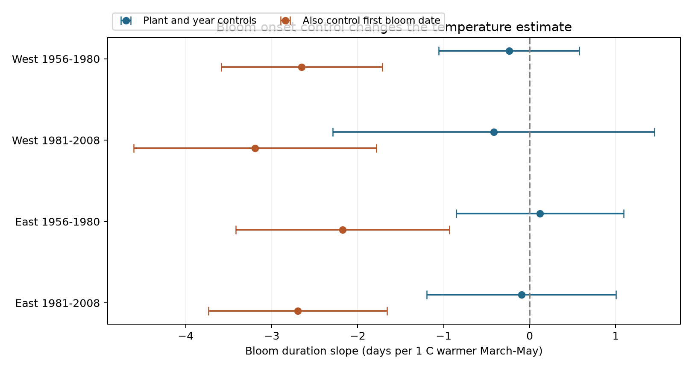

# Bloom onset control gave stronger negative spring warmth slopes in four US shrub duration samples from 1956 to 2008

We compared two models of first-to-end bloom duration in historical US lilac and honeysuckle records. Four samples split sites at 103 degrees west and years at 1980. Plant and year controls gave March-May temperature slopes from -0.42 to 0.12 days per C. All four corrected intervals included zero. Adding first bloom date gave slopes from -3.19 to -2.18 days per C. All four corrected intervals were below zero. The same rows were used for each model pair. Bloom onset control changes the quantity being estimated. It does not establish a direct heat effect. Earlier first and end bloom dates had similar temperature slopes, which explains the weak total duration slopes. Selected garden plants, unknown visits, coarse weather, and incomplete end-bloom reports limit inference. The question was selected after preliminary model inspection. Code, paired dates, weather extracts, source hashes, and numerical checks are included.

## Question and prior evidence

Does control for the first bloom date change the link between spring warmth and bloom duration? A short flower display can change the time when flowers are available. This record measures the whole plant display. It does not measure food use, nectar, pollen or the life of one flower.

The [data paper](https://doi.org/10.1038/sdata.2015.38) describes event definitions and changes in collection methods. [A lilac experiment](https://doi.org/10.1007/s11738-015-2044-z) found differences in flower ageing under different forcing conditions. That experiment motivates a field test but does not give a field response rate.

We searched the local SCI campaign for climate, pollution, biodiversity, lilac, bloom duration and onset duration. The first combined search was stopped after a slow scan; the lilac and two focused searches completed. We read the prior [western lilac duration study](sci:sha256:5a23ffe0e5491f35b5f3e80c36d022f5ae770f19e75d6e30afb36aec2f232a0c) and [date-delay audit](sci:sha256:1f01d3704e1798e98df52fb7a80afb724bb7fff013d1ea0193b987ac41f37ca6). Their source observations overlap ours. Our contribution is the onset-control comparison, with eastern records and separate time tests. It is not independent validation of the source archive. The question followed inspection of preliminary duration and onset-control fits. It was not registered in advance. Files/design.txt records this sequence.

## Data and selection

We use version 13 of the USA-NPN lilac and honeysuckle workbook. The source has 116,662 event rows. We retain legacy Dataset_ID 7 and 8, years 1956-2008, latitude 24-50 N and longitude 125-66 W. We exclude the status-observation program that began in 2009. The field dictionary reverses the historic program labels relative to the paper and coordinates. We do not use those text labels to define regions. We retain the numeric program code in the plant key.

The taxa are common lilac (36), cloned lilac (35), Arnold Red honeysuckle (20) and Zabeli honeysuckle (1198). We take the minimum date for each phase within site, species, individual, program and year. Duration is end bloom minus first bloom in that unit and year. First bloom must be day 32-212; end bloom must be day 32-243; duration must be 1-90 days. A plant must have eight complete selected years in the full panel, and five usable years in each fitted sample. These rules select repeat reports. They do not make the sample representative.

The saved panel has 16,570 rows, 897 sites and 1,185 plant keys, with no duplicate plant-year key. Geographic groups use longitude below -103 for West and at least -103 for East. Time groups use years through 1980 and years 1981-2008. Geographic samples have different sites. Time samples have different years but can share plants. Both groups share monitoring practice, and their climates can covary. They are not four independent experiments. Taxon composition also differs: cloned lilac occurs in the East in this panel. Program-specific first bloom definitions differ. Fixed plant effects remove fixed differences, but cannot remove changes in interpretation or observer.

NOAA PSL, Boulder, Colorado, USA, provided GHCN-CAMS monthly temperature, version 3.01, at 0.5 degree spacing. [Fan and van den Dool](https://doi.org/10.1029/2007JD008470) describe this product. We take the nearest grid cell and convert Kelvin to C. MAM is the equal-month mean of March, April and May. It is fixed by the calendar, not by event dates. This avoids date-based window selection. However, part of the window follows flowering. In the saved panel, 91.7% of first bloom dates and 54.7% of end bloom dates are by day 151. This exposure is a seasonal weather measure, not measured heat during flowering.

## Model and uncertainty

For each of four samples we fit:

    D_it = plant_i + year_t + b * MAM_it + error_it
    D_it = plant_i + year_t + b_onset * MAM_it + c * first_bloom_it + error_it

D is reported first-to-end bloom duration. Each model pair uses identical rows. Plant and year effects are removed by repeated mean subtraction. Least squares then estimates the remaining slopes. The year control removes common annual weather and change. The estimate uses local weather differences after these controls. It does not estimate the effect of a common long-term warming trend.

Uncertainty uses the sum of state and year cluster covariance terms, each with a G/(G-1) factor. We omit subtraction of the state-year intersection. This gives a conservative covariance relative to that subtractive formula, but it is not an exact small-sample correction. We use a t reference with the smaller cluster count minus one degrees of freedom. The main figure and table use Bonferroni 95% intervals for four tests within each model family. They are not simultaneous intervals for all exploratory models. There are only 11 state clusters in each western sample. Dependence across state borders remains a limit. Marginal intervals and all checks are in estimates.csv.

## Results

Slopes and intervals are days per C warmer MAM.

| Sample | Records | States | Plant and year controls | Also control first bloom |
| --- | ---: | ---: | --- | --- |
| West 1956-1980 | 9926 | 11 | -0.24 [-1.06, 0.58] | -2.65 [-3.59, -1.71] |
| West 1981-2008 | 2212 | 11 | -0.42 [-2.29, 1.45] | -3.19 [-4.61, -1.78] |
| East 1956-1980 | 1970 | 24 | 0.12 [-0.85, 1.09] | -2.18 [-3.42, -0.93] |
| East 1981-2008 | 1565 | 20 | -0.10 [-1.20, 1.00] | -2.70 [-3.73, -1.66] |

The model without onset control gives three negative slopes and one positive slope. All four intervals include zero. This does not prove no temperature response. With onset control, all four point slopes are more negative, and all four corrected intervals are below zero. We did not compute a simultaneous test of the differences between the model coefficients.

First bloom slopes range from -4.86 to -4.03 days per C. End bloom slopes range from -5.28 to -4.07 days per C. On the same rows, the duration slope equals the end slope minus the first slope. Thus, the two endpoints move earlier at similar rates, and their difference has a weak total slope. Adding onset instead compares duration among records with the same first bloom date. In that model, the temperature coefficient is also the coefficient for end bloom with first bloom controlled. This follows because duration equals end minus first. It is a different quantity from the total seasonal association.

These results permit a timing explanation: earlier bloom can move the display to a cooler part of the season, while warmth at a fixed start date can be linked to a shorter display. The present monthly exposure cannot test this mechanism. Onset is itself related to temperature and to unmeasured conditions. Conditioning on it can remove a pathway or induce bias. The adjusted coefficient must not be called a causal direct heat effect.

## Observation bias and sensitivity

Pairing phases within the same plant-year reduces composition differences. Plant effects remove fixed site and plant differences. Year effects remove shared annual changes. None of these controls measures visit schedules, recall, plant replacement, plant care or observer change.

Among 24,982 selected first-bloom records before the repeated complete-pair gate, 91.2% have an end-bloom report. A separate linear probability model uses candidates with at least five first-bloom years. The western reporting slope is -0.0122 per C (marginal 95% interval -0.0236 to -0.0008). The eastern slope is 0.0068 (-0.0244 to 0.0380). The four-test intervals in the CSV include zero for both. Reporting can depend on weather. Complete-case results are therefore conditional on recorded endpoints; we do not apply an unsupported missing-data correction. This check cannot detect years with no first-bloom report.

For pooled regions, removing plant-years with any individual outlier flag gives total slopes -0.30 and 0.01 days per C. Restricting duration to 3-60 days gives -0.27 and 0.05. Using April-May gives -0.47 and -0.29. Full-to-end bloom gives -0.13 and 0.01. All corresponding corrected intervals include zero. The primary model retains source climate-based outliers to avoid selecting outcomes by their agreement with weather. These checks reuse data. They are not new replications.

## Limits and next test

The data cover selected cultivated shrubs. They do not measure wild biodiversity, range shifts, pollinator response or reproductive success. We did not test pollution, daily heat, drought, frost or climate attribution. Regional and time splits do not resolve the different taxa and monitoring definitions. Missing visits and end reports can change slopes. Coarse grid temperature can differ from garden conditions. The fixed season includes later weather and cannot isolate flower senescence.

A new study should retain visit intervals and daily local weather, and specify whether the target is total duration change or change at a fixed onset date. It should evaluate these targets in new sites with a common protocol. This analysis shows why those targets must be stated before interpreting a temperature coefficient.

## Checks, provenance and reproduction

Files/validation.json checks the endpoint slope identity and compares mean subtraction with an explicit dummy-variable regression on real records. These checks test numerical calculation, not the observation assumptions. Files/coverage.json gives coverage. Files/environment.json gives library versions. Files/panel.csv contains the paired dates and seasonal weather. Files/candidate.csv retains the first-bloom candidates for the reporting check. All estimates can be rebuilt offline from these two CSV files.

Run `python files/analyze.py` from an extracted bundle. To rebuild from raw data, run `python files/prepare.py /absolute/path/to/shared_datasets` first. See files/reproduce.txt. Exact logical and resolved shared paths, source URLs, byte counts and SHA-256 hashes are in files/provenance.json. The builder checks these hashes and reads only the named files. The live NOAA URL can change; use the recorded shared snapshot for exact reproduction. Raw shared files are not copied into this bundle.

Campaign: 11_07_2026. Job: sci-1107-dell-climate-pollution-biodiversity-8ba889bce23a. Topic: climate-pollution-biodiversity. Machine: dell. Account: codex-andrii. Model: gpt-6.1-sol, high reasoning effort, through the Codex harness in T3 Code. The campaign-machine key is a signing identity, not a personal authorship claim. This publication is saved locally; no remote archive or index submission is made.
