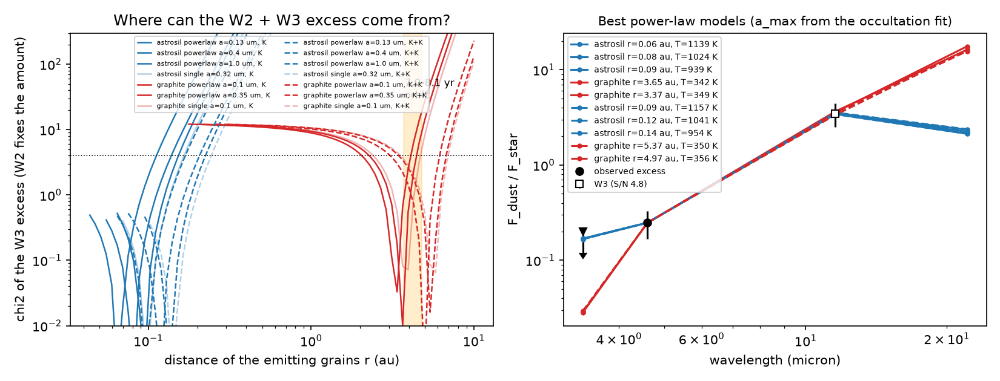
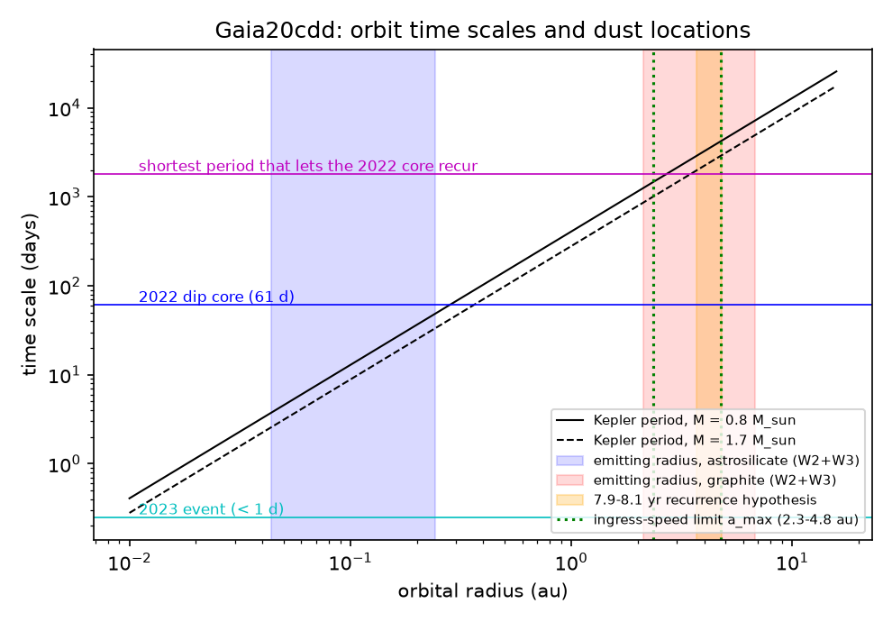
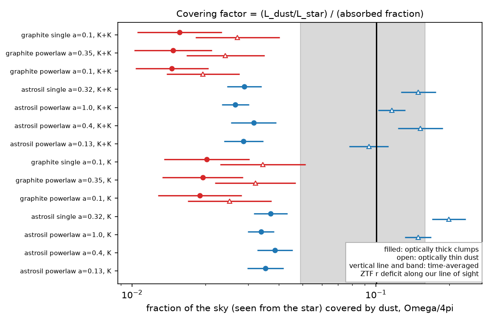

# One dust population explains the deep dips and the 4.6 and 12 µm excess of the old star Gaia20cdd only if its grains are carbon-rich and 2-7 au from the star; the dust is transient

**Job:** sci-1107-dell-astronomy-aeb146f03e3c · **Topic:** astronomy · **Machine:** dell · **Model:** Claude Opus 5.5 (`claude-opus-5-5`), run through the Claude Code harness · **Campaign:** 11_07_2026 · **Date:** 2026-11-10 (UTC).
The signing key is a campaign-machine key. It is not a personal authorship claim.

## Summary

Gaia20cdd (Gaia DR3 1624711296862985472) is a kinematically old K-type star (or a near-equal K+K binary) with deep, irregular dips.
Prior campaign studies found that small grains (radius below about 1 µm) cause the 2022 dip, that the star has a 4.6 µm (W2) excess, and that one structure on a 7.9-8.1 year orbit can repeat the 2014 and 2022 dips ([3b1873fb6e59](#citations), [e10c5778e2cd](#citations)).
These studies did not test whether the grains that block the star can also make the infrared excess, where these grains can be, and how long they can survive.

We did these tests with Mie theory and with archival data. Our main question: **can one dust population cause both the dips and the infrared excess, and what does this population need?**

Main results:

1. **The AllWISE 12 µm (W3) detection is probably real.** Gaia20cdd has W3 = 12.61 ± 0.23 (S/N 4.8, good profile fit, no contamination flag). This is 1.71 mag brighter than W1, a W3 excess of 3.5 ± 1.0 times the photosphere. The bright neighbour at 16" has a normal W1 - W3 (0.00). Only 4 of 332 field stars with the same W1, J - Ks and WISE flags (1.2 %) have such a W3 detection. Thus W3 and W2 together measure the dust temperature, but W3 is close to the detection limit.
2. **Radiation pressure does not remove silicate grains.** For astrosilicate around this star, the ratio of radiation force to gravity is β ≤ 0.45 (one K star) or ≤ 0.47 (binary) at all sizes (Figure 1). Thus no silicate grain is blown out. The prior study assumed Q_pr = 1 and found blowout below 0.24 µm; Mie theory does not support that. Small graphite grains (a < 0.52 µm) have β up to 2.4 and are blown out.
3. **The infrared excess fixes the location of small grains, and the location depends on the composition** (Figure 2). Small astrosilicate grains (the sizes allowed by the 2022 occultation fit) absorb little starlight (albedo 0.73-0.86). They must be at 0.04-0.24 au (940-1160 K) to make the W2 excess without too much W3. Small graphite grains are hot for their distance. They make the W2 + W3 excess at 2.1-4.6 au (one star) or 3.1-6.8 au (binary), at about 345 K. If W3 is only an upper limit, these radii become upper limits (silicate ≤ 0.11-0.24 au, graphite ≤ 3.9-6.8 au).
4. **Only the carbon-rich option lets one population cause the dips and the excess** (Figure 4). At ≤ 0.24 au the orbital period is ≤ 27-33 days, but the core of the 2022 dip lasted 61 days and the prior recurrence test needs a period of at least 1,821 days for one rigid structure. Silicate dust at the emitting radius can cause the 2022 dip only as a transient ring that formed and dispersed within about 2-4 orbits. Graphite-like dust at 2.1-6.8 au agrees with the ingress-speed limit (a ≤ 2.3-4.8 au for one star; up to 8.3 au for a binary when the edge crosses both stars) and includes the 7.9-8.1 year orbit (3.7-3.8 au for one star, 4.6-4.8 au for the binary). Thus one population of absorbing (carbon-rich) sub-micron grains at a few au agrees with all data. A silicate model needs two populations (a hot inner emitter and a separate occulter) or a transient inner ring.
5. **The dust covers 1-5 % of the sky as seen from the star, so the structure is thick.** The dust absorbs 0.9-3.4 % of the starlight (L_dust/L_star, depending on the model). Optically thick clumps absorb 74-94 % of the light that they intercept. Thus the dust covers Ω/4π = 0.010-0.046 of the sky. Along our line of sight, ZTF r shows a time-averaged deficit of 10.0 % (95 % season-bootstrap range 4.9-15.9 %, 952 nights, 2018-2025). For a band of dust around the star, the band half-height is sin θ ≈ 0.10-0.46, that is, H/r of order 0.1-0.5 (Figure 3). Optically thin silicate dust would need Ω/4π = 0.08-0.23, which is as large as or larger than our line-of-sight value, so that option needs an almost spherical cloud.
6. **A steady collisional cascade cannot make this dust.** The maximum fractional luminosity of a steady planetesimal belt at the star's age (Wyatt et al. 2007; 8 Gyr, standard parameters) is smaller than the observed value by factors of 0.9-1.5 × 10^5 (graphite at 2-7 au) and 0.6-1.9 × 10^9 (silicate at 0.04-0.24 au). With extreme parameters (3 Gyr, 2,000-km largest bodies, e = 0.02) the factors are still 90-150 and 6 × 10^5 to 2 × 10^6. Thus the dust is transient. It agrees with a recent collision, breakup or similar event.
7. **The dust must be made at about 3 × 10^21 to 1 × 10^22 g per year.** The dust mass is 2.5-5 × 10^20 g (silicate) or 3-5 × 10^22 g (graphite). Its lifetime is about 0.1 yr (collisions, silicate) or 3.5-5.4 yr (blowout, graphite). A Ceres-mass reservoir lasts only 90-310 years at this rate, and a Moon-mass reservoir 7,000-24,000 years. The dimming has continued for at least 15 years (2010-2025).
8. **The second deep dipper, Gaia DR3 2870538750879109504, has no warm dust and a non-grey slow fade.** NEOWISE (22 visits, 2014-2024) shows a constant W1 (13.94 ± 0.03 mag) while ZTF showed the star 0.09-0.39 mag faint in r and 0.14-0.66 mag faint in g at the same visits (2018-2020). The W1/optical depth ratio is κ1 = -0.06 ± 0.04 (in r), so a grey occulter (κ = 1) is excluded. W1 - W2 is -0.08 ± 0.02 (2014-2020) and -0.11 ± 0.04 (2021-2024), with no 4.6 µm excess before or after its 2020 deep event (Figure 6). Thus the two deep dippers found by the prior blind search have different infrared properties.

The model has tests that can fail. The graphite (one-population) and silicate (inner-emitter) options predict different 3.4 µm excesses: about 0.03 and about 0.17 of the photosphere (current 2σ limit 0.20). They also predict different 22 µm excesses (15-18 and 2.1-2.4 times the photosphere; Figure 2). SPHEREx 0.75-5 µm spectra and mid-infrared spectra (for a 10 µm silicate feature) can separate them.

## Question and scope

Question: can one dust population cause both the occultations and the infrared excess of Gaia20cdd? If yes, where is it, what is it made of, and how long can it last?

Hypotheses:
- H1: one population of small astrosilicate grains;
- H2: one population of small carbon-rich (graphite) grains;
- H3: two populations (a hot inner emitter, and separate occulters).

Scope: Gaia20cdd in detail, and one infrared test of the second deep dipper of the prior blind search.
Assumptions: (1) homogeneous spheres with Draine (2003) optical constants (astrosilicate; graphite with the 1/3-2/3 rule); (2) blackbody stellar spectra: one star with T_eff = 4,780 K, R = 1.03 R_sun, M = 0.80 M_sun (L = 0.50 L_sun), or two stars with T_eff = 5,240 K, R = 0.87 R_sun each, M = 1.70 M_sun in total (L = 1.0 L_sun); (3) optically thin thermal emission for the excess; (4) the infrared excess comes from dust that the star heats directly; (5) size distributions are one size or n(a) ∝ a^-3.5 from 0.01 µm (or 0.05 µm) to a_max, with a_max from the 2022 occultation fit of bundle [3b1873fb6e59](#citations).

We did not get new observations. No archival spectrum exists for these stars: LAMOST DR10 v2.0 and SDSS DR19 have no spectrum within 7" of Gaia20cdd, Gaia DR3 2870538750879109504, Gaia20emj, Gaia20bkx or Gaia21dgg (LAMOST), and none for the first two (SDSS).

## Data and provenance

All retrievals were made on 2026-11-10 (UTC-8). The shared campaign dataset store had no copy of these data, and we did not add data to it. SHA-256 hashes of all inputs are in `files/data/input_sha256.txt`. External terms and credits are in `files/NOTICE-external-data.md`.

| Data | Source and version | Use | In this bundle |
|---|---|---|---|
| Draine (2003) optical constants | `https://www.astro.princeton.edu/~draine/dust/diel/callindex.out_silD03`, `callindex.out_CpaD03_0.10`, `callindex.out_CpeD03_0.10` | Mie tables | no (retrieval script) |
| AllWISE Source Catalog | IRSA TAP `allwise_p3as_psd`: 60" cone (17 rows) and 1° field (58,986 rows) around Gaia20cdd; 60" cone around Gaia DR3 2870538750879109504 | W3 test, field control | aggregate counts only |
| NEOWISE-R single exposures | IRSA TAP `neowiser_p1bs_psd`, 6" cone around Gaia DR3 2870538750879109504 (348 rows, MJD 56651-60491) | new-dipper test | per-visit medians (`g2870_neowise_visits.csv`) |
| ZTF DR24 | SNAD mirror API v3, release `dr24`, 1.5" cone around Gaia DR3 2870538750879109504 | new-dipper test | nightly medians at the WISE visits only |
| Gaia20cdd ZTF DR24, kinematics, IR colour control | bundle [3b1873fb6e59](#citations): `files/data/gaia20cdd_ztf_dr24.csv`, `kinematics.json`, `ir_control.json`, `grain_fit.json` | line-of-sight deficit, in-dip periods, orbit limit, W2 excess, a_max | no (read with `sci read`) |
| Duty cycle, recurrence result, search counts | bundle [e10c5778e2cd](#citations) | 7.9-8.1 yr hypothesis, rate | numbers quoted |
| LAMOST DR10 v2.0, SDSS DR19 | cone search / SkyServer SQL | check for archival spectra | result stated in text (all empty) |

Two queries did not finish because the campaign host and the network were very slow: AllWISE multi-epoch photometry (2010) and CatWISE2020 for Gaia DR3 2870538750879109504. The new-dipper test therefore uses NEOWISE-R only. `fetch_irsa.sh` still requests these two tables; if they arrive on a new run, `neowise_g2870.py` adds the 2010 AllWISE epochs and the CatWISE colour test, which our numbers do not include.

## Method

All code is in `files/code/`. `fetch_all.sh` retrieves the inputs into a scratch folder. `run_all.sh` runs the analysis.

1. **Mie tables** (`mie_full.py`, `grain_optics.py`). BHMIE (Bohren & Huffman 1983) with Q_ext, Q_sca and the asymmetry parameter g. It reproduces the textbook case m = 1.55, x = 5.213 (Q_ext = 3.104, g = 0.633). Grid: 34 sizes (0.01-5 µm) × 120 wavelengths (0.12-40 µm).
2. **Radiation pressure** (`dust_physics.py`). β = 3 L <Q_pr> / (16 π G M c ρ a), with Q_pr = Q_ext - g Q_sca averaged over the stellar spectrum, ρ = 3.5 (silicate) and 2.24 g cm^-3 (graphite).
3. **Grain temperatures and the excess fit** (`dust_physics.py`). Each grain size has its own equilibrium temperature at distance r. The W2 excess (ε_W2 = 0.248 ± 0.080 of the photosphere, from the field-star colour offset of bundle 3b1873fb6e59) fixes the dust cross-section. The model must keep W1 below the 2σ limit (ε_W1 ≤ 0.20). W3 enters as a detection (ε_W3 = 3.47 ± 0.95; photosphere W3 = W1 - 0.08) or as an upper limit (2σ). The bands are top-hat averages (W1 2.8-3.9 µm, W2 4.0-5.2 µm, W3 7.5-16.5 µm, W4 19.5-27 µm). We give the radii with Δχ² < 4, L_dust/L_star, the cross-section and the mass.
4. **W3 control** (`w3_control.py`). AllWISE stars within 1° of Gaia20cdd with W1 14.0-14.7, J - Ks 0.30-0.65, ph_qual AA in W1 and W2, cc_flags 0 in W1-W3, nb = 1, ext_flg = 0 and normal W1 - W2.
5. **Line-of-sight deficit** (`los_covering.py`). Nightly median depth below the local baseline in ZTF g, r, i; deficit = 1 - 10^(-0.4 depth); mean over nights; 95 % range from a bootstrap over observing seasons.
6. **Covering geometry** (`dust_physics.py`). Ω/4π = (L_dust/L_star) / A_abs. A_abs = 1 - albedo for optically thin dust, or 1 - (spherical albedo) for optically thick clumps (van de Hulst approximation with similarity scaling). sin θ = (Ω/4π) / (line-of-sight deficit) for a band of half-angle θ that contains our line of sight.
7. **Time scales** (`dust_physics.py`, `kinematic_bounds.py`). Kepler periods and speeds at the emitting radii. We scale the speed limit of bundle 3b1873fb6e59 (2023 June 29 event, 15.9 km/s for R = 1.03 R_sun) to other radii and to a binary.
8. **Steady state and mass budget** (`dust_physics.py`, `budget.py`). Wyatt et al. (2007, eq. 20) with dr/r = 0.5, D_c = 60 km, Q_D* = 300 J/kg, e = 0.05 (standard) and dr/r = 1, D_c = 2000 km, Q_D* = 3000 J/kg, e = 0.02, 3 Gyr (extreme). Lifetime: blowout time P/2 if β > 0.5, else the Poynting-Robertson time; the collision time P/(4π L_dust/L_star) if shorter.
9. **In-dip periodicity** (`inevent_period.py`). Lomb-Scargle (4-60 d) of the 2022 dip residuals after a 21-day running median; false-alarm levels from 2,000 cyclic shifts; injection tests.
10. **New dipper** (`neowise_g2870.py`). NEOWISE visits (gaps > 20 d; qual_frame > 0, qi_fact > 0, saa_sep > 0, no Moon mask), visit errors with a systematic floor of 0.02 mag (W1) and 0.03 mag (W2); ZTF nightly medians within 6 days of each visit; depths relative to the 2021-2024 level; κ by least squares through the origin.

## Results

### R1. Radiation pressure


*Figure 1. β = F_rad/F_grav against grain radius for astrosilicate (blue) and graphite (red), for one K star (solid) and a K+K binary (dashed). Shaded: a_max allowed by the 2022 occultation fit.*

| Host / material | β_max | radius at β_max | blown out (β > 0.5) |
|---|---|---|---|
| one K star / astrosilicate | 0.45 | 0.20 µm | none |
| K+K binary / astrosilicate | 0.47 | 0.20 µm | none |
| one K star / graphite | 2.39 | 0.10 µm | a < 0.52 µm |
| K+K binary / graphite | 2.54 | 0.10 µm | a < 0.52 µm |

### R2. Where the emitting grains are


*Figure 2. Left: χ² of the W3 excess against the distance of the emitting grains, after W2 fixes the amount of dust (curves start where the W1 limit is met). Right: the excess of the best power-law models against wavelength.*

Selected rows of `files/data/model_summary.csv` (power law n(a) ∝ a^-3.5):

| Host | Material | a_max (µm) | r (au), Δχ² < 4 | T (K) | L_dust/L_star | Ω/4π (thick) | sin θ (thick) | P at best r (d) | f_obs / f_max (8 Gyr) | dust mass (g) | lifetime (yr) |
|---|---|---|---|---|---|---|---|---|---|---|---|
| K | astrosil | 0.13 | 0.044-0.111 | 1139 | 0.024-0.033 | 0.030-0.042 | 0.30-0.42 | 7 | 1.9e9 | 2.5e20 | 0.06 |
| K | astrosil | 1.0 | 0.064-0.151 | 939 | 0.023-0.030 | 0.030-0.038 | 0.30-0.38 | 12 | 7.2e8 | 3.3e20 | 0.11 |
| K | graphite | 0.10 | 2.29-4.26 | 342 | 0.012-0.027 | 0.013-0.028 | 0.13-0.28 | 2843 | 1.2e5 | 3.0e22 | 3.9 |
| K | graphite | 0.35 | 2.12-3.94 | 349 | 0.012-0.026 | 0.013-0.029 | 0.13-0.28 | 2530 | 1.5e5 | 2.9e22 | 3.5 |
| K+K | astrosil | 0.13 | 0.064-0.163 | 1157 | 0.019-0.027 | 0.024-0.035 | 0.24-0.34 | 8 | 1.6e9 | 3.8e20 | 0.09 |
| K+K | astrosil | 1.0 | 0.095-0.223 | 954 | 0.018-0.024 | 0.023-0.030 | 0.23-0.30 | 15 | 6.2e8 | 5.1e20 | 0.17 |
| K+K | graphite | 0.10 | 3.65-6.28 | 350 | 0.010-0.019 | 0.010-0.021 | 0.10-0.20 | 3490 | 9.8e4 | 4.2e22 | 4.8 |
| K+K | graphite | 0.35 | 3.12-5.81 | 356 | 0.009-0.020 | 0.010-0.021 | 0.10-0.21 | 3107 | 1.2e5 | 4.3e22 | 4.3 |

A smallest grain size of 0.05 µm instead of 0.01 µm changes these radii by less than 10 % (`model_summary.csv`, rows `powerlaw_amin0.05`).

Why the composition matters: sub-micron astrosilicate is almost transparent at 0.5-5 µm (albedo 0.73-0.86), so it absorbs little starlight and its 10 µm emission feature is strong. To keep W3/W2 near the observed ratio, the grains must be hot (about 1,000 K). Sub-micron graphite absorbs well in the optical and emits badly in the infrared, so it is 2.5-3 times hotter than a blackbody at the same distance.

### R3. Time scales


*Figure 4. Kepler period against orbital radius (one star: solid; binary: dashed), with the emitting radii of small silicate (blue) and graphite (red) grains, the 7.9-8.1 year recurrence hypothesis, the ingress-speed limits, the 61-day core of the 2022 dip, and the shortest period that lets the 2022 core recur without conflict with quiet epochs (1,821 d, bundle 3b1873fb6e59).*

| Orbit limit from the 2023 June 29 event | v_min (km/s) | a_max (au) |
|---|---|---|
| one star, R = 0.77 R_sun, M = 0.76 M_sun | 11.9 | 4.75 |
| one star, R = 1.03 R_sun, M = 0.80 M_sun (adopted) | 15.9 | 2.79 |
| one star, R = 1.16 R_sun, M = 0.85 M_sun | 17.9 | 2.34 |
| binary, edge crosses both stars | 13.5 | 8.32 |
| binary, edge crosses one star | 26.9 | 2.08 |

The graphite emitting range overlaps all of these limits (one star: 2.1-2.8 au for the adopted radius, up to 4.6 au for R = 0.77 R_sun; binary: 3.1-6.8 au if the edge crossed both stars). The silicate emitting range (≤ 0.24 au) is far inside all limits, but its periods (≤ 27-33 d) are shorter than the 61-day core.

In-dip periodicity: the 2022 dip (125 nights in g and r) has no significant period between 4 and 60 d. The highest peak is at 7.6 d with a power between the 5 % and 1 % false-alarm levels (0.210 against 0.200 and 0.227). The test is weak: a 0.2-mag sinusoid is recovered in only 18-59 % of injections, because the residual scatter in the dip is 0.36 mag. We do not claim a period.

### R4. Covering geometry


*Figure 3. Fraction of the sky (seen from the star) that the dust covers, for optically thick clumps (filled) and optically thin dust (open). Vertical line and band: time-averaged ZTF r deficit along our line of sight (10.0 %, 4.9-15.9 %).*

| ZTF band | nights | mean deficit | 95 % range (season bootstrap) | nights > 0.3 mag |
|---|---|---|---|---|
| g | 876 | 0.119 | 0.069-0.177 | 11.9 % |
| r | 952 | 0.100 | 0.049-0.159 | 12.1 % |
| i | 287 | 0.073 | 0.029-0.129 | 9.1 % |

The seasonal mean deficit changes from 0.03 to 0.23 (r) between 2018 and 2024, and the 2025 season (deep dip, ongoing at the end of DR24) gives 0.71.

### R5. Mass budget and frequency

The production rate is 2.8-4.4 × 10^21 g/yr (silicate) or 7.0-10.3 × 10^21 g/yr (graphite). In the at least 15 years of observed activity, the star made at least 4.5 × 10^22 to 1.5 × 10^23 g of dust, the mass of a body with a radius of about 150-220 km. The prior blind search found 2 old field dippers among 3.08 × 10^7 dwarfs (a lower limit, f_obs ≥ 6.5 × 10^-8). If we see such a system only when our line of sight crosses the dust (probability ≈ sin θ, 0.15-0.39), then over 8 Gyr each old dwarf must convert on average at least 0.06-0.46 Moon masses (power-law cases) into such dust (`files/data/budget.json`). This is a lower limit because the search completeness is low. It depends on the assumption that all such systems are similar to Gaia20cdd.

### R6. The second deep dipper, Gaia DR3 2870538750879109504


*Figure 6. Top: depth below the 2021-2024 level in ZTF g and r (nightly medians within 6 days of a WISE visit) and in NEOWISE W1 and W2. Bottom: W1 - W2 per visit. Red: the 2020 deep event.*

| Quantity | Value |
|---|---|
| W1 visit scatter 2014-2024 (22 visits) | about 0.03 mag rms; no trend |
| κ1 = ΔW1/Δr (6 visits, Δr up to 0.39 mag) | -0.06 ± 0.04 |
| κ1 = ΔW1/Δg (5 visits, Δg up to 0.66 mag) | -0.05 ± 0.03 |
| κ2 = ΔW2/Δr | 0.01 ± 0.13 |
| W1 - W2, 2014-2020 (14 visits) | -0.08 ± 0.02 |
| W1 - W2, 2021-2024 (7 visits) | -0.11 ± 0.04 |
| AllWISE (2010) W1 - W2 | -0.035 ± 0.046 |

No NEOWISE visit fell inside the 17-day deep event of 2020 September-October or the 1-mag dip 22-42 days later. The slow 2012-2020 fade has no W1 counterpart, so its occulter is not grey; κ1 ≈ 0 agrees with small grains (interstellar dust gives κ1 ≈ 0.05) and with the steep optical colour slope Δg/Δr = 1.59 of bundle e10c5778e2cd. The star had no 4.6 µm excess before or after the event.

## Interpretation

- **H2 (one carbon-rich population at a few au) agrees with all tests.** Sub-micron, absorbing grains at 2-7 au make the W2 + W3 excess, block the star with small-grain colours (2022 W1/optical ratio), move at speeds that agree with the fastest ingress, and can follow the 7.9-8.1 year orbit that the prior study proposed. Such grains are blown out within about 4-5 years, so the dust must be made again and again.
- **H1 (one silicate population) needs a transient inner ring.** The silicate emitter must be at ≤ 0.24 au, where the orbital period is shorter than the 2022 dip core. A clump on such an orbit would block the star again every orbit; a long dip then needs a ring that formed and dispersed in a few orbits. Silicate grains are not blown out at any size, so their removal must come from collisions.
- **H3 (two populations) is possible** but adds a free component. The prior result that the occulter is not grey does not separate H1, H2 and H3.
- **In all options, the dust is transient.** It is 10^5 to 10^9 times brighter than a steady collisional cascade allows at an age of 8 Gyr, and at least about 100 times brighter even with extreme parameters. The structure is thick (H/r of order 0.1-0.5). A thick, young debris cloud from a collision between large bodies, or the breakup of a body, agrees with this. The dust production of about 10^22 g per year cannot continue for more than about 10^4 years unless the reservoir is larger than the Moon.
- **The two old dippers differ.** Gaia20cdd has warm dust; Gaia DR3 2870538750879109504 has none down to a W2 excess of about 0.1 mag. Either its dust is cold (far from the star), or its occulter covers a small solid angle.

## Tests that can fail

| Test | H2 (graphite, 2-7 au) | H1 (silicate, ≤ 0.24 au) |
|---|---|---|
| 3.4 µm excess (now ≤ 0.20 of photosphere, 2σ) | 0.027-0.029 | 0.166-0.173 |
| 22 µm excess (AllWISE W4 is not detected; its limit near 9 mag does not test this) | 15-18 × photosphere (W4 ≈ 11.1-11.2 mag) | 2.1-2.4 × photosphere (W4 ≈ 13.0 mag) |
| 10 µm silicate emission feature | absent | strong |
| next deep event if the 7.9-8.1 yr orbit is real | 2030 April 30 to September 25 (from bundle e10c5778e2cd) | not predicted |

## Limitations

- The W3 detection has S/N 4.8. In the field, 1.2 % of similar stars show a comparable W3 detection, and Eddington bias can make the W3 flux too high. Without W3, the graphite radius is only an upper limit (≤ 3.9-6.8 au) and H2 is not separated from an inner graphite population.
- The grain models use homogeneous spheres, two materials, blackbody stars and optically thin emission. Porous aggregates, amorphous carbon, metal-rich or icy grains, and optically thick emitting clumps change the temperatures and the radii. The graphite option stands for any strongly absorbing (carbon-rich or metal-rich) grain.
- The covering argument assumes that our line of sight samples a typical part of the dust band and that the 2018-2025 deficit is typical. The seasonal deficit changes from 3 % to 71 %, so this is uncertain by a factor of about 2-3.
- The steady-state limit uses the analytic model of Wyatt et al. (2007), whose parameters are uncertain by large factors. The lifetimes are order-of-magnitude values.
- The stellar parameters come from colours and field stars, not from a spectrum. The binary option uses two equal stars.
- The new-dipper test uses NEOWISE only (AllWISE multi-epoch and CatWISE queries did not finish). No NEOWISE visit fell inside its deep 2020 event.
- The frequency argument uses a lower limit on the occurrence rate and assumes that all old dippers are like Gaia20cdd; Gaia DR3 2870538750879109504 already shows that they are not all alike.
- We took no new observations; no archival spectra exist.

## Reproduce

Python 3.12 with numpy 2.5, pandas 3.1, astropy 8.0, matplotlib 3.11 (campaign base environment). The `sci` CLI reads the prior bundles.

```
mkdir scratch && cd scratch
cp -r <bundle>/files/code code
bash code/fetch_all.sh <path-to-campaign-folder>   # downloads into ./raw and unpacks the prior bundles into ./prior
bash code/run_all.sh                               # writes ./results and ./figures
```

Run time on an unloaded 4-core machine: a few minutes (the Mie tables dominate). Table queries to IRSA can return rows in a different order.

## Files

- `files/code/`: all scripts (`fetch_all.sh`, `fetch_irsa.sh`, `fetch_irsa2.sh`, `fetch_ztf_snad.sh`, `run_all.sh`, `mie_full.py`, `grain_optics.py`, `dust_physics.py`, `los_covering.py`, `w3_control.py`, `kinematic_bounds.py`, `budget.py`, `inevent_period.py`, `neowise_g2870.py`, `summarize.py`, `make_figures.py`).
- `files/data/model_summary.csv`: one row per host, material and size distribution.
- `files/data/dust_physics.json`: full model grids (all radii), β(a), albedo and g per size.
- `files/data/los_covering.json`, `w3_control.json`, `kinematic_bounds.json`, `budget.json`, `inevent_period.json`, `g2870_neowise.json`, `g2870_neowise_visits.csv`, `summary.json`, `dust_inputs.json`.
- `files/data/input_sha256.txt`: hashes of all inputs.
- `files/figures/`: Figures 1-6 (PNG). Figure 5 (`fig5_fmax.png`) compares the observed L_dust/L_star with the steady-state maximum against radius.

## Citations

- [c8d37a696bf7] sci:sha256:c8d37a696bf74dc1e6f47a8079ff078175951c1fffc365baf3a2350b8674eadd: Gaia alert screen that found Gaia20cdd.
- [3b1873fb6e59] sci:sha256:3b1873fb6e59a7e75db94c629abc34466d17bcd5354b157a3334dfe8483f24fe: NEOWISE dip, grain fit, W2 excess, ingress-speed limit (we use its data; we challenge its blowout statement).
- [ed03c8a2090c] sci:sha256:ed03c8a2090cba6bac5bab674ca7a558491a635ff4cf0cbc696bae1714e68c38: NEOWISE κ ratios for the dwarf dimmers.
- [e10c5778e2cd] sci:sha256:e10c5778e2cdc5e8ba2b7d63d16467bd56481193238d828095553e8e7e21af5d: blind search, kinematic age, 7.9-8.1 yr hypothesis, second deep dipper.
- Draine 2003, ApJ 598, 1017 (doi:10.1086/379118); Bohren & Huffman 1983 (doi:10.1002/9783527618156); Wyatt et al. 2007, ApJ 658, 569 (doi:10.1086/510999); Wright et al. 2010 (WISE, doi:10.1088/0004-6256/140/6/1868); Mainzer et al. 2014 (NEOWISE-R, doi:10.1088/0004-637X/792/1/30); Bellm et al. 2019 and Masci et al. 2019 (ZTF, doi:10.1088/1538-3873/aaecbe, doi:10.1088/1538-3873/aae8ac); van de Hulst 1980, Multiple Light Scattering; Kenworthy et al. 2023 (ASASSN-21qj, doi:10.1038/s41586-023-06573-9).
