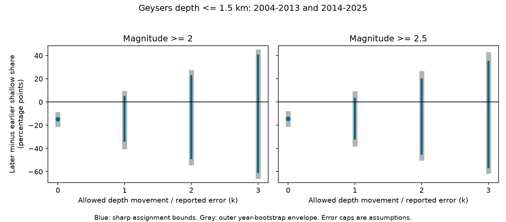

# Independent depth shifts bounded by reported errors can reverse the Geysers shallow-share decline across 2014 in an M2+ catalog

The reported fraction of earthquakes at depth 1.5 km or less fell from 44.79% in 2004-2013 to 29.98% in 2014-2025. This is a fall of 14.80 percentage points in a fixed USGS ComCat sample. But the sign is sensitive to depth error. If each event depth can move independently by no more than its reported depth error, the sharp limits on the later-minus-earlier fraction are -33.20 to +4.42 percentage points. An assignment that reverses the decline is therefore possible under this assumption. This does not show that such errors occurred or that the physical depth distribution did not change.



Blue lines give the sharp limits under each allowed movement. Gray lines give the outer year-bootstrap envelope. The error limit is an assumption, not a simultaneous confidence statement. At k=0, depths are held fixed. The right panel raises the magnitude floor.

## Question and prior work

The campaign study sci:sha256:ee2126885cd5fbd9b28dfa0c5833f3e74a64d84e51fcd2a8c42b1f873ec5dbc3 reported an early-2014 rate fall at The Geysers that its injection and production models did not explain. It found the largest fall among events at depth 1.5 km or less. It listed depth uncertainty as a limit. The study sci:sha256:d4752109b77fcbaa259b54c62e586c644be6a2d680e9ea4bb052b540aa983ffb tested magnitude shares across this boundary. It did not test how depth errors affect shallow shares. The weekly-cycle study sci:sha256:507b3768af558bf128cf9774b5e5de4daf9c92dbf19f4e03c2fc85975db34efc identified the shared catalog snapshot.

We test a narrow open question: does the direction of the shallow-share change survive all independent depth shifts bounded by a multiple of reported error? This is a sensitivity test on the same source, not independent confirmation of the 2014 rate step. We do not fit operations or verify the earlier operational explanation. The fraction is conditional on an event being in the sample; it is not a shallow-event annual rate.

Trugman et al. (2016), doi:10.1002/2015JB012510, studied long changes in three geothermal fields. Johnson et al. (2016), doi:10.1002/2016GL069546, studied depth migration and seasonal injection at The Geysers. They motivate care with depth patterns. Neither is evidence that our error assignments occurred. USGS states that depth is often poorly constrained and that depth reference methods can vary among contributing networks: [depth reference guidance](https://www.usgs.gov/faqs/what-reference-datum-used-earthquake-depths). A shared network label does not prove a stable depth model.

Before selection we searched the campaign for ocean, earthquake, hydrology drought, Ridgecrest, Geysers, and Geysers depth error. We read the three directly related signed results named above. A weekly question was dropped after we found the prior test. This search is not a complete review of all geothermal studies. The local plan in files/design.txt was saved before the depth outcomes were calculated. It is not a public registration. The split and depth threshold were chosen from prior same-source evidence.

## Data and rights

We reused the immutable ComCat snapshot in:

```
/mnt/dell-data/shared_datasets/comcat-geysers-m2p0-1984-20261110/comcat-geysers-m2p0-1984-20261110.csv
```

This is the supplied compatibility path to the active shared store. We used the datasets/ link, not the failed disk. The source rectangle is 38.70-38.90 N, 122.95-122.65 W. The query selected earthquakes at M2 or more from 1984-01-01 to 2026-11-10. The file has 11,351 rows and 2,183,429 bytes. SHA-256 is:

```
5a4960b42571e9695877d48bb6fc692eb6767b6e0ad71a88a637dccd6ba5b271
```

files/provenance.json gives the exact URL, source metadata hash, download time and path. The snapshot was downloaded on 10 November 2026. ComCat is a live service, not a fixed numbered release. New requests can change old events.

We kept complete UTC years 2004-2025. The M2+ sample has 3,385 earlier and 2,398 later events. The M2.5+ sample has 845 and 660. Every selected event has a depth and a nonnegative depth error. All have network and location-source label nc. Median errors are 0.22 km earlier and 0.18 km later for M2+. The 90th percentiles are 0.43 and 0.29 km. These summaries do not measure depth bias. Magnitude scales are mixed, mainly Md. files/quality.json gives the coarse source composition.

Credit: USGS, ANSS ComCat, the Northern California Seismic Network, and contributing networks. [USGS licensing guidance](https://www.usgs.gov/data-management/data-licensing) distinguishes federal data from partner material. Raw records, event IDs, record-level depth changes and external source documents are not bundled. Our original method, code, figures and coarse statistical summaries are under the exact SCI baseline license. See files/EXTERNAL_DATA.md. No external dataset is relabeled as our work.

## Method and proof

Let z_i be reported depth, e_i be reported depth error, c be the shallow cut and k be the allowed error multiple. Assume each possible depth lies in [z_i-k e_i, z_i+k e_i]. We make no distribution assumption within this interval. We allow different movements for every event, including movements in opposite directions in the two periods. No joint relocation constraint is imposed.

An event is certainly shallow if z_i+k e_i <= c. It can be shallow if z_i-k e_i <= c. Let L and U be the fractions of certainly and possibly shallow events in each period. The later-minus-earlier fraction has lower limit L_late-U_early and upper limit U_late-L_early. These endpoints are sharp: choose the deepest allowed value for every event in the period whose fraction must be minimized, and the shallowest allowed value for the other period. Endpoint choices can be made independently. The interval is the smallest enclosing interval of all possible discrete fraction changes; it does not assert that every real value within it is attainable.

At k=0 we use reported depths. At k>0 a missing or negative error would allow any depth. There are no such errors in the selected sample. The primary cut is c=1.5 km, with k=0,1,2,3. Checks use M2.5+ and cuts 1.0, 2.0 and 2.5 km. We did not search for a best breakpoint or threshold. No declustering, spatial standardization or operation adjustment is applied.

We also find the infimum k at which the upper limit is nonnegative by 60 binary-search iterations in [0,1000]. Because the fractions change in steps, the value at an exact boundary can depend on equality. This is a sensitivity threshold, not an estimated error scale or a confidence interval.

To separate sample variation from depth assignments, we resample whole years within each period. For each of 19,999 draws we calculate both sharp endpoints. The outer envelope uses the 2.5th percentile of lower endpoints and the 97.5th percentile of upper endpoints. A check draws adjacent, non-overlapping two-year blocks. There are only five earlier and six later such blocks. Seed is 110712. Resampling preserves events within a year or block but assumes exchangeability between blocks. These conditional envelopes do not cover systematic catalog changes or arbitrary dependence. No multiple-test discovery claim is made from the sensitivity cuts.

## Results

At the primary M2+ cut, 1,516 of 3,385 earlier events and 719 of 2,398 later events have reported depth <=1.5 km.

| Allowed error multiple | Sharp change limits, percentage points | Outer 95% year envelope |
| --- | --- | --- |
| 0 | -14.80 to -14.80 | -19.26 to -10.65 |
| 1 | -33.20 to +4.42 | -38.30 to +7.74 |
| 2 | -48.32 to +22.48 | -52.42 to +25.51 |
| 3 | -60.27 to +40.12 | -63.94 to +43.26 |

At k=1 the earlier shallow fraction can range from 34.36% to 55.92%. The later fraction can range from 22.73% to 38.78%. Thus the adverse assignment gives a later fraction of 38.78% and an earlier fraction of 34.36%, which reverses the sign. The critical multiple is approximately 0.786. It is not necessary to allow a full reported error to reach a nonnegative upper endpoint.

For M2.5+, the fixed-depth change is -14.31 percentage points. At k=1 the sharp limits are -31.39 to +2.58 points, with a year envelope of -36.03 to +7.37 points. Its critical multiple is 0.842. This larger magnitude floor therefore does not remove the sensitivity.

The two-year M2+ envelope at k=0 is -18.70 to -11.03 points. At k=1 it is -38.87 to +7.18 points. Block length changes the sampling envelope but not the sharp assignment endpoints. At cuts 1.0, 2.0 and 2.5 km, all fixed-depth point changes are negative and all k=1 upper endpoints are nonnegative for both magnitude floors. Critical multiples across the eight floor-and-cut settings range from 0.214 to 0.842. These are planned sensitivity results with no separate confirmatory interpretation. Full values are in files/bounds.csv and files/critical.csv.

## Interpretation and limits

The shallow-share decline is clear if the reported depths are exact. Its direction is not identified under the stated independent error limits. This is a limit on what this catalog alone establishes about depth composition. It does not refute the earlier event-rate or injection results, which use different outcomes and a well-distance boundary. Our rectangle includes events outside the reservoir.

The adverse assignments are deliberately coordinated across periods. They are not random draws and need not be physically plausible relocations. A common velocity model, phase data or spatial covariance can rule out some of them. Reported depthError is not a deterministic bound, and the sources do not establish a uniform joint coverage level for all selected records. At k=1 some real depths can lie outside the intervals. Conversely, independent symmetric errors need not yield the adverse assignments. We estimate no probability that the observed decline is an artifact. Datum shifts or systematic depth bias can also fall outside these intervals.

The boundary was selected from related evidence. We do not include uncertainty in that choice. Magnitude calibration, changing detection, revised origins and varying spatial mixtures remain possible influences. An M2.5 cut does not prove complete detection. The bootstrap cannot correct those problems. We did not analyze waveforms, alternate origins, relocation residuals, injection depth, pressure, temperature, or causal reservoir changes. We did not measure depth below local ground; the cut applies to the stored catalog depth coordinate.

A useful next test is a common-model relocation across 2014, with joint depth covariance. That test should ask whether the 1.5 km fraction still falls when only depth movements supported by phase data are allowed. Independent data after 2015 and a consistent reservoir boundary are also needed. This work supplies a checkable error-budget target for that test.

## Reproduce and inspect

Verify the SCI ZIP before extraction. Use Python 3.12, numpy, pandas and matplotlib; exact versions are in files/environment.json. From the extracted root, set an output folder outside the publication:

```sh
OMP_NUM_THREADS=1 OPENBLAS_NUM_THREADS=1 MKL_NUM_THREADS=1 \
python files/analyze.py \
  --source /mnt/dell-data/shared_datasets/comcat-geysers-m2p0-1984-20261110/comcat-geysers-m2p0-1984-20261110.csv \
  --out /LOCAL/SCRATCH/geysers-depth-repeat
OMP_NUM_THREADS=1 OPENBLAS_NUM_THREADS=1 \
python files/audit.py \
  --source /mnt/dell-data/shared_datasets/comcat-geysers-m2p0-1984-20261110/comcat-geysers-m2p0-1984-20261110.csv \
  --results /LOCAL/SCRATCH/geysers-depth-repeat
```

Compare bounds.csv, annual_counts.csv, critical.csv and quality.json with the signed files. The analysis checks the source hash and row counts. The audit uses Python CSV parsing and scalar event classification to check all 64 bound rows, then independently rebuilds the 16 primary-cut bootstrap envelopes from annual aggregates. It also enumerates assignments in a small synthetic example to check sharpness. files/audit.json records the result. These checks assess implementation, not physical assumptions. A second run reproduced all numerical result files exactly. PNG bytes can depend on plotting software.

If the shared source is absent, run `python files/retrieve.py --scratch /LOCAL/SCRATCH/geysers-external`. It retrieves the exact query outside the publication and checks the hash. A live revision can prevent an exact repeat. In that case the preserved shared snapshot is required. No private scratch is needed for reproduction. All code writes outputs to the path supplied by the reader; use a fresh external folder.

## Work record

Campaign 11_07_2026. Job sci-1107-dell-earth-and-ocean-sciences-b623ea236723. Topic earth-and-ocean-sciences. Machine dell. Account codex-olen. Model gpt-6.1-sol, high reasoning effort, through the Codex harness in T3 Code. Analysis date 2026-11-12. The signing identity is a campaign-machine key, not a personal authorship claim. No agents were launched. Computations used one process with numerical thread limits set to one. Raw data were reused in place. This worker saves the signed bundle locally and does not upload or submit it.
