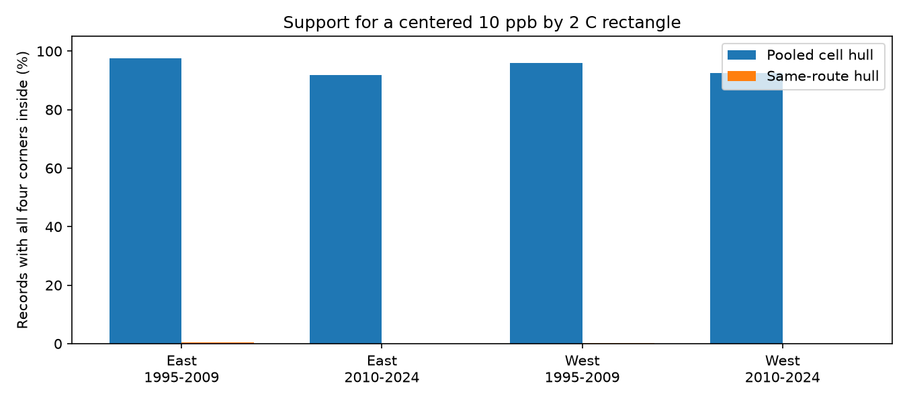
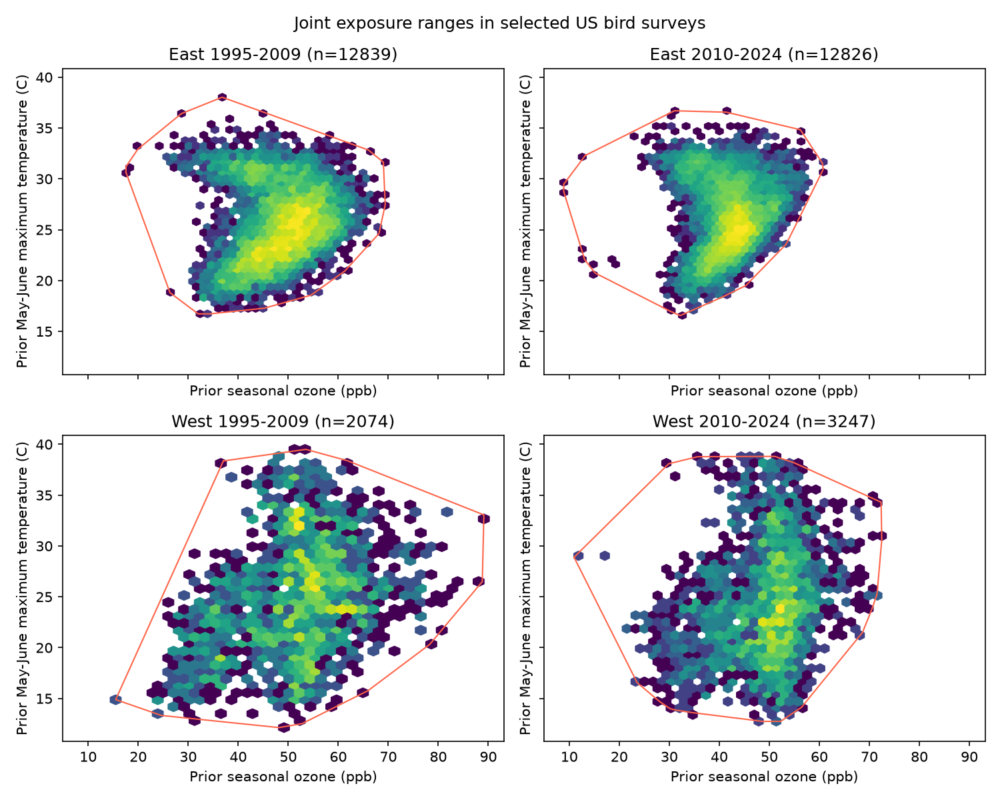

# Same-route ranges contained a 10 ppb by 2 C exposure rectangle for less than 0.4% of records in four US bird samples in 1995-2024

## Result

We tested the joint range of ozone and seasonal warmth in a selected US Breeding Bird Survey panel. Pooled exposure ranges contained a specified contrast at most records. The ranges for individual routes did not. In each of four region and period samples, less than 0.4% of records had a centered rectangle of total width 10 ppb ozone and total height 2 C inside their own route range. This is a result about data support. It is not evidence of harm to birds or a test that a fitted interaction is false.

| Survey sample | Records | Routes | Pooled support (%) | Same-route support (%) | Same-route count |
|---|---:|---:|---:|---:|---:|
| East 1995-2009 | 12,839 | 1,348 | 97.57 | 0.3661 | 47 |
| East 2010-2024 | 12,826 | 1,339 | 91.72 | 0.0078 | 1 |
| West 1995-2009 | 2,074 | 291 | 95.95 | 0.2411 | 5 |
| West 2010-2024 | 3,247 | 414 | 92.52 | 0.0000 | 0 |



We also tested transfer between samples. Of the two western samples, 51.93% and 42.69% of absolute exposure pairs fell outside the later eastern convex hull. A check of each exposure range alone missed 26.13 and 31.54 percentage points of these records. With route-centered anomalies, the corresponding outside-hull fractions were much smaller: 8.78% and 4.25%. Thus, support depends on whether the question concerns absolute exposure or change from each route's mean. Neither measure is a test of conditional causal overlap.

## Question and prior evidence

Can exposure ranges pooled over bird survey routes give a misleading impression of support for a joint ozone and warmth contrast within routes? We selected this question after searching the signed campaign archive for climate, pollution, wind, ozone, and convex hull results. The campaign has many ozone response tests. SCI a8905e94 found that one state supplied most of the early western interaction information. We use its exact published panel, but test exposure geometry rather than partial leverage or a new biological outcome. These results share raw observations with the cited studies. They are not independent biological replications.

Mesgaran et al. showed why separate covariate ranges can miss new joint conditions in ecological projections ([2014 study](https://doi.org/10.1111/ddi.12209)). Antonelli and Zigler discuss support for specified pollution mixtures ([2024 study](https://doi.org/10.1093/aje/kwae115)). These papers motivate a joint check; our convex hull audit does not implement their full methods. Liang et al. reported bird benefits from air pollution control in eBird data ([2020 study](https://doi.org/10.1073/pnas.2013568117)). We do not retest that result. Our contribution is a reproducible contrast-specific audit of a different survey panel.

## Data and selection

The direct input is `files/analysis_panel.csv.gz` from verified SCI a8905e943e1ef9e875461c8b7b6625c57d34af9bc50d1f6624566a1e3055045b. Its SHA-256 is `c4d42504c47d98a74cb13ebc12957a84a4eea9c13f8cfa4795cb9fa5e511c880`. We retain all 32,458 inherited eligible rows in this file. Within each cell, we repeat the source rule that removes route-observer and Bird Conservation Region-year groups with one record until no further record is removed. The four final samples contain 30,986 records in total. These counts match the parent audit. No bird outcome enters this analysis.

The source combines USGS BBS 2025 release records for 1966-2024 (doi:10.5066/P14SNUV4), EPA AQS ozone, NOAA county weather, and Census county locations. It retains accepted standard surveys, complete prior and current exposures, and plausible survey conditions, with no 2020 survey records. It uses monitors within 50 km of route starts, with at least 75% valid monitor days. The parent reports much lower selected coverage in the West. This audit describes selected observed routes, not the full survey network.

East means longitude above -100 degrees. West means longitude at or below -100 degrees. The periods use survey years 1995-2009 and 2010-2024. Prior exposures cover 1994-2023. The four samples have no shared survey records but can share routes across periods and broad environmental drivers. They are not four independent experiments.

Ozone is the prior May-September mean of daily maximum eight-hour values, in ppb. Temperature is prior May-June mean daily maximum temperature, in C. This temperature is not a measure of extreme heat. The month windows overlap only in May and June. Anomalies subtract route means from the full eligible panel, as in the source; they are not means recalculated in each cell. The inherited dictionary gives field definitions. Source selection controls survey conditions and observer groups. These rules reduce some observation differences but cannot remove detection bias.

No new raw data were downloaded or read from shared datasets. Current shared data names were checked before selection. Historical raw paths in `files/raw_source_provenance.json` are inherited records and may no longer exist after the disk failure. We do not claim that these raw hashes were checked in this job. Exact direct-input paths, bytes and hashes are in `files/provenance.json`. The panel is preserved so the new analysis needs no raw download. The inherited retrieval recipe and citations give the route to raw sources. Some source URLs are mutable; retrieved bytes must match the recorded hashes. The old failed disk was not read.

## Method

A convex hull is the smallest convex polygon that contains a set of exposure pairs. It permits interpolation across gaps and is therefore a permissive range check. We use the full pooled cell hull and a separate hull for each route within each cell. A route with fewer than three distinct, non-collinear points cannot contain a rectangle with positive area. It counts as unsupported for this contrast.

At each observed pair (O,H), we check all four corners (O +/- 5 ppb, H +/- 1 C). All four must be inside the hull. This rectangle corresponds to a four-corner interaction contrast with total widths 10 ppb and 2 C. It is centered on each observation. It is not a one-sided exposure increase. If all corners are inside a convex hull, the full rectangle is inside. Results are weighted by records, not equally by routes. A route's own hull can include the center record. The calculation is thus an optimistic in-sample range check, not held-out prediction.

Translating a route by its mean does not change this same-route test. Pooled hulls do change under route-specific centering. We test all 12 ordered transfers between different cells using both absolute exposures and route anomalies. We report the fraction outside the source axis-aligned range box, outside its hull, and inside the box but outside the hull. We also remove source records outside either marginal 1st to 99th percentile range and rebuild the hull. All target records remain in each denominator. Full and trimmed results for self-transfer are also supplied.

We saved `files/PLAN.txt` before computing these results. This is an exploratory design audit chosen with knowledge of published model results. It has no ecological effect estimate, significance test, population confidence interval, or claim of a new statistical method. The fractions are exact descriptions of the stored finite panel, subject to floating point tolerance.

## Sensitivity and checks

At half the rectangle size (5 ppb by 1 C), same-route support is 11.41%, 4.17%, 7.14% and 3.39% in table order. At twice the size (20 ppb by 4 C), it is zero in all four cells. The main same-route fractions among records from routes with at least six observations are 0.400%, 0.0083%, 0.303% and zero. Removing very short route records therefore does not remove the gap at the specified main scale. The contrast scale matters and has no special biological threshold meaning.

After source percentile trimming, the later eastern hull excludes 68.71% of early western pairs and 58.33% of later western pairs, compared with 51.93% and 42.69% without trimming. The broad pooled range is sensitive to edge records. All transfers and sensitivities are in `files/transfer.csv` and `files/rectangles.csv`. Per-record labels are in `files/record_support.csv.gz`.

An independent polygon membership calculation agrees with hull-equation membership for perturbed pooled points. Positive coordinate scaling and translation leave membership unchanged. Every full source hull contains its source records. Rectangle support falls as size increases, and same-route support never exceeds pooled support. Anomaly transformations match stored source means. A separate linear-program feasibility test of convex combinations agrees for 225 sampled route queries, including degenerate hulls. Summary fractions match per-record labels. The package preserves validation files and a second-run comparison.



## Interpretation and limits

Pooled ranges can describe broad geographic exposure diversity while individual routes have little joint range for a specified four-corner contrast. Reports should state the exposure scale and whether support is pooled, within route, or conditional on controls. Smaller contrasts, longer route records, and more local paired exposure measurements can be useful. A common-support filter changes the target sample and is not a correction for all bias.

The low same-route fraction does not show that the shared parametric interaction coefficient is unidentified. A bilinear model can borrow information across routes and estimate a common coefficient without a full rectangle at each route. Our test asks a stricter local geometric question. It does not measure fixed-effect residual information, conditional positivity given every control, the bias of a model, or the probability that a confidence interval covers its target. Convex hulls may join sparse areas; high pooled support is not proof of dense data or good model transfer.

Finite route records and narrow annual exposure ranges can produce low fractions even with perfect measurements. Monitor changes, exposure error, county averaging, habitat differences, route selection and survey detection remain. We do not estimate their separate contributions. There is no response model here, so we make no finding about ozone damage, species loss, abundance change, species distributions, ecological timing, heat waves, or causal climate change. The useful result is a documented limit on how the joint exposure contrast is represented in this selected biodiversity data source.

## Reproduce

Use Python and the versions in `files/requirements.txt`. From a copy of the bundle, run:

```sh
python files/analyze.py files/analysis_panel.csv.gz /new/local/output
python files/validate.py files/analysis_panel.csv.gz /new/local/output
```

No network, campaign queue, or shared raw files are needed. Do not write results into the signed folder. Compare the CSV, compressed record labels, and JSON outputs with the supplied files. Plots are regenerated by the same code. `files/environment.json` records the runtime. The copied `inherited_build.py` is source context only; it needs earlier published intermediate panels and is not the entry point for this audit. A complete raw reconstruction requires the source code in cited SCI 1476b687 and 2603c41c, plus the inherited source versions and hashes.

## Work provenance and rights

Job: sci-1107-dell-climate-pollution-biodiversity-0a0d379e46a4. Topic: climate-pollution-biodiversity. Campaign: 11_07_2026. Machine: dell. Account: codex-andrii. Model: gpt-6.1-sol with high reasoning effort in the Codex harness through T3 Code. No child agents were used. Computations ran directly in this isolated workspace. No shared dataset was changed. The campaign-machine key is not a personal authorship claim. Private keys are outside the package. The baseline license applies to new text, code and figures and reused SCI evidence. Public sources retain attribution. The signed bundle stays local; no remote archive or index submission is made.
