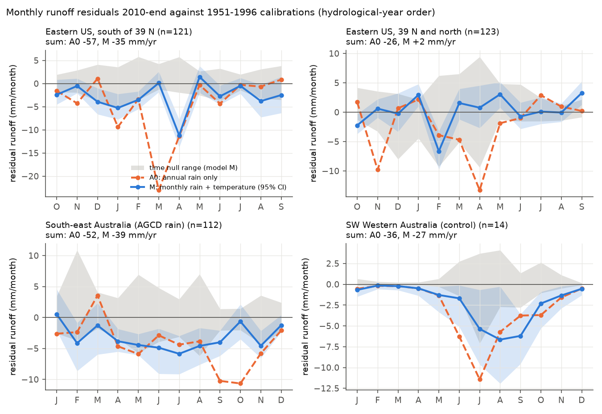
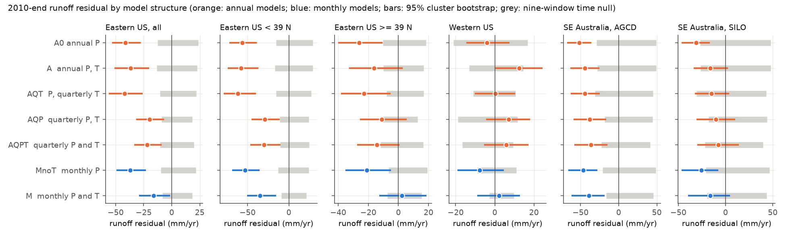
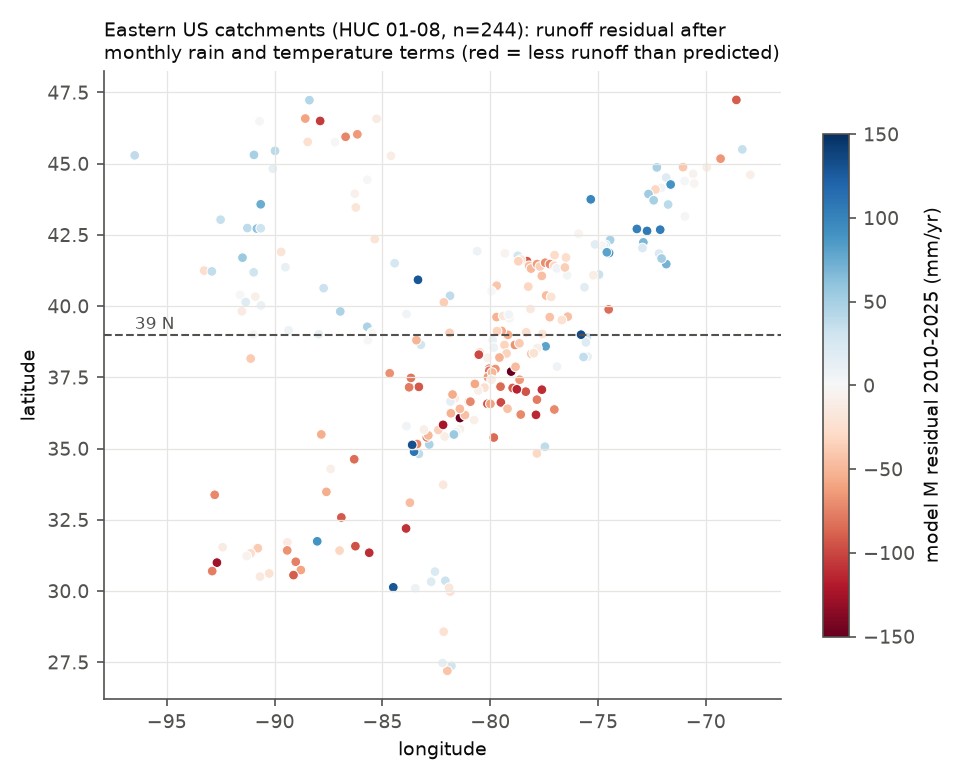

# Monthly rain and temperature terms removed about half of the post-1997 eastern US runoff offset; the remaining deficit was in basins south of 39 N and mostly in November-April (CAMELS, 1951-2025)

Job `sci-1107-dell-earth-and-ocean-sciences-abaa1bcbc29d`, campaign 11_07_2026, topic
earth-and-ocean-sciences, machine dell, account claude-olen. Model: Claude Opus 5.5
(`claude-opus-5-5`) in Claude Code (T3 Code). The signing key is a campaign-machine key. It is
not a personal authorship claim.

## Summary

**Question.** Campaign bundles found that after 1997 runoff in south-east Australia (SE-AU) and in
the eastern US (East-US, HUC-02 regions 01-08) fell about 40 mm per year below each catchment's
1951-1996 annual rainfall-runoff relation (bundles 7dedc5bb, df943002, 20955da2). The SE-AU change
is a loss of runoff response to rain; the East-US change is a constant offset (871b2192, ccf7e5d4).
Evaporative demand does not explain either shift (58715cfe), and GRACE shows that the water was
not stored (ccf7e5d4). All of these tests used annual totals. We asked: **in which months is the
runoff lost, and do monthly rain timing, monthly temperature, or snow explain the deficits?**

**Data.** Daily flow of 655 catchments with complete monthly records: 112 SE-AU, 14 south-west
Western Australia (SW-WA, a known groundwater-decline control) and 35 northern Australian
catchments from CAMELS-AUS v2.03 (1951-2021, AGCD and SILO rain); 244 East-US and 250 western US
(West-US) CAMELS-US gauges with USGS NWIS daily flow and nClimGrid monthly basin rain and
temperature (water years 1951-2025).

**Method.** For each catchment and each calendar month we fitted, on 1951-1996 only, (A) monthly
flow on annual rain, previous-year rain and annual temperature (the model of bundle 871b2192,
split by month), (M) monthly flow on rain of the same month, of the two previous months, of
months 3-5 and 6-17 before, and on monthly and previous-3-month temperature, and (MnoT) model M
without temperature. A post hoc model A0 uses annual rain only. We predicted 1997-2009 (P1) and
2010 to end (P2). Intervals are 95% cluster-bootstrap intervals over 2 x 2 degree cells. A time
null refits each model nine times without one 12-year window of 1951-1996 and tests that window.
The plan (`files/ANALYSIS_PLAN.md`) was fixed before any monthly result. Addendum 1 lists the post
hoc work, which we mark as post hoc below.

**Main results (P2 = 2010-2025 in the US, 2010-2021 in Australia).**

1. **Eastern US: about half of the offset follows seasonal climate terms.** The annual-rain model
   A0 left -41 mm/yr (95% CI -52 to -28) and model A -37 mm/yr (-50 to -21). With monthly rain and
   temperature (model M) the residual was -16 mm/yr (-28 to -2), still below the time-null range
   (-8 to +18). The planned rain-timing statistic E1 = 1 - M/A was 0.56 (0.41-0.90) and met the
   planned rule. But the decomposition shows that monthly rain alone (MnoT, -37 mm/yr) removed only
   about 4 mm/yr relative to A0; the month-specific temperature terms removed about 21 mm/yr (E5 =
   0.56). In annual models with quarterly terms (post hoc) the residual was -20 mm/yr with
   quarterly rain (AQP) and -22 mm/yr with quarterly rain and temperature (AQPT), but -42 mm/yr
   with quarterly temperature only (AQT). Thus the size of the "explained" half depends on the
   model structure (Figure 2), because the temperature coefficients change with the rain terms.
   A residual of 16-22 mm/yr stays in all seven structures and is outside the time null.
2. **Eastern US: snow loss does not cause the offset.** The deficit was largest where there is
   little snow. In basins with snow fraction < 0.10, model A left -50 mm/yr (-64 to -32) and model M
   -27 mm/yr (-41 to -12). In basins with snow fraction >= 0.20 model A left -10 mm/yr (-37 to +14)
   and model M +8 mm/yr (-21 to +30). A snowmelt cause predicts a deficit in March-May and a
   surplus in December-February. The observed difference (March-May minus December-February, model
   M) had the opposite sign: +6.2 mm (1.2 to 11.2). In northern basins, the April-May deficit of
   model MnoT disappeared when temperature terms were added (melt timing follows temperature).
3. **Eastern US: the remaining deficit is southern and in the dormant season (post hoc split).**
   South of 39 N (121 basins; Appalachian, Piedmont and south-eastern basins), model M left -35
   mm/yr (-50 to -16; time null -9 to +21), and quarterly-term annual models left -29 to -30
   mm/yr. North of 39 N (123 basins) model M left +2 mm/yr (-12 to +18). In the south, -24 mm/yr
   (-33 to -14) of the model-M residual fell in November-April and -10 mm/yr (-20 to 0) in
   May-October. The input-loss inversion (E3) assigns 26 mm/yr (16-35) of lost water input to the
   cold half-year and 14 mm/yr (-4 to +30) to the warm half-year. The deficit was largest in
   April and in December-February (Figure 1). The same pattern was present in 1997-2009 (model M
   south of 39 N: -19 mm/yr, -27 to -7). In the 1981-1996 placebo the southern residual was -1
   mm/yr (-8 to +6). Static CAMELS vegetation attributes (forest fraction, maximum LAI, LAI and
   green-vegetation seasonality) did not correlate with the residual within the south (Spearman
   |rho| <= 0.13, all p > 0.15; exploratory).
4. **South-east Australia: neither rain timing nor temperature explains the AGCD-based deficit.**
   With AGCD rain the deficit was -52 (A0), -44 (A), -47 (MnoT) and -39 mm/yr (M; CI -61 to -20;
   time null -17 to +46). Rain timing removed at most 12-15% (E1 = 0.12, CI -0.10 to 0.34; AQP
   -38 mm/yr), and temperature terms 16% (E5, 0.06-0.34). The model-M residual was about the same
   in millimetres in most months from February to November (-4 to -6 mm/month; March and October
   near -1). Thus the fractional loss was largest in the low-flow months (Figure 1). This differs
   from the SW-WA control, where the residual followed the flow regime (proportional-to-flow
   template R2 = 0.96, CI 0.52-0.98, against 0.32 in SE-AU) and fell mostly in the July-October
   wet-season months. The planned wetting-up test (E6) gave an early-wet
   (May-July) minus late-wet (August-October) fractional deficit of -0.075 (-0.128 to -0.013),
   inside the time-null range (-0.097 to +0.074). So the data do not show a delayed start of the
   wet season.
5. **South-east Australia: the result depends on the rain product.** With SILO rain the deficit in
   the same 112 catchments was -31 (A0), -16 (A; CI -33 to +2) and -16 mm/yr (M; -39 to +4), which
   is inside the time null. Bundle 20955da2 found that SILO drifted 2% low relative to fixed gauge
   networks after 2009, but this test cannot settle which product is correct. The SE-AU time null
   is wide (-27 to +49 mm/yr for model A) because 1951-1996 had large decadal swings.

**Conclusion.** The eastern US post-1997 offset is not one uniform loss. About half of it agrees
with month-specific climate terms (warming in spring and seasonal shifts), but the attribution
between rain timing and temperature is not identifiable with 1951-1996 calibrations. The robust
remainder (16-22 mm/yr for the region, 30-35 mm/yr south of 39 N) is in snow-poor southern basins
and mostly in November-April, when evapotranspiration is normally small. Thus snow loss, the
evaporative-demand change tested in 58715cfe and the seasonal rain shift do not explain the
remainder. The fingerprint agrees better with a dormant-season loss, for example more winter
interception or transpiration by evergreen vegetation or a larger soil-water deficit that each
winter must fill, or with a regional groundwater loss. We did not test these causes directly. In
south-east Australia, monthly timing tests do not explain the deficit. Its size with AGCD rain is
robust to the model structure, but it is inside the time null with SILO rain.

## Figures

**Figure 1.** Mean monthly runoff residual in 2010-end against the 1951-1996 calibration, by
calendar month in hydrological-year order (US October-September, Australia January-December).
Orange dashed: model A0 (annual rain only). Blue: model M (monthly rain and temperature) with its
95% cluster-bootstrap band. Grey: range of the nine-window time null for model M. The panel
titles give the 12-month sums.

**Figure 2.** Annual runoff residual (mm/yr) in 2010-end for seven model structures. Orange:
annual models (A0, A, quarterly temperature AQT, quarterly rain AQP, both AQPT); blue: monthly
models (MnoT, M). Coloured bars: 95% cluster bootstrap. Grey bars: time-null range for the same
model. Quarterly models and A0 are post hoc.

**Figure 3.** Model-M residual (mm/yr) in water years 2010-2025 at the 244 eastern US basins,
plotted at the gauge. Red: less runoff than the 1951-1996 monthly model predicts. The dashed line
is the post hoc 39 N split. The largest negative values are in Virginia, North Carolina, Tennessee
and central Pennsylvania; New England and the upper Midwest are near zero or positive.

`files/figures/fig4_input_loss.png` shows the seasonal input-loss inversion (endpoint E3).

## Tables

**Table 1. Annual sums of monthly residuals (mm/yr), 2010-end.** 95% cluster-bootstrap interval
in brackets, time-null range in parentheses. A0 is post hoc. P1 values are in
`files/results/endpoints.csv`.

| Group | n | A0 | A | MnoT | M |
| --- | ---: | --- | --- | --- | --- |
| SE-AU, AGCD | 112 | -51.9 [-66.5, -36.8] (-27.6 to 49.1) | -44.2 [-62.3, -26.2] (-27.0 to 49.3) | -46.6 [-65.1, -29.0] (-21.2 to 48.8) | -39.0 [-60.5, -19.5] (-16.5 to 45.7) |
| SE-AU, SILO | 112 | -31.1 [-45.6, -17.5] (-26.2 to 47.9) | -16.1 [-32.7, 1.6] (-25.7 to 47.7) | -25.7 [-45.7, -8.3] (-21.1 to 46.6) | -16.3 [-39.0, 3.8] (-19.5 to 43.5) |
| SW-WA | 14 | -35.8 [-58.7, -12.6] (-7.7 to 6.8) | -37.9 [-63.7, -14.0] (-6.9 to 8.9) | -27.9 [-51.7, -6.9] (-6.1 to 11.9) | -27.0 [-51.7, -6.7] (-6.4 to 11.3) |
| East-US | 244 | -41.2 [-52.3, -28.4] (-14.1 to 24.7) | -36.7 [-50.2, -20.8] (-13.0 to 23.5) | -36.8 [-48.3, -23.5] (-9.6 to 21.6) | -16.1 [-28.4, -2.1] (-8.1 to 18.3) |
| East-US snow < 0.10 | 133 | -49.3 [-62.5, -34.3] (-15.6 to 28.6) | -49.7 [-64.3, -32.0] (-14.6 to 28.2) | -46.1 [-58.8, -31.7] (-9.0 to 24.3) | -26.9 [-40.6, -11.5] (-9.0 to 21.4) |
| East-US snow >= 0.20 | 48 | -24.0 [-44.2, -6.7] (-16.2 to 16.5) | -9.6 [-36.6, 13.7] (-13.4 to 11.7) | -15.8 [-37.9, 1.4] (-8.8 to 19.0) | 7.6 [-20.5, 29.6] (-7.4 to 9.2) |
| East-US < 39 N (post hoc) | 121 | -56.6 [-71.0, -40.0] (-16.2 to 29.3) | -57.6 [-72.9, -37.6] (-16.4 to 28.9) | -53.0 [-67.7, -36.4] (-13.0 to 24.1) | -34.8 [-49.8, -16.2] (-9.1 to 21.3) |
| East-US >= 39 N (post hoc) | 123 | -26.0 [-39.5, -11.0] (-12.0 to 20.3) | -16.1 [-32.3, 2.3] (-10.0 to 18.5) | -20.9 [-34.7, -5.4] (-6.5 to 19.2) | 2.4 [-12.2, 18.0] (-7.3 to 15.5) |
| West-US | 250 | -3.9 [-14.1, 7.1] (-18.1 to 16.2) | 12.4 [0.5, 24.0] (-10.5 to 14.3) | -7.7 [-18.5, 4.3] (-9.0 to 11.1) | 2.1 [-8.6, 12.4] (-2.8 to 9.7) |

**Table 2. Planned seasonal endpoints, 2010-end.** E1 = 1 - D_M/D_A; E5 = (D_MnoT - D_M)/D_MnoT;
W = warm-half share of the model-M residual, W_Q = warm-half share of predicted flow (the
proportional-loss reference); L = inferred input loss per half-year (E3). Warm half: US May-Oct,
Australia Nov-Apr. Shares are unstable where the annual residual is near zero (West-US,
snowy East-US), so we do not interpret them there.

| Group | E1 | E5 | W | W_Q | L warm (mm/yr) | L cold (mm/yr) |
| --- | --- | --- | --- | --- | --- | --- |
| SE-AU, AGCD | 0.12 [-0.10, 0.34] | 0.16 [0.06, 0.34] | 0.37 [0.12, 0.51] | 0.33 | 41.0 [10.2, 62.8] | 23.2 [6.1, 41.9] |
| SE-AU, SILO | -0.01 [-1.08, 1.53] | 0.37 [0.13, 1.40] | 0.46 [-0.84, 2.23] | 0.33 | 25.5 [-1.3, 47.7] | 6.1 [-17.0, 32.7] |
| SW-WA | 0.29 [0.18, 0.52] | 0.03 [-0.02, 0.08] | 0.13 [0.09, 0.18] | 0.08 | -33.3 [-94.3, 2.8] | 77.1 [46.8, 101.8] |
| East-US | 0.56 [0.41, 0.90] | 0.56 [0.40, 0.91] | 0.22 [-0.74, 0.46] | 0.37 | 4.1 [-6.8, 14.2] | 13.3 [5.4, 20.9] |
| East-US snow < 0.10 | 0.46 [0.34, 0.67] | 0.42 [0.30, 0.65] | 0.26 [-0.12, 0.43] | 0.37 | 8.9 [-4.7, 22.8] | 21.2 [11.3, 29.7] |
| East-US < 39 N (post hoc) | 0.40 [0.28, 0.58] | 0.34 [0.24, 0.56] | 0.30 [0.02, 0.44] | 0.36 | 13.6 [-3.7, 29.6] | 25.8 [16.4, 35.2] |

Planned interpretation rules (fixed before results):

- *Rain timing explains the deficit if E1 >= 0.5 with CI excluding 0.* Met for East-US (0.56), but
  the post hoc decomposition (result 1) shows that the temperature terms, not monthly rain, cause
  most of this. Not met for SE-AU.
- *A season dominates the input loss* if its L is positive with a CI excluding 0 and the other L
  includes 0 or is less than one third. East-US: cold half dominates (13.3 vs 4.1, warm CI includes
  0). SE-AU (AGCD): neither season dominates (both positive). SW-WA: cold (wet) half dominates.
- *Snow is necessary for the East-US offset* only if the low-snow deficit CI includes 0. It does
  not (A: -50 mm/yr; M: -27 mm/yr), so snow is not necessary.

The E3 two-season fit explains only part of the month-to-month variance (R2 0.19 East-US, 0.49
SE-AU, 0.88 SW-WA), so L values describe the seasonal balance, not a complete model.

## Relation to prior work

- Saft et al. (2015, doi:10.1002/2014WR015348) and Peterson et al. (2021, doi:10.1126/science.abd5085)
  showed shifts of the rainfall-runoff relation in SE-AU after the Millennium Drought; Fowler et
  al. (2022, doi:10.5194/hess-26-6073-2022) review causes, including rain seasonality. Our monthly
  tests show that rain seasonality explains at most about 15% of the SE-AU deficit in 112 CAMELS-AUS
  catchments with AGCD rain.
- Berghuijs et al. (2014, doi:10.1038/nclimate2246) linked a shift from snow to rain to lower
  streamflow. The East-US offset does not have this fingerprint: it is largest in snow-poor basins,
  and in snowy northern basins temperature terms remove the spring deficit.
- Campaign bundle 7dedc5bb tested cool-season rain in Australia; bundle 996e7776 used four-season
  rain fits at 70 Victorian gauges and kept a deficit. Our results agree for SE-AU and add the
  East-US decomposition, the month profile, the snow test and the southern localisation.
- Campaign bundle 58715cfe found that CRU PET explains about half of the East-US offset after
  2009 but not its start in 1997-2009. Our monthly temperature terms remove a similar share in
  both periods (P1: A -25, M -13 mm/yr), and the remainder is concentrated in the dormant season.
- Campaign bundle 5b8df990 found a baseflow-index decrease in SE-AU. The near-constant mm loss in
  all SE-AU months, with the largest fractional loss in low-flow months, agrees with that result.

## Limitations

- **Post hoc localisation.** The 39 N split and the quarterly annual models were chosen after the
  planned results. The southern East-US result needs an independent test, for example with
  more basins (GAGES-II) or with a split defined from physical attributes before analysis.
- **Identification of temperature effects.** Month-specific temperature coefficients come from
  1951-1996 year-to-year variation. Warm months can also be sunny or dry months, so a temperature
  coefficient can include weather-type effects. The annual and monthly structures attribute the
  same 15-20 mm/yr to different terms. We do not claim that warming caused that half.
- **Fewer Australian catchments.** The complete-month rule kept 112 of the 175 SE-AU catchments of
  bundle 871b2192 and only 14 SW-WA catchments. Australian flow ends in 2021.
- **Rain products.** The SE-AU deficit is product-dependent (AGCD vs SILO). US rain is nClimGrid
  only; bundles 20955da2 and 7dedc5bb checked the US shift with fixed gauges and Daymet.
- **Linear models in mm.** We used linear models so that monthly residuals add up. They can predict
  small negative flows in dry months. Heteroscedasticity does not bias the means but makes CIs
  approximate.
- **Mechanisms not tested directly.** The dormant-season fingerprint agrees with winter
  interception or transpiration, soil-water carry-over or groundwater loss. We did not use
  land-cover change, forest age, groundwater levels or water-use data. Static vegetation attributes
  are weak tests.
- **Provisional data.** US flows after 2023 include provisional values.

## Reproduce

All code is in `files/code/`. `files/code/reproduce.sh <DATASETS_DIR> <SCRATCH_DIR> <CODE_DIR>`
runs every step and writes only into scratch. Inputs and hashes are in `files/provenance/`;
source URLs and terms in `files/DATA_NOTICE.md`. The US monthly tables are bundled
(`files/data/`), so the US steps can start from them. The Australian monthly table is regenerated
from CAMELS-AUS v2.03 with `build_aus_monthly.py`. Steps:

1. `fetch_nwis.py` (USGS daily flow), `build_us_monthly.py`, `us_basin_clim.py` (nClimGrid basin
   means), `build_aus_monthly.py`.
2. `monthly_models.py` (planned models plus A0; AGCD and SILO), `summarize.py` (endpoints,
   profiles, per-catchment sums; bootstrap seed 20261110, 2,000 resamples).
3. `posthoc_annual.py` (Addendum 1), `exploration/*.py`, `figures.py`.

Run time on the shared Dell host: about 10 minutes after the downloads. Software versions are in
`files/provenance/environment.txt`. Set `OMP_NUM_THREADS=1` on shared hosts.

## Files

- `files/ANALYSIS_PLAN.md`: plan, execution notes and Addendum 1.
- `files/results/endpoints*.csv`: all endpoints by group and period (P1, P2, placebo PL) with
  bootstrap CIs and time-null ranges; `_SILO` = SILO rain in Australia.
- `files/results/profiles*.csv`: monthly residual profiles by group, period and model.
- `files/results/catchments*.csv`: per-catchment annual sums of residuals.
- `files/results/posthoc_annual_*`: Addendum 1 annual models; `posthoc_warming*.csv`: quarterly
  temperature change.
- `files/results/exploration/`: quarterly coefficients, latitude-band profiles, vegetation
  correlations.
- `files/data/`: US monthly flow (NWIS) and nClimGrid basin climate.
