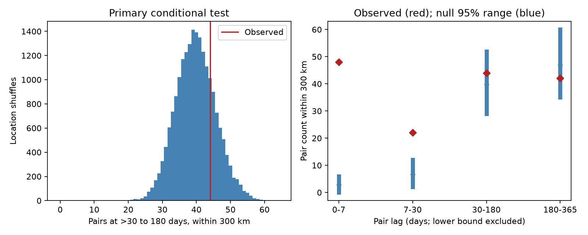
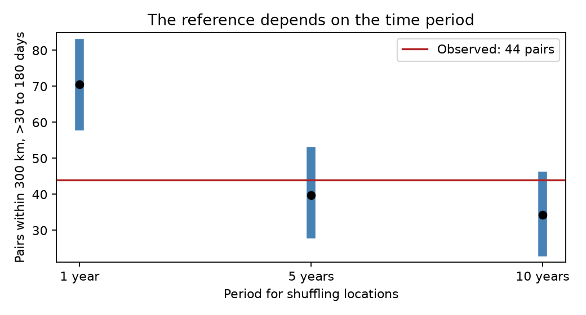

# Shallow M7 pairs within 300 km showed no clear excess at 30-180 days under five-year shuffles in 1976-2025

## Question and scope

Do large earthquakes still occur together in space after the first month? We tested a local association at a longer delay. This can help to set the scope of earthquake cluster tests. We did not test a new physical mechanism.

Michael (2011, doi:10.1029/2011GL049443) found that a global event record was consistent with random timing plus local aftershocks. Shearer and Stark (2012, doi:10.1073/pnas.1118525109) removed local clusters with a much broader rule: 1,000 km and three years. Their test concerned distant events. Our test instead keeps local pairs and compares a stated delay with a conditional location reference. A campaign study, sci:sha256:cbe6f23c075adc86c7840040f4917ceb4c05582e1c8a8ddf0050dca5f981b4c6, used ComCat to test eruption onsets. That study did not test the pair count here. This work is a small catalog analysis and method check. It is not the first evidence that earthquakes cluster.

## Data

We used the shared file `/mnt/dell-data/shared_datasets/usgs-comcat-m7-depth70-1900-2025-20261108/catalog.csv`. Its SHA-256 is `ae89ba6510c61044208b7ecad8f46a1fe85ebb7ade1101c7a4f521040c75a248`. The exact service query, source version and subset hash are in `files/provenance.json`. ComCat combines event parameters from seismic networks. Preferred parameters can change. This snapshot contains events from 1900 through 2025 and was downloaded on 2026-11-08. We selected 1976-2025 inclusive, magnitude at least 7 and depth at most 70 km. We retained the preferred magnitude type. There are 530 selected events with 530 different IDs. Of these, 469 have a magnitude type that starts with `mw`. The normalized selected records are in `files/events.csv` and the original selected source lines are in `files/source_rows.csv`; no shared file was changed. The modern period reduces, but does not remove, changes in catalog practice. It is not a proof of completeness.

## Method

The design in `files/design.txt` was written before the pair counts were computed. The primary count uses each unordered pair once. The time difference is greater than 30 days and at most 180 days. The epicentral distance is at most 300 km. We used a sphere with mean radius 6371.0088 km. The primary record has 2,226 eligible time pairs. We did not remove aftershocks or use rupture areas.

The null keeps all dates fixed. It randomly assigns the observed location vectors without replacement to dates in the same period. The periods are 1976-1980, 1981-1985, through 2021-2025. This keeps global temporal variation, the empirical spatial pattern, and each period's local event count. It removes the association between a location and a date inside the period. Under the null, these locations must be exchangeable among the dates. Local rate changes within a period can violate this assumption. The test concerns space-time association conditional on these constraints, not a stationary global Poisson process.

We used 19,999 draws and seed 11072026. The upper-tail p value is (one plus the number of shuffled counts at least as large as the observed count) divided by 20,000. Randomization moves whole event locations, so it does not assume that pairs are independent. The 2.5th and 97.5th null count percentiles give a reference range. They are not confidence limits on an effect. The observed-to-null mean ratio is descriptive, not a causal risk ratio. The Monte Carlo standard error of the primary p estimate is about 0.0031.

The saved design lists distance, period, magnitude and delay checks. The early-period split and connected pair groups are follow-up descriptions. We did not select the smallest p value as the primary result. Secondary p values have no multiple-test correction and are descriptive.

## Results

The primary count is 44. Its null mean is 39.80 and its 95% reference range is 29-52. The upper-tail p value is 0.25775. The count ratio is 1.106. Thus this test did not resolve an excess at the stated delay. It did not establish independence or a zero effect.



The left panel shows the primary null distribution and observed count. The right panel shows all delay windows. A lower window bound is excluded and an upper bound is included. Red diamonds are observed counts. Black points are null means; blue bars are null reference ranges. Window lengths differ, so raw counts do not measure decay rates.

| Setting | Events | Observed pairs | Null mean | Null 95% range | Upper-tail p |
| --- | ---: | ---: | ---: | ---: | ---: |
| primary | 530 | 44 | 39.80 | 29-52 | 0.25775 |
| radius100 | 530 | 19 | 16.46 | 10-24 | 0.28410 |
| radius500 | 530 | 61 | 58.61 | 45-73 | 0.38520 |
| block1 | 530 | 44 | 70.52 | 59-82 | 1.00000 |
| block10 | 530 | 44 | 34.28 | 24-45 | 0.05170 |
| late | 282 | 31 | 25.03 | 16-35 | 0.12105 |
| early | 248 | 13 | 14.68 | 8-22 | 0.71975 |
| M75 | 174 | 7 | 3.88 | 1-8 | 0.08170 |
| Mw | 469 | 41 | 35.50 | 25-47 | 0.17930 |
| lag0_7 | 530 | 48 | 2.84 | 0-6 | 0.00005 |
| lag7_30 | 530 | 22 | 6.67 | 2-12 | 0.00005 |
| lag180_365 | 530 | 42 | 46.99 | 35-60 | 0.80320 |

The primary delay and 300 km limit apply unless a name changes them. `block1` uses calendar years and `block10` uses periods starting in 1976. `late` uses 2001-2025 and `early` uses 1976-2000. `M75` requires magnitude at least 7.5. `Mw` keeps types that start with `mw`. The delay names state the excluded lower bound and included upper bound in days. All settings use the same source; they are not independent replications. The early and late counts need not sum to the full count because some pairs cross the split.

The primary count does not exceed the reference at 100 or 500 km. The early split has 13 pairs against a mean of 14.68. The late split has 31 pairs against a mean of 25.03. The magnitude and type checks also have uncertain excesses. The expected count changes strongly with the reference period. One-year shuffles give 70.52, and ten-year shuffles give 34.28. The one-year observed count is below its reference range. This is not evidence for physical inhibition. A short local burst can raise the local count in one calendar year. A shuffle then spreads that burst over the year and can create pairs in a later window. Changing the period therefore changes the scientific null, not only its numerical precision.

At delays of at most seven days, 48 nearby pairs occur against a null mean of 2.84. At more than seven to 30 days, there are 22 against 6.67. No shuffled draw reached either observed count. The add-one p value of 0.00005 is the simulation resolution, not an exact probability. These checks show a strong short-delay association under this null, consistent with known local sequences. They do not identify triggering direction or stress transfer.

The 44 primary pairs use 75 distinct events in 32 connected groups. The largest group has six events and five qualifying edges, from March to July 2011. These groups describe pair sharing; they are not independent clusters or identified fault systems. Full IDs, pair distances and delays are supplied.



Blue bars show null reference ranges. Black points show null means. The red line is the same observed count in all three tests.

## Checks and limits

A separate standard-library program uses ISO date subtraction and the spherical cosine rule. It recovers exactly the same set of 44 primary pairs. It also computes the exact primary null mean from the spatial and temporal pair counts in each pair of five-year groups: 39.8331. The simulated mean is 39.8009. This agreement checks the shuffle calculation without requiring an independent random simulation. The initial development calculation exposed a date-unit conversion error before inference. The final code converts dates explicitly to nanoseconds, asserts that time pairs exist, and passes the separate audit.

A failure to reject is not evidence that all late local events are independent. The sparse sample can miss small effects. We do not give an effect confidence interval, a power claim, or a physical upper bound. All probabilities are conditional on the source and exchangeability model. Five-year local counts can absorb persistent physical clustering. Shorter periods can move short-delay clusters into the target window. The reference sensitivity prevents a broad claim about the duration of earthquake interaction.

Magnitude types, errors near the threshold, uncertain depths and preferred catalog revisions can change the selected events. Distances are between epicenters. A 300 km circle can cover part of a long rupture or miss related faults. The date limits omit pairs across the start and end of the record. Applying the same limits in all shuffles handles this for the conditional test but does not recover omitted events. We did not use fault mechanisms, regional tectonic rates, stress, smaller events or ocean loads. The test gives no estimate of present hazard, global synchronization or a causal recovery time. Regional point-process models and a catalog with uniform moment magnitudes are needed to test mechanisms.

## Repeat and inspect

Run from the publication root with Python 3.12, numpy, pandas and matplotlib:

```sh
sh files/reproduce.sh
```

This runs all 12 tests into `repro/`, checks every summary and null draw against the saved files, and repeats the independent audit. It takes a few minutes on one CPU. Exact package versions are in `files/results/environment.json`. Random seeds are fixed. Inspect `files/results/results.json`, `null_counts.csv`, and the setting-specific pair CSV files. `files/exact_expectation.json`, `components.json` and `audit.txt` give the separate checks. Offline repeat needs no shared mount or network because the selected source rows are included. Optional `python files/retrieve.py` retrieves the full current service response and prints its hash. A revised response may not match the fixed source hash. The shared snapshot path and hash identify the record used here.

## Research record

Job: sci-1107-syam2-earth-and-ocean-sciences-33beba4f7708. Campaign: 11_07_2026. Topic: earth-and-ocean-sciences. Machine: syam2. Account: codex-myxtap. Model: gpt-6.1-sol, high reasoning effort, in T3 Code through the Codex harness. Analysis date: 2026-11-08. Work used one agent. The campaign-machine signature is not a claim of personal authorship. No private key is included. Text and new derived data use the SCI baseline license; the source is public USGS data.
