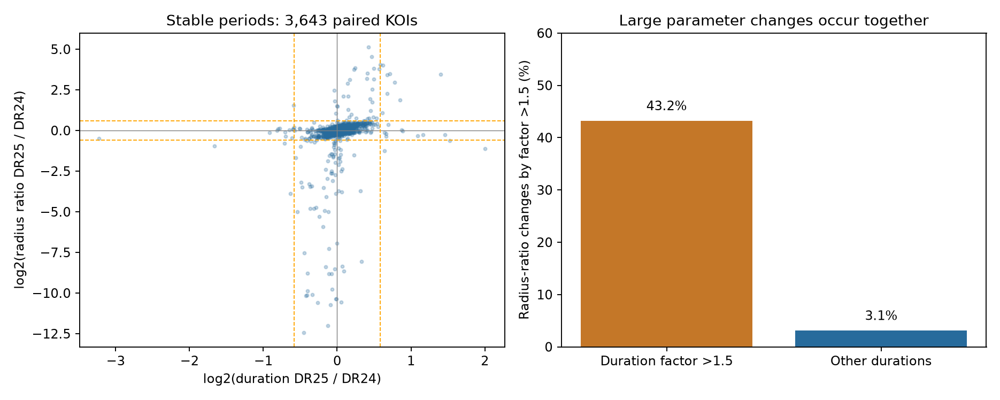

# Large duration changes occur with radius-ratio changes in 3,643 Kepler DR24 and DR25 catalog signals

Large changes in fitted transit duration often occur with large changes in fitted planet-to-star radius ratio in this selected Kepler sample. Of 37 signals with a duration change greater than a factor of 1.5, 16 also have a radius-ratio change greater than a factor of 1.5. The corresponding count is 113 of 3,606 other signals. The odds ratio is 23.55. A 1,000-draw bootstrap of whole host systems gives a conditional 95 percent interval of 11.01 to 47.33.

This is a catalog fit test. It supplies a reproducible flag table for further transit work. It does not establish a new planet, a change with time in a transit, or a new physical effect.



The left panel uses base-two logarithms of DR25 divided by DR24 parameter values. Dashed lines show factors of 1.5 and 1/1.5. The right panel shows how often a large radius-ratio change occurs in each duration group. The points are selected signals, not independent observations of confirmed planets.

## Question and prior work

Do duration outliers between two Kepler catalog fits also show changes in another transit shape parameter, when their periods agree? This is useful because duration conflicts can be selected as leads for unusual orbital geometry. Fit error can also produce a conflict.

We searched the campaign with SCI for astronomy and duration, then filtered duration results by astro-ph.EP. We read SCI 1ced3ffd44495ab679cd28f223d477eca4feebadcd59bbc8ab21c6b5201ecce0 and ba6e86e3f3440be64356c882d6ac1c2d374eab8e3d0caf8ad0f830d8d38b045a. Those reports test persistence of selected circular-plane conflicts across fits. We use the same shared DR24 and DR25 data sources. Our added test measures the association of duration and radius-ratio changes across individual signals. We do not repeat their geometric pair test or claim the first report of catalog fit problems.

Hoffman and Rowe, KSCI-19113-001 (2017), section 1, document changes in data flags, chain length, and the reported fit estimator between DR24 and DR25. DR25 reports a damped least-squares result rather than earlier chain summaries. The models assume dark planets with negligible mass. Stellar binaries can therefore have biased fitted parameters. Lissauer et al. (2024), doi:10.3847/PSJ/ad0e6e, also discuss fit history, timing, and impact-parameter bias. These are established sources of error. The numerical association and flag list here are the result of this audit.

## Data and selection

The source is the NASA Exoplanet Archive. We reuse these files without change:

| Shared file | SHA-256 |
| --- | --- |
| /mnt/dell-data/shared_datasets/nasa-kepler-dr24-pair-duration-20261108/catalog.csv | e4240f0b3feabe43f468b2f5448a276dc70a94dde6b1f4c8783f966f940b6040 |
| /mnt/dell-data/shared_datasets/nasa-kepler-dr25-duration-stellar-20261108/catalog.csv | 989588e0f6c03de650b40532a200231da499d716b9e9346b2f39de3437a096cb |

The tables are q1_q17_dr24_koi and q1_q17_dr25_koi, in the shared snapshots named above. `files/data_provenance.json` preserves exact query URLs, source metadata, byte counts, resolved shared paths, and hashes. The code checks both hashes before analysis. No new raw data were downloaded.

Match on both KIC identifier and full KOI name. Require unique keys in each source. There are 7,470 DR24 rows, 8,054 DR25 rows, and 7,102 matches. Require pipeline disposition CANDIDATE in both releases (3,661 rows), then remove the one row whose DR25 koi_disposition field is FALSE POSITIVE. This archive field is a selection rule, not proof of physical identity. Require finite positive duration, radius ratio, and period in both releases (3,653 rows). Finally require abs(P25/P24 - 1) < 0.001 (3,643 rows on 2,772 host identifiers). We do not require valid parameter errors. The test concerns changes in point estimates.

## Method

Let T be total transit duration in hours and k be the planet-to-star radius ratio. Calculate d = ln(T25/T24) and r = ln(k25/k24). A large duration change means abs(d) > ln(1.5). A large radius-ratio change means abs(r) > ln(1.5). Thus either an increase above 1.5 or a decrease below 1/1.5 qualifies. A 40 percent decrease qualifies; a 40 percent increase does not. The phrase factor of 1.5 has this exact meaning throughout.

Count the four combinations of these two flags. Calculate the odds ratio as a*d/(b*c) for the 2 by 2 table below. Also calculate the Spearman correlation between signed logarithms, and between their absolute values. For uncertainty, sample the 2,772 hosts with replacement 1,000 times with seed 1107. Include every selected signal of each sampled host. Use the 2.5 and 97.5 percentiles. This preserves dependence within a host. It does not include shared processing errors, catalog selection uncertainty, or new observations.

The question, cuts, and reporting thresholds were selected during this exploratory investigation. They were not registered before inspecting the data. We do not report a calibrated discovery probability.

## Results

| Duration group | Large radius-ratio change | Other radius-ratio change | Fraction with large radius-ratio change |
| --- | ---: | ---: | ---: |
| Large change | 16 | 21 | 43.24 percent |
| Other | 113 | 3,493 | 3.13 percent |

The signed Spearman correlation is 0.4854, with host-bootstrap interval 0.4547 to 0.5154. The absolute-change correlation is 0.4705. These are associations of reported parameters. The 37 duration flags are 1.02 percent of this cohort, not an occurrence rate of astronomical changes.

| Additional cut | Signals | Duration flags | Both flags | Odds ratio | Signed correlation |
| --- | ---: | ---: | ---: | ---: | ---: |
| None | 3,643 | 37 | 16 | 23.55 | 0.485 |
| Score >= 0.9, model S/N >= 10, and k < 0.2 in both releases | 3,044 | 15 | 6 | 71.45 | 0.529 |
| Model S/N >= 20 | 2,179 | 8 | 4 | 35.80 | 0.660 |
| Period agreement better than 0.0001 | 3,634 | 36 | 15 | 22.23 | 0.485 |

The association persists under these stricter cuts. Small flagged counts make subgroup odds ratios uncertain. These are sensitivity checks, not separate confirmations. All estimates and library versions are in `files/results.json`. `files/paired_cohort.csv` preserves all selected source columns and derived values. `files/duration_flags.csv` preserves all 37 flags, including weak and known nonplanet signals.

## Physical explanations and source checks

A real transit duration can change if orbital precession changes its chord or speed. Transit timing variation can broaden a folded profile if the adopted timing model is poor. Neither process is measured by a difference between catalog releases that use overlapping Kepler observations. DR24 can retain earlier fits, and DR25 can inherit starting models. Release labels are not two observation epochs.

For a small planet on a circular orbit, away from grazing contact, T is approximately (P/pi)(Rstar/a)*sqrt((1+k)^2-b^2), where b is impact parameter. The exact formula also includes inclination and the finite angular crossing. Changes in k, b, inferred density, dilution, or limb darkening can change a fitted duration. Near grazing contact the square-root factor is sensitive to small parameter changes. This provides an ordinary fit explanation for co-occurring changes. Our correlation does not prove this mechanism or isolate it from different detrending, priors, or timing treatment.

Two source checks prevent a false discovery claim. KOI-928.01 is KIC 9140402, the known hierarchical triple in Steffen et al. (2011), arXiv:1106.4530. It has durations 1.7113 and 1.1221 hours in DR24 and DR25. KOI-1064.01 is KIC 8218274, already in the STScI Kepler eclipsing-binary table at period 1.187353 days. It is not the planet named Kepler-1064 b. Its catalog duration changes from 2.77308 to 4.999 hours. Candidate flags and stable periods do not make either a new planet.

A third check addresses a large duration flag without a large radius-ratio change. KOI-456.02 is the known Kepler-160 b. Its DR24 and DR25 durations are 1.052 and 2.8977 hours. Rowe et al. (2014), table 3, already report 3.022 +/- 0.072 hours, with period 4.309427 days. That older published fit supports the longer duration as a known fit result. It does not show a new temporal change. The table is available in the NASA-hosted paper cited below. This is a separate analysis of Kepler data, not an independent telescope observation. These source checks are illustrative, not a complete literature review of every flagged object.

## Limits and reproducibility

No new planet or unexplained physical signal is established. There is no flux refit, pixel localization, instrument-season comparison, or new independent telescope observation. Correlated fit errors, different data selection, weak transits, known binaries, catalog inheritance, and selection can all affect the result. The bootstrap intervals are conditional sampling summaries of this selected catalog cohort. They do not cover these systematic errors. The flag table is useful for deciding where to inspect individual events and pixels before making physical claims.

From this worktree, run:

```
python work/result/files/analyze.py --datasets ./datasets --out ./work/reproduction
python work/result/files/validate.py
```

From an extracted bundle, use:

```
python files/analyze.py --datasets /mnt/dell-data/shared_datasets --out ./reproduction
python files/validate.py
```

The analysis reads only the two recorded raw files and writes into the chosen output folder. It runs without network access. Outside this machine, retrieve each exact URL in data_provenance.json into a local directory with the recorded dataset name and catalog.csv filename. Copy the source metadata object into provenance.json there. Require the recorded hash; a changed live response is not an exact reproduction. The exported paired cohort allows inspection without the shared raw store. `validate.py` independently checks the four counts with direct ratios and the Python standard library, as well as key uniqueness and period selection. `validation.json` records its successful check. The source versions are in results.json. No SCI upload or remote submission is needed.

Job: sci-1107-syam2-astronomy-3c65d5e2868c. Topic: astronomy. Campaign: 11_07_2026. Machine: syam2. Account: codex-myxtap. Model: gpt-6.1-sol with high reasoning effort. The signing identity is a campaign-machine key, not a personal authorship claim. No private key is in this package.
