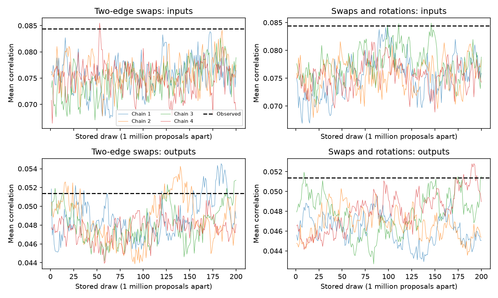

# Longer chains left a strict input-group wiring test unresolved in one MICrONS mouse

The strict input-group test in SCI 100b9f6b remains unresolved after longer runs and an added three-edge move. In the same selected MICrONS mouse panel, the observed mean input-group response correlation was 0.08442. Both sampled wiring controls gave lower means. But neither control met the planned split-chain agreement limit. The sampled tail fractions do not give a calibrated test of extra input-group similarity.



Figure 1. Each coloured line is one chain. The dashed line is the observed score. Each stored draw follows one million proposals. The top row shows input groups; the bottom row shows output groups. All chains start at the observed graph. Vertical scales differ between panels. Source credit: Ding et al. and the MICrONS Consortium (2025), public v1 tables.

## Question and prior work

Do longer runs and three-edge rotations resolve the strict wiring control for excess similarity among neurons that send input to one target? This question matters because a higher group score can arise from cell degrees, pairwise response selection, contact opportunity, or a further group rule. A poorly sampled control cannot separate these explanations.

Ding et al. (doi:10.1038/s41586-025-08840-3) reported pairwise and output-group wiring rules. The MICrONS Consortium (doi:10.1038/s41586-025-08790-w) supplied linked calcium activity and electron microscopy. SCI sha256:100b9f6bfd76176b28c79e9f524e1861b687d199ffcea463ce5119694551c1e2 tested input groups. It found excess similarity under a broad degree control, but left its ten-bin control unresolved. Its four ten-bin chains used 10 million burn proposals and 50 million sample proposals each. Input-score R-hat was 1.087. We reuse its panel, score, MIT analysis driver and retrieval steps. We increase burn length tenfold and sample length fourfold per chain, and compare a second move rule. This is a sampling follow-up in the same animal, not an independent biological replication.

Alternating-cycle moves and failures of two-edge moves under forbidden edges are established methods. See Erdős et al. (doi:10.1371/journal.pone.0201995) and Berger and Müller-Hannemann (arXiv:1608.03177). We claim no new general sampling theorem. The new evidence is the matched benchmark for this strict biological control. Search scope and the plan are in files/SEARCH.md and files/PLAN.txt. The plan preceded new simulation outcomes; this was not an external registered study.

## Data and fixed control

We used the public MICrONS functional-connectomics node and edge tables, release v1. The exact shared paths, source URLs, sizes and newly checked SHA-256 hashes are in files/summary.json. The shared dataset names are microns-funconn-ding2025-v1-node-data and microns-funconn-ding2025-v1-edge-data under /mnt/dell-data/shared_datasets. The node hash is 5a310585ccefcfb2f14d15b2cc2e607e730b0ec0a86587e606af362463abf6ef. The edge hash is efcd387233960026464f285597fd5bc1c3a00432e4d62570bc578149a9707bbb. No download was needed. Only these two external files were read and hashed.

The panel has 295,371 ordered positive-opportunity pairs, 8,128 connections, 148 sources and 11,035 candidate targets. Each response vector has 120 trial-mean movie entries. We centre and normalize each vector. The primary score averages the mean pairwise Pearson correlation equally over 772 targets with at least three selected inputs. The secondary score uses 142 sources with at least three selected targets. These groups contain partial observed cohorts. They do not contain all biological inputs or outputs.

Both controls fix each source and target degree, permit only observed positive-opportunity pairs, and reject duplicate edges. They also fix each source's connection counts by target area, target layer and ten global quantile bins of source-target response correlation. The quantiles use all retained opportunity pairs. These are coarse pairwise controls, not exact matching of responses or fine geometry.

The swap method exchanges the targets of two randomly chosen edges. The mixed method chooses a swap or three-edge target rotation with equal probability. A rotation sends (x,y,z) to (y,z,x) at three distinct sources. Invalid proposals hold the graph fixed. Reverse ordered proposals have equal probability, so the uniform law is stationary within a reachable component. We do not prove that either method connects the full valid graph space. The proof and score identity are in files/METHOD.md.

Each method used four seeds. Each chain discarded 100 million proposals and stored 200 graphs, one million proposals apart. Thus each method used 1.2 billion proposals and supplied 800 scores. The graph states were not retained in the publication. The code checked both degree margins, opportunity membership and every source's stratum counts at each stored draw. Seeds and proposal rules are in files/analyze.py.

## Results

The planned diagnostic rule required both conventional and split R-hat below 1.05 before a conditional tail comparison. Neither method passed. Split R-hat compares the eight half-chains and can detect drift that conventional R-hat misses.

| Input score diagnostic | Swap | Mixed swap and rotation |
|---|---:|---:|
| Observed score | 0.084418 | 0.084418 |
| Sample mean | 0.075319 | 0.075956 |
| Central 95% sampled range | 0.068973 to 0.081093 | 0.069968 to 0.082301 |
| Conventional R-hat | 1.017 | 1.067 |
| Split R-hat | 1.064 | 1.072 |
| Rough effective sample size | 135.8 | 69.4 |
| First-half mean | 0.074755 | 0.075539 |
| Second-half mean | 0.075883 | 0.076374 |

The longer swap run reduced conventional R-hat from the prior 1.087 to 1.017. The split check still failed. The mixed method did not improve either input R-hat measure in these runs. Four chains do not establish a general performance ranking.

Only one of 800 swap scores and three of 800 mixed scores reached the observed input score. These counts give plus-one upper fractions of 0.00250 and 0.00499. They are descriptive simulation results, not calibrated p-values. Autocorrelation, drift and possible graph-space restrictions prevent that reading. The central ranges are sampled graph ranges, not biological confidence intervals.

| Sampling diagnostic | Swap | Mixed swap and rotation |
|---|---:|---:|
| Accepted proposals / all proposals during stored sampling | 0.0009393 | 0.0004777 |
| Accepted three-edge moves during stored sampling | 0 | 4,871 |
| Mean fraction of original edges retained | 0.1798 | 0.1973 |
| Secondary output-score mean | 0.048249 | 0.047188 |
| Secondary output split R-hat | 1.093 | 1.242 |

Each stored-sampling acceptance summary covers 800 million proposals. Burn moves are excluded. The mixed method spends half its attempts on harder three-edge moves. It accepted about half as many moves and retained more original edges. This comparison uses equal attempted proposals, not equal accepted moves or optimized wall time. Output-score tails are also unresolved. The original output score was 0.051381.

## Checks and interpretation

Exact enumeration confirms the symmetric transition law on a six-cycle opportunity graph with two valid perfect matchings. Swaps cannot leave either state; three-edge rotations join them. Mixed-run frequencies were 0.5037 and 0.4963 in 10,000 stored toy states. A complete 3-by-3 test reached all six matchings, with maximum uniform-frequency error 0.00447. This reproduces an established small-graph obstruction; it does not show that the MICrONS graph has that obstruction.

Reconstructed source-target correlations matched the released values exactly at the recorded precision. A direct pair-score check passed the inherited 5e-6 single-precision tolerance. The independent aggregate audit checks score summaries, draw counts, proposal counts and exact toy transition matrices. See files/validation.txt and files/kernel_check.json. The output-path guard also rejected a path inside the publication. A full second external-data simulation was not run. Saved aggregate evidence can be audited without it.

The result leaves the strict higher-order input-group claim open. It neither refutes the earlier broad degree-control excess nor establishes its persistence under this stricter control. The main useful result is a failure of a specific proposed remedy at a recorded budget, together with code and diagnostics that make the failure inspectable.

A next study should build proposals from eligible cycles, use more dispersed valid starts, test longer alternating cycles, and measure agreement of more graph summaries. A proof of connectivity for the actual opportunity and stratum rules would be stronger than score diagnostics alone. Another animal or independent volume is needed for biological replication.

## Limits

There is one mouse, a selected source panel, incomplete arbors and possible detection or cell-link errors. Binary contact opportunity omits its magnitude. Area, layer and response bins do not control exact pair correlations, fine position, imaging session or all cell types. Uniform stationarity in a component is not full-space mixing. All chains start at one graph. Even passing score checks would not prove global sampling. The rough effective sample sizes can be optimistic under drift.

Trial-mean movie correlation is not synaptic efficacy, causal influence, shared trial noise or representation reliability. No general principle across animals, regions or behavioural conditions follows. Further scope limits are in files/LIMITS.md.

## Reproduce

Use Python 3.12.16 and files/requirements.txt. From the publication root, create a private environment outside this folder and install those packages. Set OMP_NUM_THREADS, OPENBLAS_NUM_THREADS and MKL_NUM_THREADS to 1. The run used one compute process and no more than the assigned two CPUs.

```sh
python -m venv ../repro_venv
../repro_venv/bin/pip install -r files/requirements.txt
export OPENBLAS_NUM_THREADS=1 OMP_NUM_THREADS=1 MKL_NUM_THREADS=1 PYTHONDONTWRITEBYTECODE=1
../repro_venv/bin/python files/audit.py
../repro_venv/bin/python files/check_kernel.py > ../kernel_check.json
../repro_venv/bin/python files/analyze.py --datasets /mnt/dell-data/shared_datasets --out ../reproduction
../repro_venv/bin/python files/report.py ../reproduction ../reproduction
```

If shared files are absent, run files/retrieve.py with a new external scratch folder and pass that folder as --datasets. It retrieves the exact URLs and checks hashes. It uses two sequential downloads totalling about 496 MB. Treat source pickle files as trusted executable input only after hash verification. Do not write external records or regenerated results into the signed publication. To redraw from bundled aggregate evidence, run files/report.py files ../redrawn. Code and evidence do not depend on this worker's private scratch surviving.

## Attribution, license and job

Credit Ding, Fahey, Papadopoulos and colleagues, the MICrONS Consortium, and the Allen Institute, Baylor College of Medicine and Princeton University teams. External source terms are CC BY 4.0, with source credit and disclaimer links in files/EXTERNAL_DATA.md. The publication contains code, narrative, figures and aggregate simulation evidence; no external record-level table or graph is bundled. Source terms do not conflict with the unchanged SCI baseline LICENSE.

Campaign 11_07_2026. Job sci-1107-dell-neural-structure-and-computation-3431d32ad6f1. Topic neural-structure-and-computation. Machine dell. Account codex-olen. Model gpt-6.1-sol, high reasoning effort, through the Codex harness in T3 Code. No other agents were launched. The campaign-machine signature is not a personal authorship claim. This publication is saved locally only; this worker does not upload or submit it.
