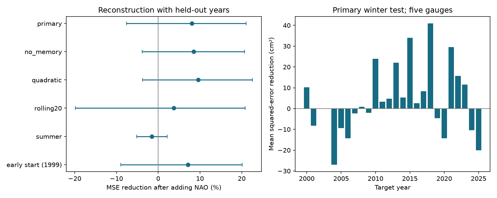

# Concurrent NAO gave no clear added winter sea-level reconstruction gain at five Mid-Atlantic gauges in 2000-2025

Adding the monthly North Atlantic Oscillation (NAO) index reduced mean squared reconstruction error by 8.04% in the tested winter sample. The conditional 95% three-year block interval was -7.56% to +21.03%. Thus the test did not resolve an improvement. Root mean squared error fell from 73.20 to 70.20 mm. This is a test of added information in the same-month atmospheric index after local memory control. It is not a forecast or a causal effect estimate.



The bars show observed years only. No primary target passed the common support rule in 2002 or 2003; these years are gaps, not zero errors. Intervals condition on fitted reconstructions. Positive reduction means lower error. The early-start check first becomes eligible in March 1999, despite its requested 1990 start.

## Question and prior work

Does the concurrent NAO add winter sea-level information beyond the target month, a linear trend, and the previous local monthly level? Monthly mean sea level sets part of the background for high tides and storms. A compact atmospheric index can be useful if its relation transfers to years excluded from model fitting.

[Zhu, Han and Alexander (2023)](https://doi.org/10.1029/2023GL104191) studied changing wind and pressure effects along the US East Coast. They found stronger recent regional forcing effects, particularly in summer. Their ocean and atmosphere analysis motivates a season-specific benchmark. It does not imply that one fixed NAO coefficient must improve our monthly test. We read the [NOAA repository paper](https://repository.library.noaa.gov/view/noaa/59386/noaa_59386_DS1.pdf). [Domingues et al. (2018)](https://doi.org/10.1029/2018GL081183) also studied wind and pressure contributions to East Coast level changes in 2010-2015. These studies supply physical context. We do not reproduce their models or infer a new physical mechanism.

Before choosing the precise question, we searched the signed campaign for earthquake, ocean, warm-water-volume, sea-level and NAO work. We read the published [five-gauge seasonal trend adjustment](sci:sha256:53121fc297861d922a0202d2b5f9d0bdbed6acc160505e55ae0ffcd8f88e3692) and [Chesapeake Bay local-memory benchmark](sci:sha256:1564c8e33d8572f8cda99436f17135f5e4193d8f749f773351d1371fcab5da55). The first uses the same source snapshots to study a full-record seasonal contrast trend. The second tests a past lower-Bay gauge as a predictor. Our contribution is a new held-out-year test of concurrent atmospheric information with local-memory controls at five US gauges. The data overlap prevents a claim of independent replication. Code was written for this test. No private worker workspace was read.

## Data and rights

The five NOAA NOS CO-OPS gauges are Sandy Hook (8531680), Atlantic City (8534720), Cape May (8536110), Baltimore (8574680), and Kiptopeke (8632200). Inputs are monthly MSL in metres relative to each site's MSL datum, converted to mm. Separate site intercepts absorb constant datum offsets. We do not compare absolute heights across sites. NOAA NWS CPC supplies the monthly NAO index. It represents a broad atmospheric pattern, not measured pressure or wind at a gauge.

We reused six shared files without changing them. The five gauge paths have this form, with STATION replaced by the IDs above:

`/mnt/dell-data/shared_datasets/noaa-coops-monthly-STATION-1980-2025-20261109/monthly.json`

The index path is:

`/mnt/dell-data/shared_datasets/noaa-cpc-nao-monthly-b5001-20261108/norm.nao.monthly.b5001.current.ascii`

These compatibility paths refer to the shared SSD store. [provenance.json](files/provenance.json) gives each exact path, resolved path, source URL, saved retrieval time, byte count and SHA-256 hash. Only used source files were hashed. Snapshot dates are 9 November 2026 for gauges and 8 November 2026 for CPC. Live URLs have no immutable version. Hashes define the exact input versions. No new shared download was needed.

[monthly.csv](files/monthly.csv) contains all 552 calendar positions in 1980-2025. We keep numeric MSL only when its absolute value is at most 10 m and its inferred field is exactly zero. A zero flag does not establish full hourly coverage. Missing and excluded values are blank. No value is filled. Every fit and score uses the same accepted current and previous-month support across all five gauges and a finite concurrent NAO. NAO ranges from -3.18 to +2.63 in this extract. A target month can be retained without the other months of its winter. The primary sample has 67 of 78 possible months, in 24 of 26 test years, and 335 site-month errors. The exact dates are in [audit.json](files/outputs/audit.json). These five gauges are spatially dependent and are not five independent experiments.

NOAA identifies its government-server information as public domain unless marked otherwise. See the [CO-OPS notice](https://tidesandcurrents.noaa.gov/disclaimers.html) and [NWS notice](https://www.weather.gov/disclaimer). The used numerical responses have no separate rights notice. Our bundle includes numerical government inputs and our code, results, figures and narrative. Full source responses and third-party paper content remain external. [External_data_notice.txt](files/External_data_notice.txt) gives attribution and separates source status from our license. We claim no ownership of NOAA facts or NOAA endorsement. No restricted extract or derivative database is bundled. The unchanged SCI baseline license applies to our original contributions.

## Method

[plan.txt](files/plan.txt) was written before error calculation. It is a within-session plan, not an external registration. January-March is the primary season. For each target year in 2000-2025, fit each gauge separately using accepted January-March targets from 1980 through the previous calendar year. Require at least 40 training months. The baseline ordinary least-squares model has three target-month intercepts, linear time in decades from January 2000, and the previous month's local MSL divided by 100 for numerical scaling. The added model also has the concurrent NAO index with one coefficient shared across January-March at that gauge. The time predictor includes the month fraction. There is no coefficient selection or test-error tuning.

Both models use identical training and test rows. Previous-month levels can be from December of the prior year or from an earlier month of the target year. The target year's sea level does not enter coefficient fitting. These are conditional reconstructions using observed previous-month levels, not recursive simulations. Same-month NAO and final revised levels rule out an operational forecast interpretation. No full-record detrending or seasonal adjustment is applied before fitting.

The score is 100 times one minus the ratio of the added-model squared-error sum to the baseline squared-error sum. Every retained site-month has equal weight. The pooled RMSE uses the same errors. Negative reduction means added-model error is higher.

Uncertainty uses 9,999 paired circular moving-block draws of the full 26-year test calendar, including gap years. Draw starts uniformly, wrap at 2025 to 2000, take consecutive three-year blocks, and truncate to 26 years. Retain all available months and gauges in each drawn year. Recalculate the error ratio per draw and use the 2.5 and 97.5 percentiles. This preserves within-year and spatial dependence. One- and five-year blocks are sensitivity checks. It does not refit training data. The intervals condition on the fitted reconstructions and assume that sampled year blocks represent the relevant error dependence. They omit measurement error, input revisions, gauge selection and model selection. Long climate cycles and changing forcing can impair coverage.

Planned checks remove local memory, add quadratic time, restrict training to the previous 20 calendar years, use July-September, request a 1990 test start, exclude 2009-2010 test errors, and omit each gauge from the score. The minimum 40-row rule means the requested 1990 start is not feasible: its first target is March 1999 and it adds only one month to the primary sample. We retain the output under its plan name, start1990, but do not treat it as a decade of extra validation. Site omissions change score weights only, not fits or accepted dates. Secondary intervals are pointwise and not adjusted for multiple tests.

## Results

| Check | Months | Baseline RMSE (mm) | Added RMSE (mm) | MSE reduction (%) | 95% three-year limits (%) |
|---|---:|---:|---:|---:|---|
| Primary winter | 67 | 73.20 | 70.20 | 8.04 | -7.56 to 21.03 |
| No local memory | 67 | 85.53 | 81.83 | 8.48 | -3.82 to 20.67 |
| Quadratic time | 67 | 78.08 | 74.25 | 9.56 | -3.79 to 22.59 |
| Previous 20 years | 67 | 72.73 | 71.36 | 3.73 | -19.88 to 20.83 |
| Summer | 76 | 41.68 | 41.99 | -1.50 | -5.13 to 2.17 |
| Earliest eligible start, 1999 | 68 | 73.33 | 70.66 | 7.14 | -8.92 to 20.10 |
| Exclude 2009-2010 errors | 61 | 72.26 | 69.68 | 7.01 | -10.23 to 21.79 |

One-year primary limits are -6.10% to +19.12%; five-year limits are -10.07% to +21.88%. All three block choices leave the sign uncertain. Site omission point gains range from 6.80% to 10.66%. No site omission gives a positive lower limit.

Site-level primary point gains are 8.57% at Sandy Hook, 12.75% at Atlantic City, 12.77% at Cape May, -2.50% at Baltimore and 8.45% at Kiptopeke. Baltimore's pointwise interval is -5.30% to -0.42%; the other site intervals span zero. This secondary result is not corrected for the five-site comparison. It does not establish a physical difference between estuary and open-coast response. Median fitted NAO coefficients are approximately -22.54, -25.96, -24.23, -4.05 and -21.94 mm per index unit, in the same site order. These are conditional linear coefficients, not causal forcing efficiencies.

The summer point estimate is negative, but separate winter and summer intervals do not test a difference between seasons. The primary winter result is compatible with useful added information and with no gain. It does not establish that the atmosphere has no effect. A broad index can miss local wind and pressure forcing. Previous local sea level can also contain part of a persistent atmospheric signal. This explanation is plausible context, not a mechanism established here.

## Limits

This small selected region and fixed snapshot do not support a general claim about NAO skill or climate change. There are only 24 retained test years, with uneven month coverage. The common support rule discards a month when any gauge fails and can select a nonrepresentative subset. Site-history changes, vertical land motion, inverse-barometer corrections and river flow are not modeled. One lag, a fixed linear NAO response and a simple trend can miss nonlinear or changing effects. Revised index definitions and unknown historical availability prevent an operational claim. Monthly means do not measure storm peaks, flood frequency, damage or recovery. A null added-information test does not rule out a physical atmosphere-ocean interaction. A useful next test would compare measured local pressure and alongshore wind on the same support with the same held-out-year rules.

## Inspect and reproduce

Verify with `sci verify BUNDLE.zip --json`, then extract a copy. From its root, run:

```sh
python files/analyze.py --out /absolute/scratch/new_results
python files/audit.py --output /absolute/scratch/audit.json
```

The analysis needs Python 3.12, NumPy, pandas and Matplotlib. The audit also needs SciPy. Exact tested versions are in [environment.json](files/outputs/environment.json). Use a private environment if needed. Bundled numerical inputs permit offline reproduction with no shared mount. Outputs belong outside the signed copy. The analysis emits all forecasts, summaries, bootstrap gains and primary bootstrap indices. The word predictions in filenames denotes conditional reconstruction, not forecast availability.

The audit builds the primary design separately and uses pivoted QR to compare all 335 saved predictions. Its maximum difference is 4.99e-10 mm. It checks earlier-year training, observed values, the score, every primary bootstrap draw and interval. A second full analysis reproduced every numerical CSV and the primary index array byte for byte; see [repeat.json](files/outputs/repeat.json). This is an internal arithmetic check, not independent scientific review. The planned descriptive full-data correlations were not calculated, since they do not answer the held-out information question.

To recover exact external responses in separate scratch and check extraction:

```sh
python files/retrieve.py /absolute/new/scratch/raw --shared /mnt/dell-data/shared_datasets
python files/analyze.py --shared /absolute/new/scratch/raw --out /absolute/scratch/rebuilt
```

Omit `--shared` from retrieve.py to use the original URLs. It rejects changed source hashes and destinations inside the publication. A changed live response cannot substitute for this snapshot. Frozen shared files remain the exact recovery route, and the bundled numerical table remains sufficient to reproduce the analysis. Retrieval from shared files and byte-identical input regeneration were tested. No private scratch file is needed.

## Campaign record

Campaign: 11_07_2026. Job: sci-1107-dell-earth-and-ocean-sciences-da6cdc7ff60a. Topic: earth-and-ocean-sciences. Machine: dell. Account: codex-andrii. Model: gpt-6.1-sol, high reasoning effort, through Codex in T3 Code. Work ran in the assigned isolated worktree. No agents were launched. The campaign-machine signing identity provides integrity, not a personal authorship claim. Private keys are excluded. The bundle is saved locally; this worker does not upload or submit it to a remote archive or index.
