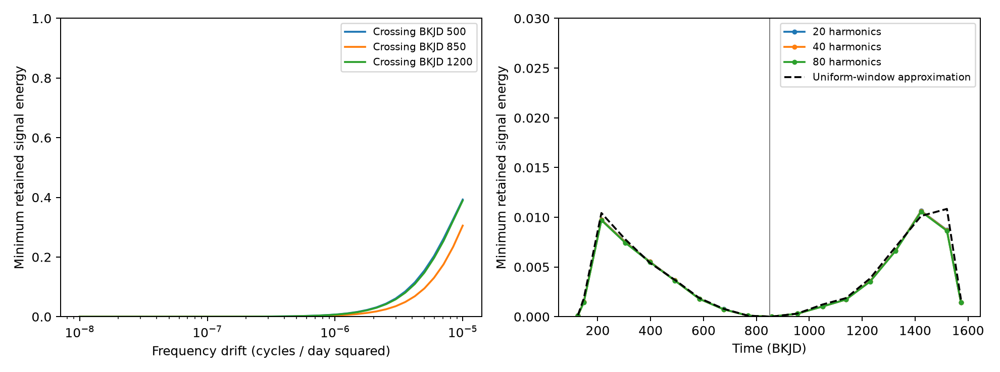

# Quarter orbital fits remove over 99 percent of a test frequency sweep in KIC 3230227 sampling

We test loss of a constant-amplitude signal whose frequency crosses the 13th orbital harmonic at BKJD 850. The test uses public Kepler release 25 sample times for KIC 3230227. With a drift of 0.000001 cycles per day squared and 40 orbital harmonics fitted separately in each quarter, the full data retain 0.00406 to 0.00409 of signal energy over all phases. Quarter 9 retains only 0.0000066 to 0.0000069. A joint fit recovers added coefficients in a no-noise check. The result gives a search-method check for signals with changing frequency. It does not show a frequency sweep in the star, a new mode, or a planet. It does not test instrument corrections or real noise.



## Question and prior work

Can separate quarter orbital subtraction create a deep loss of signal as a constant-amplitude oscillation crosses an orbital harmonic? This matters when a residual search interprets a signal that fades and returns as a change in stellar excitation. We test a linear frequency sweep at actual Kepler sample times. We do not search the observed flux for a sweep or infer that a sweep is present.

Guo (2020, DOI 10.3847/1538-4357/ab911f) studies known tidal modes and nonlinear coupling in KIC 3230227. That work reports mostly stable modes. Guo, Gies and Fuller (2017, DOI 10.3847/1538-4357/834/1/59) gives the binary context. The constructed frequency drift here is a test input, not a measured value or a challenge to those results. General least-squares projection is an established method.

SCI 3e7129b73af75ad2295b3bfafd5823ad0dab0d9df706f6d6936a05e868ca6dd5 measures loss of coherent fixed-frequency modes near the same harmonic. SCI 52fa3764eee383e49866699468c049c67c3d9f33bdf4c548d769a345020465c8 reports related search sensitivity. We extend the fixed-frequency check to a two-parameter grid of frequency drift and crossing time. The new outputs are the phase bounds across that grid and the time-dependent response to a constant input amplitude. No prior code or derived arrays are reused.

Before this precise test, we ran `sci search "astronomy" --in ./campaign` and `sci search "3230227" --in ./campaign`. These full-folder checks were slow. We stopped only our two searches. We inspected published ZIP metadata and texts and completed SCI search on a subset of two relevant bundles. files/campaign_search.json preserves its verified results. files/search_record.json records the limited scope. We make no complete novelty claim. No private sibling workspace was used as research evidence.

## Data

The exact shared raw path is `/mnt/dell-data/shared_datasets/kepler-kic3230227-q0-q17-dr25/lightcurves.tar`.
The resolved path is `/mnt/dell-data/shared_datasets/.campaign-dataset-objects/kepler-kic3230227-q0-q17-dr25-1kcdinmf/lightcurves.tar`.
The source is the NASA MAST Kepler S3 mirror:

https://stpubdata.s3.amazonaws.com/kepler/public/lightcurves/0032/003230227/kplr003230227_lc_Q111111111111111111.tar

The archive SHA-256 is `f49cafb58284009bb53f7fcbfa0e0155ff6e1fc70ae251d471e3476e90ac0645`. It is release 25 long-cadence data. files/provenance.json records hashes of all used FITS members, release fields, selected counts and software versions. Existing shared data were read in place and were not changed. No raw download was needed. The source data rights still apply.

Keep finite TIME, SAP_FLUX and PDCSAP_FLUX with SAP_QUALITY=0. This matches the common sample selection in the cited fixed-frequency test. There are 52,076 selected samples in quarters 0 to 17. Only TIME and quarter enter our calculation; flux determines finite-sample selection but is not fitted. Both flux products share exposures. This study has one sampling set, not two independent flux confirmations. BKJD means BJD minus 2454833. files/samples.npz preserves every selected time and quarter for offline checks.

## Test definition

Adopt P=7.047106 days and f_h=13/P=1.844728886 cycles per day. For crossing time t_c and constant frequency derivative r, the signal phase in radians is

`theta(t) = 2*pi*[f_h*(t-t_c) + 0.5*r*(t-t_c)^2]`.

The instantaneous frequency is `f_h + r*(t-t_c)`. The two columns S are sin(theta) and cos(theta). A fixed vector c sets a constant input amplitude and initial phase for the whole mission. Rates span 41 logarithmic steps from 1e-8 to 1e-5 cycles per day squared, plus zero, at t_c=500,850,1200 BKJD. A separate example uses r=1e-6 and t_c=850. A negative-rate control uses r=-1e-6. A fixed-frequency control uses the published f16=1.8441372 cycles per day. The example duplicates one grid point; it is stored for convenience, not treated as another observation. The rates and crossing times are designed stress tests with no data-based selection.

For each quarter, X contains a constant, linear and quadratic time trend, and sine and cosine at orbital harmonics 1 through H. H=40 is the main case; H=20 and H=80 test finite harmonic-order sensitivity. Time polynomials are centered and scaled to each quarter. The harmonic phase zero is BKJD 1000. No mask, clipping, weighting, extra pulsation term, or fitted orbital period is used. This design follows the cited response test and includes both binary light and any orbit-repeating oscillations. It does not separate their physical sources.

Use a reduced QR decomposition of X. With R=I-Q Q transpose, the subtracted signal is R S c. Do not form the dense projector R. Compute G=S transpose S and K=S transpose R S=(R S) transpose (R S). The smallest and largest generalized eigenvalues of (K,G) give exact minimum and maximum retained energy ratios over every c. Sum G and K over quarters to obtain full-mission bounds, with one common c across the mission. This is not an average of independent quarter phases. Round only in the printed tables. The CSVs keep full precision.

A retained energy fraction is not a recovered Fourier amplitude or a detection probability. Its square root is a retained signal norm ratio. A later fit of unprojected signal columns to subtracted data can also bias coefficients. A joint fit projects both the data and signal columns and can recover coefficients in exact data, but it has less information when K is small. We verify this distinction with an added-signal calculation.

## Results

The r=1e-6, t_c=850 example retains only 0.0040601 to 0.0040935 of full-mission signal energy at H=40. Thus, it loses more than 99 percent for every input phase. The frequency changes by about 0.00147 cycles per day across the data span. The test input amplitude does not change.

The deepest quarter loss occurs in Q9, near the crossing. The response before and after this quarter rises. This provides a deterministic example of a changing residual envelope without changing input amplitude. The short Q0 and Q1 windows also have low response even far from the crossing. Quarter duration and gaps matter, so the minimum is not interpreted as a measured damping event.

| Quarter | Mean BKJD | Minimum energy fraction | Maximum energy fraction |
|---|---:|---:|---:|
| 0 | 125.30 | 0.0001292 | 0.0001405 |
| 1 | 147.30 | 0.0014698 | 0.0016256 |
| 2 | 213.98 | 0.0097402 | 0.0102175 |
| 3 | 304.52 | 0.0074882 | 0.0079891 |
| 4 | 397.33 | 0.0055161 | 0.0057259 |
| 5 | 491.28 | 0.0036494 | 0.0038636 |
| 6 | 584.21 | 0.0018016 | 0.0019023 |
| 7 | 675.58 | 0.0007491 | 0.0007696 |
| 8 | 769.05 | 0.0000990 | 0.0001029 |
| 9 | 857.35 | 0.0000066 | 0.0000069 |
| 10 | 954.32 | 0.0003009 | 0.0003102 |
| 11 | 1050.00 | 0.0010302 | 0.0010901 |
| 12 | 1138.85 | 0.0017299 | 0.0017501 |
| 13 | 1229.57 | 0.0035620 | 0.0036766 |
| 14 | 1325.98 | 0.0066352 | 0.0067359 |
| 15 | 1422.68 | 0.0106166 | 0.0112117 |
| 16 | 1520.19 | 0.0086891 | 0.0095081 |
| 17 | 1573.34 | 0.0014339 | 0.0014687 |

The fixed-frequency f16 control retains 0.0086907 to 0.0087478 of full-mission energy. This agrees with the prior fixed-frequency study after squaring its reported norm ratios. The maximum absolute difference between H=20 and H=80 quarter minimum-energy fractions in the sweep example is 0.0000953. These finite checks show that the large loss is not confined to a single tested harmonic order. They do not prove convergence for all designs.

The figure's left panel shows full-mission minimum energy over the positive-rate grid. The right panel shows the quarter response for the example. Its dashed curve is `1-sinc(delta_f*T)^2`, where sinc(x)=sin(pi*x)/(pi*x), delta_f=r*(mean_time-t_c), and T is the selected quarter span. It approximates the response of a continuous rectangular window to a nearby fixed-frequency sinusoid. It ignores gaps, other fitted columns, and chirp curvature. It is a guide, not an exact bound. For small offset, its leading term is `pi^2*delta_f^2*T^2/3`. Exactly at a centered crossing, chirp curvature instead gives an approximate floor `pi^2*r^2*T^4/180` under the same continuous-window assumptions. The exact matrix calculation includes that curvature.

## Validation

For Q8 at H=40, an SVD least-squares subtraction agrees with the QR projected signal to 5.22e-15 in sample units. An exact signal with coefficients [40,-20] added to a constructed orbital model is recovered by a joint SVD fit with maximum coefficient error 2.56e-13. Fitting unprojected signal columns after subtraction instead gives [0.004105100702000643, -0.0019635074451702286]. The joint design condition number is 205. These are no-noise implementation checks; they do not measure robustness to stellar or instrumental noise. files/validation.json preserves the exact values. files/validate.py independently rebuilds this quarter from the saved times and checks the reported energy bounds and injection coefficients.

At zero drift, the injected signal is exactly in the orbital design. Its computed energy is at roundoff level. This is an algebraic null control, not a nondetection in observed flux. Both positive and negative test drifts and all intermediate grid points are retained in the CSVs.

## Physical use and limits

A quarter template can follow a slowly changing phase difference from an orbital harmonic. It can therefore remove most of a constant-amplitude signal. Searches for mode growth, damping, or nonlinear interactions near a forced harmonic need a time-dependent transfer test as well as a fixed-frequency spectrum. One practical use of this code is to evaluate candidate clocks on the actual selected samples before interpreting their residual amplitudes. Joint fitting addresses coefficient bias in a specified model, but cannot restore information that the nuisance model makes nearly degenerate.

This study establishes a method response, not a new astronomical phenomenon. We do not fit flux, find a mode or planet, test pixel localization, or obtain independent observations. The test is one star's time sampling, one adopted period, quadratic quarter trends, and coherent sampled chirps. We do not measure a physical drift rate, give a detection limit, fit nonlinear mode dynamics, or validate the stability of the orbital light curve. Blends, detector errors, data-dependent masks, normalization, finite exposure integration and upstream correction can change a real search response. The signal is defined at sample times rather than integrated over an exposure. No uncertainty interval is needed for a deterministic projection conditional on exact inputs; the untested model choices remain a limit. The construction shows a possible analysis artifact, not its occurrence in this star.

## Reproduce

Use a writable copy. With Python and the packages in files/requirements.txt, rerun all extraction, response calculations, validation checks and figure creation into a new local directory:

```sh
OPENBLAS_NUM_THREADS=2 python files/analyze.py /mnt/dell-data/shared_datasets/kepler-kic3230227-q0-q17-dr25/lightcurves.tar /new/local/output
```

The script checks the exact archive hash and records member hashes. It writes only its output directory. To inspect the saved numerical evidence offline, use mission_response.csv and quarter_response.csv. For an independent SVD check without the raw archive, run `OPENBLAS_NUM_THREADS=2 python files/validate.py`. It reads only bundled samples and tables and prints its errors. To retrieve raw data when the shared store is absent, use `python files/retrieve.py /new/local/scratch/lightcurves.tar`. That script requires a new file and verifies the exact hash. Never replace a shared dataset. The retrieval recipe, samples, source, tables, figure and version record permit independent inspection. All calculations completed on the assigned host. No child agents were used.

## Campaign record

Campaign 11_07_2026. Job sci-1107-dell-astronomy-cabf59652f1c. Topic astronomy. Machine dell. Account codex-andrii. Model gpt-6.1-sol with high reasoning effort through the Codex harness in T3 Code. Date 2026-11-08. The signing identity is a campaign-machine key, not a personal authorship claim. No private key is included. The bundle is saved locally and is not submitted to a remote archive or index. The baseline license covers our text, figures, derived evidence and code, subject to original data rights.
