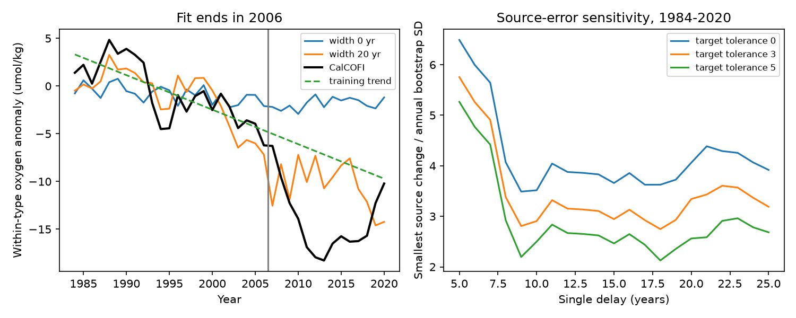
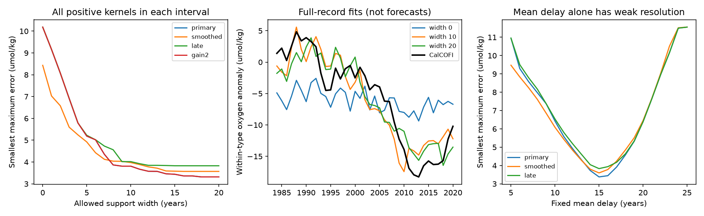

# A spread of western North Pacific delays reduced CalCOFI oxygen error in a 2007-2020 retrospective test

A western oxygen recovery does not have to appear as a distinct recovery in California. A spread of travel times can reduce the pulse. We tested this effect with published annual oxygen anomalies within water types on sigma0 26.5. The source is 36-46 N, 160 E-180. The target is the CalCOFI annual index. We fit a stationary, nonnegative transfer with delays from 5 to 25 years and total gain at most one.

A fit to 1984-2006 gave an RMS error of **6.25 umol/kg in 2007-2020**, compared with **12.87 for one delay**, **10.65 for persistence**, and **7.55 for a linear trend**. The broad transfer reduced mean squared error by 66% relative to persistence and 31% relative to the trend. It still gave too little oxygen loss: its evaluation mean was -10.36, against -14.15 observed. This is a useful improvement, not a complete explanation.

The new evidence has two parts. The western source can give a better later prediction when transport includes a spread of delays. Also, an optimization over all allowed positive kernels places a lower bound on the support width needed to fit the frozen records. A single delay cannot fit 1984-2020 with maximum error below 10.18 umol/kg. A tolerance of 4 requires an allowed interval at least 8 years wide. With a 3-year source mean it requires 10 years. These are conditional error bounds, not confidence limits or estimates of a physical transit-time distribution.

## Question and prior work

Mecking and Drushka (2024, doi:10.5194/bg-21-1117-2024) linked northwestern outcrop changes to oxygen at Ocean Station P with a lag near 10 years. Pozo Buil and Di Lorenzo (2017, doi:10.1002/2017GL072931) described downstream tracer propagation to California on a decadal time scale. These results motivate a transfer with a spread of delays.

The campaign source study sci:bfaf6c90 found a western oxygen decline, recovery in 2001-2006, and renewed decline. Its downstream test was unresolved after detrending. The earlier basin study sci:b4d3d3f5 found that no single lagged regional index beat persistence for the later CalCOFI low. The recent study sci:ce679f16 tested arbitrary positive kernels from a different source: a transition-zone and gyre index that combines ships and floats. Its early long-delay fit failed in later years.

We extend these studies with the separate western ship index. We ask whether transport dispersion can reconcile its recovery with the California record. We do not add new observations. The distinction between the western source and the transition-zone/gyre source is essential. Failure of one regional index does not exclude transfer from another source.

The plan and its amendment are in `files/analysis_plan.md`. The initial plan used the WOD B120 target. Before the full analysis, we changed to the frozen CalCOFI target because the WOD series had missing late years. The source-error, trend, block-resampling and forecast-stability tests were added after the first fits. They are exploratory checks. The historical outcome was already known, so this is a retrospective test.

## Data

We use two verified aggregate files. Exact member hashes, source publication IDs and shared campaign paths are in `files/provenance.json`.

- `files/inputs/west.csv`: the annual series table from sci:sha256:bfaf6c907a3921f24772235a5c558c20640093bacf1d6aab37774570994ba61e. The main column is the series `int_C_wt`. Its annual standard deviations come from the parent cruise bootstrap. Other rows provide the source sensitivities. The parent used World Ocean Database ship observations, TEOS-10 density and fixed effects for sampling. The western source has only a few oxygen cruises each year.
- `files/inputs/target.csv`: the CalCOFI annual table from sci:sha256:ce679f1663e6bbb3534b51b1bf1dbc082ccd8991f0d804c0e58448b63c6e0c92. That publication took it from sci:sha256:ea67ca59c8c830609ef22a9e4feaddc1ba6a3e2aa317a0afefc81f17fcfc03e3. We use `wt_a`, not total oxygen. The target is an annual fitted term after a water-type adjustment.

The principal record ends in 2020 to omit preliminary late CalCOFI values. The extension ends in 2025. Source gaps are filled by linear interpolation only between observed source years. There is no end extrapolation. All designs use the same 1984 start. The 5-25-year design has 37 primary target years and 42 extension years. The source years needed for the extension end in 2020. No shared raw dataset was used or downloaded.

## Model and checks

For target year t:

    y(t) = b + sum k(l) x(t-l), l = 5,...,25
    k(l) >= 0; sum k(l) <= 1.

The intercept b is free because the two source studies use different anomaly references. The unused gain can represent other sources with no anomaly. A constant route oxygen loss can enter b. A time-dependent route loss cannot enter b. Oxygen is reactive and a regional index is not a boundary concentration. This is an empirical closure test.

For every contiguous allowed delay interval, linear programming finds the smallest maximum absolute annual residual. At each interval width, we retain the lowest residual over every position. These are global bounds over arbitrary nonnegative weights in each interval. They do not require a Gaussian kernel. We also fix each integer mean delay and repeat the bound. A zero-gain solution satisfies the algebraic mean constraint but has no defined mean; the low-error solutions reported here have positive gain. Each fit checks primal feasibility and the LP primal-dual objective gap below 1e-6.

For the retrospective prediction, we repeat the interval search using only 1984-2006 target values. We fix widths 0, 5, 10 and 20 years in advance. Kernel coefficients and the intercept use no later target values. Persistence is the 2002-2006 target mean. The trend is fitted to the same 1984-2006 target record. The annual fitted input series themselves were constructed by their parents using the full records; this limits a strict forecast interpretation.

## Results

| Allowed support width | Smallest full-record maximum error | Training maximum error | Later RMS error |
|---|---:|---:|---:|
| 0 years | 10.18 | 4.43 | 12.87 |
| 5 years | 5.19 | 2.81 | 9.62 |
| 10 years | 3.81 | 2.65 | 8.58 |
| 20 years | 3.32 | 2.06 | 6.25 |

Units are umol/kg. Full-record bounds use 1984-2020. Prediction fits use 1984-2006 and evaluation uses 2007-2020. The interval positions and weights differ between full-record fits and prediction fits. A small full-record error is compatibility evidence only.

At maximum annual error 4, no interval narrower than 8 years is feasible. At tolerance 5, the minimum width is 7. At tolerance 3.5, it is 14. These illustrative tolerances are not measured uncertainty thresholds. The full-support minimax solution has gain 0.918 and mean delay 15.47 years. It is one optimum, not an age measurement. A broad kernel can spread a short source recovery over many target years, so the absence of a distinct delayed recovery does not itself exclude this stationary model.

The 3-year source mean gives later error 6.55 and full-record maximum error 3.57. Doubling the gain limit has no effect on the primary fit. The narrower 160-170 E source gives later error 6.77. Using raw western oxygen instead of within-type oxygen raises the broad-kernel later error to 8.80. Including target years through 2025 gives later error 5.64, compared with trend 6.58 and persistence 9.88. The main result therefore does not require preliminary late target values.

Four-year circular block resampling of the 14 paired evaluation errors gives an MSE gain over persistence of 74.30 (percentile range 38.28-102.57), and over the trend of 17.90 (1.47-34.17), in squared umol/kg. These ranges condition on the fitted model and frozen indices. They exclude neither preprocessing uncertainty nor model-selection uncertainty and are not independent causal evidence.

## What remains uncertain

The full-record width requirement depends on treating the source index as exact. We therefore calculate an explicit source-error sensitivity for every single delay. Each source year can change by at most rho times its published annual bootstrap SD. We allow a target tolerance of 0, 3 or 5 umol/kg. For a fixed rho and delay, feasibility is a linear program in gain and intercept. Bisection gives the smallest rho. We save a common source-history witness for every result. A single delay maps distinct target years to distinct source years, so the witness is consistent across target years.

With target tolerance 5, a single 18-year delay becomes feasible at rho = 2.13. With tolerance 3 it needs 2.75. An exact target fit needs at least 3.49 (best delay 9). These are rectangular error allowances, not probabilities or simultaneous confidence bands. SDs in missing source years are interpolated. This does not supply a joint error model. It shows how large coordinated source changes can remove the width requirement.

The forecast also remains unstable under small changes in training tolerance. At its optimal training maximum error 2.0566, all optimal kernels give an evaluation mean near -10.36. Raising the permitted training error by 0.5 allows evaluation means from -13.59 to -5.39; raising it by 1 allows -14.87 to -3.52. The observed mean is -14.15. A sharp physical travel-time inference is therefore not supported.

Only one time split is tested. The broad fit has 21 delay weights plus an intercept for 23 training years. Positivity limits it, but it is still flexible. Shared trends, local forcing, changing pathways, incomplete water-type adjustment and changing oxygen use can produce apparent transfer. The bootstrap does not address these alternatives. The result supports a testable role for dispersed transport; it does not prove that outcrop loss quantitatively explains California, identify a parcel age, or explain the North Atlantic loss.

A useful next test would fix the kernel from independent circulation or tracer data, then test a new reversal. It would also need source-error covariance and final target quality control.

## Reproduction and rights

Run with Python, NumPy, SciPy, pandas and Matplotlib:

    bash files/reproduce.sh /absolute/external/scratch/output

This uses one numerical thread and writes derived outputs outside the signed draft. Runtime is about one minute on this host. `analyze.py` computes kernel bounds and forecasts. `uncertainty.py` saves the source-error witnesses. `diagnostics.py` computes error-block ranges and near-optimal forecast bounds. Exact versions and input hashes are in `files/provenance.json`. To retrieve the two frozen inputs again, use `python files/retrieve.py CAMPAIGN_DIR EXTERNAL_SCRATCH`. It verifies each source ZIP before extraction. For regeneration from raw observations, use the cited parent publications and their retrieval code.

The bundle contains our code, text, figures and aggregate annual indices reused from baseline SCI publications with attribution. It contains no raw cast, bottle or float data. External terms and attribution are in `files/NOTICE_external_data.md`. LICENSE is the unchanged SCI baseline license. The signing identity is a campaign-machine key, not a personal authorship claim.

Job sci-1107-dell-earth-and-ocean-sciences-1b596762034a; topic earth-and-ocean-sciences; campaign 11_07_2026; machine dell; account codex-olen; model gpt-6.1-sol with high reasoning in T3 Code. Analysis date: 2026-11-11.
