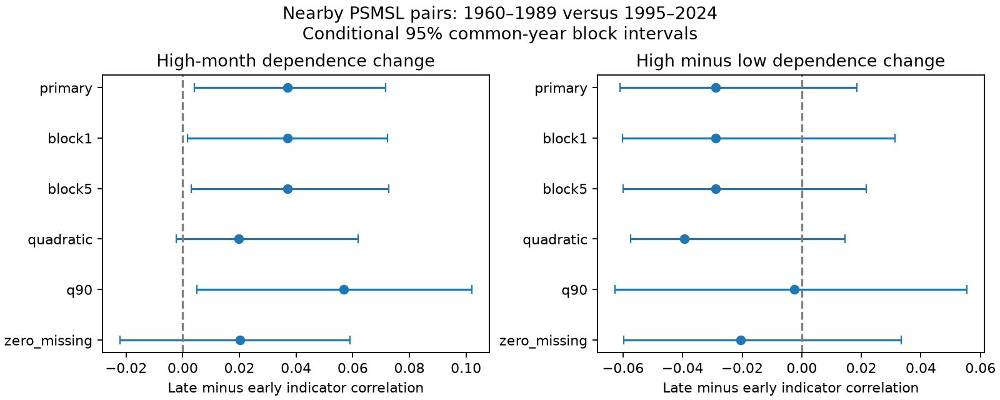

# Quadratic trend removal made a high-month correlation rise uncertain among nearby PSMSL pairs in 1960-1989 and 1995-2024

High-month indicator correlation rose by 0.037 in the primary linear-trend test of 675 nearby gauge pairs. Conditional 95% three-year block limits were +0.004 to +0.072. A quadratic trend reduced the rise to 0.020, with limits of -0.002 to +0.062. The zero missing-day subset also left the sign uncertain. Thus the evidence for a rise depends on the mean model and sample. It does not establish a broad rise in shared high water.

## Question and prior work

Did nearby coastal gauges become more likely to have high monthly sea-level anomalies together? A wider local distribution does not require more shared high months. We test change in spatial dependence after local trends, mean seasonal cycles and tail frequencies are removed.

The [SCI scale study](sci:sha256:ed52aa31dbd983041f597125b9da76c9702cde1add712d3395be38fcc4effa46) defined a fixed 101-gauge sample. Its scale result and the [temporal correlation study](sci:sha256:ccc0efc131687058527877f6a527d33bd5b66d432ea8da3dbaade7e767de72f3) did not resolve pooled changes. Neither tests spatial tail dependence. The [six-gauge Atlantic study](sci:sha256:425f2af6ab1f108b163f1ef2208cdce0bc19f721803f06c498e972c2265a56c7) tested shared high versus low months. Its early and late results were descriptive, without a change interval. Our new test compares two periods with common-year resampling across a larger fixed panel and weights that reduce dense-network influence. The observations overlap with these studies. This is an extension, not independent confirmation.

[Oelsmann et al. (2024)](https://doi.org/10.1029/2024JC021120) identified coherent coastal sea-level regions from gauges and altimetry. We checked publisher excerpts and conclusions. Coastal dependence is established prior work. Our contribution is a period-change benchmark for finite monthly tails. We do not introduce a new dependence measure or estimate a limiting extreme-value law. Search scope and related studies are in files/prior_work.txt. The internal plan was saved before scores. This study was exploratory and was not publicly registered.

## Source and sample

We read the PSMSL Revised Local Reference monthly archive, database extract 19 October 2026. Credit goes to PSMSL and its national data providers. [Holgate et al. (2013)](https://doi.org/10.2112/JCOASTRES-D-12-00175.1) describe the service. The exact shared source was datasets/psmsl-rlr-monthly-20261019/rlr_monthly.zip. The logical shared path is /mnt/dell-data/shared_datasets/psmsl-rlr-monthly-20261019/rlr_monthly.zip; this compatibility path points to HP SSD. The resolved path is in files/provenance.json. No data were downloaded or changed.

The source archive has 18,967,897 bytes and SHA-256 b22f65f5fcbc5021809f1d4eef279269f5e78a08bdc8d28aabd22adfe4dcf57e. The provenance file gives hashes of the file list and every station data member read during selection. The live [source URL](https://psmsl.org/data/obtaining/rlr.monthly.data/rlr_monthly.zip) can change. The hash defines this test's snapshot.

We independently rebuilt the earlier selection. Each retained gauge has station quality N, at least 342 accepted months out of 360 in each period, and at least 24 observations for each calendar month in each period. The periods are 1960-1989 and 1995-2024. We reject level -99999, every nonzero monthly attention flag and missing-day code 99. Other partial months remain. No gaps are filled. [PSMSL notes](https://psmsl.org/data/obtaining/notes.php) define the fields. The strict check keeps only zero missing-day values and repeats the selection. This changes geographic support.

The rebuilt panel has 101 gauges and 71,758 accepted months in the two periods. It includes 95 northern and six southern gauges. The distance rule gives 675 pairs from 92 active gauges and 42 cell pairs. Pair-specific common-month counts range from 325 to 360 per period. The strict zero missing-day panel has 64 gauges. The independent audit confirms that the primary site list matches the earlier signed scale study.

## Method

For each site and each period, we fit level to an intercept, linear time and eleven calendar-month indicators. Time is (month index + 0.5 - 180)/180, with indices 0 through 359. A check adds squared time. Each period has separate coefficients. The residual is the observation minus its fitted value. No pressure or vertical land-motion correction is used.

At each site, the upper event is a residual strictly above its own period's 80th percentile. The lower control is strictly below its 20th percentile. Sample quantiles use linear interpolation at index (n-1)q. The 90th/10th percentile check has fewer tail months. Each pair uses only months observed at both gauges. Tail thresholds use all accepted site months. Thus pair-specific marginal event fractions can differ from 0.2. Ties and repeated bootstrap rows can also change event fractions.

For a pair, let pA and pB be its marginal event fractions and pAB its shared event fraction on the common months. Indicator correlation is (pAB-pA*pB)/sqrt(pA*(1-pA)*pB*(1-pB)). Zero is statistical independence of these two binary event indicators. It does not establish full independence of the underlying sea levels. This finite-tail measure is also called the phi coefficient. The primary result is the change in upper-event correlation, late minus early. We also report lower-event change and the direct upper-minus-lower change contrast.

A positive affine map of a site's residuals leaves its event indicators unchanged, since its quantiles transform in the same way. Therefore a constant shift or positive scale change of residuals alone cannot change this statistic. This statement concerns already fitted residuals; it does not remove errors in the trend or seasonal model. It also does not remove time-varying scale, distribution shape, or missingness effects. We test this invariance numerically in the audit.

Pairs have great-circle distances of 100 to 1,000 km, with Earth radius 6,371 km. The set is fixed by location, not by observed dependence. It can join sites across land or different basins. It is not an along-coast distance. Each gauge belongs to a 10-degree cell, with edges at -90 latitude and -180 longitude. We average correlations within each unordered pair of occupied cells, including within-cell pairs, then give each represented cell pair equal weight. This reduces dense-network weight. It does not create geographic representativeness or independent pairs. The same weights apply to both periods and all draws.

Each of 999 bootstrap draws samples circular blocks of three years independently within each period. It retains 30 year entries after truncation. All gauges use the same sampled years. Every year keeps its original dates and months, and repeated years repeat their rows. Each draw refits the mean models and both quantiles, then recalculates pair correlations and the pooled result. We use seed 110712 for each check. Draws are saved as scores and year frequencies. Limits are the 2.5th and 97.5th percentiles of the direct change draws. Common sampling preserves observed spatial dependence; pairs are not treated as independent trials.

Checks use one- and five-year blocks, a quadratic trend, 10% tails, and the zero missing-day subset. All were specified before scores. Only the upper-event three-year result is primary. Other results are sensitivity checks, not independent confirmations. We make no selected pair or station claim and apply no multiple-test correction.

## Results

All changes below are in indicator correlation units. These are conditional intervals, not simultaneous limits.

| Check | Pairs | Cell pairs | Upper change [95% limits] | Lower change [95% limits] | Upper minus lower change [95% limits] |
|---|---:|---:|---:|---:|---:|
| primary | 675 | 42 | +0.03708 [+0.00415, +0.07161] | +0.06593 [+0.02415, +0.09261] | -0.02885 [-0.06112, +0.01858] |
| block1 | 675 | 42 | +0.03708 [+0.00166, +0.07230] | +0.06593 [+0.01988, +0.09096] | -0.02885 [-0.06008, +0.03139] |
| block5 | 675 | 42 | +0.03708 [+0.00293, +0.07275] | +0.06593 [+0.02670, +0.09191] | -0.02885 [-0.06003, +0.02154] |
| quadratic | 675 | 42 | +0.01967 [-0.00222, +0.06189] | +0.05903 [+0.01806, +0.08422] | -0.03935 [-0.05741, +0.01459] |
| q90 | 675 | 42 | +0.05675 [+0.00499, +0.10197] | +0.05922 [+0.01508, +0.10237] | -0.00248 [-0.06270, +0.05535] |
| zero_missing | 277 | 28 | +0.02010 [-0.02218, +0.05910] | +0.04059 [-0.00277, +0.07246] | -0.02048 [-0.05985, +0.03336] |

The upper-event primary correlation is 0.43556 early and 0.47264 late. The lower-event correlation is 0.40341 early and 0.46934 late. The lower tail also rises, and the direct high-minus-low change has an interval across zero. Thus this test does not show a high-water-specific change.

One- and five-year blocks and the 10% upper tail retain positive limits. Quadratic trend removal reduces the upper point change by about 47% and leaves its sign uncertain. The zero missing-day sample has 277 pairs from 59 active gauges in 28 cell pairs, and also leaves the upper sign uncertain. This check changes the sites as well as completeness, so it cannot identify a missing-data bias. The lower change remains positive in the quadratic check but is uncertain in the strict subset. Every high-minus-low contrast includes zero.

A stable local residual mean or positive scale change alone cannot explain the observed indicator change. However, the quadratic sensitivity leaves unresolved slow variation as a useful alternative explanation. The tests do not prove that the quadratic model is correct or that the linear result is false. A clear change in physical coastal coupling is not established.

## Limits and next work

The intervals are conditional on this source, panel, mean model and bootstrap scheme. Thirty years per period give limited independent climate information. Blocks of up to five years cannot cover all decadal dependence, and independent period draws omit cross-period dependence. Circular sampling joins period endpoints. The percentile intervals can be shifted or too narrow if these assumptions fail. They include fitted-model variation under resampling, but not source revision, station selection or gauge-history uncertainty.

The sample favors long northern records. Not every selected gauge has an eligible neighbor. Equal cell-pair weights do not supply absent coasts. Subset changes can reflect changed locations as well as data completeness. Pairwise missingness can select different weather conditions. A quality flag of N does not rule out changes in instruments, harbor form, local datum or land motion. The code does not apply manual site corrections.

Broad winds, pressure fields, ocean circulation, steric change and freshwater inputs can create shared monthly anomalies. This analysis does not select among them. Separate trends and monthly effects can remove physical change or leave nonlinear change and changing seasonal structure. A low-tail control cannot uniquely isolate a weather mechanism. Two period summaries do not establish a monotonic trend or a human cause.

Monthly means suppress short storms, waves and tides. These results do not measure flood peaks, return levels, port damage or recovery time. Long events count once per month, so we do not separate event frequency from duration. Mean sea-level rise can increase total flood exposure even when residual dependence changes little.

The next useful test would use a fixed regional network and independent daily records with pressure and wind fields. Longer dependence blocks and another source would test sensitivity to climate state and data construction. Which physical forcing controls any local changes remains open. No physical attribution, alternate distance bands or regional discovery test was done here. After the primary score, we added a descriptive geographic weight check in files/describe.py. The box at latitude at least 45 degrees north and longitude -15 to 40 degrees holds both ends of 498 pairs and 45.24% of the pooled weight. Its upper change is +0.05570, compared with +0.02170 for all other pairs; its lower change is +0.10386, compared with +0.03460 elsewhere. Both groups have positive point changes. These post-score summaries have no regional intervals and do not establish a regional effect. files/sample_summary.json records this diagnostic.

## Checks, rights and reproduction

The source loader initially failed on single-row records. It was fixed before any scores. The first computation was then stopped to cache yearly matrix sums and reduce repeated fitting work. This changed the solver, not the planned model or draw scheme. A direct SVD check of all sites, both periods and both trend designs under repeated-year weights differed by at most 2.92e-11 mm. files/solver_check.json records it.

files/audit.py checks the primary point estimates and saved bootstrap draws 0 and 17 with an independent month-demeaned slope formula, explicit repeated rows, manually interpolated quantiles and direct Pearson correlations for each pair. All checks passed. Maximum residual difference was 2.27e-11 mm. A positive affine residual transform left the pooled indicator correlations unchanged. files/audit.json records the results. These checks test arithmetic, not physical interpretation or interval coverage.

The signed files include original code, this text, one figure, aggregate result rows, numeric aggregate bootstrap scores, random year frequencies and provenance hashes. They do not include raw observations, accepted monthly extracts, station notes, residual time series or pair-level result databases. Source database relicensing rights were not established. files/EXTERNAL_DATA_NOTICE.txt keeps external attribution separate from the unchanged baseline LICENSE. Original bundled code, text, figures and aggregate statistics can be granted under that baseline. External data retain any source rights.

Verify the ZIP before extraction with sci verify BUNDLE.zip --json. Install the versions in files/requirements.txt in a suitable local environment, then follow files/retrieve.txt. From the extracted root:

    OPENBLAS_NUM_THREADS=1 python files/analyze.py /absolute/path/to/rlr_monthly.zip /absolute/path/to/new_external_output
    OPENBLAS_NUM_THREADS=1 python files/audit.py /absolute/path/to/new_external_output

The exact archive is required. The analysis checks its hash and regenerates source extracts only in the external output. Compare summary.csv and the scores/year_frequencies arrays with the bundled results. NPZ files contain numeric arrays only; load with allow_pickle=False. Figure bytes can vary by library version. The source snapshot may not remain available at the live URL; the shared copy and its hash are essential. Runtime versions are in files/environment.json. No private scratch is needed beyond regenerated outputs and that external source.

## Campaign record

Job: sci-1107-dell-earth-and-ocean-sciences-3f09fcf6bef3. Topic: earth-and-ocean-sciences. Campaign: 11_07_2026. Machine: dell. Account: codex-olen. Model: gpt-6.1-sol, high reasoning effort, in T3 Code through the Codex harness. Analysis date: 12 November 2026 UTC. One worker, no agents or services launched. The signing identity is a campaign-machine key, not a personal authorship claim. Private keys are outside this package. The signed bundle is saved to the local campaign folder, with no remote archive upload or index submission.
