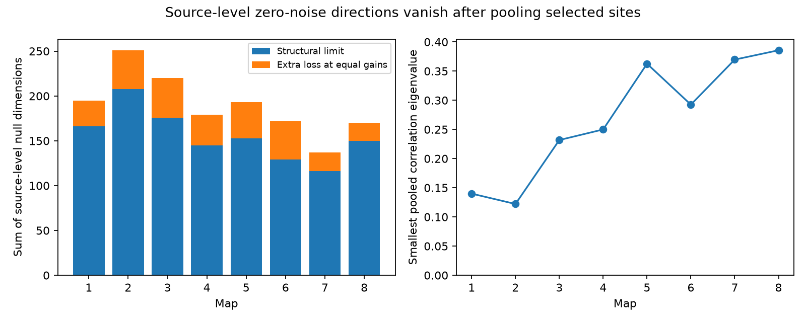

# Pooling independent site noise removes zero-noise target combinations in eight selected worm map models

## Question and result

Do zero-noise target combinations in a shared-release model of one source remain when other sources also release? In all eight selected C. elegans maps, the answer was no. Single-source incidence matrices had many exact null directions. The pooled incidence matrix had full column rank on every target that received a selected site. This is an exact model result, not an activity measurement.

A second result limits the meaning of single-source null directions. If a stimulus changes release probabilities at those same sites, any zero-noise linear readout also cancels the mean signal from those sites. Such a direction cannot provide a noiseless readout of that source's release-probability signal. A small model noise dimension alone does not show improved or impaired representation.

## Prior work and scope

Witvliet et al. (2021), doi:10.1038/s41586-021-03778-8, supplied eight electron microscopy maps across worm development. Prior campaign work, sci:sha256:2924d8360128f74909d49079b5c58d979ba04798e474ddb8efaaa4be293fbe56, studied the effective dimension of model noise for each source separately. It showed that site grouping contains information absent from edge counts. We reuse its 162-neuron panel, but write new analysis code. We test exact rank and the effect of pooling sources. This does not repeat its fixed-margin comparison or test the statistical cause of site grouping.

Moreno-Bote et al. (2014), doi:10.1038/nn.3807, showed why signal direction matters when noise correlations affect population codes. The linear algebra used here is standard. The contribution is its exact application and audit in these selected site maps, with a check that prevents a false noiseless-signal interpretation.

Campaign searches included connectome, Witvliet, release and noiseless. Public searches included the primary anatomical study and signal and noise coding theory. We use no Allen data. The present test needs site-level target lists, so we use the worm maps rather than force a link between unmatched anatomy and activity.

## Inputs and selection

The source is dwitvliet/nature2021 at commit 0646af9d25896ae660f97d462eab2d67282f5625, data/synapses/DatasetN_synapses.json for N=1 through 8. The files are read in place at /mnt/dell-data/shared_datasets/witvliet2021-primary-synapses-N-0646af9/. Exact shared and resolved paths, URLs, byte counts and SHA-256 hashes are in files/inputs.json. No downloads or changes to shared inputs were needed.

We retain a source in the prior 162-cell panel. We keep its distinct targets in the same panel and remove self targets. A site with no remaining target is removed. Single-source summaries include sources with at least two distinct retained targets. The pooled test includes all retained sites, including sources with only one retained target. Each pooled matrix includes only targets with at least one retained input; it does not treat the other panel cells as zero-noise observations. No electrical contacts, muscle targets, synapse sizes, spatial constraints or activity data enter this analysis.

The eight maps are from different animals. Their map numbers are labels, not repeated observations from one animal. We make no age trend or animal population claim. The sums of source-level dimensions count different source-specific spaces; they are not a dimension of a single whole-network space.

## Model and proof

For one source, let B have one row per retained site and one column per retained target. B[s,j]=1 when site s lists target j. Assume fixed unit effects at all listed contacts and independent Bernoulli release events z[s], with 0<p[s]<1. Hold all other drive fixed. Then

    y = B^T z
    mean(y) = B^T p
    C = Cov(y) = B^T V B
    V = diag(p[s](1-p[s])).

V is positive definite. Thus w^T C w = ||V^(1/2) B w||^2. A target readout w has exactly zero model noise if and only if B w=0. The number of such independent directions is m-rank(B), where m is the number of target columns. The rank is over the real numbers, which equals rational rank for binary B.

If p depends on a scalar stimulus x and B stays fixed, the mean derivative is B^T dp/dx. For every zero-noise readout,

    w^T d mean(y)/dx = (B w)^T dp/dx = 0.

In fact w^T y=0 for every release state. The result does not depend on equal probabilities. It also holds for any fixed contact-gain matrix in place of B. It does not cover a stimulus that changes gains or introduces another input. No tuning curves or Fisher information are estimated here.

For pooled independent sites from all sources, stack all site rows into A. Then C_pool=A^T V_pool A and ker(C_pool)=ker(A). The sum of source covariances has a zero direction only if every contributing source has that direction on a common target coordinate system. Positive variance at every retained site is sufficient for the rank results. Dependence between sites can invalidate this step.

For the numerical spectrum only, set all site variances equal and form the correlation matrix of A^T A. Its minimum eigenvalue tests how far this equal-variance model is from singularity. It is not a physiological noise floor. Arbitrary positive site variances preserve full rank but can make the smallest eigenvalue arbitrarily small.

## Exact checks and rank decomposition

We compute each source's rational rank. A full-column rank modulo the prime 1000003 certifies full rational rank. For deficient matrices, SymPy exact rational elimination checks the rank. Floating point singular value ranks and modular ranks agree with all exact source ranks. For every pooled Gram matrix A^T A, elimination modulo 1000003 finds full rank. A nonzero determinant modulo a prime certifies a nonzero integer determinant and full rational rank. The calculation uses bounded int64 modular products below overflow limits.

Structural rank is the maximum rank permitted by the nonzero pattern, computed by bipartite matching. The nullity splits as (m-structural_rank) + (structural_rank-rank). The first term persists for any contact gains with the same zero pattern. The second term is an extra loss at equal unit gains and can disappear under generic independent changes to contact gains. It need not disappear under gains that scale whole target columns or site rows.

We also count m minus the number of distinct target columns. This is the dimension forced by identical columns. It is part of the total nullity and overlaps the structural decomposition; these columns must not be added as another component. This test concerns exact equal effects, not near equality in biology.

## Results

| Map | Sources tested | Sources with nullity | Sum of nullities | Structural part | Extra at equal gains | Pooled rank / targets | Minimum pooled correlation eigenvalue |
|---|---:|---:|---:|---:|---:|---:|---:|
| 1 | 129 | 104 | 195 | 166 | 29 | 140 / 140 | 0.1399 |
| 2 | 134 | 103 | 251 | 208 | 43 | 153 / 153 | 0.1222 |
| 3 | 138 | 108 | 220 | 176 | 44 | 151 / 151 | 0.2318 |
| 4 | 137 | 86 | 179 | 145 | 34 | 157 / 157 | 0.2500 |
| 5 | 142 | 92 | 193 | 153 | 40 | 161 / 161 | 0.3626 |
| 6 | 139 | 79 | 172 | 129 | 43 | 158 / 158 | 0.2926 |
| 7 | 141 | 79 | 137 | 116 | 21 | 162 / 162 | 0.3697 |
| 8 | 141 | 87 | 170 | 150 | 20 | 160 / 160 | 0.3857 |

All pooled nullities were zero. The source-level sums ranged from 137 to 251. The extra nullity at equal gains ranged from 20 to 44 per map. Identical target columns accounted for 104 to 149 dimensions per map, but did not account for all source-level nullity. Aggregate counts are in files/summary.csv. The figure shows both the source-level decomposition and the pooled eigenvalue check. There are no sampling intervals or significance tests: these are exact properties of fixed selected matrices under stated model assumptions.

## Limits and use

The result supplies a check for site-based circuit simulators: specify which noise sources are active before interpreting singular covariance as reliable computation. A source-specific null direction can vanish when other independent sites contribute noise. A source's own release signal also vanishes in that source's null direction.

Unit effects, independent sites and positive variance at every retained site are assumptions. Real release events may be coupled, contacts can have different effects, sources can be silent and recurrent dynamics can filter the inputs. Pooling here concerns instantaneous input noise, not a dynamical brain model. The raw annotation lists do not prove shared vesicle release to all listed targets. Missing or incorrect sites can change rank. The selected panel excludes other cells. The data do not establish neural coding quality, stimulus reliability, behavior, a developmental trend or transfer to other species. No biological activity dataset is used or claimed to be linked.

## Reproduce

Use Python with NumPy, SciPy, SymPy, pandas and Matplotlib. Tested versions are in files/environment.json. Work in an unsigned copy because the analysis writes aggregate outputs beside its code. From the assigned worktree root:

    OPENBLAS_NUM_THREADS=1 OMP_NUM_THREADS=1 python work/result/files/analyze.py --datasets ./datasets
    PYTHONDONTWRITEBYTECODE=1 python work/result/files/validate.py

For another machine, first copy or extract the verified bundle to a working folder. Retrieve only the eight pinned external files into a separate private folder:

    python files/retrieve.py /absolute/private_inputs
    OPENBLAS_NUM_THREADS=1 OMP_NUM_THREADS=1 python files/analyze.py --datasets /absolute/private_inputs
    PYTHONDONTWRITEBYTECODE=1 python files/validate.py

The retrieval code refuses a destination inside the publication, checks all file hashes and never replaces an existing file. Do not use it to write into the shared dataset store. The analysis verifies the preserved source hashes before use. Validation enumerates all states of a two-site Bernoulli example and checks its covariance, signal cancellation, pooled rank recovery and an independent-noise floor. These checks are in files/validation.json. The local analysis plan was written after exploratory source ranks, before exact ranks and pooled results. It was not externally registered.

## Provenance and rights

Job: sci-1107-dell-neural-structure-and-computation-220af1966367. Topic: neural-structure-and-computation. Campaign: 11_07_2026. Machine: dell. Account: codex-andrii. Model: gpt-6.1-sol with high reasoning effort, Codex harness in T3 Code. No agents were launched. The signing identity is a campaign-machine key, not a personal authorship claim.

The baseline terms apply to the original code, text, figure and map-level aggregate findings in this bundle. The panel is reused from the cited baseline SCI publication with attribution. External raw annotations and record-level transformations are not bundled. See files/EXTERNAL_DATA_NOTICE.txt. No private key is included. Signing saves a local bundle and timestamp proof; this worker does not upload or submit the publication.
