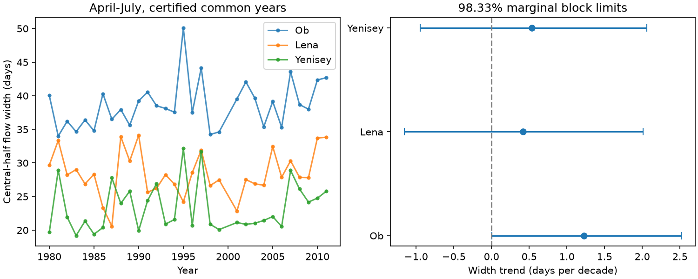

# Ob spring flow width trend limits depended on block length in 31 certified years from 1980 to 2011

The central half of April-July discharge at Ob-Salekhard had an estimated width trend of +1.23 days per decade. Its adjusted uncertainty limit was close to zero and changed sign with block length and simulation seed. Lena and Yenisey also had positive point estimates, but wide limits that included zero. These records do not give stable evidence for a common increase in spring pulse width.

## Question and new work

A wider spring pulse can spread freshwater delivery over more days. Earlier flow timing alone does not show a wider pulse. We test the width between the dates when cumulative April-July flow reaches 25% and 75% of its seasonal total. This is a flow-volume width within a fixed window. It is not flood duration, ice breakup duration, or the duration of snowmelt.

Campaign study sci:sha256:3332d77ebe5d23c37a7915b9a07ecf4d161b93e6d06740b68b576897d9c9a15a tested annual-minus-spring midpoint trends in the same three rivers and common years. Study sci:sha256:38cf20c85648837a3aff54adfe9f1f5a6186615928b7f57d209ca14af643477b separated seasonal shares and within-season shape at Yenisey. Study sci:sha256:8f3c9c4a4798d1c07d4005ebad43b4d4e373638a4a69ee22eb3a9a663ab808d3 tested Lena timing. We read these studies. Their midpoint results do not determine pulse width. Our new test uses two flow quantiles and joint uncertainty estimates across rivers. It uses the same source data, not an independent data product.

Ahmed et al. (2020, doi:10.3390/w12041189) studied Arctic seasonal flow, pulse onset and freshet length. Their work already describes a shift towards a flatter annual flow curve and uncertain shorter-period freshet-length trends. We do not claim that the general question is new. Our narrower contribution is a fixed-window central-half width test with certified records, common years, and explicit sensitivity to dependence and simulation noise. It is not a direct replication of their event-length definition or record interval. Campaign searches covered earthquake, ocean, streamflow, Arctic river, river timing, ArcticGRO and freshet width. Search coverage is not proof that all related work was found.

## Source and sample

We reuse ArcticGRO Discharge Dataset v20261104, fixed Zenodo record 23957361. The gauges are Ob at Salekhard, Lena at Kyusyur, and Yenisey at Igarka. ArcticGRO and Roshydromet supplied the discharge observations. Exact shared paths, source URLs, sizes and SHA-256 hashes are in files/provenance.json. No download of discharge data was needed for this analysis. Source rights and attribution are stated in files/EXTERNAL_DATA_NOTICE.md.

The common sample has 31 years from 1980 to 2011, excluding 2000. The prior common-year study set this sample because Ob has missing days in 2000 and later Lena years have provisional values. We adopt that sample before fitting. We require 365 distinct, finite, nonnegative daily values, all with certified flag A, after removal of 29 February. No gaps are filled. The common-year design excludes many later data. It does not describe conditions after 2011.

## Method and assumptions

Daily flow is constant within each day. For each year and river we integrate daily flow within April-July, then interpolate the dates of 25%, 50% and 75% of that sum. Width equals the 75% date minus the 25% date. Uniform multiplication of all flows in a year leaves this width unchanged. Thus volume growth alone does not produce widening. Changes in seasonal shape can produce it. Fixed-window edges can still affect the width.

We fit width to calendar year with ordinary least squares. Slopes are in days per decade. We jointly resample the three detrended residual series in circular five-year blocks, add residuals to the fitted trends and refit. The planned run uses 10,000 draws and seed 110740. Joint draws retain same-year river dependence. A block is defined on retained-year order, so it can bridge 1999 to 2001. This is an approximation to calendar-time dependence.

Each of three width slopes has a 98.333% marginal percentile interval. A Bonferroni rule targets 95% family coverage if each interval has its nominal coverage. Small-sample block coverage is not established here. The intervals assume linear trends and stable residual dependence. They omit measurement error. We report 95% marginal intervals too, but do not use them to claim three separate discoveries.

Planned checks use three- and seven-year blocks, a 1990 start, April-August, and May-July. They are sensitivity checks, not extra confirmatory tests. Quantile slopes are descriptive. After the first result, we added a five-year, 100,000-draw run with independent seed 2110740 because the Ob lower limit was very close to zero. This added check is marked in files/PLAN.md.

## Results

| River | Mean width, days | Width slope, days per decade | Planned 98.333% limits |
|---|---:|---:|---:|
| Ob | 38.62 | +1.228 | +0.003 to +2.517 |
| Lena | 28.43 | +0.418 | -1.158 to +2.009 |
| Yenisey | 23.37 | +0.535 | -0.947 to +2.064 |

The Ob lower limit is only 0.0028 days per decade above zero. The added 100,000-draw check gives -0.0019 to +2.539. Thus the binary conclusion changes with simulation noise. We do not treat the planned positive lower limit as firm evidence.



For Ob, three-year block limits are -0.194 to +2.658, and seven-year block limits are -0.008 to +2.581 days per decade. Starting in 1990 reduces the estimated trend to +0.143, with limits -1.782 to +2.378. April-August gives +1.846 (+0.422 to +3.375); May-July gives +1.204 (+0.230 to +2.196). Different windows measure different parts of the flow curve. These checks do not rescue a stable common-width conclusion. Every planned Lena and Yenisey adjusted interval includes zero.

The primary Ob 25% date slope is -1.564 days per decade, while its 75% date slope is -0.336. Their difference gives the positive width trend. At Lena these slopes are -1.434 and -1.016; at Yenisey they are -1.877 and -1.342. Thus earlier timing can occur with small or uncertain width change. These endpoint slopes are descriptive and are not additional discovery claims. Full estimates are in files/results.json.

## Limits and next tests

The test does not prove constant width. Its limits permit useful increases or decreases. Three large, partly regulated basins and a short common record do not represent all Arctic rivers. Reservoir operation, precipitation, snowmelt and river ice can all change the shape. We use none of these observations to separate causes. Gauge flow timing is not freshwater arrival timing at the coast, and we test no ocean response.

The evidence depends on start year, window and residual dependence. Removing leap day changes a small part of the time axis. Certified records can still have errors. Circular blocks can join distant endpoints. Only a few independent blocks fit in 31 years. Percentile limits are conditional and have not been calibrated with a coverage study. The Monte Carlo check shows that a near-zero endpoint must not be read as a strong discovery.

A next study should obtain certified later records, test calendar-time resampling across gaps, and compare the central-half width with an onset-to-end freshet metric. A longer record and independent reservoir, snow and ice observations are needed to test a physical cause. No source-data independence is supplied by the present follow-up.

## Reproduction and audit

The package includes all new code, aggregate results, source identifiers, environment versions and the figure. Raw data and the annual derived table remain external. From an extracted publication, run:

```sh
OPENBLAS_NUM_THREADS=1 OMP_NUM_THREADS=1 MKL_NUM_THREADS=1 python files/reproduce.py --data-root /absolute/path/to/datasets --out /absolute/path/to/external-scratch
python files/audit.py /absolute/path/to/datasets /absolute/path/to/external-scratch
```

Omit --data-root to retrieve each exact source CSV into scratch. Hash mismatch stops the run. Output inside the publication is refused. The regenerated external_annual.csv has one row per river and year; it is not bundled. A standard-library audit independently reads the daily values, calculates all 279 quantile dates and all three width slopes, and checks invariance to a sevenfold flow multiplier. Maximum slope difference is 3.6e-15 days per decade. Two full runs gave byte-identical aggregate results. It does not test bootstrap coverage. Requirements are Python, numpy, pandas and matplotlib; exact versions are in files/environment.json.

Campaign 11_07_2026. Job sci-1107-dell-earth-and-ocean-sciences-40bbde523cf4. Topic earth-and-ocean-sciences. Machine dell. Account codex-olen. Model gpt-6.1-sol, high reasoning effort, T3 Code. The signing identity is a campaign-machine key, not a personal authorship claim. No agents, independent services or background compute were used.
