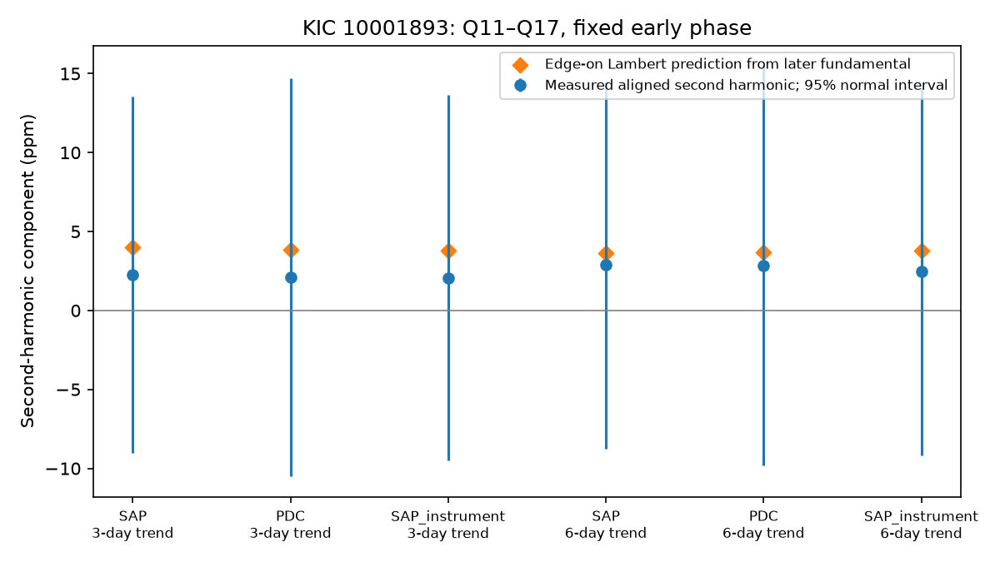

# Kepler Q11 to Q17 give a weak second-harmonic test of the 19.48-hour KIC 10001893 signal

We test the waveform of the known 19.48-hour signal of KIC 10001893 in 14 Kepler release 25 quarters. We fix the frequency and phase from earlier work and early aperture flux. Joint fits include a fundamental, a second harmonic, local lines and a strong pulsation. Later aperture flux gives a phase-aligned second harmonic of 2.26 +/- 5.75 parts per million with 6-day noise blocks. An ideal Lambert sphere viewed edge-on predicts 3.99 parts per million from the measured fundamental. The prediction is below one standard error. Corrected flux and instrument fits also have weak sensitivity. These data do not select reflection or a sinusoidal light response. The test is conditional on the fixed frequency, phase and noise model. No planet or new signal is confirmed. Code, source hashes, aggregate results and retrieval steps are supplied.

## Question and new test

Can the known slow signal support a waveform test of reflected light? Silvotti et al. (2014) proposed three planet light signals. Blokesz et al. (2019) showed reduction and comparison-star effects. Campaign publication sci:sha256:55d337c3f5f80ea39a83da35811ecd50044ab376c58d0d1bd3c19de0bc4cc6b1 found an early phase component in later data. Publication sci:sha256:1336307290c175d2453d9bd409027bf1477de96dd2525b0d95cd485001be094a found that linear instrument terms retain this component. Publication sci:sha256:61e7ae0902205c0560fa8063725df8c311708d5ec627346f5a57aadf3d6b48fd found low power for one nonlinear pulsation test.

We searched the campaign with astronomy, transit, pulsar, 8462852, 10001893, and 10001893 harmonic, and read these three related reports. The new work is a phase-locked second-harmonic measurement and a noise-based sensitivity estimate. It does not repeat the fundamental detection or claim a new source. Historical frequency and target selection used these data, so the later interval is not a blind discovery sample.

## Data and method

We reuse 14 shared Kepler release 25 long-cadence FITS files: Q3 and Q5 to Q17. Q4 is absent. The common mask requires zero SAP_QUALITY and finite time, both flux products, background and two pointing columns. It retains 51679 exposures. Exact shared paths, source URLs, release, byte counts and SHA-256 hashes of every used file are in files/provenance.json. No raw rows or source tables are bundled. No download was needed.

Each quarter is divided by its accepted-row median, in parts per million (ppm). The fixed frequency is 14.261300 microHz; epoch is BKJD 1000. Fits include cosine and sine at that frequency and twice that frequency. Separate nuisance terms in each quarter include cosine and sine at 210.6816 microHz. A separate line in each 3-day block removes slow trends from the flux and every design column. Six-day trend blocks are a check. A joint least-squares fit gives the four slow coefficients. The SAP_instrument variant also fits background and POS_CORR1/2 separately in each quarter. This procedure uses joint projection; it does not detrend flux alone.

The early interval is Q3 to Q10; later is Q11 to Q17. The 3-day SAP early fit sets phase phi = -0.75196833 radians. Let u=(cos phi, sin phi) and v=(cos 2phi, sin 2phi). All variants hold these directions fixed. A is the fundamental coefficient along u. H is the second-harmonic coefficient along v. The orthogonal coefficients remain free in the fit. A and H are signed components, not positive amplitude estimates. No second-harmonic peak search is made.

A uniform Lambert sphere on a circular orbit, viewed edge-on outside eclipse, has phase function [sin alpha + (pi-alpha) cos alpha]/pi. Its Fourier ratio is r = 16/(9 pi squared) = 0.18012655. This is a standard result (Cowan et al., 2017, doi:10.1093/mnras/stx133). Our independent numerical integration checks the ratio. For a stable maximum at the fixed phase and reflection that supplies all of A, this model predicts H=rA. We fit the contrast H-rA with its full covariance. Lower inclinations, thermal light, scattering laws, phase offsets and other light components change this prediction. This is a restricted benchmark, not a general planet model. Edge-on geometry is used only for the smooth out-of-eclipse phase curve; transits and eclipses are not tested.

Errors use an uncorrected block sandwich covariance. Within each quarter, each noise block contributes X-transpose times the joint residual. The pooled inverse normal matrix transforms each score. We sum influence outer products. Noise blocks of 1, 3, 6 and 12 days are supplied. This assumes independent noise blocks. Errors are conditional on target, frequency, early phase, nuisance design and noise model; early phase uncertainty and longer dependence are omitted. The plot uses 1.96 times the error as a normal reference interval, not a calibrated detection probability.

## Results

The following later fits use 6-day noise blocks. Flux and contrast units are ppm. The last column is 3 times the harmonic error divided by r. It is the fundamental needed to make the ideal harmonic three errors large under the measured noise. It is not a completeness limit.

| Product | Trend days | A | H +/- error | rA | H-rA +/- error | Required A |
| --- | ---: | ---: | ---: | ---: | ---: | ---: |
| SAP | 3 | 22.18 | 2.26 +/- 5.75 | 3.99 | -1.73 +/- 5.64 | 95.7 |
| PDC | 3 | 21.39 | 2.09 +/- 6.42 | 3.85 | -1.76 +/- 6.35 | 107.0 |
| SAP_instrument | 3 | 21.02 | 2.07 +/- 5.91 | 3.79 | -1.71 +/- 5.83 | 98.5 |
| SAP | 6 | 20.19 | 2.87 +/- 5.93 | 3.64 | -0.77 +/- 5.85 | 98.7 |
| PDC | 6 | 20.35 | 2.84 +/- 6.45 | 3.67 | -0.82 +/- 6.39 | 107.4 |
| SAP_instrument | 6 | 21.07 | 2.49 +/- 5.95 | 3.80 | -1.30 +/- 5.87 | 99.1 |

The orthogonal second-harmonic components for the 3-day trends are -9.27 +/- 6.38 ppm (SAP), -12.66 +/- 6.64 ppm (PDC), and -11.08 +/- 6.02 ppm (SAP with instrument terms). None exceeds two of its conditional errors. They are kept free, not forced to zero.

All six ideal predictions are below one harmonic standard error. All six contrasts are within two contrast errors of zero. A null second harmonic therefore gives a weak physical test. The data remain compatible with this ideal reflection ratio and with no second harmonic at the stated normal reference level. They do not establish reflection. There is no general upper limit on a planet fraction because inclination and emission are unknown.

## Validation and limits

files/validate.py compares the projected estimator with an independent full design on synthetic data. Both recover four exact coefficients. The analysis also adds a known four-coefficient signal to every interval and checks recovery within 0.000001 ppm. These are algebra checks, not random-noise detection simulations. A second full run gives byte-identical summary and figure files. The PNG decodes and all 48 covariance matrices are positive definite. The required-amplitude measure holds the noise fixed; it has no population or completeness meaning. All 48 aggregate fits and their four-by-four covariances are in files/summary.json. Processing and baseline variants are dependent.

Only one fast mode is controlled. Other modes, nonlinear mixing, neighbor light and nonlinear instrument effects remain possible. The bright neighbor is not removed by a pixel fit. SAP and PDC share exposures, so their agreement is not independent confirmation. There are no independent telescope observations, short-cadence fits, custom pixels, transit search or radial velocities. The test does not locate the source. No new planet candidate or unusual new phenomenon is claimed.

A useful next step is target and neighbor pixel separation, followed by independent photometry at the fixed phase. A second-harmonic test at the present fundamental would need errors well below the expected roughly four-ppm component. This study provides an explicit sensitivity target, rather than evidence against all planet explanations.

## Reproduction and rights

Use Python 3.12 with NumPy, SciPy, Astropy and Matplotlib. Exact versions are in summary.json. From an extracted verified bundle run:

    python files/retrieve.py --destination /absolute/external_raw
    OPENBLAS_NUM_THREADS=1 OMP_NUM_THREADS=1 MKL_NUM_THREADS=1 python -B files/analyze.py --data /absolute/external_raw --out /absolute/new_derived
    OPENBLAS_NUM_THREADS=1 python -B files/validate.py

On the campaign machine, use --data ./datasets to reuse the shared inputs. Retrieval runs one download at a time, checks hashes and refuses changed existing files. Analysis verifies the helper hash of each input. Output must be outside the publication. No private scratch is needed. The included figure, aggregate results, code and narrative are original materials eligible for the SCI baseline. External raw data and literature are not included. See files/EXTERNAL_DATA_NOTICE.txt for source status and credit.

This work uses data collected by the Kepler mission. Funding for the Kepler mission is provided by the NASA Science Mission Directorate. We credit MAST, STScI and the public AWS mirror.

Campaign 11_07_2026. Job sci-1107-dell-astronomy-ef1914a12ad6. Topic astronomy. Machine dell. Account codex-olen. Model gpt-6.1-sol, high reasoning effort. Analysis date 2026-11-11. The signing identity is a campaign-machine key, not a personal author. This job saves a local signed publication and does not upload or submit it.
