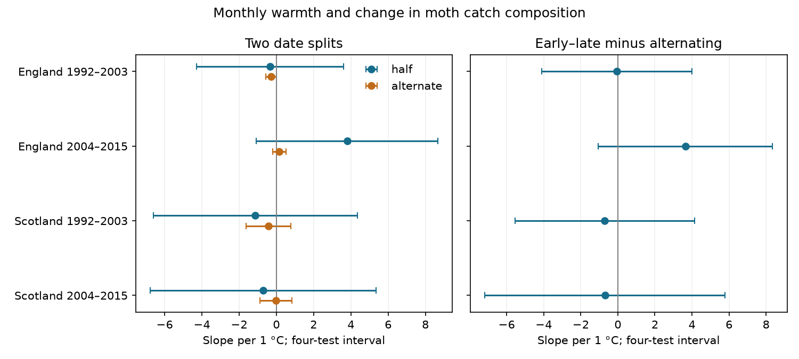

# Warmth slopes for within-month moth composition change were uncertain in four British samples in 1992-2015

Job: sci-1107-dell-climate-pollution-biodiversity-09c34b9b5b33. Topic: climate-pollution-biodiversity. Campaign: 11_07_2026. Machine: dell. Account: codex-myxtap. Model: gpt-6.1-sol with high reasoning effort. Date: 2026-11-09. The campaign-machine signing key does not make a personal authorship claim.

## Result

Monthly warmth did not have a clear common link to within-month change in moth catch composition. We tested four samples from England and Scotland in 1992-2003 and 2004-2015. Each main interval included zero. The estimates permit large positive and negative links. They do not show that the true link is zero.

We compared early and late visits in each trap-month. We then subtracted the composition difference between alternating visits in that same month. Both distances include a correction for finite catch size. This contrast asks whether warmth is linked to more temporal structure than the alternating split captures.

| Region and period | Months | Slope per C | Four-test interval |
|---|---:|---:|---:|
| England, 1992-2003 | 239 | -0.062 | -4.109 to +3.986 |
| England, 2004-2015 | 232 | +3.644 | -1.066 to +8.353 |
| Scotland, 1992-2003 | 52 | -0.701 | -5.556 to +4.154 |
| Scotland, 2004-2015 | 34 | -0.697 | -7.185 to +5.791 |

There were 557 eligible trap-months in total. Slopes use 100 times squared taxon-share distance per C. They are not percent changes in richness or abundance. Mean excess distances were 16.77, 16.25, 8.57 and 7.65 in table order.

Bars use a t interval with a correction for four tests within each outcome. Separate regions and periods test consistency. They are disjoint records, not four independent experiments. Traps can recur across periods and weather can correlate between regions.

## Question and prior work

Can faster seasonal change explain part of the link between warmth and light-trap records? Monthly richness can change when taxa enter and leave the adult flight stage within the month. A composition comparison that holds the month and trap fixed can test one part of this explanation. It cannot identify the cause of the change.

We searched the campaign before selecting this question. Searches for climate, phenology, pollution, moth rain and moth within month found prior tests of catch richness, observation timing and adjacent-year composition. We read and verified sci:sha256:06dc7cded149294f30e29fd4042620f73104a929da18bd8df3dcc858dfeafd5f and read sci:sha256:504e0fb930e0e71afc2e3af7ce1c74a43f82122f2dd1c53d215a6b998af41c25. The latter compares adjacent years, not dates within one month. We reuse source-selection code and the same archive. This is not independent validation of those records. The new contrast and fits were selected before viewing their estimates. The study is exploratory and not preregistered.

Jonason and colleagues (2014, doi:10.1371/journal.pone.0092453) showed that weather and season affect light-trap catches. This supports a direct check of within-month catch structure. The ECN protocol uses standard Rothamsted light traps, with daily emptying where possible. Rennie and colleagues describe the joint environmental archive (doi:10.5194/essd-12-87-2020). These sources motivate the question; we make no claim to a full literature review or a new distance estimator.

## Data and visit selection

We used ECN moth data for 1992-2015, supplied by Rennie and colleagues through EIDC (doi:10.5285/a2a49f47-49b3-46da-a434-bb22e524c5d2), and Met Office country temperature and rainfall series. See files/EXTERNAL_DATA_NOTICE.txt for credit and external rights. All six inputs were already in the shared dataset store. We read them in place and checked their exact SHA-256 hashes. No download or change to shared data was needed. files/provenance.json lists the exact resolved shared paths, source URLs, snapshot sizes, retrieval times and hashes of the inputs actually used.

We retained May-September records in England and Scotland. We kept positive integer counts with numeric taxon labels 1-969. These are core macro-moth labels, not a full species inventory. We excluded Q-flagged samples, duplicated duration keys, all site quality-note date ranges and samples with a duration other than one day. A biological record or explicit no-moths marker must confirm a visit. An absent date is not a zero catch. A valid visit with no core taxa contributes zero core catch.

For each trap-month, we sorted valid visit dates. The first floor(n/2) visits formed the early group; the others formed the late group. A second partition put visits with even and odd sequence numbers in two groups. Thus the split follows visit order, not fixed calendar halves. Each of the four groups needed at least five visit dates and 50 individuals. The partitions overlap in records, and each uses the same total catch. Counts are pooled within each group. English samples contain seven sites and nine or eight trap units. Scottish samples contain two sites and three or two units. Scotland has 11 represented years early and 12 later. England has 12 in each period.

## Distance and observation bias

For group counts a_i and b_i, totals N and M, and shares p_i=a_i/N and q_i=b_i/M, the direct distance is D=sum((p_i-q_i)^2). We use

    U = sum(a_i*(a_i-1))/(N*(N-1))
        + sum(b_i*(b_i-1))/(M*(M-1))
        - 2*sum(a_i*b_i)/(N*M).

Under independent multinomial samples with fixed group probabilities, U has expectation equal to squared probability distance. The algebraic identity D-U=(1-sum(p_i^2))/(N-1)+(1-sum(q_i^2))/(M-1) holds for each group pair. We checked it on every retained calculation. U can be negative and we do not truncate it.

The main outcome is 100*(U_early_late-U_alternating). The subtraction is paired within a month, not a comparison of unrelated samples. It removes some general between-visit variability. It does not remove all observation bias. Pooling changing nightly probabilities violates the fixed-probability sampling model. Nightly clustering and taxon-specific capture can also violate it. We therefore interpret U as a descriptive corrected catch distance, not as an unbiased estimate of latent biodiversity. Alternating dates can retain seasonal differences when visits have gaps. Unequal catch totals also change weights even when visit counts are close.

## Models and checks

We fit separate ordinary least squares models in the four region-period samples. The target predictor is country monthly mean temperature. Controls are rainfall per 100 mm, number of visits, standard deviation of visit day, mean visit day, trap by calendar-month fixed effects and year fixed effects. Each trap-month has equal weight. Year effects remove common annual shifts; remaining temperature variation comes from month-specific deviations across years. Residual temperature RMS values were 0.74, 0.66, 0.52 and 0.43 C in table order.

We clustered model scores by year. The covariance multiplier is G/(G-1)*(n-1)/(n-k), where k is design rank and G is the number of observed years. Intervals use t(1-0.05/8, G-1). This is a Bonferroni rule for four tests within an outcome, conditional on valid marginal coverage. It does not correct for all model choices. Few year clusters and dependence across years can make coverage poor. Country weather is shared by traps, so we do not treat each trap-month as an independent weather exposure.

files/results.csv gives every retained model, including both component distances. Sensitivity fits lower the group threshold to three dates and 30 individuals, raise it to seven dates and 100 individuals, omit visit-date controls, use direct uncorrected distance, or replace year effects with a linear trend. Main excess-distance signs persist with the lower threshold, no-date and raw variants. The high-threshold early Scottish sign changes. The high-threshold later Scottish sample has only 15 records and a deficient design, so it is not fit. files/skipped.json records all omitted fits.

Only the later English linear-trend variant has a corrected excess-distance interval above zero: +4.50, interval +1.10 to +7.91. The main year-effect interval includes zero. This suggests sensitivity to annual confounding or to the variation that year effects remove. It does not establish a general warmth effect. All other retained excess-distance sensitivity intervals include zero.

All retained design matrices have full rank. A separate residualization calculation checks every target coefficient. An explicit year-score covariance calculation matches the library cluster covariance. files/numerical_checks.csv records the errors. We rebuilt the source panel and reran the full analysis; the aggregate results matched byte for byte. files/build_checks.json records the external panel hash and distance-identity error. Code checks unique visit keys and catch conservation across each partition.

## Limits and contribution

The method provides a paired check of temporal structure in catch composition while keeping the same visits. It does not measure a species range shift. The two Scottish sites and short periods give limited precision. Selection for sufficient catch and visits can itself depend on weather. Timing shifts, changing populations, habitat, local weather, moonlight, light attraction and identification can all change the outcome. Month and year effects do not remove every confounder. Squared shares give greater weight to common taxa. Country means do not measure conditions at each trap. The group threshold does not guarantee representative coverage of the whole month.

These data do not establish a repeated warmth link in the selected scope. They also do not rule one out. The study tests weather variation, not a causal effect of climate change. It tests no extreme-event threshold and has no air pollution measure. Local daily weather, independent activity measures and more regions would be needed to test those explanations.

## Reproduce

The bundle contains our code, narrative, figures, model summaries and check results. It excludes external raw inputs and all record-level derived panels. Do not write new outputs into the signed package.

On the campaign machine, from the extracted publication folder, run:

    python files/build.py /absolute/path/to/assigned-worktree /absolute/path/to/new-scratch
    python files/analyze.py /absolute/path/to/new-scratch /absolute/path/to/new-results

The first argument must have the datasets link. The script checks six source hashes before analysis. Elsewhere, retrieve the pinned external inputs into a new local tree:

    python files/retrieve.py /absolute/path/to/new-input-root
    python files/build.py /absolute/path/to/new-input-root /absolute/path/to/new-scratch
    python files/analyze.py /absolute/path/to/new-scratch /absolute/path/to/new-results

Retrieval writes outside the publication and checks every hash. It does not replace existing inputs. Mutable URLs can fail the hash check if a source changes; the script stops rather than uses changed data. Exact historical bytes may then require a source archive or the shared snapshots. files/environment.json records library versions. Compare new results.csv with the bundled table and new panel.csv SHA-256 with files/build_checks.json. The baseline LICENSE applies to bundled original material. External rights and attribution remain separate. The signed ZIP is saved locally; this job does not upload or submit it.
