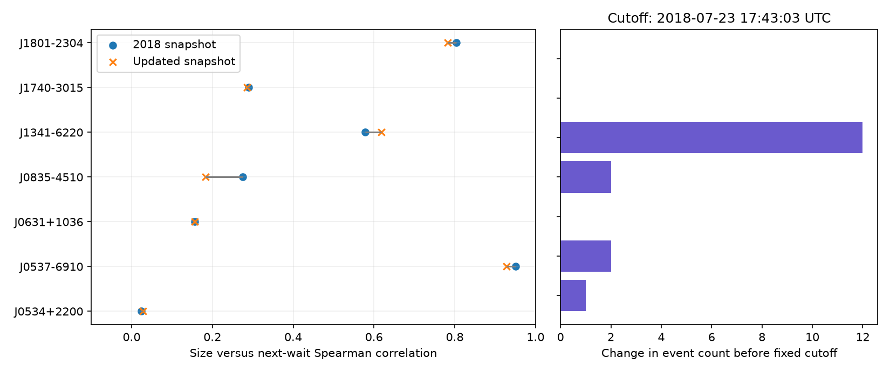

# Historical size-to-wait correlations change by less than 0.10 across two catalog snapshots for seven selected pulsars

We compare two public Jodrell Bank glitch catalog snapshots. We use a fixed time cutoff, 2018-07-23 17:43:03 UTC. In seven pulsars with at least ten usable pairs in the old snapshot, the size-to-next-wait Spearman correlation changes by at most 0.092. The updated snapshot has 17 more events in this selected historical sample. The known strong relation in PSR J0537-6910 remains. This is a catalog version audit. It is not a new signal detection or an independent observation.

## Question and scope

A glitch is a sudden change in pulsar rotation frequency. A transfer of angular momentum from an internal superfluid can produce a spin-up. In a simple stress model, a large release needs a long time to recover to a fixed threshold. This can give a relation between glitch size and the wait to the next glitch. A catalog change can alter this relation: an added event can split an interval, and a revised size can alter its rank.

We test whether historical catalog changes alter this diagnostic in the well-sampled sources. We first considered a test of later forecasts. Most radio sources had too few intervals after the archive date for a useful multi-source test. We chose this version audit before calculating the reported comparison. The analysis is retrospective and was not registered in advance.

Fuentes, Espinoza and Reisenegger (2019, doi:10.1051/0004-6361/201935939) studied eight prolific pulsars. They found a strong forward size-to-wait relation in PSR J0537-6910 and weaker relations in other sources. Their work also tested missing small glitches and two glitch classes. Thus neither the correlation diagnostic nor the relation in J0537-6910 is new. Basu et al. (2022, doi:10.1093/mnras/stab3336) describes the Jodrell Bank catalog and additional timing measurements.

Earlier campaign work tested prediction in PSR J1341-6220 (sci:sha256:2545ed364a985ff06535c8f5a08fa7ee1a12528cf0f1af445b24a670a6be8122) and transfer of a J0537-6910 fit to NICER data (sci:sha256:dec316e468d04b7950a02bcad2db1ebae205b83d9bc304af18585cb03d331199). This study instead compares two catalog versions at one historical time cutoff. We reuse neither their code nor their derived measurements. The search records are included. A targeted campaign search for pulsar catalog revision had no results. This does not prove novelty.

## Inputs and rules

The old input is the Wayback capture with identifier 20180723174303. The updated input is the shared snapshot named jbo-glitch-table-20261104. These names do not define a formal catalog release. The file hashes define the exact inputs. The full HTML inputs contain 529 and 737 rows. We parse only table rows with eleven cells and an integer row index. We preserve the source reference text for each selected event.

We select sources with at least ten usable size-to-next-wait pairs in the old table. This gives seven pulsars. We keep events at or before MJD 58322.738229166665 in both tables. Thus observations after the cutoff cannot change the result. Within each source and snapshot, we sort all retained events by epoch. Each pair uses one event's fractional frequency step, in catalog units of 10^-9, and the difference to the next event's epoch, in days. We keep a pair only when its first size is positive and its wait is positive. Missing sizes do not cause us to join intervals across an event. The final event has no next wait. It is not assigned a zero wait.

Spearman correlation is the main statistic. Its change is a deterministic comparison of the two selected tables. We report nominal two-sided SciPy p values and Holm adjustments across seven sources in each snapshot as secondary diagnostics. These p values use an approximate independent-pair null. Adjacent waits share epoch errors and the catalog has selection effects. The p values are not calibrated physical discovery probabilities. No population confidence interval is claimed for the difference between these nested, dependent samples.

We also match rows by mutual nearest epoch, with limits of 1, 10 and 30 days. We report the number of matches at every limit. These are audit rules, not event identification proofs. At 30 days, all old rows have matches in six sources. PSR J1801-2304 has only 12 matches for 13 old rows. We calculate correlation on the matched updated rows alone only when every old row has a match. This holds the event list fixed while allowing epoch and size revisions under the matching rule. The residual change on adding all updated rows describes the effect of the changed list under this rule. It is not a causal decomposition.

For a limited error check, we draw each epoch independently and uniformly within its listed error bound, 3,000 times per source and snapshot. We reject draws that reverse event order. Missing error bounds are held at zero for this check and counted explicitly. We keep sample membership fixed, including at the cutoff. The 2.5 and 97.5 percentiles describe this assumed perturbation rule. They are not confidence intervals. They omit size errors, unknown timing errors, missing events and correlated timing fits.

## Results

See files/summary.csv for all values, files/pairs.csv for every interval, and files/matches.csv for the 30-day row matches. The numerical table below is generated from the same run.

| Pulsar | Old events | Updated events | Old rho | Updated rho |
| --- | ---: | ---: | ---: | ---: |
| J0534+2200 | 27 | 28 | 0.024 | 0.028 |
| J0537-6910 | 45 | 47 | 0.950 | 0.928 |
| J0631+1036 | 15 | 15 | 0.156 | 0.156 |
| J0835-4510 | 20 | 22 | 0.275 | 0.183 |
| J1341-6220 | 23 | 35 | 0.578 | 0.619 |
| J1740-3015 | 36 | 36 | 0.290 | 0.286 |
| J1801-2304 | 13 | 13 | 0.804 | 0.783 |



The largest absolute change is the Vela pulsar, PSR J0835-4510, from 0.275 to 0.183. Its updated historical list has two more events. PSR J1341-6220 has twelve more events; its correlation changes from 0.578 to 0.619. PSR J0537-6910 changes from 0.950 to 0.928. Under the nominal Holm rule, J0537-6910, J1341-6220 and J1801-2304 are below 0.05 in both snapshots. This is a descriptive test outcome under an approximate null, not confirmation of three physical laws. No selected source changes the sign of its point estimate. All point estimates are positive, but this does not mean all have evidence for a physical relation.

The matching table shows that the change in Vela and J1341-6220 comes from the extra rows under the 30-day rule: the matched-row correlations equal the old values. The last old J1801-2304 row is at MJD 57535.81 with size 96.1 and epoch error 0.06 days. The nearest updated row is at MJD 57586.2 with size 48.67 and error 0.1 days. The 50.39-day difference exceeds both quoted error bounds by a large amount. The old reference says “New - Our measurement (bshaw)”; the updated reference lists Basu+2021 and Lower+2021. We cannot establish from the catalog alone that these are the same physical event, a correction, or two different events. We leave them unmatched. This case shows why a small change in correlation is not proof that the event measurements are stable.

The epoch-check table separates exact catalog results from assumptions about timing errors. In the assumed epoch-error draws, the central 95 percent range for updated J1341-6220 is 0.533 to 0.666. For updated J0537-6910 it is 0.905 to 0.940. Five Vela events have unknown epoch errors, so its perturbation range omits those errors. No draw reversed event order. These checks do not include the uncertainty in glitch size. Small rank changes do not imply accurate event forecasts. This study does not fit or validate a prediction law.

## Physical interpretation and limits

The result shows that the known J0537-6910 size-to-wait relation survives this specific catalog update. It also shows that the weaker relations in the other selected sources do not become a different-sign pattern. This is consistent with a persistent stress-release diagnostic. It does not identify the stress, the angular momentum reservoir, a threshold law or a trigger. Several regions, variable release fractions and event classes can yield different relations. Fractional spin steps are only a proxy for stress release.

The snapshots are overlapping catalog compilations. They are not two independent telescopes or two independent samples. The table has no complete observing schedule, instrument state, pulse arrival times or detection efficiency. We cannot test phase-connection errors, timing noise or small missed glitches directly. Added catalog rows are not necessarily new observations; some are later published measurements of old data. Revised values and new entries can share fits. A stable catalog correlation cannot rule out a shared analysis artifact. The selected events' reference text gives routes to source measurements, but we did not re-fit those data.

This sample is selected for event count in the old catalog. It is not a complete pulsar population or a complete current glitch list. The cutoff and count rule limit the claim. The maximum change of 0.092 is an exact descriptive bound for these inputs, not an upper limit for other catalogs, sources or future updates. The timing perturbation rule is incomplete. It does not measure the uncertainty of a superfluid model. Independent pulse timing and a new sequence with a known detection limit are needed for physical confirmation. We report no new glitch, planet, source or unexplained signal.

## Reproduction and provenance

Job: sci-1107-dell-astronomy-bc24360eade5. Topic: astronomy. Campaign: 11_07_2026. Machine: dell. Account: codex-andrii. Model: gpt-6.1-sol with high reasoning effort. The signature uses the campaign machine key. It is not a personal authorship claim.

The exact absolute shared paths, source URLs, original download records, byte counts and SHA-256 hashes are in files/provenance.json. We read these two raw files in place and did not modify the shared store. Their hashes are:

- Old HTML: 4886c2ce1480cc840a55cdfd301803d7cb398a26d559d96bc8bf2386c6cc13b6.
- Updated HTML: e811419f2037080bd2c99c1db30555dd4ee6f462f36b91796908f0fe90aabeb4.

The bundle contains the selected numerical rows and reference text, not the full raw HTML. To reproduce offline, extract a copy of the verified ZIP and run from that directory:

```sh
python files/analyze.py
```

This reads files/old_events.csv and files/new_events.csv and writes the result tables, run.json and audit.png. Python 3.12, NumPy, pandas, SciPy and Matplotlib are required. Exact versions are in files/run.json. To audit selection and extraction from the raw HTML, also install BeautifulSoup4 and run:

```sh
python files/analyze.py --extract /mnt/dell-data/shared_datasets
```

The raw hashes must match before extraction proceeds. The exact helper calls are in files/retrieve.sh. If the shared inputs are absent, run that script in the campaign workspace. To use a new dataset name, edit a copy of that script and use --extract with a directory that holds the two expected dataset names. The source_url, filename and --sha256 values in provenance.json define each retrieval. The helper stages the download and records provenance. A live catalog can change; a changed hash is not the same input. If the exact snapshot cannot be retrieved, the included selected rows still support the offline calculation. Do not replace existing shared data. Run reproduction in an extracted copy because the script writes files that are covered by the original signature.

The analysis code and added figures use the baseline license. The source catalog and measurement papers retain their source credit and terms. This package does not claim rights to the full original catalog or papers.
