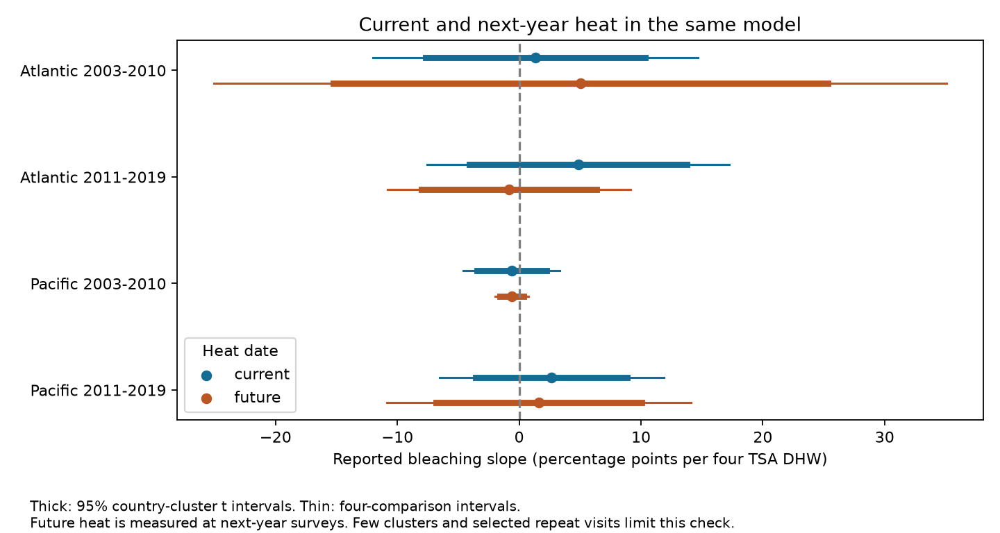

# Next-year heat gave no clear bleaching link in four matched Atlantic and Pacific coral samples in 2003-2018

We tested whether heat stress measured one year after a coral survey was linked to its reported bleaching. We used Reef Check records from the Atlantic and Pacific oceans. We matched the same site and calendar month in the next year. We fit four separate models for two oceans and two periods. Each model included current heat stress, depth, and site, year and month effects. All four adjusted intervals for future heat included zero. The intervals were wide. This test gives no clear future-heat signal, but it cannot show that a current heat estimate is free from bias.



## Question and prior work

Heat can harm reef communities. Survey records can also depend on when and where people visit. A useful check is to ask whether future heat predicts an earlier report after control for measured current heat. Future heat cannot cause past bleaching. However, it can track past heat that the model did not measure well. Such a test can detect some problems but cannot identify a bias source or validate a causal model by itself.

Sully et al. (2019, DOI 10.1038/s41467-019-09238-2) studied global bleaching and temperature. The source data description is van Woesik and Kratochwill (2022, DOI 10.1038/s41597-022-01121-y). Lipsitch et al. (2010, DOI 10.1097/EDE.0b013e3181d61eeb) describe the assumptions needed for negative control tests. We use their logic as a diagnostic, not as a bias correction.

Campaign searches included phenology, bird weather, ocean fish depth, coral bleaching, and future heat bleaching. We read SCI 053ae1380c211d172074dbb24811ca5ca0a63e4112efbad9fc0ce66ce2786ac2 and reuse its verified monthly evidence. A later search found SCI f5898b5e327ea84648225e96452f63b8faeaa226b110867958ef97b2d67438eb. That study compared three-month mean surface temperature before and after surveys. Our test extends that check to supplied accumulated heat stress one calendar year later, with exact site and month matches. It uses fewer records and a different exposure. These studies share biological records. They are not independent confirmation. The design was written before coefficient estimates, but was not registered. See files/plan.txt.

## Data and selection

We use BCO-DMO dataset 773466, version 2, dated 2022-10-14. We use only Reef_Check records in the Atlantic and Pacific in 2003-2019. The raw data contain repeated substrate rows for a survey. The source panel keeps one record per Sample_ID after checks that the used fields agree. It requires complete site, country, ecological region, year, month, depth, bleaching, and heat stress. Bleaching must be 0-100%, depth 0-40 m, and heat stress nonnegative. It averages samples within site, year and month. Each monthly record has equal weight. The outcome is mean reported bleaching percentage, not death or species richness.

TSA_DHW is the supplied CoRTAD version 6 thermal stress dose. It accumulates anomalies above the maximum weekly temperature norm over the prior 12 weeks, for anomalies at least 1 C. Four TSA degree-heating weeks (DHW) is our slope unit. This is not a fitted threshold or a claim that different DHW products are equal.

The verified source panel has 7,820 monthly records. A standard-library CSV audit rebuilt every field from the raw file with zero numerical difference. Future heat comes from an eligible survey at the same Site_ID and Date_Month in year t+1. No exposure is filled for an absent future survey. The future record also had to have a reported bleaching value because the source panel requires it. This is an important selection condition.

Both dates must be in the same period, 2003-2010 or 2011-2019. Thus the outcome years are 2003-2009 and 2011-2018. Each site must then have at least two distinct outcome years in its period. A record can be the future match for one row and the current row for another.

| Ocean and matching period | Source months | Next-year matches | Analysis months | Sites | Countries |
| --- | ---: | ---: | ---: | ---: | ---: |
| Atlantic 2003-2010 | 1,018 | 101 | 65 | 12 | 6 |
| Atlantic 2011-2019 | 695 | 109 | 76 | 28 | 9 |
| Pacific 2003-2010 | 2,679 | 315 | 144 | 57 | 9 |
| Pacific 2011-2019 | 3,428 | 682 | 555 | 162 | 6 |

Only 840 of 7,820 source months remain. The repeat rules reduce fixed site differences and seasonal mismatch, but they select a small subset. They do not correct visit or detection bias. The two oceans have separate sites. The periods have separate years, but can share sites. All records come from one reporting system.

## Model and uncertainty

The primary joint model is:

`mean bleaching = site effect + outcome-year effect + calendar-month effect + current heat/4 slope + next-year heat/4 slope + current depth slope + error`.

We fit ordinary least squares with explicit indicator columns and a pseudo-inverse. The indicator system has redundant columns. We use its effective rank for the degrees of freedom. Checks with repeated mean removal confirm that the three residual slope columns have full rank. The nuisance indicator values need not be unique, but the tested slopes are identified.

The primary covariance groups errors by country. Its multiplier is G/(G-1) times (n-1)/(n-rank). Student t limits use G-1 degrees of freedom. Primary future-heat intervals use two-sided alpha 0.05/4 for four comparisons. These are approximate Bonferroni intervals under the country-cluster assumptions. Six to nine countries are few clusters; t limits do not guarantee correct coverage. Shared ocean heat can link errors across countries.

Current heat slopes and current-minus-future contrasts are secondary. Their four-comparison intervals are separate descriptive families, not a simultaneous guarantee across all reported quantities. We also change the error groups to ecological regions or outcome years, and replace site effects with site-by-calendar-month effects. The latter check requires each site-month group in at least two outcome years. It changes the sample. We do not choose a model based on significance.

## Evidence

Slopes are bleaching percentage points per four TSA DHW. The table gives joint-model country-cluster intervals adjusted for four comparisons.

| Ocean and period | Current slope | Future slope | Adjusted future interval |
| --- | ---: | ---: | --- |
| Atlantic 2003-2010 | +1.33 | +5.01 | -25.07 to +35.09 |
| Atlantic 2011-2019 | +4.85 | -0.85 | -10.82 to +9.13 |
| Pacific 2003-2010 | -0.62 | -0.61 | -1.97 to +0.76 |
| Pacific 2011-2019 | +2.66 | +1.60 | -10.89 to +14.09 |

All future intervals include zero. All current and current-minus-future intervals also include zero. Current-only slopes on the same samples are -3.12, +5.06, -0.79 and +2.32. These intervals also include zero. A sign change in early Atlantic after adding future heat does not establish a difference. Its residual current-future heat correlation is -0.77. Correlations in the other samples are -0.23, +0.12 and -0.21. These values control the stated fixed effects and current depth. Sparse exposure and correlated predictors can make joint slopes unstable.

Future slopes with site-by-month effects are +5.78, -1.30, -0.79 and +0.08. Every adjusted interval includes zero. Grouping errors by ecological region or year also gives intervals that include zero in all four samples. Full estimates, sample sizes and interval limits are in files/estimates.csv.

## Limits and use

This test did not establish a repeatable future-heat signal. It also did not establish a lack of bias. Large future slopes remain compatible with several intervals. The early Pacific result is more precise, but it is not an equivalence test with a prespecified useful bound.

Future heat is measured only when a site was surveyed again and a percentage was reported. Earlier bleaching can affect those later visits. Conditioning on a future visit can create selection bias. Shared heat history, missing past heat, seasonal changes, observer error and changing coral composition remain possible explanations for associations. We have no observer IDs or full visit logs. Fixed effects remove only fixed site differences and common time patterns. The surface heat dose can differ from colony exposure. Monthly averaging loses day-level detail. Linear slopes need not hold at severe doses and should not be used as unrestricted percentage predictions.

This is a narrow method check in selected coral surveys. It cannot estimate long-term climate attribution, adaptation, air pollution effects, species loss, or distribution shifts. Bleaching is a stress response, not a direct measure of those endpoints. A stronger future study would obtain complete daily heat fields without conditioning on future survey presence, full visit logs, and independent monitoring data.

## Inspect and reproduce

Use a writable extracted copy. Python 3 with NumPy, pandas, SciPy, Matplotlib, threadpoolctl and Statsmodels is required. Exact analysis versions are in files/environment.json.

```sh
python files/analyze.py --out reproduced
python files/validate.py
```

The first command rebuilds matches, estimates, coverage, numerical checks and the PNG from files/source_panel.csv without network access. The second checks all primary coefficients and standard errors against Statsmodels using a full-rank indicator basis. Redundant indicators in the first validation attempt caused a numerical failure; selecting an independent indicator basis resolved it. The main slope design was full rank. The final validation output is in files/validation.json. A separate run reproduced all analysis outputs byte for byte; see files/reproduction_check.json. These checks concern implementation, not causal assumptions.

For an independent raw reconstruction:

```sh
python files/audit_raw.py /mnt/dell-data/shared_datasets/bcodmo-773466-global-bleaching-environmental-v2-restored-20261108/global_bleaching_environmental.csv
```

The exact shared path, source URL, version, size and SHA-256 are in files/provenance.json. Raw SHA-256: `78cc014b1e7887f26f4c44a40d4d9213212f3c6217541c6a1b69e723b61bfacb`. Raw size: 16,772,400 bytes. The raw file remains in place and is not duplicated. Elsewhere, retrieve the recorded source_url into scratch, verify that hash, and pass its path to the audit. The audit reconstructs all 7,820 panel rows, checks sample duplicates and monthly averages, and rejects changed raw bytes. files/matched_panel.csv preserves every model row. No remote publication or index submission was made.

Data credit: van Woesik and Burkepile, BCO-DMO 773466 version 2; CoRTAD version 6, DOI 10.25921/ffw7-cs39; Reef Check contributors. Source data keep their CC BY 4.0 terms. The baseline license covers the new text, code, derived evidence and figure, subject to source rights. The reused monthly panel is cited by its signed publication ID.

## Job record

Campaign: 11_07_2026. Job: sci-1107-dell-climate-pollution-biodiversity-7e864f2f7697. Topic: climate-pollution-biodiversity. Machine: dell. Account: codex-andrii. Model: gpt-6.1-sol, high reasoning effort, through the Codex harness in T3 Code. Analysis date: 2026-11-09. No child agents were used. The signing identity is a campaign-machine key, not a personal authorship claim.
