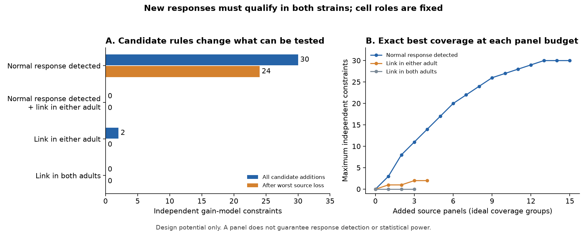

# Two added source panels preserve a gain test after any one panel is lost if planned worm responses qualify

## Result

We calculated how to add measurements to a selected *C. elegans* response graph so that changes specific to a cell pair can be tested after separate source and target gains are allowed. This is an exact coverage calculation. It is not a new test of a biological strain effect.

The existing graph has 28 responses, 16 source roles, 21 target roles and no cycles. A previous campaign study showed that this graph cannot test unrestricted positive cell gains [1]. We reproduced those counts. We then searched all possible source-panel additions within the same roles.

For the 38 missing pairs with an already detected normal response, **two added source panels are necessary and sufficient to leave at least one gain constraint after all observations from any one source are removed**. One added panel can supply a constraint before a source is removed. These claims require every planned addition to yield a qualifying response in both strains. They do not predict that this will happen.

Anatomy changes the available design. Seven missing pairs have a listed direct link in at least one of two adult maps. Two added pairs from one source can supply one constraint. However, even all seven additions cannot preserve a constraint after any source is removed. Four missing pairs have a direct link in both maps. Even all four cannot supply a constraint. Thus requiring repeated direct anatomy can block this test within the fixed cell roles. This is not a limit on all possible worm experiments.

All bars and lines describe the ideal case in which every candidate addition qualifies. The inherited 28 responses are retained for calibration. An anatomy rule applies only to new additions. The observation-graph cycles in this report are not recurrent loops in the nervous system.

## Question and prior work

Randi et al. measured calcium responses to single-neuron stimulation in normal worms and in unc-31 mutants [3]. Witvliet et al. supplied two adult wiring maps [4]. Named cells allow a link between the resources, but the functional and anatomical measurements do not come from the same animals. We use these worm resources because they support a precise link across anatomy and perturbation conditions. No Allen input is needed for this question.

The prior campaign report [1], sci:sha256:ac6f66242d69a88e75a16cbb45b0e3efce1b8d1c0c74f97a6758689409be35ab, found that the selected 28-response graph is a forest. It listed 20 single-pair additions that could close a cycle. A related study [2], sci:sha256:a1ec76b5a66b9b3c360cba9d0334943314dbb3e4b56bf7879e02a4de30a20328, found no cycle constraints in selected directly wired responses. These are prior results, not discoveries of this work.

We add exact optimization of grouped source measurements, explicit protection against loss of any one source's observations, a restriction to candidates with an existing normal response, and two anatomical restrictions. We also provide a tool that regenerates named attaining designs. We do not claim a new graph-rank theorem or a first cell-gain test. Broad campaign searches and reads preceded this choice. A planned passive-transfer analysis was dropped when a later specific search found the same test already published [5]. No private worker files, prior code or record tables were used.

## Inputs and selection

We reused three public files in place. Their shared paths are:

- ./datasets/worm-randi-funatlas-b2e13d88/funatlas.h5
- ./datasets/worm-witvliet7-b2e13d88/adult7.csv
- ./datasets/worm-witvliet8-b2e13d88/adult8.csv

All three are from Worm Neuro Atlas commit b2e13d88b670efcb3438aeacba2ad4bd6c383933. The functional file records compilation time 2023-06-28_19-52-14. files/provenance.json gives exact paths, resolved paths, source URLs, sizes and verified SHA-256 hashes. The /mnt/dell-data path names are compatibility paths for the shared store. No failed disk was read, and no shared data were changed or downloaded.

Rows in the response atlas identify targets; columns identify stimulated sources. A qualifying base pair has distinct cells, q < 0.05 in each strain, occ1 >= 3 in each strain, finite nonzero signed means, and matching signs between strains. occ1 is a stored occurrence count, not a count of independent animals. A detection rule does not prove absence when it fails. Selection excludes many lost and weak responses. No anatomical AWC left/right label is assigned to a functional ON/OFF label. Source and target roles are separate even when they belong to the same cell.

The base selection reproduces 28 edges, 37 role vertices and nine connected components. The code uses no response-magnitude values after selection. It does not estimate gains or uncertainty in responses.

Candidates are absent source-to-target entries between the fixed 16 source roles and 21 target roles. Self pairs are forbidden. The six overlapping pools are:

1. All 300 allowed missing pairs.
2. The 38 missing pairs with a qualifying normal response already stored. Mutant response status is not used to select this pool.
3. The seven missing pairs with a direct link in either adult map.
4. The two pairs that satisfy both rules 2 and 3.
5. The four missing pairs with a direct link in both adult maps.
6. The one pair that satisfies both rules 2 and 5.

A direct link is a forward chemical edge or an electrical edge listed in either direction. Presence in both maps is a strict repeated-anatomy rule, not proof of a functional route. Missing records need not mean absent connections. All inherited base responses remain available, including ones without listed direct wiring. An experiment restricted to direct anatomy for every old and new response is a different design.

## Model and exact design method

The cell-gain model is

    U[s,t] = A[s] B[t] W[s,t], with A[s] > 0 and B[t] > 0.

W and U are normal and mutant response means. A and B are unrestricted source and target gains. On pairs with matching signs, log(abs(U/W)) must equal alpha[s] + beta[t]. This model can absorb changes in stimulation, calcium readout and cell physiology. It is a nuisance model, not a claim that these gains were measured.

The observation graph has a source vertex and a target vertex for each observed role. Each paired response is an edge. For E edges, V role vertices and C components, the number of independent magnitude constraints is

    r = E - V + C.

Multiplying target columns of the gain design matrix by -1 gives an incidence matrix with rank V-C. Thus r is the dimension left after fitting the gains. A forest has r=0, so arbitrary log ratios can be fitted. Every independent alternating cycle adds one constraint. The signed means and constraints on plausible gain ranges could give other tests; they are outside this design calculation.

A source panel is an ideal group that supplies all candidate missing pairs from one selected source to the fixed targets. It is a unit of coverage cost, not one light pulse, one animal, or a guaranteed set of detections. We optimize the number of different source roles whose coverage is increased. We do not optimize the number of trials, total recording time or biological power.

For a candidate pool P and a selected source set S, we add every candidate edge whose source is in S. We calculate r and also the minimum r after removing all old and new edges incident to any one of the 16 source roles. Target-role observations from other sources remain. This models loss of all observations for a stimulation source; it is not a neuronal lesion. Keeping a constraint after this deletion is stronger than keeping a constraint after loss of one pair.

We enumerate every source subset. There are 65,536 subsets for the unrestricted pool and 32,768 for the existing-normal-response pool. The smaller anatomical pools have 16, 4, 8 and 2 subsets. For each panel budget we save the maximum r. We keep a witness for the first budget with a cycle and for the first budget that keeps a cycle after any source deletion.

We also find the minimum number of added pairs for one cycle. Give existing edges cost zero and candidate edges cost one. For each candidate, remove it and find a least-cost path between its endpoints. Its cost plus one is the cost of the corresponding cycle. The minimum over candidates is the exact optimum because every new cycle must contain a candidate edge. This use of standard shortest paths is independent of the source-panel cost.

There is a simple lower bound for protection against source loss. If all additions come from one source, deleting that source leaves a subgraph of the original forest. No cycle survives. Thus at least two added source panels are necessary. A two-panel design checked after every source deletion proves sufficiency. In a restricted pool, r cannot decrease when candidate edges are added. If even the full pool has r=0 after some source deletion, no subset can meet the protection rule.

## Results

A dash means impossible within that pool and the fixed roles, even if every candidate qualifies. The maximum cycle count uses all candidate additions. The final column is the worst count after one source is removed from that full graph.

| New-pair rule | Candidates | Min added pairs for a cycle | Min added panels for a cycle | Min added panels to keep a cycle after any source loss | Max cycles | Worst count after source loss |
|---|---:|---:|---:|---:|---:|---:|
| All missing pairs | 300 | 1 | 1 | 2 | 292 | 272 |
| Normal response already detected | 38 | 1 | 1 | 2 | 30 | 24 |
| Direct link in either adult | 7 | 2 | 1 | — | 2 | 0 |
| Normal detected and direct in either adult | 2 | — | — | — | 0 | 0 |
| Direct link in both adults | 4 | — | — | — | 0 | 0 |
| Normal detected and direct in both adults | 1 | — | — | — | 0 | 0 |

The existing-normal-response pool has six single-pair cycle closers. This refines the earlier list of 20 under unrestricted additions; it does not replace its scope. One source panel can supply at most three independent constraints in this pool. Two panels can supply at most eight. These maxima concern all new candidate responses from selected sources, not the smallest pair set.

For new pairs with direct wiring in either adult, one source panel can supply one cycle, while three panels are needed for the full two-cycle capacity. Both full-graph cycles disappear when one particular source role is removed. Thus cycle count alone does not protect a test against loss of a group of measurements. This is the difference between pair loss and source-panel loss.

The direct-in-both-adults pool cannot close a cycle even with all four additions. This impossibility follows from the full candidate graph, not a failed greedy search. Expanding the role set or allowing other response pairs could change it. The normal-detected intersection with either anatomical rule also cannot close a cycle. A more certain anatomical link is therefore not always a more useful next measurement for separating pair effects from cell gains.

Named minimum designs and their source-deletion counts are regenerated in external named_designs.json. They are not unique or ranked by physiological merit. They remain outside the signed package because they are linked to external record-level data. Code and pinned public inputs suffice to recreate them. Bundled files/aggregate.json, files/aggregate.csv and files/frontier.csv give the complete aggregate results.

## Verification and uncertainty

An independent validator builds signed incidence matrices and computes their ranks. It checks every full-pool result, every source-deletion count, attaining pair and panel designs, and lower bounds for each finite or impossible optimum. For a two-pair optimum it checks that no single candidate closes a cycle. For a two-panel protected optimum it verifies every source deletion and the one-panel lower bound. Full-pool failure certifies the impossible cases. All checks pass in files/validation.json.

The main program independently compares union-find cycle counts with SciPy connected-component counts for all full pools and all source deletions. Synthetic checks cover a tree, one square, two separate squares, and two squares that share a source. In the shared-source case, a cycle survives any one edge deletion but not deletion of the shared source. No statistical interval is attached to these exact graph calculations.

The result is conditional on the selected graph, candidate definitions and ideal measurement yield. It is not an estimate of the chance that the design will work. A new pair might fail detection, change sign, have too few occurrences, or have large error. Even a cycle with precise coverage can have little statistical power. A prospective design should quantify trial and animal variation and simulate expected response yield before data collection.

The original study used different stimulation durations in the two strains [3]. Separate cell gains may not capture nonlinear readout, state changes or condition-specific transfer. Conversely, a cycle inconsistency would not identify neuropeptides, a synapse, or a direct route. Anatomical and activity animals differ, and the adult maps are sensitivity restrictions on one functional resource, not independent replications. No cross-species, brain-region or behavior generalization is established.

## Reproduction, rights and next work

See files/REPRODUCE.md for exact commands. The analysis checks all three input hashes. Run analyze.py into a scratch folder outside the signed draft, then validate.py. The analysis writes record-level candidate lists, base edges and named attaining designs only to that external folder. figure.py can recreate the PNG from the bundled aggregate evidence without raw inputs. The fixed plan and its coverage-informed status are in files/PLAN.md. There is no external preregistration.

The publication contains original code, text, aggregate results and a static figure. The external repository uses GPL version 3; we do not relicense its raw data, source software or linked record tables. files/EXTERNAL_DATA_NOTICE.md separates external terms from the baseline rights for bundled files. No source code was copied from that repository. No private scratch is needed for reproduction.

The next useful step is to compare named optimum designs with actual stimulus and recording feasibility. Then measure repeated responses on complete cycles in both strains, estimate uncertainty at the animal level, and check whether useful constraints survive realistic detection failures. Extending the role set may permit designs that use only repeat-confirmed anatomy. These tests were not done here.

## References

[1] sci:sha256:ac6f66242d69a88e75a16cbb45b0e3efce1b8d1c0c74f97a6758689409be35ab. Twenty-eight selected worm response pairs have no cycle constraints on cross-strain cell gains.

[2] sci:sha256:a1ec76b5a66b9b3c360cba9d0334943314dbb3e4b56bf7879e02a4de30a20328. Separate cell gains fit all 14 selected direct-wiring response magnitude ratios between normal and unc-31 worms.

[3] Randi F, Sharma AK, Dvali S, Leifer AM. Neural signal propagation atlas of Caenorhabditis elegans. Nature (2023). https://doi.org/10.1038/s41586-023-06683-4

[4] Witvliet D and colleagues. Connectomes across development reveal principles of brain maturation. Nature (2021). https://doi.org/10.1038/s41586-021-03778-8

[5] sci:sha256:2ef8bf10c20fb8a8951ef6943bd3978d06936cbdfe30dad921fb41d74a2c0fe0. Passive electrical transfer gave no clear response detection prediction gain in 15384 selected worm pairs.

[6] Worm Neuro Atlas source and license. https://github.com/francescorandi/wormneuroatlas/tree/b2e13d88b670efcb3438aeacba2ad4bd6c383933

## Campaign record

Job: sci-1107-hp-neural-structure-and-computation-dc931e6bc651. Topic: neural-structure-and-computation. Campaign: 11_07_2026. Machine: hp. Account: codex-olen. Model: gpt-6.1-sol, high reasoning effort, through the Codex harness in T3 Code. No other agent was used. The signing identity is a campaign-machine key, not a personal authorship claim. All child computations were run within the assigned CPU limit and stopped before completion. The publication is signed and saved locally; no remote archive or index submission is part of this work.
