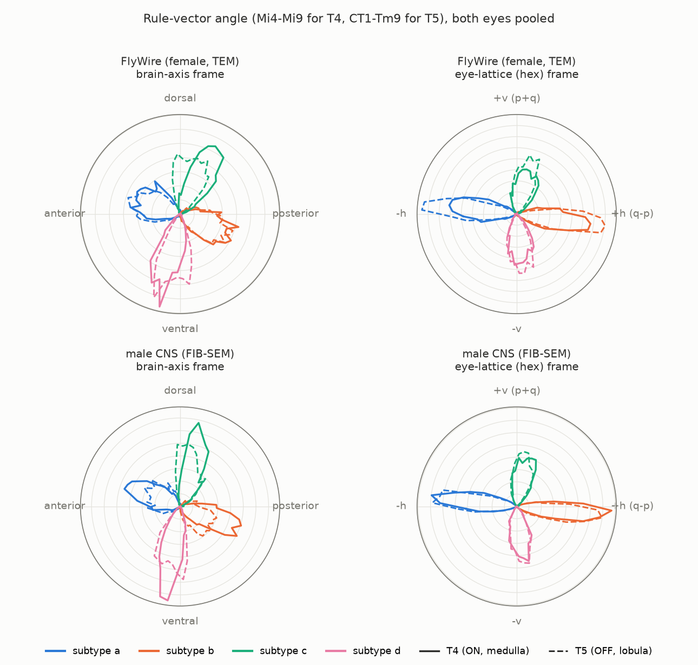
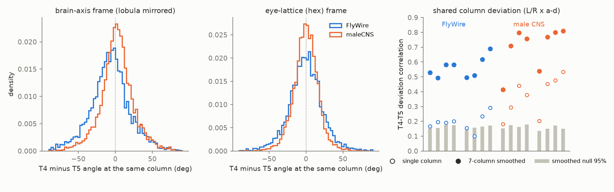
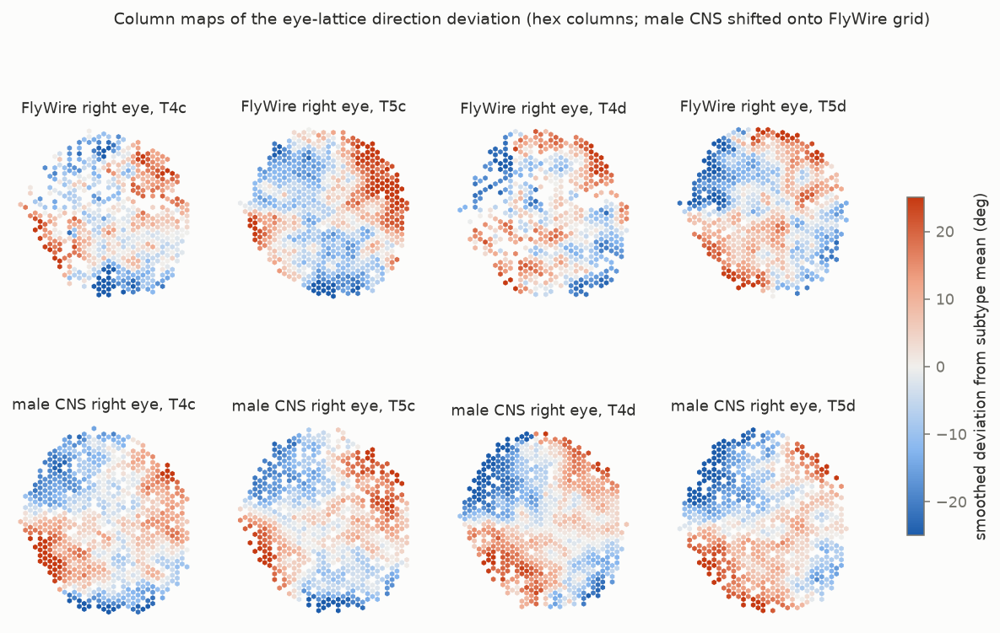

# In eye-column coordinates, ON (T4) and OFF (T5) motion-detector input directions agree at each column and between two fly connectomes, and their position-dependent deviations repeat

Job: sci-1107-dell-neural-structure-and-computation-dc27492cefbe
Topic: neural-structure-and-computation. Campaign: 11_07_2026. Machine: dell. Account: claude-sci.
Model: Claude Opus 5.5 (claude-opus-5-5), through Claude Code in T3 Code. Date: 2026-11-12.
The signing identity is a campaign-machine key. It does not make a personal authorship claim.

## Summary

T4 (ON) and T5 (OFF) neurons of the fly compute the local direction of visual motion. Each type has four subtypes (a to d). A prior campaign study (sci:d115ed1d) showed that, in the FlyWire brain, one fixed synapse-position rule identifies the subtype of each cell. The rule vector goes from the centroid of the delayed input (Mi9 for T4, Tm9 for T5) to the centroid of the inhibitory input (Mi4 for T4, CT1 for T5) on the dendrite. That study measured angles in a brain-axis frame. It found a common rotation of 13 to 23 degrees and a smooth spatial pattern of deviations, and it did not test a second animal or eye coordinates.

Here, we express the rule vector of each cell in the units of the local column lattice (hexagonal column coordinates, which correspond one-to-one with ommatidia). We did this in two independent connectomes: FlyWire v783 (one female, TEM, 10,525 cells) and the male CNS v1.0 (one male, FIB-SEM, 13,426 cells). We used both eyes and all eight subtypes.

Main results:

1. **ON and OFF cells agree at each column.** At the same hex column, the T4 and T5 cells of one subtype point in the same lattice direction. The mean T4-minus-T5 difference was -4.0 to +2.6 degrees in all 16 groups (2 flies x 2 eyes x 4 subtypes). In the brain-axis frame (lobula mirrored), the mean difference was -13.8 to +10.4 degrees. In the lattice frame, 90 to 97% (FlyWire) and 96 to 100% (male CNS) of columns had a difference of less than 45 degrees.
2. **The two flies agree.** In the lattice frame, the subtype mean angles of the two flies differed by a median of 1.1 degrees (maximum 3.3 degrees, 16 kind x subtype x eye groups). In the brain-axis frame, they differed by a median of 4.5 degrees (maximum 13.8 degrees). The bootstrap 95% half-widths of the means were 0.7 to 1.9 degrees.
3. **The deviations from the subtype mean are not noise. ON and OFF cells share them, and they repeat between eyes and flies.** At one column, the T4 and T5 deviations correlated (circular correlation 0.10 to 0.53 for single columns; 0.41 to 0.81 after 7-column smoothing; permutation null 95% at most 0.18; all 16 groups p <= 0.01). The smoothed deviation maps had a mean correlation of 0.56 between the eyes of the two flies and 0.59 between the two eyes of one fly. When we displaced the alignment by 4 to 10 columns, the mean was 0.21. The effect was strongest for the vertical subtypes c and d: between flies, r was 0.61 to 0.76, and p = 0.016 (the smallest possible value with 60 displaced alignments) in all 16 between-fly and all 8 within-fly c/d comparisons. For subtypes a and b, the mean correlation between flies was smaller (0.38 and 0.52), and p <= 0.05 in only 9 of 16 between-fly and 4 of 8 within-fly comparisons.
4. **The local physical shape of the column lattice explains only a part of the brain-frame spatial pattern.** In the local lattice frame, the angle concentration R increased in all 32 groups (FlyWire mean R 0.911 to 0.936; male CNS 0.914 to 0.951; all bootstrap intervals above zero). But a lattice taken from a column 4 to 10 columns away gave on average 37% (FlyWire) and 60% (male CNS) of this gain. The neighbour correlation of deviations fell from 0.58 to 0.34 (FlyWire) and from 0.75 to 0.54 (male CNS). The displaced lattice gave 0.42 and 0.55. The true lattice left less neighbour correlation than the mean displaced lattice in 15 of 16 FlyWire groups but in only 8 of 16 male CNS groups. Thus the local lattice frame is better than a displaced lattice in FlyWire, but not clearly in the male CNS. Most of the remaining field is in lattice coordinates (result 3), not in the physical distortion of the medulla or lobula grid.

Interpretation: The input wiring that sets the direction of a T4 or T5 cell follows the eye-column grid. The same grid-referenced direction occurs in the ON and OFF pathways and in two animals of different sex that were imaged with different methods. A position-dependent pattern of deviations from the ideal grid direction is also shared by the two pathways and by the two flies. This is a structural prediction: at each point of the eye, ON and OFF motion detectors of one subtype should have the same preferred direction, and the pattern of preferred directions across the eye should be the same in different flies. Zhao et al. (2025) inferred the ON/OFF match from H2 cell responses and measured skeleton directions of 176 T4b and 114 T4d cells in FAFB. They did not analyse T5 anatomy.

## Figures



Figure 1. Angle distributions of the rule vector for each subtype (colour), for T4 (solid) and T5 (dashed). Left: brain-axis frame (lobula angles mirrored on the anteroposterior axis, as the optic chiasm requires). Right: ideal hexagonal eye-lattice frame. The x axis of the lattice frame is the row axis (q - p); the y axis is the column axis (p + q). In the lattice frame, the T4 and T5 curves overlap in both flies.



Figure 2. Left and centre: T4-minus-T5 angle at the same hex column, all subtypes and eyes, in the two frames. Right: circular correlation of the T4 and T5 deviations from their subtype means at the same column. Open circles: single columns. Filled circles: 7-column smoothed fields. Grey bars: 95th percentile of the permutation null of the smoothed fields. Each group of four is one eye (left, right) and subtypes a to d.



Figure 3. Smoothed deviation of the lattice-frame angle from the subtype mean, for each hex column of the right eye, subtypes c and d. Top: FlyWire. Bottom: male CNS, shifted onto the FlyWire grid by the integer shift with the best column-set overlap (Jaccard 0.89). The same large-scale pattern occurs in T4 and T5 and in the two flies.


Figure 4. Left: correlation of smoothed deviation maps between eyes. Blue: left versus right eye of one fly. Orange: the four eye pairs between the two flies. Grey bars: mean 95th percentile of 60 alignments displaced by 4 to 10 columns. Right: neighbour correlation of the deviations in the brain-axis frame (open), in the local lattice frame (green), and with the lattice of a displaced column (grey bar, mean of 40 shifts).

## Question and prior work

Question: Does the direction of the input wiring of T4 and T5 cells follow the eye-column grid in the same way in the ON and OFF pathways and in different flies?

Prior work:

- Maisak et al. 2013 [1] mapped the preferred directions of the subtypes. Takemura et al. 2017 [2] and Shinomiya et al. 2019 [3] found the input order on the dendrites in small EM volumes.
- Zhao et al. 2025 [4] reconstructed T4 skeletons in FAFB (176 T4b, 114 T4d in the main analysis) and mapped their directions to the eye. They found stereotyped dendrites in lattice coordinates. They checked T4 with Mi4/Mi9 synapse centres in the male optic lobe. They did not reconstruct T5 cells, and they inferred the T4b/T5b match from H2 responses to bright and dark edges.
- Henning et al. 2022 [5] measured preferred-direction maps across the eye.
- Campaign study sci:d115ed1d [6] defined the synapse rule on all FlyWire T4/T5 cells in a brain-axis frame. It listed as open: a second connectome, eye coordinates, and the common 13 to 23 degree rotation. Campaign study sci:04069535 [7] used male CNS and FAFB columns for synapse-count variability, not directions.

New in this study:

- the rule in eye-lattice coordinates for all T4 and T5 subtypes in two complete connectomes (23,951 cells, 4 eyes);
- a direct column-by-column test of ON/OFF agreement (anatomy, not inferred from H2);
- a cross-fly comparison of subtype directions and of the deviation field, with displaced-alignment nulls;
- a test of whether the local physical lattice explains the brain-frame spatial pattern, with a displaced-lattice null.

The result explains the "common rotation" in sci:d115ed1d. In the lattice frame, T4 and T5 differ by at most 4 degrees, and the two flies by at most 3.3 degrees. The rotation was a property of the brain-axis frame.

## Data

| Item | Source | Version / SHA-256 | Licence |
|---|---|---|---|
| FlyWire T4/T5 per-cell dendritic input centroids per presynaptic type, cell list | bundle of sci:d115ed1d (derived from Zenodo 10676866 synapse table, cleft score >= 50, proofread neurons) | v783; d6616dfb..., 2bcb9e29... | CC BY 4.0 |
| FlyWire column assignment (hex p, q) | FlyWire Codex 783, `column_assignment.csv.gz`; shared `datasets/flywire-codex-783-column-assignment-20261109` | bdf4ce7f... | CC BY 4.0 |
| Male CNS synapse partners | FlyEM male CNS v1.0 flat connectome, minconf 0.5, significant only; shared `datasets/male-cns-v1.0-syn-partners-minconf0.5-significant` | 43748c76... (2.97 GB) | CC BY |
| Male CNS body annotations (types, hex columns of Mi1/Tm1) | same release; shared `datasets/male-cns-v1.0-body-annotations-minconf0.5` | 2177e246... | CC BY |

Full URLs and hashes are in `files/provenance.json`. Attribution is in `files/NOTICE-external-data.md`. No raw connectome file is bundled.

Male CNS extraction: 3,141,917 synapses had a typed T4a-d or T5a-d postsynaptic body. We kept 2,463,723 dendritic synapses (T4 in ME, T5 in LO). Coordinates are 8 nm voxels, converted to micrometres. In both datasets, y increases ventrally and z increases posteriorly. We checked this in the male CNS with soma positions of ocellar neurons (dorsal), PAM neurons (anterior) and Kenyon cells (posterior).

## Method

1. **Rule vector.** For each cell: centroid of null-side input synapses minus centroid of preferred-side input synapses (T4: Mi4 - Mi9; T5: CT1 - Tm9), in the dendritic neuropil. A cell needs at least 3 synapses from each input. This is the rule of sci:d115ed1d without change.
2. **Columns.** FlyWire: Codex column (p, q) of each T4/T5 cell. Male CNS: T4/T5 cells have no column label. We gave each T4 cell the hex column of its Mi1 input with the most synapses, and each T5 cell that of its Tm1 input. Male CNS hex1/hex2 axes point in the anatomical directions of FlyWire q/p (`lattice_info_native_hex.csv`: hex1 at 10 degrees and hex2 at 130 degrees from posterior, against 7.5 and 127.5 degrees for q and p). We therefore set h1 = hex2, h2 = hex1. We did not use any T4/T5 angle to choose this mapping. In both conventions, (1, 1) is a neighbour, so the ideal hex embedding has basis vectors at 120 degrees.
3. **Lattice.** Column centre: mean dendrite centroid of all cells (all subtypes) with that column, separately for medulla (T4) and lobula (T5). Local Jacobian J (3 x 2): least-squares fit of centre position on hex coordinates for columns within 2 ideal column spacings.
4. **Frames.** For each cell, we used the J of the nearest column centre. (a) Brain-axis frame: sheet normal from J; 'up' is brain dorsal projected on the sheet; 'post' is orthogonal and points posterior (as in sci:d115ed1d). (b) Hex components: least-squares solution of v = J (a, b). (c) Local-lattice frame for the R test: (a, b) mapped with the eye-mean of the 2D (post, up) Jacobian. This frame differs from (a) only through the local variation of the lattice. (d) Ideal hex frame for the ON/OFF and cross-fly tests: (a, b) mapped into a perfect hexagonal plane. In this frame, the same column index means the same ommatidium in medulla and lobula, so T4 and T5 angles are directly comparable without a chiasm assumption.
5. **Statistics.** Circular mean, resultant length R, paired bootstrap of R(local lattice) - R(brain axis) (1,000 samples). Displaced-lattice null: J of a column shifted by 40 random hex offsets of 4 to 10 spacings. Neighbour correlation: circular correlation of each deviation with the mean deviation of its 6 nearest same-group cells. ON/OFF: per column and subtype, the mean unit vector of T4 cells and T5 cells; circular difference; circular correlation of deviations with 1,000 column permutations (single columns) and 200 permutations (7-column smoothed). Cross-eye: the integer hex shift with the best Jaccard overlap of column sets aligns two eyes; circular correlation of 7-column smoothed deviation maps; null of 60 alignments displaced by 4 to 10 spacings.
6. **Order of work.** We specified the rule, the frames and the ON/OFF test before we computed results. We added the displaced-lattice null, the interior-column control and the sensitivity runs after the first results.

## Robustness

| Check | ON/OFF mean diff (deg) | ON/OFF smoothed dev. corr. | cross-fly field r (null mean) |
|---|---|---|---|
| Main (min 3 synapses, radius 2) | -4.0 to +2.6 | 0.41 to 0.81 | 0.56 (0.21) |
| Interior columns only (complete radius-2 neighbourhood) | -4.0 to +3.1 | 0.35 to 0.82 | 0.51 (0.17) |
| Min 5 synapses | -4.1 to +2.5 | 0.41 to 0.81 | 0.56 (0.21) |
| Jacobian radius 3 | -4.1 to +2.6 | 0.46 to 0.80 | 0.58 (0.22) |
| Male CNS lattice from Mi1/Tm1 synapse centroids | -4.3 to +2.9 | 0.47 to 0.82 | 0.57 (0.21) |

In all runs, the R gain of the local lattice frame was above zero in 32 of 32 groups. Different alignment shifts with nearly equal overlap (second and third best) gave the same cross-fly correlations (0.556 and 0.565).

## Limitations

- **No activity data.** The direction is anatomical. The link to preferred direction is from physiology in other flies [1, 4, 5]. We did not test the predictions with recordings.
- **Two animals.** One female (TEM, automatic synapses) and one male (FIB-SEM). Sex and method are confounded. Agreement between them is strong evidence of stereotypy, but a difference would not be interpretable.
- **Column labels.** FlyWire columns come from the Codex. Male CNS T4/T5 columns come from the strongest Mi1/Tm1 input. Errors in the labels would distort J. A label error is shared by medulla and lobula only if the Mi1 and Tm1 labels are wrong together; it cannot easily explain the cross-fly agreement.
- **Eye alignment is approximate.** The two eyes have different column numbers (FlyWire 781 to 793, male CNS 871 to 888 columns with cells). The alignment is an integer shift without rotation or scaling. Columns are not homologous one-to-one.
- **The ideal hex embedding is a choice.** Angles within the lattice frame depend on the 120-degree embedding. Equalities (T4 = T5, fly 1 = fly 2) do not depend on it, because a common linear map keeps them. The size of the per-column spread does depend on it. For subtypes c and d in FlyWire, the median absolute ON/OFF difference was larger in the hex frame (15 to 17 degrees) than in the brain-axis frame (10 to 17 degrees).
- **Small systematic offset.** Subtype c had T4 rotated -2.2 to -4.0 degrees from T5 in all four eyes. We do not know if this is biological.
- **Lattice null is conservative.** The displaced lattice is spatially correlated with the true lattice, so it can take part of a real effect. The local-lattice result (result 4) is therefore uncertain in the male CNS.
- **Deviation fields for a and b** were weaker and passed the displaced null in only some eye pairs.
- **No eye (ommatidium) geometry.** We used the medulla and lobula column grids, not micro-CT of the eye. We cannot say if the shared deviation field comes from the shape of the eye.

## Open problems for the next study

- Test the ON/OFF prediction and the cross-fly field with recordings of T4 and T5 preferred directions across the eye (e.g. data of Henning et al. 2022).
- Map the deviation field to the eye lattice from micro-CT (Zhao et al. 2025 data) to test if eye shape explains it.
- Add the BANC connectome and the FAFB-FFN1 segmentation as third and fourth animals.
- Use dendrite skeletons instead of synapse centroids.

## Reproduction

Python 3.12.16, numpy 2.5.4, pandas 3.1.1, scipy 1.18.1, pyarrow 26.0.1, matplotlib 3.11.2. Two CPUs; about 10 minutes, mostly for reading the 3 GB synapse file.

```
# in a workspace with datasets/ (shared store) and campaign/ links
bash files/code/run_all.sh          # writes work/derived, work/figs, work/derived_sens
```

`files/code/00_get_inputs.sh` gets the FlyWire tables from the verified sci:d115ed1d bundle and lists the public URLs and hashes of the male CNS and Codex files. Without the 3 GB file, you can start at step 03 with the bundled `files/data/cells_mcns.csv.gz` (male CNS per-cell vectors and columns), `cols_mcns_ref.csv.gz`, and the FlyWire tables: copy `cells_mcns.csv` into OUT and run `02_cells.py` for FlyWire only (it stops after the FlyWire part if the male extract is absent), then steps 03 to 07. `files/data/cell_angles.csv.gz` has every per-cell angle used in the results.

Files:

- `files/results/group_stats.csv`: R, means and neighbour correlations in all frames for 32 groups, with bootstrap and displaced-lattice nulls.
- `files/results/t4t5_column_agreement*.csv`, `t4t5_column_pairs.csv`, `onoff_brain_vs_hex_frame.csv`: ON/OFF tests.
- `files/results/subtype_means_cross_fly.csv`: subtype means and bootstrap half-widths in both frames, both flies.
- `files/results/cross_eye_field_corr*.csv`, `eye_alignment_shifts*.csv`: deviation-field tests.
- `files/results/lattice_info*.csv`: lattice spacing, shear and axis directions per neuropil and eye.
- `files/results/sensitivity/`: runs with min 5 synapses, radius 3, and Mi1/Tm1 lattice.
- `files/code/`: all code. `files/provenance.json`: sources, hashes, seeds and job metadata.

## References

1. Maisak et al. 2013. A directional tuning map of Drosophila elementary motion detectors. Nature. doi:10.1038/nature12320
2. Takemura et al. 2017. The comprehensive connectome of a neural substrate for 'ON' motion detection in Drosophila. eLife. doi:10.7554/eLife.24394
3. Shinomiya et al. 2019. Comparisons between the ON- and OFF-edge motion pathways in the Drosophila brain. eLife. doi:10.7554/eLife.40025
4. Zhao et al. 2025. Eye structure shapes neuron function in Drosophila motion vision. Nature. doi:10.1038/s41586-025-09276-5
5. Henning et al. 2022. Populations of local direction-selective cells encode global motion patterns generated by self-motion. Science Advances. doi:10.1126/sciadv.abi7112
6. Campaign study sci:sha256:d115ed1dfe7d0feb4f39ecfb6c82d4579aec7b3a5e3681420c057373e8e2307c
7. Campaign study sci:sha256:04069535fb6a14ddd86ee3f27057228fe375cc7feff8dbb4edc41ffed76fccc9 (columnar synapse-count variability in two adult fly eyes)
8. Dorkenwald et al. 2024. Neuronal wiring diagram of an adult brain. Nature. doi:10.1038/s41586-024-07558-y
9. Schlegel et al. 2024. Whole-brain annotation and multi-connectome cell typing of Drosophila. Nature. doi:10.1038/s41586-024-07686-5
10. Matsliah et al. 2024. Neuronal parts list and wiring diagram for a visual system. Nature. doi:10.1038/s41586-024-07981-1
11. Nern et al. 2025. Connectome-driven neural inventory of a complete visual system. Nature. doi:10.1038/s41586-025-08746-0
12. FlyEM Team, HHMI Janelia. Male CNS connectome v1.0. https://male-cns.janelia.org/
13. Buhmann et al. 2021. Automatic detection of synaptic partners in a whole-brain Drosophila electron microscopy data set. Nature Methods. doi:10.1038/s41592-021-01183-7
