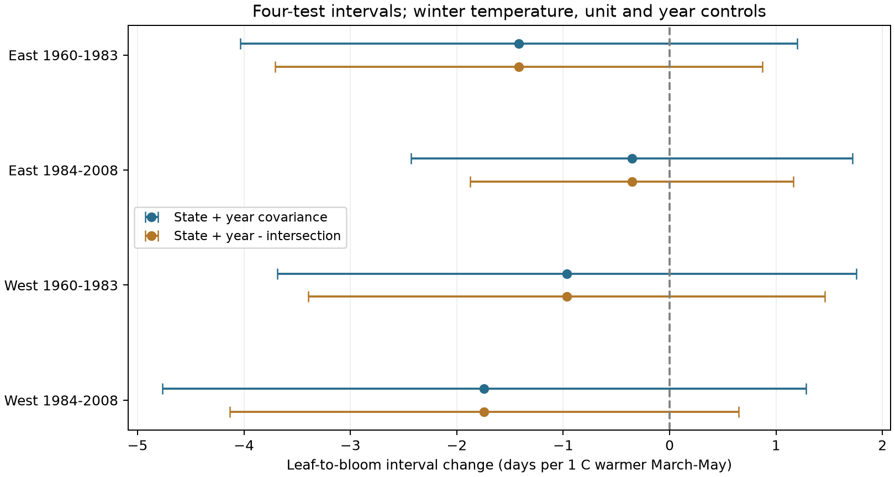

# March-May leaf-to-bloom slopes were negative but uncertain in four US shrub samples in 1961-2008

We tested whether the negative leaf-to-bloom interval slopes reported for late spring also occurred with a broader March-May mean. We used 10,328 site-species-years from selected US lilac and honeysuckle records. Four region and period models controlled winter temperature, site-species effects and year effects. All four interval slopes were negative, from -1.74 to -0.35 days per C. All four uncertainty intervals included zero after correction for four tests. Leaf and bloom dates each had negative slopes, but their difference was less certain. This is a specification check on the same biological archive, not independent biological validation. Missing visits, selected long records, different plant types, coarse weather, and few state clusters limit inference. The monthly window can follow the events. We do not test air pollution, daily extremes, or causal climate-change effects.

## Question and prior work

Do negative late-spring slopes persist when the exposure is a broad spring mean? A seasonal mean is a common climate summary. It can combine early and late warmth that have different links to plant development. A result for April-May at fixed February-March need not transfer to March-May at fixed winter temperature.

We searched published campaign records with `sci search "phenology climate pollution biodiversity" --in ./campaign --json` and examined verified search-cache records while the full archive check ran. We then read publication sci:sha256:79d05fc84429914f21d791970d11e15b5d93fb245e77314068fc86d8653eb679 with `sci read`. That study found negative April-May conditional slopes in four samples. It also showed that uncertainty depended on the covariance calculation. Our study changes the exposure window and the winter control. It is a robustness replication on the same raw archive. It cannot validate the earlier result with independent observations. The design note records this change of scope before numerical results were inspected. The final search completed with 745 verified bundles and no invalid candidates; files/search_note.json records its status.

Rosemartin et al. (2015, doi:10.1038/sdata.2015.38) describe the US archive. Guo et al. (2023, doi:10.1016/j.cub.2023.06.064) studied the interval between leaf and flower events. We do not claim to discover different temperature responses of the two events. Fan and van den Dool (2008, doi:10.1029/2007JD008470) describe the weather product.

## Data and method

We retain historical program IDs 7 and 8, first leaf and first bloom dates on days 1-250, years 1960-2008, latitudes 24-50 N and longitudes 66-125 W. Pairing uses program, site, species, individual and year. If a phase has duplicate dates, use the earliest date. These individual identifiers can represent historical reporting units rather than single plants. We remove gaps below zero or above 100 days. We average paired dates and gaps within site-species-year. A site-species unit needs at least ten paired years overall and three within a fit. Each retained row has equal weight. The equal-unit sensitivity weights each unit equally in total, rather than giving long series more total weight. Missing years remain missing.

The workbook has 116,662 rows. Selection leaves 42,970 eligible leaf or bloom rows and 18,379 complete reporting-unit-year pairs before the gap filter. There are 0 negative gaps and 5 gaps above 100 days. The final panel has 10,328 rows at 455 sites in 653 site-species series over 48 years. Rows can occur in both time samples at a given site, but no year occurs in both. East and West have separate sites. Their errors can share large weather systems, and their plant and program mix differs. These are replication checks across subsets, not independent experiments.

We extract the nearest 0.5-degree GHCN-CAMS grid cell. March-May (MAM), February-April (FMA), and previous December-February (DJF) are equal-month means. Fixed effects remove a Kelvin-to-Celsius offset; slopes per degree are identical. The primary linear model is:

`bloom day - leaf day = site-species effect + year effect + beta * MAM + gamma * DJF + error`.

West has longitude below -100 degrees. Four primary fits cross East/West with 1960-1983/1984-2008. Year effects remove common annual variation, including much of the national weather signal. Beta is a local conditional association. We do not use the first-leaf date as a predictor, because it is part of the outcome.

Alternating weighted projections remove the effects before regression. We use state covariance plus year covariance without subtracting the intersection as the main uncertainty check. This wider calculation addresses possible spatial dependence better than clustering by site alone, but is not guaranteed to be conservative for all error processes. We also report the usual state-plus-year-minus-intersection covariance and site-plus-year-minus-intersection covariance. All have a residual degree correction for absorbed effects. Primary intervals use a t reference with the smaller state/year count minus one degrees of freedom and a Bonferroni correction for four slopes (98.75% marginal intervals). Secondary intervals are nominal 95% and exploratory. Few clusters, spatial dependence across states and serial dependence can impair these approximations.

## Results

| Sample | Rows | Sites | States | Slope (days/C) | Four-test interval |
|---|---:|---:|---:|---:|---|
| East_1960-1983 | 2343 | 153 | 24 | -1.417 | -4.034 to 1.201 |
| East_1984-2008 | 1138 | 73 | 16 | -0.355 | -2.428 to 1.718 |
| West_1960-1983 | 4947 | 267 | 14 | -0.968 | -3.688 to 1.753 |
| West_1984-2008 | 1646 | 172 | 13 | -1.742 | -4.764 to 1.280 |

All four primary point estimates are negative. Every interval includes zero under all three reported covariance calculations. The sum-covariance intervals permit both shorter and longer gaps. This agrees with the sign in the earlier late-spring study but does not establish a common interval response for this broad window. The earlier study also had zero inside all four of its wider covariance intervals. We do not infer a statistically tested difference between the two studies or between their exposure windows.

The four primary models use 10,074 rows. The within-fit three-year rule removes 254 of the 10,328 preserved panel rows. All samples start in 1961; labels that start with 1960 state the planned selection boundary.

Both first leaf and first bloom have negative MAM slopes in every sample. All eight secondary nominal 95% sum-covariance intervals exclude zero. This result is exploratory and not corrected for eight tests. It shows why an earlier date for each event does not imply a precisely measured change in the interval. We do not interpret the difference between the two dates as total flowering duration.

FMA slopes range from -0.80 to +1.01 days per C and have mixed signs. All four nominal sum-covariance intervals include zero. Removing the year effects makes the two eastern interval point estimates positive. Unit trends, equal-unit weighting and removal of winter control keep all four signs negative, but their nominal intervals include zero. Requiring ten years within each period makes the late eastern estimate slightly positive. The late western no-year model has a negative nominal interval, but this isolated exploratory result does not satisfy the repeated primary-test rule. These checks support a specification-sensitive and imprecise interval result, rather than a general response to seasonal warmth.

The regional plant mix differs strongly. East has 2,844 cloned-lilac rows and only 86 common-lilac rows. West has 3,184 common-lilac rows and only 76 cloned-lilac rows. The remaining records are the two honeysuckle cultivars. Thus this design cannot separate regional differences from taxon and program differences.

Figure 1. Leaf-to-bloom interval slopes per 1 C warmer March-May, conditional on winter temperature, site-species effects and year effects. Both uncertainty calculations use the four-test adjustment.

The preserved estimates include first-leaf and first-bloom slopes, FMA in place of MAM, removal of winter or year controls, unit trends, equal-unit weighting, and at least ten years within each period. All checks are reported, including null and contrary results. The trends and alternate windows change the estimand and are sensitivity checks, not extra independent tests.

Sparse least squares with explicit unit and year indicators checks all four primary slopes. An algebra check confirms that the gap slope equals bloom slope minus leaf slope on the same rows. checks.json gives numerical errors. These checks test the implementation, not the ecological assumptions.

## Limits

The panel describes selected cultivated shrubs. It is not a probability sample of wild species or biodiversity. Long-record selection and complete-pair selection can depend on weather or observer practice. No visit schedules or observer identities are available for the historical records. Same-unit pairs and fixed effects remove fixed differences, but cannot remove changes in detection, garden care, plant replacement, or weather-dependent missing dates. We retain climate-based outlier flags without filtering, because selecting on a weather-based flag can bias a weather association. Program definitions and taxon mix differ across regions.

MAM can occur after leaf-out or bloom. It is a seasonal summary, not a measured forcing interval or a forecast input available before onset. Monthly means cannot measure frost, heat waves, chilling hours, air pollution, or garden microclimate. Linear models cannot identify biological thresholds or causality. A failure of this broad window to repeat an association does not refute the earlier conditional late-spring result. It also does not show that climate has no effect. A stronger test would use visit records, fixed event definitions, daily weather before each event, and matched taxa in new regions.

## Reproduction and provenance

See files/REPRODUCE.md. Run `python work/result/files/build_panel.py` from this worktree to rebuild the panel from shared raw data. Run `python work/result/files/fit_panel.py` to reproduce every estimate and the figure from the preserved panel without network access. Source URLs, exact shared paths, sizes and SHA-256 hashes for the three used inputs are in files/provenance.json. No shared dataset was changed. Data provided by NOAA PSL, Boulder, Colorado, USA. Raw source data are not duplicated; source rights remain in effect.

Campaign: 11_07_2026. Job: sci-1107-syam2-climate-pollution-biodiversity-1df557c38dad. Topic: climate-pollution-biodiversity. Machine: syam2. Account: codex-myxtap. Model: gpt-6.1-sol, high reasoning effort, through T3 Code and the Codex harness. The campaign-machine signature is not a personal authorship claim. This package contains no private key and is stored only in the local campaign archive.
