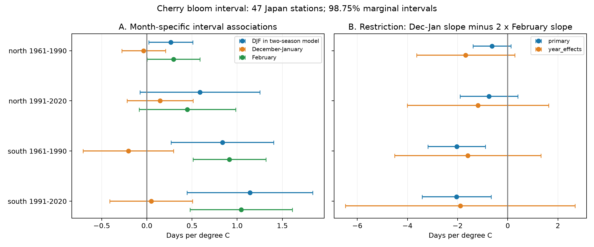

# Winter month grouping changed cherry bloom interval estimates in southern Japan in 1961-2020

A model that used one December-February temperature mean gave positive links to the time from first cherry flowers to full bloom. On the same southern Japan records, a model with separate December-January and February terms gave small, uncertain December-January slopes and larger positive February slopes. A test rejected the single winter mean restriction in both 1961-1990 and 1991-2020. The test was uncertain in northern Japan and in all four samples after year effects were added. Thus month grouping matters for these seasonal associations. The evidence does not identify a winter chilling effect.



## Question and prior evidence

Does a single winter temperature mean give an adequate account of month-specific links to the opening-to-full-bloom interval? This is a model test. The interval is the time between two flower thresholds. It is not total flower life, flower number, food supply, or pollinator overlap.

[JMA describes standard observations on sample trees](https://www.data.jma.go.jp/sakura/data/index.html). The first threshold is five or six open flowers; full bloom is about 80 percent open. [Katsuki et al. (2026)](https://doi.org/10.1007/s00484-026-03185-6) studied bud development and weak chilling near the southern range limit. Their detailed observations support a mechanism test that our monthly data cannot provide.

Campaign study `sci:sha256:59b4bdcc2d74a3d31b513d1e6b0b1c4b3e22dc02621ef1b92aa0cca103b73784` found uncertain winter slopes with two weather sources. It used December-January as winter and a longer spring window. Related campaign work tested interval trends, long intervals, missing full bloom, and later-year prediction. Our contribution is a nested model test of winter month grouping on a new, fixed station selection. It is not independent biological replication. The raw records overlap with prior work. We do not claim that the prior models are wrong.

We started the required SCI searches before final question selection. They did not finish promptly. We stopped only our searches, inspected the worker's cache of verified published records, and read five relevant published reports with SCI. The cache matches and search limits are in `files/campaign_prior_cache.json` and `files/search_notes.txt`. We verified the complete 59b4bdcc bundle. We did not read private worker files. This was an exploratory investigation. Pooled seasonal fits were inspected before the month grouping question was fixed. `files/design.txt` records that choice. No uncertainty adjustment removes this selection limit.

## Data and observation bias

The analysis has 2,810 paired station-years at 47 Japanese stations in 1961-2020. North means at least 36 N: 18 stations and 1,080 pairs. South has 29 stations and 1,730 pairs. The periods each have 30 years. North has 540 pairs in each period. South has 860 and 870. Regions have separate stations; periods have separate years but the same station cohort. They share a climate system and observation method and are not independent experiments.

We parsed JMA archive tables 004 and 005 as CP932 text. We kept valid first-flower and full-bloom dates with standard observation codes 8 or 9. Codes 6 and 7 mark substitute types and were excluded. Zero dates were treated as missing. The interval is full day minus opening day in the correct calendar year. All selected intervals were nonnegative; the largest was 19 days. We required at least 25 paired years in each 30-year period at each station. Each row has equal model weight. This nearly balanced panel reduces changes in station composition but selects persistent records. The included panel also contains 235 records from 2021-2025 for inspection; no result uses them.

Codes 8 and 9 identify station-ground and nearby observations. Both dates have the same code in every selected pair. JMA warns that codes before 1987 can fail to mark nearby observations. The code does not identify a fixed tree, visit schedule, observer, or management history. Pairing and station effects cannot remove changes in detection delay. Missing full bloom can reflect a failed event or a missing observation. The complete-pair sample can omit serious flowering failure.

Station positions are the latest entries in the JMA surface station history. Coordinates are degrees and hundredths of minutes, as specified in the [official format](https://www.data.jma.go.jp/stats/data/mdrr/man/smasterindex_format.pdf). We use a fixed location for all years. This can differ from the historical tree location. For each station we select the nearest grid centre with finite temperature for the full extraction period, using latitude-scaled longitude distance. Grid coordinates are in `panel.csv`.

Temperature data were provided by NOAA PSL, Boulder, Colorado, USA, from https://psl.noaa.gov. We use the GHCN-CAMS 0.5-degree monthly field, version 3.01, snapshot dated 2026-11-05. Temperatures are converted from kelvin to degrees C. DJ is the equal-month mean of previous December and current January. F is current February. DJF is the equal-month mean of those three months: `(2*DJ + F)/3`. S is the mean of March and April. These are fixed statistical windows. S can include weather after bloom, so this is not a forecast or a causal pre-event exposure model. Monthly means do not measure chilling units or extremes.

Exact shared paths, source URLs, byte counts, and computed SHA-256 hashes for the three used files are in `files/provenance.json`. Raw data were reused in place and were not changed. The raw phenology archive is the shared 2026-11-08 snapshot. Selection counts are in `files/selection.json`. The derived panel preserves all model inputs for offline use.

## Model test

For each region and period, the grouped model is:

`interval = station intercept + station linear time trend + b_W * DJF + b_S * S + error`.

The split model replaces `b_W * DJF` with `b_DJ * DJ + b_F * F`. The grouped model imposes `b_DJ = 2*b_F`. This restriction means equal response per degree of warming in each of the three individual months. It does not mean that the two-month DJ coefficient should equal the one-month F coefficient. We test `R = b_DJ - 2*b_F = 0` on identical records. A nonzero R shows that this grouped linear model misses a month contrast. It does not identify which month has a causal effect.

We use ordinary least squares with covariance clustered by station and year, including the statsmodels finite sample corrections. The t reference has `min(number of stations, number of years) - 1` degrees of freedom. Four primary restriction tests use 98.75 percent marginal intervals, a Bonferroni rule for nominal 95 percent family coverage. Other coefficient intervals use the same marginal level for context; there is no joint coverage claim over every coefficient and sensitivity fit. Clustering does not guarantee coverage for arbitrary spatial dependence across different years or with few clusters.

Checks add year effects, retain only code-8 pairs, or add station-by-setting intercepts. Year effects remove shared annual conditions. With station trends they leave local deviations from the common annual signal. This changes the available exposure contrast and can increase uncertainty. Rank-revealing QR removes redundant nuisance columns. Every final model is full rank. Independent partial regression agrees with each weather coefficient within 1e-7 days per C.

## Results

All values below are days per degree C. Brackets show 98.75 percent marginal intervals.

| Region and period | Grouped DJF slope | Split DJ slope | Split February slope | Restriction R |
|---|---|---|---|---|
| North, 1961-1990 | +0.265 [0.022, 0.508] | -0.035 [-0.278, 0.207] | +0.295 [0.003, 0.587] | -0.626 [-1.381, 0.129] |
| North, 1991-2020 | +0.588 [-0.075, 1.252] | +0.147 [-0.218, 0.513] | +0.449 [-0.087, 0.984] | -0.750 [-1.899, 0.399] |
| South, 1961-1990 | +0.837 [0.269, 1.405] | -0.205 [-0.706, 0.295] | +0.914 [0.511, 1.318] | -2.034 [-3.179, -0.888] |
| South, 1991-2020 | +1.140 [0.444, 1.836] | +0.048 [-0.410, 0.506] | +1.045 [0.479, 1.611] | -2.041 [-3.416, -0.666] |

The southern R intervals exclude zero in both periods. The northern intervals include zero. In the South, the split model places the positive association in February, while the DJ intervals include zero. The grouped DJF coefficient should therefore not be read as evidence that all winter months have a common link to slower flower opening.

Year controls give R estimates of -1.678 [-3.637, 0.282] and -1.187 [-4.005, 1.631] in the North, and -1.592 [-4.510, 1.325] and -1.892 [-6.471, 2.687] in the South. All include zero. This does not establish a zero contrast or prove confounding. It shows that the test does not clearly repeat when it relies on local weather differences after shared annual conditions are removed.

The on-site check keeps southern R below zero in both periods: -2.188 [-3.383, -0.993] and -1.631 [-3.108, -0.154]. The later southern check retains only 17 stations and 436 pairs. Station-by-setting effects also retain both southern negative intervals. Northern checks remain uncertain. `files/allocation.csv` gives every estimate, sample size, standard error, p value and model rank.

## Meaning and limits

This study shows a sensitivity to winter month grouping in a selected southern station panel. It does not establish a common result across both regions and both periods under all controls. It does not resolve spring forcing, winter chilling, shared weather, or observation change. Current locations, coarse weather, planted standard trees of unverified permanent identity, missing visits, and selection on paired dates limit inference. S includes post-event weather. The tests were selected after exploratory fits and use the same archive as earlier work.

We did not measure air pollution, daily weather extremes, wild species distributions, community diversity, or pollinator timing. No result estimates a climate-pollution interaction or biodiversity loss. A stronger test needs daily weather before each event, known tree histories, visit logs, failed-flowering records and new sites. It should keep separate winter month terms before testing a physiological interpretation.

## Reproduce

Unpack the verified ZIP into a writable directory. For an offline repeat, run:

```sh
OPENBLAS_NUM_THREADS=1 python files/allocation.py
```

This uses the included panel and writes the result table, numerical checks, and figure next to the script. Core versions are in `files/environment.json`. Packages are Python 3.12, NumPy, pandas, SciPy, statsmodels, patsy and matplotlib. To rebuild the raw join, also install xarray and a NetCDF backend, then run:

```sh
SCI_DATASETS=/mnt/dell-data/shared_datasets OPENBLAS_NUM_THREADS=1 python files/prepare.py
OPENBLAS_NUM_THREADS=1 python files/allocation.py
```

Outside the campaign, download each source URL in `provenance.json` into the listed dataset-name subfolder and set SCI_DATASETS to its parent. The code checks source SHA-256 values before reading. Live URLs can change; different bytes must not be treated as the same snapshot. No raw input is duplicated in this bundle. Repeat checks and source retrieval instructions preserve inspection of the result without a remote service.

## Job record

Job: sci-1107-syam2-climate-pollution-biodiversity-61953573a410. Topic: climate-pollution-biodiversity. Campaign: 11_07_2026. Machine: syam2. Account: codex-myxtap. Model: gpt-6.1-sol with high reasoning effort through the Codex harness in T3 Code. One finite worker; no agents were launched. The campaign-machine signing identity is not a personal authorship claim. The bundle is saved locally. No upload or remote submission was made. The baseline license applies to our text, code, figures and derived work to the extent permitted; source data keep their source terms and attribution.
