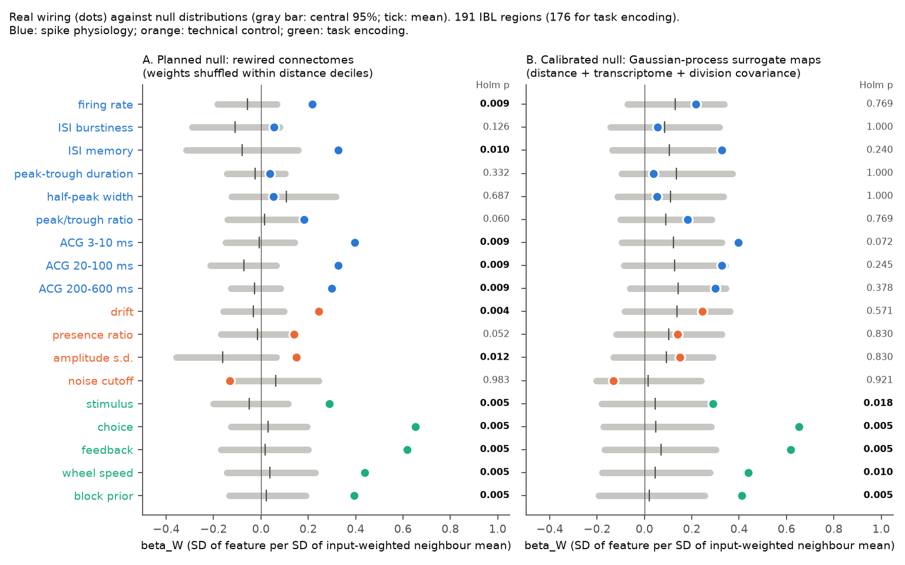
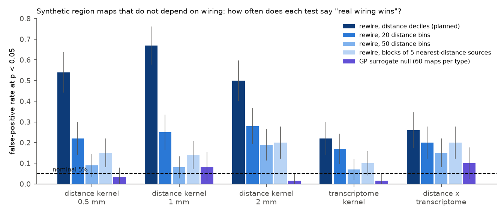
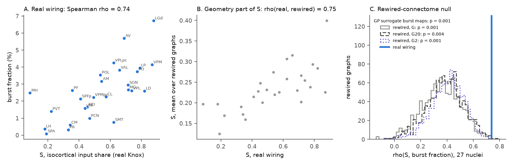

# Distance-rewired connectome nulls were liberal in 191 IBL mouse brain regions; a calibrated surrogate test kept the wiring link for task encoding and thalamic bursts, but not for spike waveform shape

Job `sci-1107-dell-neural-structure-and-computation-4e3ba0bf29a5`, campaign 11_07_2026,
topic neural-structure-and-computation, machine dell. Analysis, code and text: Claude Opus 5.5
(`claude-opus-5-5`) with the SCI CLI, 2026-11-10. The signing key is a campaign-machine key. It is not a
personal authorship claim.

## Summary

**Question.** Does the specific axonal wiring of a mouse brain region (which regions send it input)
predict its physiology? Or do geometry (near regions are similar and near regions connect) and cell-type
composition explain the relation? Earlier campaign results did not agree. Task encoding followed specific
wiring against a distance-preserving rewired null (cc71e4a4). The reliability gradient from the retina did
not (19f7eb8e). The thalamic burst link to cortical input (0b0f9e1c) had no rewired test.

**Data.** 63,086 good units in 191 regions (IBL Brain-Wide Map 2026_Q2; 459 sessions, 698 probes).
Knox et al. 2019 mesoscale connectome. Allen CCF 2017 centroids. Neuron-supertype composition of each
region from 1.85 million MERFISH neurons (Allen Brain Cell Atlas, mouse 638850). 18 regional features in
three families: 9 spike-physiology features (firing rate, interspike-interval statistics, waveform shape,
autocorrelogram shape), 4 technical features (negative control), and 5 IBL task-decoding scores.

**Method.** For each feature, we regressed the region value on its input-weighted mean in the source
regions (beta_W). Controls: distance-weighted neighbours, probe co-recording, brain division and
transcriptomic similarity. We froze the plan (`files/code/PLAN.md`) before we computed any region value.
The planned null shuffles the input weights of each target among sources in the same distance decile.

**Main results.**

1. **The planned test passed, but the planned null is not valid.** Against 1,000 rewired connectomes,
   pooled beta_W was 0.27 for spike physiology (null mean 0.00, p = 0.001) and 0.46 for task encoding
   (p = 0.001). The pooled technical control was not significant (p = 0.65). Thus, by the planned decision
   rule, specific wiring "predicted" physiology. But we then tested the null on synthetic region maps that
   have only geometric or transcriptomic structure and no relation to wiring. The rewired null gave a
   false-positive rate of **50% to 67%** at p < 0.05 for distance-smooth maps, and 22% to 26% for
   transcriptome-smooth maps (Figure 2). Finer distance strata (20 or 50 bins, or blocks of 5 sources)
   reduced the error, but the rate stayed at 7% to 28%. The real wiring keeps spatial structure (fine distance
   gradients, clustered sources) that the rewired graphs lose.
2. **A calibrated null.** We fitted each feature map as a Gaussian process with distance kernels (0.5, 1,
   2 mm), the transcriptomic similarity matrix, the division block and noise. No term uses the axonal
   wiring. Surrogate maps from this model give the null for beta_W. On 300 synthetic maps, this test gave
   a false-positive rate of 5.0% at p < 0.05 (range 1.7% to 10% across five map types, 60 maps each).
3. **With the calibrated null (Figure 1B):**
   * **Task encoding follows specific wiring.** All 5 decoding scores exceeded the null (Holm p 0.005 to
     0.018). Mean beta_W 0.48 against a null mean of 0.05 (p = 0.001). This confirms cc71e4a4 with a
     different and calibrated null.
   * **Spike physiology follows specific wiring only weakly.** Mean beta_W over the 9 features was 0.21
     against a null mean of 0.12 (p = 0.012). No single feature passed Holm correction. The strongest was
     the short-latency autocorrelogram (3-10 ms; p = 0.008, Holm 0.07). Waveform shape (peak-trough
     duration, half width, peak/trough ratio) had no wiring signal (p 0.15 to 0.82).
   * **Technical features do not.** Mean beta_W 0.10 against 0.09 (p = 0.41).
4. **Cell-type composition, not wiring, is the main structure in spike physiology.** In the Gaussian-process
   fits, the transcriptomic term took a median 55% of the variance of the physiology features, distance
   25% and noise 7%. For task encoding, noise took 52% and the transcriptome 28% (`gp_params.csv`).
5. **The thalamic burst link is specific to wiring (Figure 3).** Across 27 thalamic nuclei, the
   isocortical input share S predicted burst fraction (rho 0.74, data from 0b0f9e1c). With S computed in
   1,000 rewired connectomes, the mean null rho was 0.36 (p = 0.001; also p = 0.004 with 20 distance bins
   and p = 0.001 with a division stratum). Against Gaussian-process surrogate burst maps, p = 0.001.
   For this design, the rewired null was only mildly liberal (11.5% false positives at 0.05).

**Main limits.** All results are correlations across region averages. The Gaussian-process null assumes
that the controls we put in it (distance, transcriptome, division) describe the non-wiring structure. Other
structure (for example, laminar sampling or probe paths) can be absent from it. The Knox connectome is a
voxel model that itself depends on distance. Task scores are published summary values with their own noise.

## 1. Background and question

A connectome can predict regional physiology for reasons that are not specific to its wiring. Near regions
connect more strongly, and near regions have similar cell types and similar recording conditions. The
standard answer is a rewired null that keeps the distance profile of the inputs. Two campaign studies
used this null and got different answers (cc71e4a4: task encoding, p = 0.001; 19f7eb8e: retina
reliability gradient, p 0.19 to 0.42). The thalamic burst result (0b0f9e1c) did not test it.
We asked three questions:

* Q1. Over many kinds of regional physiology, which features follow specific wiring?
* Q2. Does the transcriptomic composition of regions explain the wiring relation?
* Q3. Is the rewired null itself a valid control for geometry?

Q3 was not in the plan. We added it after the planned negative control showed signal in single technical
features (drift and amplitude s.d.).

## 2. Data

| Input | Version / source | Shared dataset path | Use |
| --- | --- | --- | --- |
| IBL BWM clusters table | 2026_Q2 aggregate, `clusters.pqt` | `datasets/ibl-bwm-2026q2-clusters` | unit location, quality, waveform and ISI metrics |
| IBL log-spaced autocorrelograms | 2026_Q2, `clusters.acgs_log.npy`, `acgs_log.times.npy` | `datasets/ibl-bwm-2026q2-clusters-acgs-log`, `...-acgs-log-times` | ACG features |
| IBL BWM region decoding table | `region_info.csv`, GitHub commit `de37454` | downloaded to scratch | task family E |
| Knox et al. 2019 connectome | `normalized_connection_density.csv.gz` | `datasets/knox2019-normalized-connection-density-20261109` | W[source, target], ipsilateral |
| Allen CCF 2017 annotation 10 um | `annotation_10.nrrd` | `datasets/allen-ccf2017-annotation10-20261109` | region centroids |
| Allen structure ontology | structure graph 1, `api.brain-map.org` | downloaded to scratch | label mapping |
| ABC Atlas MERFISH 638850 | `cell_metadata_with_parcellation_annotation.csv` (20231215) | `datasets/abc-merfish-638850-parcellation-meta-20231215` | supertype composition |
| Thalamic burst table | SCI publication 0b0f9e1c, `files/results/nucleus_burst_table.csv` | campaign | H6 |

SHA-256 values of all inputs that we used are in `files/provenance/`. We verified the shared files
against their recorded hashes. External data is not in this bundle; see `files/NOTICE.md`.

## 3. Methods

**Units and regions.** IBL label 1 units. Each unit goes to the deepest Knox region that contains its CCF
label (84.5% of good units map). A region needs at least 20 units from at least 3 sessions and at least 100
MERFISH neurons. 191 regions pass (43 isocortex, 29 thalamus, 21 medulla, 19 midbrain, 17 cerebellum and
62 others).

**Features (median over units).** Physiology P: log10 firing rate, IBL `burstiness`, IBL `memory`,
peak-trough duration, half-peak duration, log peak/trough ratio, and three ACG shape indices
log10((ACG in window + 0.1) / (ACG at 1.0-1.94 s + 0.1)) for 3-10 ms, 20-100 ms and 200-600 ms.
Technical N: log10 drift, presence ratio, amplitude s.d. (dB), log10 noise cutoff. Task E: `stim_dec`,
`choice_dec`, `fback_dec`, `speed_dec`, `prior_dec_ep` (176 regions with values). Each feature is
converted to z-scored ranks.

**Structure matrices.** W = Knox ipsilateral density, W[s, t]. D = centroid distance (one hemisphere,
40 um grid, streamed from the 10 um volume). C = number of probes with good units in both regions.
V = same major division. T = Bhattacharyya coefficient of the neuron-supertype proportions of two regions.

**Model.** X_M[r] = sum over s != r of M[s, r] y[s] / sum of M[s, r]. OLS of y on X_W, X_D (exp(-d / 1 mm)),
X_C, X_V and X_T, all z-scored. Pooled tests stack the features of one family.

**Planned nulls (files/code/02_fit.py).** G: for each target, shuffle input weights among sources in the
same global distance decile. G2: decile x same-division stratum. T: the same shuffle for the
transcriptomic matrix. 1,000 graphs each (two chunks of 500, seeds 101-106). One-sided p.

**Planned session split (H5, 03_split.py).** Target values from one half of the sessions, neighbour values
from the other half; 20 random splits, both directions. Because of the compute load on the host, we ran
20 rewired graphs per split, not the planned 200. Thus the smallest possible p is 0.048.

**Planned thalamus test (H6, 04_thalamus.py).** We recomputed S = isocortical / (isocortical +
subcortical) input density for each of 27 nuclei in 1,000 rewired full Knox graphs (291 regions).

**Exploratory, added after the planned results.**

* Calibration of the rewired nulls (07_calibration.py, 08_calibrate_nulls.py). Synthetic maps
  y = M e, with e white noise and M a row-normalised distance kernel (0.5, 1, 2 mm), a sharpened
  transcriptomic kernel (T^8), or their product. These maps have no relation to wiring. A valid null gives
  p < 0.05 in 5% of maps. The run of 08_calibrate_nulls.py stopped at the 2-hour task limit after 21 of 30
  scheme x generator cells; we report the 21 completed cells (`null_calibration.csv`).
* Gaussian-process null (09_gp_null.py). Covariance
  a1 K(0.5) + a2 K(1) + a3 K(2) + a4 T + a5 V + a6 I, fitted by maximum likelihood (a >= 0). 1,000
  surrogate maps per feature, ranked and refitted with the same controls. For family means, the surrogate
  draws keep the cross-feature correlation of the whitened features. We checked the calibration on 60
  synthetic maps per generator with 100 surrogates each. For the thalamus, the burst map of 27 nuclei
  was fitted with distance kernels and noise.
* Leave-one-region-out R2 of each model and input-versus-output weighting (05_exploratory.py).

## 4. Results

### 4.1 Planned tests (rewired null G, 1,000 graphs)

| Statistic | beta_W | null G mean (SD) | p (G) | p (G2) | Session split beta_W (p) |
| --- | --- | --- | --- | --- | --- |
| H1 pooled physiology | 0.268 | -0.004 (0.034) | 0.001 | 0.001 | 0.200 (0.048) |
| H3 pooled physiology, no X_T | 0.293 | -0.043 (0.036) | 0.001 | 0.001 | - |
| H4 pooled technical | 0.071 | 0.089 (0.055) | 0.645 | 0.682 | 0.077 (0.43) |
| pooled task encoding | 0.457 | 0.019 (0.048) | 0.001 | 0.001 | - |

H2 (per feature, Holm over 9): firing rate, ISI memory and the three ACG indices p_Holm 0.009 to 0.010;
burstiness 0.13; peak/trough ratio 0.06; waveform durations 0.33 and 0.69. Technical features: drift
p_Holm 0.004 and amplitude s.d. 0.012, although the pooled technical test was not significant. Drift is
not a pure technical measure here: across regions it correlates with firing rate (Spearman 0.93).
After we removed the linear effect of the 9 physiology features, the residual technical features gave
p 0.02 to 0.81 against null G (`technical_residual_tests.csv`).

By the planned decision rule (H1 significant and H4 not significant), "specific wiring predicts spike
physiology" was supported. Section 4.2 shows why we do not accept this conclusion.

### 4.2 The rewired null does not control for geometry

| Synthetic map type | decile null (planned) | 20 bins | 50 bins | blocks of 5 | GP null |
| --- | --- | --- | --- | --- | --- |
| distance, 0.5 mm | 0.54 | 0.22 | 0.09 | 0.15 | 0.033 |
| distance, 1 mm | 0.67 | 0.25 | 0.08 | 0.14 | 0.083 |
| distance, 2 mm | 0.50 | 0.28 | 0.19 | 0.20 | 0.017 |
| transcriptome | 0.22 | 0.17 | 0.07 | 0.10 | 0.017 |
| distance x transcriptome | 0.26 | 0.20 | 0.15 | 0.20 | 0.100 |

Values are false-positive rates at p < 0.05 (100 maps per cell for the rewired nulls, 60 for the GP
null; binomial 95% half-width about 0.06 to 0.09). The controls in the model (a 1 mm distance kernel and
the transcriptomic neighbour mean) do not remove this error. We did not isolate the cause. Two probable
causes: (a) inside each distance decile, real weights still fall with distance (median Spearman -0.12;
negative in 66% of target-decile cells), and (b) real sources of one target are spatially clustered,
while rewired sources are spread over a shell. Both make the real X_W a different spatial smoother from
the rewired X_W, so a smooth map can "prefer" the real wiring. A blocks-of-3 scheme gave 0.10 for the 0.5 mm map
(only cell completed).

**Consequence for earlier work.** The null B of cc71e4a4 and the wiring null of 19f7eb8e use this
decile construction. A p of 0.001 against it is not, alone, evidence for specific wiring. The negative
result of 19f7eb8e is not affected in direction: a liberal null that still does not reject is a strong
null result.

### 4.3 Calibrated test (Gaussian-process surrogate maps, 1,000 per feature)

| Family | mean beta_W | GP null mean (SD) | p | Features with Holm p < 0.05 |
| --- | --- | --- | --- | --- |
| Spike physiology (9) | 0.211 | 0.116 (0.043) | 0.012 | none (best: ACG 3-10 ms, p 0.008, Holm 0.072) |
| Technical (4) | 0.100 | 0.087 (0.057) | 0.406 | none |
| Task encoding (5) | 0.482 | 0.046 (0.060) | 0.001 | all 5 (stimulus 0.018, choice 0.005, feedback 0.005, wheel speed 0.010, block prior 0.005) |

The GP null mean is positive (about 0.1) for physiology and technical features. This is the geometric
part of beta_W that the rewired null did not remove.

### 4.4 Thalamus

| Null | null mean rho | SD | p |
| --- | --- | --- | --- |
| rewired, distance deciles | 0.356 | 0.147 | 0.001 |
| rewired, 20 distance bins | 0.387 | 0.140 | 0.004 |
| rewired, deciles x division | 0.405 | 0.124 | 0.001 |
| GP surrogate burst maps | -0.007 | 0.299 | 0.001 |

Observed rho = 0.739 (27 nuclei). S from the rewired graphs keeps part of the real order of the nuclei
(rho 0.75 between real S and the mean rewired S), and this geometric part alone gives rho 0.59 with burst
fraction. The real cortical identity of the inputs adds to it. On GP burst maps, the decile rewired test
gave 11.5% false positives at p < 0.05, so its p = 0.001 here is not explained by the liberal null.

### 4.5 Exploratory: prediction and variance components

Leave-one-region-out R2 (Figure 4 in `files/figures/fig4_cv_r2.png`): the transcriptomic neighbour mean
alone predicts waveform duration (R2 0.82) and firing rate (0.57) better than the distance kernel (0.72,
0.44). The real wiring adds R2 0.11 for ACG 3-10 ms, 0.03 to 0.04 for the other ACG indices, 0.02 to 0.11
for task encoding, and less than 0.02 for waveform and ISI features. Inputs predict task encoding better than outputs in a joint model
(for example choice: input 0.45, output 0.35). These R2 values come from in-sample neighbour means and
are descriptive only.

## 5. Interpretation

Over 191 mouse brain regions, specific axonal wiring is a robust predictor of *what a region encodes
during the task*, and of thalamic burst firing, beyond geometry and cell-type composition. For intrinsic
spike physiology, most of the regional pattern follows neuron-type composition and distance. Specific
wiring adds a small contribution, mainly for spike-train timing at 3-100 ms, and none for waveform
shape. This agrees with a simple view: waveform shape is set by cell type, but timing and task content
also depend on input. The largest methodological result is that distance-decile rewiring, a standard
control in connectome studies, is strongly liberal for smooth brain maps. Tests of wiring specificity
must calibrate their null on synthetic maps that have no wiring dependence.

## 6. Limitations

* Correlational, region-level. Shared inputs or shared developmental origin can make connected regions
  similar without any direct effect of the axons.
* The GP null is valid only for the structure that it models. We tested it on maps made from the same
  kernels (with a sharper transcriptomic kernel and product maps as a mild misspecification). Its error
  was 1.7% to 10% (60 maps per type). The highest cell (10%, product maps) has a binomial 95% interval of
  about 2% to 18%, so the test can be mildly liberal for mixed structure.
  Structure that it does not model (laminar sampling, probe trajectories, unit-quality gradients) can
  still bias beta_W.
* The session split used 20 rewired graphs per split (not 200, compute limit) and the rewired null, which
  is liberal. It shows only that beta_W stays positive (0.20) when the target and neighbour values come
  from different sessions.
* Knox is a voxel model built from wild-type injections, with distance-dependent smoothing. It has no
  cell-type or sign information.
* MERFISH comes from one brain. Region composition uses all neurons; layer and subregion sampling differ
  between MERFISH and Neuropixels.
* Some technical features are not purely technical (drift tracks firing rate). The planned negative
  control is thus weaker than intended.
* The 08 calibration run stopped after 21 of 30 cells. The missing cells are finer rewiring schemes
  (blocks of 3 and blocks of 3 x division).

## 7. Reproduce

1. `bash files/code/get_data.sh /path/to/root` downloads all inputs into `<root>/datasets` and
   `<root>/work/ext` and prints SHA-256 values. Compare them with `files/provenance/`. On the campaign
   machine, link `<root>/datasets` to the shared dataset store instead.
2. `cd <root>/work && bash code/run_all.sh`. Python 3.12, numpy 2.5.4, pandas 3.1.1, scipy 1.18.1,
   pyarrow 26.0.1, matplotlib 3.11.2. Seeds are fixed in the code. The full run took about 8 hours on a
   heavily loaded 24-thread host.

Files:

* `files/code/` - all analysis code, the frozen plan `PLAN.md` and its hash log.
* `files/results/region_features_ibl.csv` - 191 x 13 regional features from IBL data, with unit and
  session counts.
* `files/results/tests.csv`, `observed_betas.csv`, `null_betas.npz` - planned tests and 1,000 null betas
  per null.
* `files/results/split_tests.csv`, `split_raw.csv.gz` - session split.
* `files/results/gp_tests.csv`, `gp_params.csv`, `gp_null_betas.npz`, `gp_calibration.csv` - GP null.
* `files/results/null_calibration.csv`, `calibration_surrogates.csv`, `calibration_summary.csv`,
  `technical_residual_tests.csv` - calibration of the rewired nulls.
* `files/results/thalamus_tests.csv`, `thalamus_gp.json`, `thalamus_null_rho.npz` - thalamus.
* `files/results/exploratory.csv` - R2 and input/output models.
* `files/figures/` - four figures.
