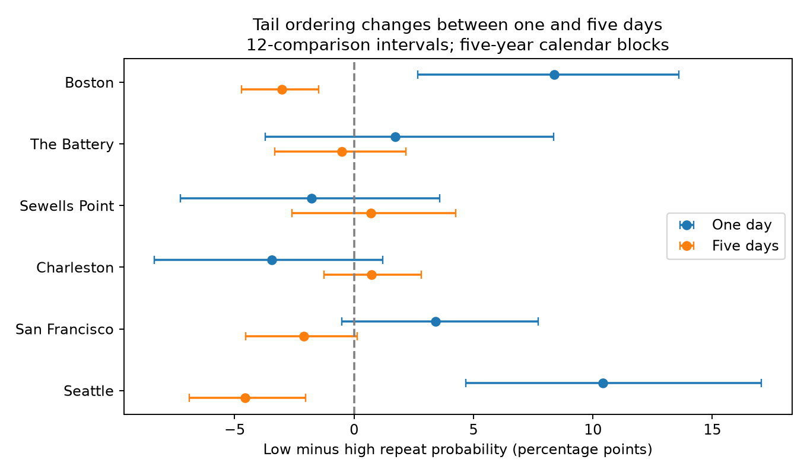
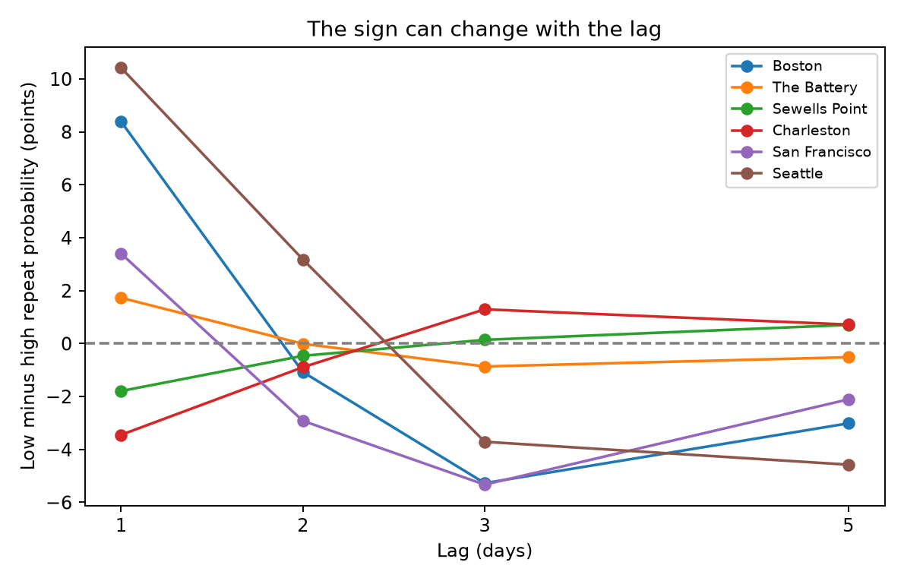

# Tail repeat probability differences changed sign between one and five days at Boston and Seattle in retained 1960-2025 records

We tested whether high and low water tails have the same ordering at one-day and five-day lags. We used NOAA daily hourly maxima and minima at six US gauges in 1960-2025. We removed each year's median daily midpoint and set separate calendar-month 5% tails. At Boston, low-minus-high repeat probability was +8.39 percentage points at one day and -3.01 points at five days. At Seattle, it was +10.42 and -4.57 points. Five-year block intervals adjusted for twelve comparisons excluded zero in all four cases. The other four sites did not show a resolved sign change. This is an exploratory extension of campaign work on the same source records. The five-day test was selected after inspection of lag results. Intervals fix thresholds and baseline estimates. Daily extrema retain tides. The result does not identify storm duration, recovery or a physical cause.



## Question and contribution

A next-day tail advantage need not hold several days later. We test that restriction on the same daily extrema, accepted dates, baseline and threshold rules. Low water can restrict navigation and expose coastal organisms. High water can cause flooding. Our percentile events are diagnostic measures, not navigation or flood limits.

Campaign report 641009dc already compared next-day extrema tails in 1960-2025. Report 9bd57682 compared midpoint tails at two-week lags and stated that a common-method sign-change test was missing. Reports b50a3910 and 0c2179d5 showed sensitivity to lunar filters and tide subtraction. Full IDs are in sci.json. We read their published text. We do not claim a new next-day discovery or an independent sample. No prior code or derived data was reused.

We started a broad SCI search and completed a coastal search. While that scan ran, we read cached public metadata and verified published reports. The saved search includes a continuation token; the metadata screen was also used. The initial next-day question overlapped earlier work. After we saw the lag curves, we chose the one-day versus five-day extension. Thus the final test is exploratory. The twelve-comparison rule does not account for all question, lag, baseline and threshold selection. It is not a registered discovery test.

Wadey et al. (2014; doi:10.5194/os-10-1031-2014) described coastal high-water clusters at several time scales. Gauff et al. (2026; doi:10.1111/gcb.70976) studied long negative sea-level anomalies. These works motivate separate tail and lag measures. We do not reproduce their definitions or infer their mechanisms.

## Data and quality rules

We reused 42 shared NOAA CO-OPS JSON responses. Each gauge has seven date ranges: 1960-1969 through 2010-2019, then 2020-2025. Stations are Boston (8443970), The Battery (8518750), Sewells Point (8638610), Charleston (8665530), San Francisco (9414290) and Seattle (9447130). This is an available-data sample of harbor gauges.

The source is NOAA daily_max_min, in metres relative to each gauge's fixed MSL datum, with local standard dates. We use dailyMaxHourly and dailyMinHourly only. These are extrema of hourly samples, not six-minute peaks. Both extrema must have at least 95% hourly completeness and inferred flag zero. A year must have at least 330 accepted paired days. Maximum must be at least minimum. We fill no gaps. The accepted table has 136,721 station-days. Coverage decisions and excluded years are in quality.csv. Rejected years can contain major events.

The exact raw paths, source URLs, response sizes and SHA-256 hashes of all 42 used responses are in files/provenance.json. Each source path is resolved under /mnt/dell-data/shared_datasets/noaa-coops-STATION-daily-START-END-msl-lst-20261108/data.json. The 20261108 label is a retrieval snapshot, not an immutable NOAA release. We changed no shared file. Raw bytes are not duplicated. The bundle includes accepted daily high, low and adjusted levels to support offline inspection.

## Common method

Let H and L be daily maximum and minimum. For each accepted year, compute the median of (H+L)/2 over accepted days. Subtract this one constant from both H and L. This removes annual background shifts but retains within-year ocean changes, season and tides. It is not subtraction of measured monthly mean sea level.

For each station and calendar month, pool adjusted levels across accepted years. A high-tail day strictly exceeds the 95th percentile of adjusted H. A low-tail day is strictly below the 5th percentile of adjusted L. We use linear quantiles. Ties can make rates differ slightly from 5%. The thresholds are fitted retrospectively, not forecast thresholds.

At lag k, an eligible origin-tail day must have a valid endpoint k calendar days later in the same month and year. Divide the number of pairs with the same tail at both endpoints by eligible origin-tail days. D(k) is low probability minus high probability. Missing dates are not joined. At k=1 this measures next-day persistence. At k=5 it measures endpoint recurrence; intervening days need not be valid or extreme. It is not a five-day event duration.

For the final extension, reversal.py uses 12,000 paired circular five-calendar-year block samples, seed 6522. Each sample has 66 year labels; excluded years carry zero counts. Blocks can wrap from 2025 to 1960. Resampling uses annual numerator and denominator counts and makes no new date pairs. For each site, both tails and lags use the same year sample. Each site's bootstrap is generated separately. Site ordering and block ordering are fixed in the code.

The main interval rule uses marginal percentile bounds 0.025/12 and 1-0.025/12 for six sites times two lags. This is a nominal family 95% rule if the marginal bootstrap coverage is valid. A resolved reversal requires the one-day interval to be above zero and the five-day interval to be below zero. Separate six-site intervals for D(1)-D(5) describe change in contrast; they do not by themselves prove reversal. One-year blocks are a sensitivity check.

Intervals hold source selection, annual baselines and fitted thresholds fixed. They omit their uncertainty and the effects of this investigation's exploratory choices. They also assume that calendar blocks can represent dependence in these changing records. They are conditional intervals, not exact error guarantees.

## Results

| Site | One-day D (points) | Adjusted interval | Five-day D (points) | Adjusted interval |
|---|---:|---:|---:|---:|
| Boston | +8.39 | +2.66 to +13.61 | -3.01 | -4.71 to -1.48 |
| The Battery | +1.73 | -3.71 to +8.37 | -0.52 | -3.31 to +2.16 |
| Sewells Point | -1.79 | -7.27 to +3.59 | +0.71 | -2.61 to +4.26 |
| Charleston | -3.45 | -8.37 to +1.20 | +0.72 | -1.27 to +2.82 |
| San Francisco | +3.40 | -0.52 to +7.71 | -2.11 | -4.53 to +0.13 |
| Seattle | +10.42 | +4.67 to +17.06 | -4.57 | -6.90 to -2.02 |


Boston and Seattle show the sign change under the twelve-comparison rule with both one- and five-year blocks. At Boston, D(1)-D(5) is 11.40 points, with a six-site adjusted five-year interval of 5.68 to 16.35 points. At Seattle it is 15.00 points, with an interval of 9.66 to 20.98 points. The other four sites do not have a resolved reversal under this rule. San Francisco has a resolved change in contrast, but each lag's adjusted interval includes zero.



The original scan covered lags 1, 2, 3 and 5, tail rates 10%, 5% and 2.5%, two baselines, and full, early (1960-1992) and late (1993-2025) records. All estimates are in results.csv. These checks were computed before the final extension. They do not supply additional confirmatory tests. For the one-day statistic, Boston and Seattle have positive point differences at all three tail rates in both periods. This does not test a temporal change or prove that the five-day reversal holds in every subperiod.

## Explanation test and limits

The evidence rejects a lag-invariant tail ordering within this method at Boston and Seattle. A simple claim that low-water extremes always have greater repeat probability is not supported. Removing one annual background level also leaves the next-day difference. Annual level shifts alone therefore do not account for that measured asymmetry under this diagnostic.

Tidal phase, unequal tide cycles, changing tidal range, weather and ocean circulation can all change the lag curve. H and L occur at different hours, and daily summaries can retain astronomical signals. The campaign tide-filter results make this a material alternative explanation. We did not subtract tide predictions, match wind or pressure, or identify storms. The sign change does not select a physical mechanism. It does not show slower recovery, an event-duration difference, a climate trend, damage, or future forecast skill.

A next physical test should compare hourly observed-minus-predicted water levels with common wind and pressure records. It should choose lag scales in advance and use later independent records. Six selected sites, source revisions, gauge changes, hourly sampling, missing events, long tidal cycles and fixed thresholds limit this result. Monthly thresholds and exclusion of month boundaries also change the target.

## Reproduction and checks

Use a writable copy of the verified publication. No network is needed for the main result:

```sh
python files/reversal.py
python files/block_check.py
python files/plot_results.py
python files/validate.py
```

reversal.py rebuilds both-lag annual counts, saved bootstrap draws and all reversal intervals from clean_daily.csv. It checks that its independently reconstructed one-day point result matches the original scan. block_check.py checks the original one-day result. plot_results.py rebuilds the figures. validate.py checks dates, coverage, level order, annual baselines, primary aggregation and all saved reversal interval endpoints. validation.txt records the successful checks. repeat_check.json records an exact separate repeat of the core count tables and bootstrap arrays, and agreement of all 42 raw hashes with source download metadata. reversal_draws.npz has shape (12,12000,2), with station order as listed above, block lengths 1 then 5, and lag columns 1 then 5. The saved seed reproduces the draws.

For the full scan from raw shared responses, from the publication root:

```sh
python files/analyze.py --datasets /mnt/dell-data/shared_datasets --out files
python files/reversal.py
python files/block_check.py
python files/plot_results.py
python files/validate.py
```

Use files/environment.json for exact package versions. requirements.txt lists the packages. retrieve.py --out NEW_PRIVATE_DIRECTORY retrieves the 42 source URLs and checks recorded hashes. Never use the shared store as that output. Live source revisions can prevent a hash match; the bundled daily evidence still supports the main offline test. Source URLs, checksums and full accepted evidence are preserved. The license retains NOAA attribution; no private key is included.

## Job record

Campaign: 11_07_2026. Job: sci-1107-syam2-earth-and-ocean-sciences-6520c7f44653. Topic: earth-and-ocean-sciences. Machine: syam2. Account: codex-myxtap. Model: gpt-6.1-sol with high reasoning effort. Date: 2026-11-08 UTC. All computations ran in this assigned worktree. No agents were launched. The campaign-machine key is not a personal authorship claim. This publication is stored locally; no remote archive or index submission is made.
