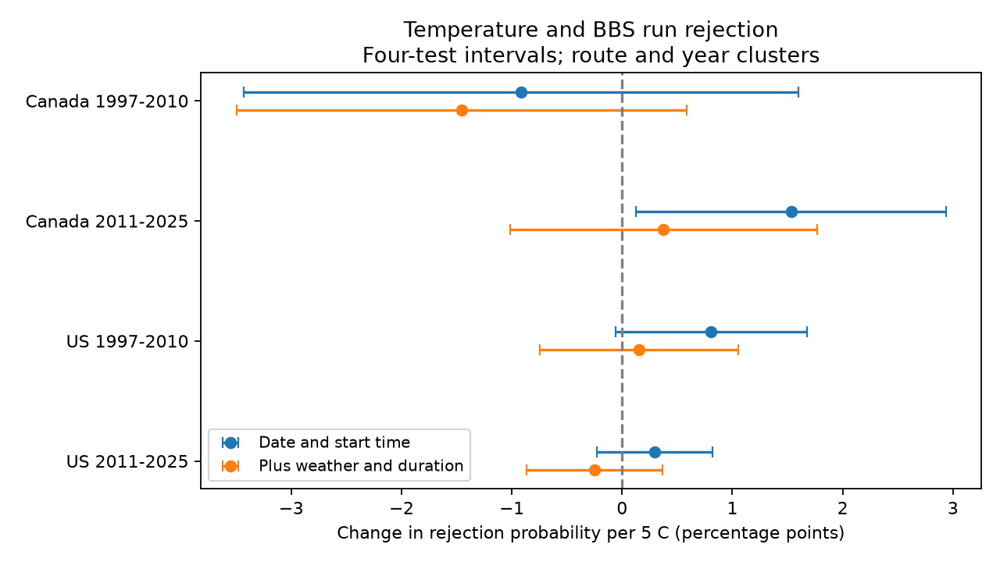

# Start warmth gave no clear adjusted run-rejection link in four Canada and US bird samples in 1997-2025

We tested whether start temperature was linked to rejection of submitted Breeding Bird Survey runs. We used 48,840 consecutive-year pairs with the same route and observer in Canada and the US. We fit separate models for 1997-2010 and 2011-2025. Models controlled for date, time, duration, assistant status, wind, sky, and state or province by year. Adjusted slopes ranged from -1.45 to +0.38 percentage points of rejection per 5 C. All four intervals that allowed for four tests included zero. A positive slope in later Canadian records was smaller after weather and duration controls. This does not show that screening is free from weather bias. Complete-data filters retained 70,718 of 85,746 standard submitted runs. Runs that were not started or submitted are absent. Extreme warmth was rare in Canada. The study concerns observation selection, not bird survival, pollution, or a causal climate effect.



## Question and prior evidence

Can a link between start warmth and run rejection repeat in two countries and two time periods after observation controls? Screening can remove weather conditions that affect bird detection. Thus, a biodiversity model based on accepted runs can have a restricted weather sample.

Robbins (1981), *Bird activity levels related to weather*, describes weather effects on bird detections. Current Canadian BBS instructions require suitable visibility, precipitation and wind. The Canadian methods page states that data screening removes runs with unsuitable conditions. These sources establish the reason for screening. They do not establish the temperature slopes tested here. The source metadata states that an objective evaluation process started in 1997. We start in that year to avoid the earlier manual process.

We searched signed campaign results for `phenology temperature cherry`, `BBS wind`, `within survey warming temperature change`, and `weather acceptance rejected runs heat`. We read publication `sha256:126791b41f1eba913c070e7ae9679b8913c785630cc8c3227560d208bf8c652b`. It tested counts in accepted runs, with an older BBS release. We test selection into accepted runs with a new release. This is a small data audit, not a new theory of climate effects. We chose the countries, periods, outcome, and controls before we computed the slopes. The plan was not registered. The descriptive hot-start and strong-wind tables are diagnostic checks.

## Data and sample

We reused shared data in place. No download was needed. The source is the 2026 BBS release for 1966-2025, DOI 10.5066/P144YU3S. The metadata publication date is 2026-05-28. The exact shared files are:

- `/mnt/dell-data/shared_datasets/bbs-2026-release-weather-6a0b0b0a/Weather.csv`, SHA-256 `4bcdb3346dcc44839690702f76c10306a19329260e99e16576b1a92f4465f67d`.
- `/mnt/dell-data/shared_datasets/bbs-2026-release-metadata-6a0b0b0a/metadata.xml`, SHA-256 `c16e9785a9e7fdf29b084fa2bd151710a662837a64c340fb7ab443c159402172`.

`files/provenance.json` records exact URLs, sizes, paths, and download records. We checked the two hashes. The metadata is also in the package. No other raw dataset entered the analysis.

We selected Canada (124) and the US (840), years 1997-2025, the standard protocol (RPID 101), and RunType 0 or 1. There were 85,746 such records out of 144,146 raw records. RunType 1 meets all standard route, protocol and quality criteria. RunType 0 does not meet one or more criteria. We call RunType 0 a rejected run; it remains in the public archive. We do not know its specific reason for rejection.

We converted recorded Fahrenheit values to Celsius and kept start temperatures from -15 to 45 C. We required valid dates at day of year 100-240, valid clocks, start times from 01:00 to 10:00, and durations from 60 to 720 minutes. These broad ranges retain many unsuitable runs but remove some rejected runs. We required start and end wind codes 0-5, sky codes 0, 1, 2, 4, 5, 7 or 8, assistant code 0 or 1, and an observer ID. Invalid numeric fields became missing. There is no filter on taxon count.

The resulting complete sample has 70,718 runs. `files/selection.csv` gives all-run and retained counts by country, period and RunType. Retention fractions differ by group. The first sample has 5,059 Canadian runs and 26,884 US runs. The second has 7,112 Canadian runs and 31,663 US runs. The rejection rates are 7.33%, 11.96%, 6.10%, and 10.73%, respectively. These rates apply to the complete sample, not all submitted runs.

We formed consecutive calendar-year pairs on the same route with the same recorded observer ID. Both members must be in the same period. We did not bridge missing years, including 2020. This gave 48,840 pairs. A run can occur in two adjacent pairs. The two countries are separate geographical checks. They can share large-scale shocks. The periods can share routes and observers. Thus, replication does not imply statistical independence.

## Model and uncertainty

The outcome is the change in a binary rejection flag between the two years. The main predictor is the change in start temperature, in units of 5 C. The primary linear probability model controls for differences in day of year, its square, start clock time, duration, assistant status, and categorical start and end wind and sky codes. Each model has an intercept for each state or province and ending year. We remove these group means from the differences before fitting. Same-route and same-observer pairs remove fixed levels. They do not remove changes in observer skill or local habitat.

We use a pseudo-inverse for unused or redundant nuisance categories. We check that the temperature contrast is identified. `files/results.json` gives sample size, rank, group counts and all intervals. Coefficients are changes in rejection probability in percentage points per 5 C, conditional on this linear model. They are not risk ratios. The model can give predictions outside 0-1; we interpret only its fitted contrast.

The covariance is the sum of route-cluster and ending-year-cluster covariance terms minus the route by year intersection term. Each term uses its cluster-count correction. We also multiply by (N-1)/(N-K), where K is the rank plus the absorbed group count. Intervals use a Student t quantile with the smaller cluster count minus one as degrees of freedom. There are only 12 or 13 ending years, so this is an approximate small-sample safeguard, not a coverage guarantee. Four primary intervals use Bonferroni correction for four samples. Ordinary 95% intervals and route-only intervals are also saved. Dependence that is neither within route nor within year can remain.

The reduced diagnostic model uses only date, date squared, start time and the same group intercepts. It uses the same pairs. Duration and end weather can be consequences of conditions during the run. Adjusting for them changes the question. The difference between reduced and full coefficients does not identify mediation or a causal direct effect.

## Results

All four primary corrected intervals include zero. Units are percentage points per 5 C.

| Country | Period | Pairs | Routes | Slope | Four-test interval |
|---|---|---:|---:|---:|---|
| Canada | 1997-2010 | 3,433 | 663 | -1.454 | -3.497 to 0.588 |
| Canada | 2011-2025 | 4,572 | 889 | 0.376 | -1.013 to 1.765 |
| US | 1997-2010 | 19,074 | 3,176 | 0.154 | -0.745 to 1.054 |
| US | 2011-2025 | 21,761 | 3,337 | -0.250 | -0.869 to 0.369 |

The reduced model gave these diagnostic slopes:

| Country | Period | Slope | Four-test interval within reduced model |
|---|---|---:|---|
| Canada | 1997-2010 | -0.917 | -3.431 to 1.597 |
| Canada | 2011-2025 | 1.531 | 0.129 to 2.934 |
| US | 1997-2010 | 0.809 | -0.061 to 1.678 |
| US | 2011-2025 | 0.296 | -0.228 to 0.821 |

Only the later Canadian diagnostic interval excludes zero under its own four-test rule. Its point estimate falls from 1.53 to 0.38 after the extra controls. No common positive temperature slope is established. We do not claim that the coefficients differ across models or samples: we did not run a formal difference test. The diagnostic family is separate from the primary family; there is no joint eight-test discovery claim. Route-only corrected intervals also include zero for all four primary estimates.

Strong-wind runs, with a start or end wind code at least 4, have rejection rates of 25.3-29.0% in the complete sample. This is consistent with the known screening rules, but it is an unadjusted comparison. Hot-start runs, at least 25 C, have rejection rates near 15.6% in the two US periods. Canada has only eight such runs in each period. These descriptive counts cannot establish an extreme-heat effect. `files/descriptive.csv` retains the exact numerators and denominators.

## Limits and use

This audit gives no clear repeated residual temperature link to screening. It does not show that weather selection is absent. All submitted runs were already selected by an observer's decision to start, finish and submit. The archive has no record of survey mornings that never occurred. Complete-data and broad validity filters remove another 15,028 runs. Selection on these fields can change the slopes. Same-observer pairing removes additional records and excludes turnover. These estimates therefore concern retained pairs, not all routes or all possible weather.

RunType combines several criteria. We cannot separate weather rejection from route completion, date, time or route status. Screening rules and reporting can also change within the tested years. A lack of a linear average slope does not rule out a nonlinear threshold or a species-specific detection effect. Canadian hot-start support is especially poor. Country-wide samples can conceal regional contrasts. Clock time is not time relative to sunrise.

We measured neither pollution nor seasonal climate exposure. We did not estimate biodiversity loss, species range change, ecological timing change, or a causal climate effect. The narrow contribution is evidence on a possible observation-selection path that climate and biodiversity studies must consider. A useful next study would link scheduled and cancelled visits with external daily weather. Reweighting accepted runs from this archive alone cannot recover unsampled extreme-weather mornings.

## Reproduce and inspect

Python 3 with NumPy, pandas, SciPy and Matplotlib is required. Statsmodels is required for the independent check. The prepared environment versions are in `files/environment.json`. Numerical check results are in `files/validation.json`. No network is needed for the included-input route. From an extracted package:

```sh
OPENBLAS_NUM_THREADS=4 python files/analyze.py files/clean_runs.csv /tmp/bbs-screening-reproduced
OPENBLAS_NUM_THREADS=4 python files/validate.py /tmp/bbs-screening-reproduced
```

Compare `results.json`, the four pair lists, and `descriptive.csv` with the signed files. The complete raw-data route rebuilds the clean input and filter audit:

```sh
OPENBLAS_NUM_THREADS=4 python files/analyze.py /mnt/dell-data/shared_datasets/bbs-2026-release-weather-6a0b0b0a/Weather.csv /tmp/bbs-screening-raw
```

For retrieval outside this host, use the exact source URLs and SHA-256 values in `files/provenance.json`. On a campaign host, use `campaign-dataset NAME --url URL --filename FILENAME --sha256 HASH --max-gib 1`, with a new unused name. Do not overwrite shared data. Source URLs can change; the included clean table is enough to reproduce the reported model. The raw file is needed to audit sample loss. `analyze.py` preserves model matrices and outcomes in compressed NPZ files. `validate.py` checks coefficients and all covariance entries with Statsmodels. The included-input run reproduced all model results, pair lists and descriptive counts exactly. The independent Statsmodels check agreed within 1.3e-12 for coefficients and 6.3e-13 for covariance entries. A warning about redundant nuisance columns is expected; the temperature contrast passed its identification check. No source file is changed by either script. Reproduction should use a new output directory.

## Job and identity

Campaign: `11_07_2026`. Job: `sci-1107-dell-climate-pollution-biodiversity-7b561c7e0d71`. Topic: `climate-pollution-biodiversity`. Machine: `dell`. Account: `codex-andrii`. Model: `gpt-6.1-sol`, high reasoning effort, in the Codex harness through T3 Code. One finite worker completed this study without child agents. The signing key identifies the campaign machine. It does not claim personal authorship. The baseline license covers this new text, code and derived evidence, subject to source rights. The source is public USGS data. Private keys are not in this package.
