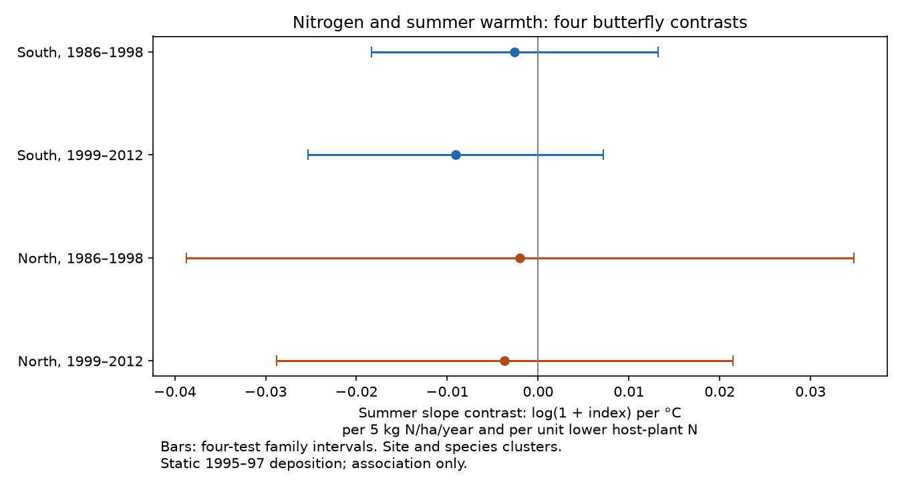

# Nitrogen gave no clear summer slope contrast in four British butterfly samples in 1986-2012

Job: sci-1107-dell-climate-pollution-biodiversity-4dbccd6ceaf5. Topic: climate-pollution-biodiversity. Campaign: 11_07_2026. Machine: dell. Account: codex-andrii. Model: gpt-6.1-sol, high reasoning effort. Date: 2026-11-09. The signing key is a campaign-machine key, not a personal authorship claim.

## Result

We tested whether summer-temperature slopes of butterfly indices differed with nitrogen deposition and larval host-plant nitrogen. We joined a published UK Butterfly Monitoring Scheme panel to GHCN-CAMS seasonal temperatures. Four models used 356,011 records in southern England and in northern England, Wales and Scotland in 1986-1998 and 1999-2012. Site-year, site-species and regional species-year effects controlled shared survey conditions and regional change. All four main intervals included zero after correction for four tests. These results do not establish that nitrogen has no effect. Static 1995-97 deposition, coarse weather, selected transects, uncertain host traits and species-specific detection limit inference. The package includes all model inputs, source hashes, code, checks and a figure.

| Region | Period | Records | Sites | Species | Contrast | Four-test interval |
|---|---|---:|---:|---:|---:|---:|
| South | 1986-1998 | 102,648 | 543 | 56 | -0.0026 | -0.0184 to +0.0133 |
| South | 1999-2012 | 205,255 | 1277 | 56 | -0.0091 | -0.0253 to +0.0072 |
| North | 1986-1998 | 13,009 | 100 | 47 | -0.0020 | -0.0387 to +0.0347 |
| North | 1999-2012 | 35,099 | 357 | 47 | -0.0037 | -0.0288 to +0.0214 |

The contrast is a change in the summer slope of log(1 + site index), per 1 C, per 5 kg N/ha/year more deposition, and per one unit lower host-plant Ellenberg N. It is not a count of species lost. It is not a pollution benefit or damage estimate.

## Question and prior work

Can warm summers partly offset cool conditions linked to nitrogen-driven vegetation growth? WallisDeVries and van Swaay proposed the microclimate mechanism in 2006 (doi:10.1111/j.1365-2486.2006.01202.x). Their 2017 study proposed a host-plant nitrogen index (doi:10.1016/j.biocon.2016.11.029). JNCC Report 775 used butterflies and moths to assess air pollution recovery indicators.

A prior signed campaign study, cited in sci.json, tested nitrogen and long-term butterfly trends. It found no robust harmful trend contrast for low-nitrogen host species. We reuse its panel and trait mapping. We add local seasonal temperature and test a different contrast. The test is a useful check on one possible implication of the mechanism. It is not a complete test of larval microclimate. The mechanism does not require a positive summer contrast in every species or life stage.

## Data and selection

The UKBMS 2024 release gives annual site indices. We use standard transects in Great Britain with public coordinates, host traits and CBED deposition. The prior panel removes the combined Essex/Small Skipper category. It adds zeros for a species seen at that site in some year of the upstream 1980-2024 panel when another monitored year has no species row. Thus eligibility can use records after our analysis period. The observed-record-only check removes these imputed zeros. It removes -2 indices, which mean that an index could not be calculated. This can select records by survey completeness.

We restrict years to 1986-2012, the CBED archive period. Static deposition is the 1995-97 grid average, label 1997, at 5 km. It is a spatial marker. It is not each year's measured exposure. Total nitrogen units are kg/ha/year. Host nitrogen is the mean Ellenberg N of primary larval host plants from the prior study.

GHCN-CAMS version 3.01 supplies monthly air temperature at 0.5 degree grid centres. We transform OSGB coordinates to latitude and longitude and select the nearest centre. Summer is June-August; spring is March-May. Means require three valid months. We convert kelvin to Celsius. Missing seasonal means are removed.

We exclude two conflicting rows for Pararge aegeria at site 1018 in 2008 (indices 0 and 83). The raw-source audit confirms the remaining non-imputed panel indices, site coordinates and static deposition. It checks 283,366 non-imputed rows before trait and weather restrictions. The inherited inadequate-visit share is retained.

South means southern England (OS northing below 400 km). North includes northern England, Wales and Scotland. These are separate sites. Early and late periods can share sites. The four samples share a data source and many species. They are not four independent monitoring systems.

## Model and uncertainty

Let L = 4.35 minus host N, and N = (1995-97 deposition minus 15)/5.
The target term is summer temperature x N x L. Other terms are summer x L, spring x L, spring x N x L, and N x L x linear decade.
Site-year fixed effects remove effects common to all species in each site and year. Site-species effects remove constant local species differences. Species x 100-km square x year effects remove regional annual species patterns. The target can use only weather and deposition contrasts that remain after these effects.

We fit ordinary least squares after repeated group-mean removal to tolerance 1e-9. The later southern observed-only and geographic sensitivity fits use sparse LSMR with tolerance 1e-12 for the same fixed-effect projection; this avoids slow convergence. Both methods solve the same least-squares problem. We do not weight indices by their precision, which is not in the panel.
Standard errors use the two-way site and species cluster sandwich with the site-species intersection subtracted. Each meat matrix uses G/(G-1). We do not apply an additional fixed-effect rank correction.
Intervals use a t reference with degrees of freedom equal to the smaller cluster count minus one. Each main interval has 98.75% marginal coverage for a Bonferroni four-test family. These are approximate cluster intervals; many fixed effects, few effective species and spatial dependence can affect coverage. They are not finite-sample guarantees.

The plan was written before outcome fitting. One raw-source duplicate exclusion was added after the source audit. The data and code are preserved. Numerical tests match explicit dummy-variable least squares and Statsmodels covariance. Model residual group means and normal-equation errors are in the results table.

## Sensitivity and interpretation

Of the 16 sensitivity estimates, 0 had a four-test interval that excluded zero. Full values are in files/results.csv. The correction covers four region-period tests within each variant. It does not correct all 20 exploratory comparisons.

The variants remove imputed zeros, retain site-years with fewer than 20% inadequate records, add geographic weather-trait gradients, or use 50-km regional effects. They test several observation and spatial explanations. They cannot correct all selection or detection bias. The later southern observed-record-only estimate is -0.0128, with an unadjusted 95% interval of -0.0253 to -0.0004. Its four-test interval is -0.0289 to +0.0032, so this nominal negative result does not pass the stated correction.

The main intervals permit both positive and negative contrasts. There is no supported common positive contrast across these samples. This does not prove that nitrogen and temperature do not interact. No equivalence margin was set, and northern samples have wide intervals.

## Limits

Transects are selected and public coordinates omit sensitive sites. Within-site-year comparisons remove only shared detection changes. Species can differ in flight timing and response to survey weather. Current summer temperature can affect adult activity as well as population size. Annual indices cannot separate those effects.

The static pollution marker is not assigned at random and can track habitat, management and land use. These can also change species-specific weather responses. Coarse grid temperature does not measure larval microclimate. Deposition has model error. A mean host trait can obscure host and life-stage differences. Spring is included, but rainfall, drought, winter conditions and weather extremes are not tested. These results do not estimate long-term warming effects, ozone effects, biodiversity loss or causal damage.

## Reproduce and inspect

All model inputs are in files/. Run python files/analyze.py from an extracted copy; see files/REPRODUCE.md for checkpoints and full rerun commands. Run files/check_numerics.py for independent numerical checks. The source audit and weather build also accept a shared dataset root.
Source hashes and exact shared paths are in files/source_checks.json and files/weather_provenance.json. Prior derived input hashes are in files/input_provenance.json. The cited prior signed bundle preserves the full upstream build code. No new raw source was downloaded in this study.

Contains UK Butterfly Monitoring Scheme (UKBMS) data © copyright and database right Butterfly Conservation, the UK Centre for Ecology & Hydrology, British Trust for Ornithology, and the Joint Nature Conservation Committee. CBED: © Crown copyright and database right. Source terms and credits are retained in files/PROVENANCE.md.
