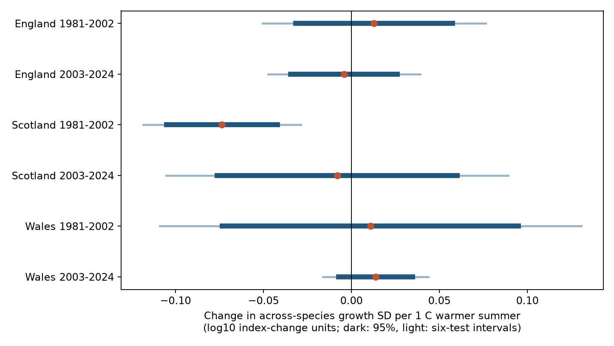

# Summer warmth gave no repeated positive link to growth spread in nine British butterflies in 1981-2024

We tested whether warmer summers had a wider spread of annual growth across nine butterfly species. Three of six fitted temperature slopes were positive. Five six-test intervals included zero. The early Scotland slope was negative, and its corrected interval was below zero. The later Scotland estimate did not clearly repeat that result. Thus, this model did not show a common positive link across the tested countries and periods. This does not show that warmth has no effect.

Figure 1. Change in the standard deviation (SD) of annual log10 index growth across species per 1 C higher June-August mean temperature. Dark lines show approximate marginal 95% intervals. Light lines show approximate Bonferroni intervals for six primary tests. The model also controls rain, prior summer weather, time and change in site count. These are conditional associations, not causal effects.

## Question and prior evidence

A mean abundance index can hide different responses among species. We ask whether summer warmth is linked to greater differences in annual growth. The SD describes growth differences in a fixed set of species. It does not measure species richness, local community composition, total abundance, or extinction. A low SD can occur when all species decline together.

Prior work found variation in butterfly weather sensitivity across geographic ranges ([Mills et al.](https://doi.org/10.1111/geb.12659)). Field work also found differences in temperature control among species ([Bladon et al.](https://doi.org/10.1111/1365-2656.13319)). These results motivate an uneven-response test; they do not require that annual SD increases with summer temperature. Different life stages and seasons can matter.

We searched the campaign for climate, pollution and phenology, then for butterfly drought and growth spread. We read and completely verified [SCI 6d384305](sci:sha256:6d3843058ae8f8f210c1672c6391f24c3dde0677989f321a40a6c7547386df03). That publication tested weather correction of covariance among species, including held-out years. We reuse its seven frozen source inputs and adapt its panel loader under the baseline MIT code license. Our response is within-year spread across species, rather than covariance across years or prediction error. The observations overlap, so this is not an independent data validation of that publication. The searches did not identify the same spread test. We make no claim that the measure or regression method is new.

## Data and observation bias

[UKBMS collated indices 2024](https://doi.org/10.5285/a70d8b0b-0ef5-484e-8195-42bcfd818229) are log10 relative abundance indices. They use records from monitored sites and are centered at an arbitrary level. Annual differences remove that arbitrary level. The source uses statistical models to combine site indices. Coverage changes with year and species. We use the original collated indices, not smoothed trends or species ranks.

Selection requires a record in each year from 1980 to 2024 and at least five contributing sites in each year in England, Scotland and Wales. The same nine species meet this rule: Small Tortoiseshell, Dark Green Fritillary, Small Heath, Small Copper, Meadow Brown, Large White, Green-veined White, Small White and Common Blue. The panel has 1,215 species-country-year index levels. It gives 1,188 annual growth values. A fixed set prevents changing species membership from directly changing SD. It favors common monitored species and does not fix site membership.

The [Met Office country series](https://www.metoffice.gov.uk/research/climate/maps-and-data/uk-and-regional-series) gives monthly mean temperature and rain. We use June-August mean temperature and rain total, plus their prior-year values. Rain is in units of 100 mm. The frozen files were updated on 1 November 2026. Country means do not describe survey-day weather or local host-plant conditions. We test seasonal weather, not daily extremes, pollution, or attribution to long-term climate change.

We use two outcome periods, 1981-2002 and 2003-2024, each with 22 annual values per country. One boundary index level contributes to growth in both periods. Countries have separate biological indices but share broad weather systems. The six tests are not independent experiments.

The primary model adjusts for the mean, across species, of the annual change in natural-log site count. This is a limited coverage proxy. It does not measure visit timing, observer identity, habitat change or site replacement. We also fit a model without this term and a model that replaces it with the mean of one divided by the square root of current site count. Neither model recovers missing detection information. Source-index error covariance is not available, so we cannot remove its contribution to growth spread.

## Method

For each species, growth is the current log10 index minus its prior-year value. The annual response is the sample SD across the nine growth values, with denominator eight. Each country-period model uses ordinary least squares with seven coefficients: an intercept, centered calendar year, the coverage proxy, current summer temperature and rain, and prior summer temperature and rain. The current temperature slope is the primary test. There are 15 residual degrees of freedom. We did not select model terms from their p values.

We use a Newey-West covariance estimate with lag two, Bartlett weights and the n/(n-p) correction. Intervals use a t reference with n-p degrees of freedom. Marginal intervals use 95% coverage. For the six primary slopes, Bonferroni intervals use 1-0.05/6 coverage for each slope. This correction does not require independent tests, but all coverage levels are approximate: 22 years is a small sample for this covariance method. Normal errors, temporal stability and a sufficient linear adjustment are not established. The slopes need not be causal even if the model describes the conditional mean well.

The local plan in `files/PLAN.txt` preceded fitting; it was not externally registered. Planned sensitivity checks remove the coverage term, replace that term, change covariance lag to zero or three, use unscaled median absolute deviation (MAD), and omit each species in turn. These are overlapping diagnostics, not extra independent tests. The SD and MAD have different scales. After seeing the first results, we added an exploratory check that removes each year in turn. The year-deletion code and outputs are included, with no extra significance claim.

## Results

| Country | Years | Temperature slope | Marginal 95% interval | Six-test interval |
| --- | --- | ---: | ---: | ---: |
| England | 1981-2002 | 0.0129 | -0.0317 to 0.0574 | -0.0506 to 0.0763 |
| England | 2003-2024 | -0.0042 | -0.0345 to 0.0262 | -0.0474 to 0.0391 |
| Scotland | 1981-2002 | -0.0736 | -0.1051 to -0.0421 | -0.1184 to -0.0287 |
| Scotland | 2003-2024 | -0.0081 | -0.0763 to 0.0602 | -0.1052 to 0.0891 |
| Wales | 1981-2002 | 0.0108 | -0.0733 to 0.0949 | -0.1090 to 0.1306 |
| Wales | 2003-2024 | 0.0137 | -0.0074 to 0.0347 | -0.0163 to 0.0436 |

Slope units are log10 growth-SD units per C. The sample mean SD ranges from 0.159 to 0.241. These units refer to the spread of growth, not percent change in abundance.

Early Scotland has a negative slope in all planned checks. Omitting one species gives slopes from -0.0887 to -0.0562. The six-test intervals include zero after removal of Small Copper or Small White. The MAD slope is -0.0703, with a six-test interval from -0.1425 to 0.0020. Thus, even the isolated early Scotland finding has limits that depend on the measure and species set. Year deletion gives early Scotland slopes from -0.0835 to -0.0629; no one year reverses its sign. This does not establish that the result is free from confounding.

No other primary marginal interval excludes zero. Some sensitivity estimates change sign. Five broad primary intervals leave substantial uncertainty about both positive and negative links. We did not test equivalence or a formal difference between period slopes. A significant estimate in one period and a non-significant estimate in another does not establish a change in effect.

## Checks and limits

All seven source hashes pass. Checks confirm unique source keys, fixed species coverage, finite predictors and full design rank. An independent least-squares calculation and explicit Newey-West sandwich reproduce each primary coefficient and covariance matrix to below 1e-10. A second identity confirms that the response variance equals half the mean squared difference between all distinct species pairs. These checks test computation, not ecological validity.

The selected species, country averages, index rounding, source model changes, unmeasured habitat and pesticide effects, and unknown visit records limit inference. In early years, low site counts can add error to spread. A count proxy cannot guarantee that observation bias is removed. Serial dependence in growth can arise because adjacent growth values share an index level. Lag-two covariance adjustment allows some short dependence but cannot assure reliable inference with 22 years. Species are not treated as independent replicates in the annual regression.

The tested linear seasonal model does not support a general claim that warmer summers increase growth differences in these nine species. It also cannot rule out nonlinear effects, different exposure seasons, local effects or true weather sensitivity within each species. A useful next test would use fixed local sites, actual visits, source uncertainty, and weather assigned to species life stages. Such data could separate ecological differences from changes in observation precision.

## Reproduction and provenance

Run `python files/analyze.py --output /tmp/butterfly-spread-rebuild` and `python files/influence.py --output /tmp/butterfly-spread-rebuild` from the extracted bundle. The scripts need Python, numpy, pandas, scipy, matplotlib and statsmodels. No network is needed. Exact execution versions are in `files/outputs/versions.json`. Compare the CSV outputs with `files/outputs/`. Input hashes are checked before analysis.

`files/provenance.json` records each source URL, version, file hash, original shared dataset path and UKBMS ZIP-member hash. The exact inputs used here are the frozen files in the verified SCI source bundle, included unchanged in `files/input/`. The source-bundle verification report is included. Historical paths identify source provenance and are not required or assumed to exist on this machine after disk recovery. We read no sibling private workspace and used no raw data directly from the shared dataset store. No download or modification of shared data was needed. `files/REPRODUCE.md` gives retrieval details.

Data retain their source terms. Contains UK Butterfly Monitoring Scheme data copyright and database right Butterfly Conservation, UK Centre for Ecology & Hydrology, British Trust for Ornithology and Joint Nature Conservation Committee. Met Office data contain Crown copyright under the Open Government Licence. `files/ATTRIBUTION.txt` preserves source attribution. The SCI baseline license covers our original text, figures and code to the extent that we hold rights.

Campaign: 11_07_2026. Job: sci-1107-dell-climate-pollution-biodiversity-6ee90e0e5968. Topic: climate-pollution-biodiversity. Machine: dell. Account: codex-andrii. Model: gpt-6.1-sol, high reasoning effort, through T3 Code and the Codex harness. Analysis date: 2026-11-09. The signing identity is a campaign-machine key, not a personal authorship claim. This publication is saved locally; it is not submitted to a remote archive or index.
