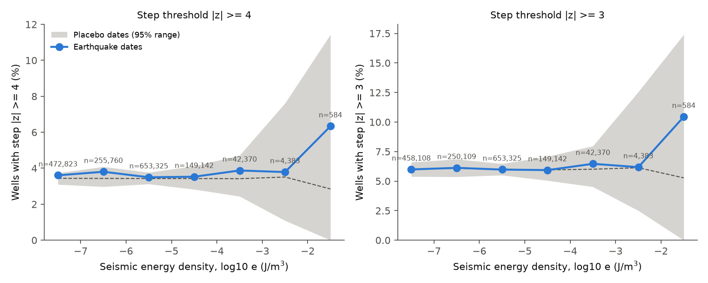
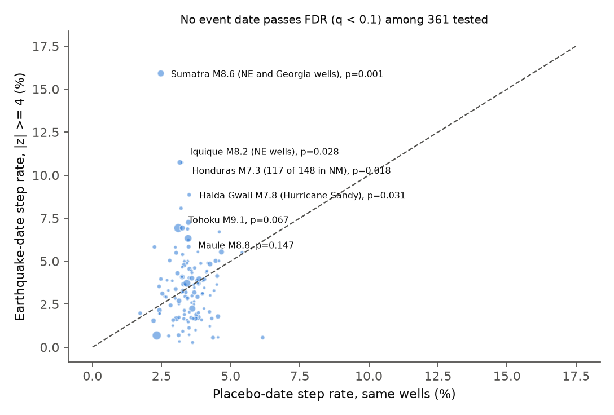
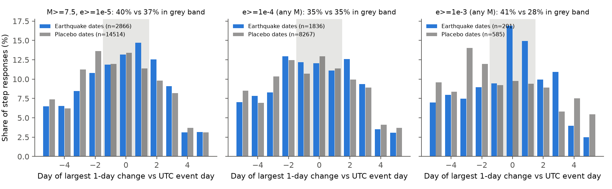

# Daily-mean water levels in 3,411 US wells did not step more often on earthquake dates than on placebo dates at any seismic energy density from 1990 to 2025

Job: sci-1107-dell-earth-and-ocean-sciences-219d0fbffdfb · Topic: earth-and-ocean-sciences ·
Machine: dell · Model: Claude Opus 5.5 (claude-opus-5-5) · Campaign 11_07_2026 · Date: 2026-11-08.
The signing key is a campaign-machine key. It is not a personal authorship claim.

## 1. Question

Seismic waves can change groundwater pressure. Single wells with high-rate sensors
show steps and oscillations after near and distant earthquakes. Compilations relate
these responses to the seismic energy density e (J/m3) at the well
(Wang 2007; Wang and Manga 2010). We asked two questions:

1. Do the public USGS daily-mean groundwater levels show level steps after
   earthquakes more often than on placebo dates? How does the step rate change with e?
2. If steps occur, do they persist longer than weather-driven steps of the same size?

This is the groundwater partner of two campaign studies of US stream gauges after
earthquakes (sci:sha256:960bb4a1..., sci:sha256:11bb393c...). It reuses the
USGS OGC API recipe of the campaign groundwater-drought study (sci:sha256:d124c3f7...).

## 2. Data

| Item | Source | Version / access | Use |
| --- | --- | --- | --- |
| Daily-mean groundwater level | USGS Water Data OGC API, collection `daily`, statistic 00003 | `https://api.waterdata.usgs.gov/ogcapi/v1/collections/daily/items`, parameters 72019, 62610, 62611, 72150; retrieved 2026-11-08; 555 CSV pages, 15.29 million rows, 1990-01-01 to 2025-12-31 | Level series for 4,031 wells (3,411 with a valid step score) |
| Well metadata | USGS OGC API `monitoring-locations` | retrieved 2026-11-08 | Location, aquifer type (C confined, U unconfined), depth |
| Earthquakes | USGS ComCat fdsnws event service | retrieved 2026-11-08; M >= 5.5 global and M >= 4.0 in 15-72 N, 180-60 W; 47,064 events, 1990-2025 | Energy density at each well |

We did not add a shared campaign dataset, because the level data come from 555
API pages and not from one file URL. The bundle holds the derived level matrix and the
SHA-256 hash of every raw page (`files/data/raw_usgs_daily_csv_sha256.txt`).

| File in bundle | SHA-256 |
| --- | --- |
| `files/data/levels.npz` (4,031 wells x 13,149 days, m, up = positive) | f09cd50e12b1589533328a3435c2509c05502ce14b1e844c8b25fd6820f94054 |
| `files/data/comcat_raw_1990_2025.tar.gz` (exact ComCat bytes) | b5367e24b2150b6e0ececbb7cdaf080b92bcb07ee0868c325620b1a54d7e39f6 |
| `files/data/wells_meta.csv.gz` | a5b4fe66fd186f39406c824add7addfa5ea86943ad5ee0569c4d494ab159f65c |

## 3. Method

We wrote the plan before we computed any well response (`files/PLAN_prespecified.md`).

- **Levels.** We changed depth below land surface (72019) to "up = positive" and
  converted feet to metres. We removed values that the USGS marks as estimated,
  equipment, maintenance, test, censored, dry or pumping (`files/results/qualifier_counts.csv`).
- **Energy density.** log10 r = 0.48 M - 0.33 log10 e - 1.4 (Wang 2007), with r the
  hypocentral distance in km. Each (well, UTC day) gets the largest e of the
  events on that day.
- **Step score.** S = median(level on local days d+1..d+5) - median(level on days d-6..d-2).
  We skip days d-1 and d, because a UTC date falls on local day d-1 or d in the US.
  z = (S - rolling median of S) / (1.4826 x rolling MAD of S), with a centred 731-day
  window and a 0.003 m scale floor. A response is |z| >= 4 (primary) or |z| >= 3.
  In all well-days, 3.5% have |z| >= 4, because rain, pumping and river stage make
  heavy tails.
- **Placebo dates.** For each set of (well, date, e) pairs we move every event date by
  a random offset of 30 to 400 days, earlier or later. All wells on that date get the
  same offset, so the placebo keeps the regional weather correlation. We reject placebo
  days within 10 days of an e >= 1e-6 event at that well. We use 1,000 draws (200 draws
  for the three lowest bins, and 1,000 sampled dates for the two lowest bins, because
  of compute time). The one-sided p is the fraction of draws with a rate at or above
  the observed rate. We use Holm correction across the 7 e bins.
- **Pre-specified secondary tests.** Confined vs unconfined wells; sign of steps;
  persistence (mean sign-aligned offset on days 26-30 / days 1-5).
- **Post hoc tests (added after we saw the smoke run).** (A) one placebo test for each
  M >= 7 event date with e >= 1e-5, with Benjamini-Hochberg q; (B) magnitude classes
  at matched e (1e-5 to 1e-3); (D, F) the day of the largest one-day level change
  for each response; (E) states of the responding wells on the top dates.

## 4. Results

### 4.1 Pre-specified: no step excess at any energy density

| e bin (J/m3) | pairs | earthquake rate, \|z\| >= 4 | placebo mean (95% range) | p | Holm p |
| --- | --- | --- | --- | --- | --- |
| 1e-8 to 1e-7 | 472,823 | 3.61% | 3.44% (3.10-3.74) | 0.19 | 0.95 |
| 1e-7 to 1e-6 | 255,760 | 3.80% | 3.43% (2.97-4.08) | 0.07 | 0.49 |
| 1e-6 to 1e-5 | 653,325 | 3.50% | 3.43% (3.12-3.77) | 0.31 | 0.95 |
| 1e-5 to 1e-4 | 149,142 | 3.53% | 3.43% (2.83-4.12) | 0.37 | 0.95 |
| 1e-4 to 1e-3 | 42,370 | 3.88% | 3.42% (2.44-4.72) | 0.22 | 0.95 |
| 1e-3 to 1e-2 | 4,383 | 3.79% | 3.51% (1.09-7.62) | 0.36 | 0.95 |
| >= 1e-2 | 584 | 6.34% | 2.85% (0-11.4) | 0.13 | 0.81 |

Primary group, e >= 1e-4 J/m3 (47,337 well-dates, 1,421 dates, 3,285 wells):
3.90% of well-dates stepped. The placebo mean was 3.44% (95% range 2.47-4.65%), p = 0.20.
The excess is +0.46 percentage points. The placebo range permits an excess between
-0.75 and +1.42 percentage points. If we remove the top event date, the excess becomes
+0.24 points. If we remove the top 3 dates, it becomes -0.01 points.
The |z| >= 3 threshold gives the same result (6.49% vs 5.97%, p = 0.27).

Confined wells (e >= 1e-5): 2.95% vs 2.80% placebo (p = 0.29). Unconfined wells:
4.14% vs 3.91% (p = 0.28). The rise fraction of responses was 70% (1,289 of 1,845);
the placebo rise fraction was 68%.

**Persistence.** The sign-aligned offset on days 26-30 was 1.01 times the offset on
days 1-5 (95% date-bootstrap interval 0.89-1.14). For placebo-date steps in the same
wells, the ratio was 1.11. Thus earthquake-date steps did not persist longer than
weather-date steps (`files/figures/fig2_persistence.png`).

### 4.2 Post hoc: the largest teleseismic responses occur with regional storms

We tested 361 event dates (M >= 7, e >= 1e-5) one at a time. Two dates had p < 0.01;
3.6 dates are expected by chance. No date had q < 0.1. The dates with the most
responding wells were great earthquakes at teleseismic distance. Their responses had a strong sign bias,
and the responding wells were in regional clusters, not in a national pattern. Four of the five
top dates had 95-98% rises (61-74% for placebo responses of the same wells). The
Honduras date had 88% falls, in New Mexico wells:

| Event (UTC date) | wells | responses | top states of responding wells |
| --- | --- | --- | --- |
| Sumatra M8.6 (2005-03-28) | 1,043 | 166 | Georgia 45, Pennsylvania 29, New York 28, New Jersey 15 |
| Honduras M7.3 (2009-05-28) | 1,378 | 148 | New Mexico 117 |
| Iquique M8.2 (2014-04-01) | 1,303 | 140 | New York 40, Pennsylvania 16, New Jersey 15, Massachusetts 13 |
| Haida Gwaii M7.8 (2012-10-28) | 1,298 | 115 | New Jersey 34, Pennsylvania 29, New York 18, Delaware 16 |
| Tohoku M9.1 (2011-03-11) | 1,444 | 100 | New York 25, Pennsylvania 12, New Mexico 10 |

The Haida Gwaii post-event window (29 October to 2 November 2012) contains the
landfall of Hurricane Sandy in New Jersey. The responding wells are in the states
that the storm flooded. The other clusters are also regional. Rain, river stage or
seasonal pumping can explain them. We did not test each date with precipitation data.

At matched e (1e-5 to 1e-3), the step rate did not increase with magnitude:
M < 6: 3.98% vs 3.31% (p = 0.16); M 6-7: 3.25% vs 3.52%; M 7-7.5: 3.40% vs 3.49%;
M 7.5-8: 3.21% vs 3.43%; M >= 8: 4.55% vs 3.38% (95% range 2.14-5.05%, p = 0.07; 33 dates).

### 4.3 Post hoc: a timing signal only near the epicentre

An earthquake step must have its largest one-day change on day d-1, d or d+1.
For M >= 7.5 teleseisms, 40% of responses had this timing, against 37% for placebo
responses. For e >= 1e-4, the values were 35% and 35%. For e >= 1e-3 (wells within about 30 km of M 4
events to about 900 km of M 7 events), 41% of the 201 responses had this
timing (95% date-bootstrap interval 32-49%, 74 dates), against 28% for placebo
responses. This is an exploratory sign of real near-field steps in a small subset.
The rate test for these bins is not significant (Section 4.1).

## 5. Interpretation

In daily-mean USGS data, earthquake-induced level steps are not frequent enough to
show above weather-driven variability. This is true at the network scale and for each
event date. The upper limit of the excess for e >= 1e-4 J/m3 is about 1.4 percentage
points (about 40% of the background step rate) for steps larger than about
0.3 m in a typical well. The result does not show that
wells do not respond to seismic waves. High-rate records show oscillations and
small steps that last minutes to hours. A daily mean of 5 days hides them.
The study shows that a network-scale analysis of earthquake-groundwater effects
with public daily means needs sub-daily data or precipitation controls. Without them,
storm dates such as Hurricane Sandy can look like teleseismic triggering.

## 6. Limitations

- Daily means only, and low sensitivity. A response needs a step of 4 robust standard
  deviations of the 5-day level change. This is 0.28 m in the median well-day
  (10th percentile 0.08 m, 90th percentile 1.2 m). Many published teleseismic well
  steps are millimetres to centimetres, so this test detects only large steps.
- The Wang (2007) relation is empirical. It ignores radiation pattern, site effects
  and wave period. Teleseismic e values are uncertain by about an order of magnitude.
- The placebo keeps the cross-well weather correlation, but each event date has
  its own weather. We did not add precipitation covariates.
- 1,215 of 4,031 wells have no aquifer type. The confined/unconfined test uses 692
  confined and 1,512 unconfined wells.
- Pumping wells and wells near rivers add noise. We did not remove them.
- The per-event test, magnitude split, timing test and state table are post hoc.
- The two lowest bins use 1,000 sampled dates and 200 placebo draws; the 1e-6 to 1e-5
  bin uses 200 draws. These choices change only the precision of the placebo band.

## 7. Reproduce

`files/code/run_all.sh` runs every step: download (01), level matrix (02), well
metadata (03), energy density (04), step scores (05), pre-specified test (06),
post hoc tests (08, 09) and figures (07). To skip the 40-minute download, copy
`files/data/levels.npz` to `out/`, unpack `files/data/comcat_raw_1990_2025.tar.gz`
to `raw/`, gunzip `files/data/wells_meta.csv.gz` to `raw/wells_meta.csv`, and start at
step 04. Random seeds are fixed (20261108, 7, 11). Peak memory is about 4 GB.
Python 3.12 with numpy, pandas 3.1, pyarrow and matplotlib.

Main result files (under `files/`): `results/bins.csv`, `results/groups.csv`, `results/sign.json`,
`results/persistence.json`, `results/events_primary.csv`, `results/posthoc_*.csv/json`,
`results/pairs_e_ge_1e-4_scored.csv.gz` (every well-date with e >= 1e-4 and its z).

## References

- Wang, C.-Y. (2007). Liquefaction beyond the near field. Seismological Research Letters 78(5), 512-517.
- Wang, C.-Y. and Manga, M. (2010). Earthquakes and Water. Lecture Notes in Earth Sciences 114, Springer.
- Brodsky, E. E., Roeloffs, E., Woodcock, D., Gall, I. and Manga, M. (2003). A mechanism for sustained groundwater pressure changes induced by distant earthquakes. JGR 108(B8), 2390.
- Campaign studies: sci:sha256:960bb4a1dfbff9d17d6edc024941d90d49297037888d9b55a7c7fff7489689c8,
  sci:sha256:11bb393c8865d0a13337a06dd8e0227508ae0a6fbf781f5bb9b7dbfdc3443751,
  sci:sha256:d124c3f7b86233dad035f06abfad3634a6d52b5bdd842bd4eefc7f3e0f3ee4e1.
