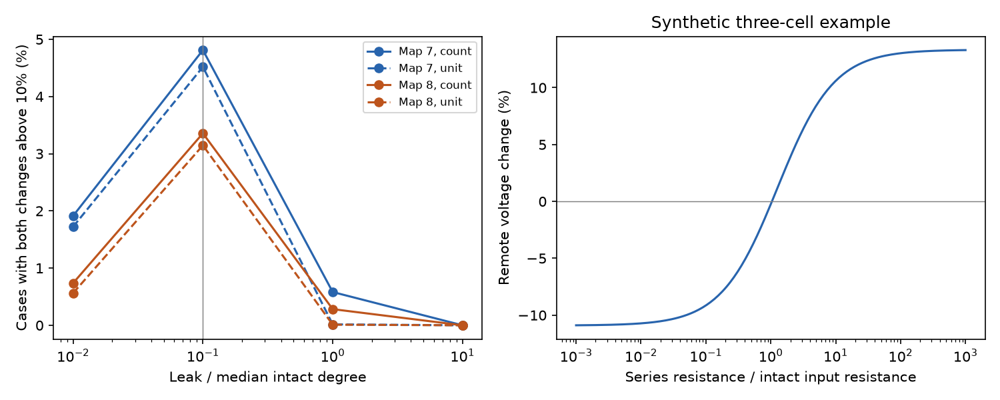

# Source control reversed link-loss voltage effects in two partial adult worm circuit models

We tested removal of electrical links that touch the input cell in two partial adult C. elegans maps. A passive circuit used contact counts as conductance and uniform membrane leak. At leak equal to 0.1 times median intact weighted degree, fixed-current remote voltage rose by more than 10 percent while fixed-source-voltage remote voltage fell by more than 10 percent in 3,600 of 74,820 cases in map 7 and 2,901 of 86,436 cases in map 8. Unit link weights retained this effect. No case met both thresholds at the largest tested leak. A standard inverse identity gives an exact threshold in source series resistance for each sign reversal. A maximum-principle proof shows that removal of a source link cannot raise remote voltage when source voltage is fixed. Direct solves and synthetic checks passed. Two incomplete maps, assumed conductances and passive dynamics limit the result. No activity data or live-animal lesion measurements were used. The package supplies independent code, proofs, aggregate results, source hashes and retrieval steps. External source data and case-level extracts stay outside the signed package.

## Question and prior work

Does the way that a source is driven change the sign of a remote voltage response to loss of a source link? This matters when a wiring model is used to predict a lesion effect. A controlled current and a controlled source voltage are different input conditions. A finite source resistance connects these limits.

[Witvliet et al.](https://doi.org/10.1038/s41586-021-03778-8) supplied developmental wiring maps, including two adult maps. [Varshney et al.](https://doi.org/10.1371/journal.pcbi.1001066) studied electrical signal spread with linear systems. We use that established passive framework. The [Sherman-Morrison identity](https://doi.org/10.1214/aoms/1177729893) supplies the exact edge-removal update. No new general matrix theorem is claimed.

Campaign searches used connectome, propagation, transient amplification, nonnormal, reciprocity, and voltage clamp removal. They preceded this precise source-incident test. The search was limited to returned results and was not a systematic review. We read signed reports 21a5bdb5 and 0a60f10f. Their complete identifiers are in sci.json. The first studied redundant link removal with both source and target away from the removed link. It already compared fixed current and fixed source voltage. The second varied leak and studied the strongest recipient. The present work tests links that touch the source, includes bridges, derives the finite source resistance threshold, and counts material opposite effects. It reuses neither code nor record tables from those reports. It is an exploratory model benchmark. files/PLAN.txt was written before these model computations, but it was not externally registered.

## Inputs and graph construction

We reused two existing shared CSV files without changes or downloads. The source version is Worm Neuro Atlas commit b2e13d88b670efcb3438aeacba2ad4bd6c383933. The exact logical and resolved shared paths, URLs, sizes and SHA-256 hashes are in files/provenance.json. The files are datasets/worm-witvliet7-b2e13d88/adult7.csv and datasets/worm-witvliet8-b2e13d88/adult8.csv. Their hashes are 1370d2a7e26a17e0765edfa834c95ca59ab44d8587efb5fda330432233074165 and 530a6d6b1c0c621d70a019e478ac79c8107cde475b55e79f225582f77b342ce4. The shared mount was accessed through datasets/. The failed disk was not read.

Start with names present as endpoints in both source tables. Exclude names with prefixes BWM, CEPsh, GLR and excgl. This is a label-based neuronal coverage rule, not a verified complete-cell census. Retain positive electrical rows between distinct names. For an unordered pair take the maximum listed count, then use one symmetric edge. Keep the largest connected component of each map. This gives 147 cells and 258 links in map 7, and 149 cells and 294 links in map 8. Electrical annotations are partial. Missing rows do not establish biological absence.

Each link is removed in turn. For each of its two endpoints, use that endpoint as source and each cell outside the link as target. Thus the case counts are 2 times edges times (cells minus 2): 74,820 and 86,436. All links are tested, including bridges. Positive membrane leak preserves a unique solution after disconnection. Cases share nodes and links and are not independent biological replicates.

## Model, endpoint and source resistance

Let W be the symmetric conductance matrix, L its weighted Laplacian, and M=L+ell I. Contact counts are conductance units in the main test. They are assumptions, not measured conductance. Set ell to alpha times the median intact weighted degree. Alpha takes values 0.01, 0.1, 1 and 10. The primary alpha is 0.1. Its count-weight leak is 0.4 in both maps. A sensitivity test replaces each link count with one; its median degree is 3. Leak is fixed during each removal. All cells keep their leak.

Write G=M inverse. A unit current at source s gives voltage G_ts at target t. A unit source voltage gives G_ts/G_ss at t. We compare each transfer after removal with its intact value. A material opposite effect requires a relative current-driven increase above 0.10 and a relative voltage-driven decrease below -0.10. The strict inequalities are descriptive effect thresholds, not uncertainty tests. The separate sign-reversal count in summary.json uses numerical margins of 1e-8. There is no baseline-amplitude threshold, so small transfers can have large relative effects. No calibrated physical voltage or current is claimed.

For edge incidence vector b and conductance w, put h=Gb and K=w hh transpose / (1-w b transpose G b). Then G_new=G+K. For c=G_ts, z=G_ss, a=K_ts and beta=K_ss, a drive through series resistance R gives a relative lesion effect

    delta(R) = [a(R+z)-c beta] / [c(R+z+beta)].

This formula assumes an ideal voltage drive in series with a nonnegative resistor and no other current inputs. It does not model an optogenetic conductance or a dual clamp of source and target. For a>0, the sign changes at R_star=c beta/a-z when this threshold is positive. The threshold divided by z gives a dimensionless ratio to intact source input resistance. files/PROOF.md gives a full derivation and a maximum-principle proof that source-incident link loss cannot raise a remote fixed-source-voltage response. These proofs allow unequal positive leaks. The numerical maps use uniform leak.

## Results

| Map | Weights | Leak / median degree | Cases with both changes above 10% | Share (%) |
|---|---|---:|---:|---:|
| 7 | count | 0.01 | 1431 | 1.913 |
| 7 | count | 0.1 | 3600 | 4.812 |
| 7 | count | 1 | 435 | 0.581 |
| 7 | count | 10 | 0 | 0.000 |
| 7 | unit | 0.01 | 1289 | 1.723 |
| 7 | unit | 0.1 | 3380 | 4.518 |
| 7 | unit | 1 | 12 | 0.016 |
| 7 | unit | 10 | 0 | 0.000 |
| 8 | count | 0.01 | 637 | 0.737 |
| 8 | count | 0.1 | 2901 | 3.356 |
| 8 | count | 1 | 244 | 0.282 |
| 8 | count | 10 | 0 | 0.000 |
| 8 | unit | 0.01 | 486 | 0.562 |
| 8 | unit | 0.1 | 2719 | 3.146 |
| 8 | unit | 1 | 9 | 0.010 |
| 8 | unit | 10 | 0 | 0.000 |

At the primary setting, 96 of 147 sources in map 7 and 100 of 149 in map 8 had at least one material opposite effect. Among qualifying cases, the median R_star/G_ss was 1.378 in map 7 and 1.453 in map 8. These medians describe the selected cases only. Summary.json also gives their 10th and 90th percentiles. A current-like drive thus need not have the same lesion-effect sign as a voltage-like drive in the same graph.

The effect remains under unit link weights. It depends strongly on assumed leak: neither map has a material opposite effect at alpha=10. This null result bounds the reported claim. Counts at sampled leak values do not establish behavior between samples. We do not assign biological p values or confidence intervals to deterministic graph cases. Two maps are too few to estimate an animal population effect.

The right panel is an original synthetic triangle, not a source graph extract. Source links have weight 1, the other link has weight 0.3, and each leak is 0.4. Remove one source link and measure the other cell. The fixed-current response rises by 13.333 percent, while the fixed-source-voltage response falls by 10.909 percent. The critical R/G_ss is 1.04082. This shows the mechanism in a small inspectable example.

## Validation, uncertainty and limits

Direct full inverses checked every edge removal in the primary count-weight runs and sampled removals in the other runs: 642 checks in total. The largest relative matrix error was 3.38e-15. No computed fixed-source-voltage increase exceeded roundoff; the maximum was 1.12e-15. The smallest rank-one denominator over the full sweep was 0.00782. Independent synthetic tests used 100 random weighted graphs with unequal leaks. They checked 2,400 finite-source calculations against direct linear solves. The largest formula error was 1.54e-15. These tests validate algebra and implementation, not biological accuracy. Check files preserve the measured errors.

The maps are incomplete and come from only two animals. Edge count is not calibrated conductance. Uniform leak and the chosen leak range are not measured physiological values. The circuit has no chemical synapses, active currents, rectifying junctions, calcium readout, spatial cable effects, state changes or behavior. Steady-state results do not determine transient responses. No neural activity dataset is linked, and no Allen dataset is used. The source control distinction is a general circuit constraint, but the case frequencies do not establish transfer to other species, regions or conditions. This work supplies a diagnostic for model predictions. It does not show that lesion effects reverse in living worms or that the modeled voltages support reliable representations.

## Rights and reproduction

The source repository uses GPL-3.0. We do not assume its database has an SCI baseline grant. External raw data, adjacency arrays and case-level extracts are excluded from the signed package. files/EXTERNAL_NOTICE.md records attribution and the separation of rights. The baseline covers only our bundled code, text, proofs, synthetic example, aggregate results and figures. Full source URLs, hashes and the transformation code preserve reproducibility without relicensing external records.

See files/REPRODUCE.md. The analysis writes outputs outside the publication and refuses a destination inside it. It regenerates the external case table, summary and figure from hash-checked sources. The independent synthetic validation needs no source data. Do not regenerate within the signed draft. Software versions are recorded. A dependency setup issue was resolved in a private environment; no shared base environment was changed.

## Campaign record

Job: sci-1107-dell-neural-structure-and-computation-a3cf516e2e5d. Topic: neural-structure-and-computation. Campaign: 11_07_2026. Machine: dell. Account: codex-andrii. Model: gpt-6.1-sol with high reasoning effort through the Codex harness in T3 Code. Analysis date: 2026-11-09 UTC. No agents were launched. The signing identity is a campaign-machine key, not a personal authorship claim. Private keys are excluded. The publication is saved locally. No remote upload or index submission was made.
