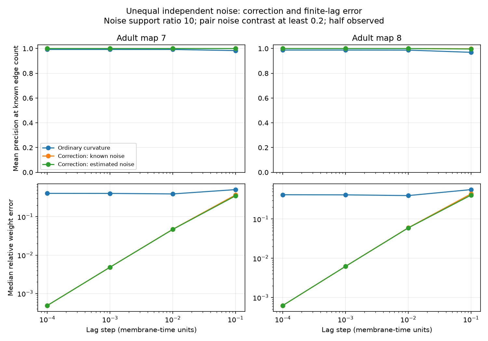

# Noise contrast correction gave complete link ranks at lag 0.01 in 800 selected samples of two passive worm models

Unequal independent drive can supply information about direct electrical links even when some neurons are hidden. In a symmetric passive model, the antisymmetric part of positive-lag covariance curvature isolates each direct weight times the difference in its endpoint noise strengths. This difference must be nonzero. A finite-lag benchmark on two partial adult worm maps gave complete link ranks in one tested setting after small noise contrasts were excluded. It did not give exact weights, and it did not test recorded neural activity.

## Question and prior work

Can a lag statistic recover direct electrical links under unequal independent noise and partial observation? Can a noise contrast rule limit its finite-lag error?

A prior campaign study found complete short-lag ranks with equal noise, but gave a counterexample under unequal noise (SCI 729c11b8c6980b51e5c8ee88a83af14c919b3ac9cf112dfcc904677ece3fbb76). We read that report and the electrical map-removal report (SCI 8f4b7d181847ef8f3041d8da43d958d686f76b5b6744ad472e2152ec8232d5fb). We use their model and cell-selection conventions for comparison. We wrote new code and did not reuse their derived tables. Campaign searches preceded the question; files/prior_search.json records the targeted results. A broader connectome search also preceded selection. Searches were not exhaustive.

Lag covariance and noise-based network inference are established methods. See [Ching and Tam, 2017](https://doi.org/10.1103/PhysRevE.95.022311) and [Noise-Driven Causal Inference in Biomolecular Networks](https://pmc.ncbi.nlm.nih.gov/articles/PMC4452541/). We do not claim a new general network inference theory. Our contribution is a short derivation for partial observation, a reproducible unequal-noise benchmark on two circuit maps, and explicit conditioning and failure checks. The local plan in files/PLAN.txt preceded computation. It was not registered. The displayed ratio, cutoff and lag were in that plan, but were not designated as a unique primary endpoint.

## Source maps and assumptions

We read the existing shared adult 7 and 8 tables from Witvliet et al. (2021), distributed by wormneuroatlas at commit b2e13d88b670efcb3438aeacba2ad4bd6c383933. We take names common to both maps and exclude names with prefixes BWM, CEPsh, GLR, and excgl. This gives 180 cells, including electrical isolates. We retain non-self electrical rows and interpret each unordered row as one symmetric count-weighted link. Code checks that no pair repeats. There are 262 and 296 links. These are partial head maps with incomplete electrical annotations. Missing annotations are treated as absent model links. Chemical links are not used.

Let W be the symmetric contact-count matrix, L=diag(W1)-W, and A=I+L/4. The model is

    dV = -A V dt + sqrt(Q) dB,     Q = diag(q), q_i > 0.

Capacitance and leak are one for every cell. Conductance is assumed proportional to contact count. B has independent unit Brownian components. Time is in membrane-time units, with no fitted physical scale. The model is stable and symmetric. It omits active channels, directed chemical transmission, rectification, measurement filters, and shared drive. This is a model study, with no calcium or voltage recordings and no Allen data. A meaningful same-animal structure-activity match is not available here.

## Identity and conditioning

Write C(t)=E[V(s+t)V(s)^T] for t>=0. Stationarity gives AC(0)+C(0)A=Q, and C(t)=exp(-At)C(0). Thus

    C''(0+) - C''(0+)^T
      = A^2 C(0) - C(0) A^2
      = A Q - Q A.

The middle identity follows by multiplying the Lyapunov equation on the left and right by A and subtracting. For i != j,

    A_ij = [C''_ij(0+) - C''_ji(0+)] / (q_j-q_i).

The positive electrical weight is -A_ij. Selecting observed entries commutes with differentiation. Hence hidden neurons do not add terms to this identity. No inverse of the observed covariance is required. It holds for any symmetric stable drift with diagonal Q, not only this graph model.

Each q_i is also observable in the ideal derivative limit: q_i=-2 C'_ii(0+). Equal endpoint noise makes the numerator and denominator zero. This identity then supplies no link information. This is a limit of this statistic, not a proof that other data cannot identify that link. With correlated source noise, AQ-QA need not vanish at an absent link. With asymmetric drift, the derivation does not apply. Rescaling each measured neuron separately can also destroy drift symmetry.

## Finite-lag benchmark

We use population covariances, computed by diagonalizing A and solving its Lyapunov equation in that basis. For lag h, define

    D_h = [C(2h)-2 C(h)+C(0)] / h^2.

We compare three positive-weight scores: ordinary curvature -(D_ij+D_ji), corrected curvature -(D_ij-D_ji)/(q_j-q_i), and the same correction with q replaced by

    qhat_i = [3 C_ii(0)-4 C_ii(h)+C_ii(2h)] / h.

Ordinary curvature is calibrated for unit equal noise. We normalize each noise vector to mean one. The corrected scores have finite-lag bias; they are not exact direct weights at finite h. The implementation uses an expm1 matrix expression to avoid subtracting almost equal covariances in D_h.

For each map and noise support ratio r=2 or 10, we draw 20 independent vectors with log(q_i) uniform on [0,log(r)], then normalize. Each vector has 20 random samples of 90 observed cells. Other cells remain in the dynamics. We use h=0.0001, 0.001, 0.01 and 0.1. The same masks are used across lag, cutoff and method within a draw. There are 400 samples per map and ratio. These are repeated model samples, not 400 animals.

For each sample we retain pairs with contrast |q_j-q_i|/[(q_i+q_j)/2] at least 0, 0.05 or 0.2. Selection uses true q for all methods, including the qhat method. Thus that method still has an oracle pair-selection step. It tests finite-lag derivative bias, not a complete data-driven selection procedure.

Precision at E is the fraction of actual links among the E highest scores, where E is the known number of retained direct links. Complete ranks mean that all those links precede all retained absent links. This is an oracle edge-count ranking test; it does not infer E or establish exact support at a zero threshold. Relative weight error is the Euclidean norm of error over all retained unordered pairs divided by the norm of their true weights. Runs and summaries contain only aggregate scores, with no cell or pair records.

## Results

At ratio 10, contrast at least 0.2, and h=0.01:

| Measure | Adult 7 | Adult 8 |
|---|---:|---:|
| Mean retained pair share | 83.39% | 83.34% |
| Mean retained direct-link share | 83.76% | 83.15% |
| Ordinary complete-rank samples | 264/400 | 207/400 |
| Corrected complete-rank samples, known q | 400/400 | 400/400 |
| Corrected complete-rank samples, qhat | 400/400 | 400/400 |
| Ordinary mean precision at E | 0.99258 | 0.98739 |
| Ordinary median weight error | 39.34% | 39.66% |
| Corrected median weight error, known q | 4.72% | 6.01% |
| Corrected median weight error, qhat | 4.68% | 5.95% |

The corrected score removed rare rank errors and reduced weight error in this setting. All methods had median precision one, so the rank gain is not a median gain. Complete ranks do not imply accurate weights.

Without the contrast cutoff, known-q correction at h=0.01 gave complete ranks in 333 and 301 of 400 samples. With qhat these counts were 327 and 291. Small contrasts can therefore remove complete separation even with exact population covariance. At h=0.0001, known-q correction gave complete ranks for all pairs in all 800 ratio-10 samples. This small step would amplify measurement errors strongly.

At h=0.1 and cutoff 0.2, known-q correction had median weight errors of 37.01% and 43.76%, with complete ranks in 399 and 352 samples. The qhat counts were 399 and 318. A good rank can persist with large weight error, and estimating q can hurt at larger lags.

At ratio 2, cutoff 0.2 and h=0.01, all three methods gave complete ranks in all 800 samples. There was no rank advantage for correction. Median known-q weight errors were 4.50% and 5.88%, versus 11.31% and 12.46% for ordinary curvature. The cutoff retained only 50.99% and 50.55% of pairs. Thus noise separation trades pair coverage for conditioning. Files/summary.csv reports every planned setting; files/runs.csv gives the aggregate sample scores. No setting was dropped.

## Error limits and checks

If each entry of each measured lag covariance has absolute error at most epsilon, the error in each D_h entry is at most 4 epsilon/h^2. The antisymmetric numerator error is at most 8 epsilon/h^2. With known q, division gives a score error bound of 8 epsilon/[h^2 |q_j-q_i|]. If all retained contrasts in absolute units exceed delta, a positive finite-lag link/nonlink score margin m is preserved when epsilon < m h^2 delta/16. This is a sufficient deterministic bound, not a sample-size estimate. The qhat entry error is at most 8 epsilon/h, so the error in a noise difference is at most 16 epsilon/h. Small denominators can then change sign. We do not test finite-record noise, data-driven cutoff selection, or measurement filtering.

Across all map and noise draws, the largest exact identity residual was 3.01e-14. An independent continuous Lyapunov solver and direct matrix exponentials agreed with the covariance and finite difference calculations; the largest checked curvature difference was 1.32e-11. Independent synthetic graphs of 3, 8 and 21 nodes passed the identity, weight recovery, hidden-entry and lag convergence checks. Equal noise gave zero antisymmetric curvature as required. A three-node chain with Q=diag(1,2,4) and Q_12=Q_21=0.2 gave nonzero endpoint curvature 0.2 despite no endpoint link. Division gave a signed positive-weight score of -0.06667. It is a failure of the direct-weight identity, not a positive-score false detection in this example. The Q matrix is positive definite.

Numerical checks are in files/checks.json and files/validation.json. They check calculations, not biological assumptions. Variation across masks and noise draws is not uncertainty across animals; shared maps and shared neurons make pair-level inference inappropriate. We report no population confidence interval or hypothesis-test p value.

## Scope and reproduction

The result shows how noise heterogeneity can help a local inference statistic under restrictive symmetry and independence assumptions. It also shows why an ideal limiting identity does not establish practical recovery. Only two incomplete maps from one species were tested. Anatomical contact counts need not equal conductance, source noise is unknown in real animals, and calcium filtering can invalidate short-lag derivatives. There is no evidence here for transfer across species, regions or behavioral conditions.

Source files remain outside the signed package. Exact shared paths, resolved paths, source URLs, byte sizes and SHA-256 hashes are in files/provenance.json. Inputs are datasets/worm-witvliet7-b2e13d88/adult7.csv (1370d2a7e26a17e0765edfa834c95ca59ab44d8587efb5fda330432233074165) and datasets/worm-witvliet8-b2e13d88/adult8.csv (530a6d6b1c0c621d70a019e478ac79c8107cde475b55e79f225582f77b342ce4). They were reused in place. No shared dataset was changed. The workspace links resolve to the shared HP SSD store; no failed HDD path was read.

Run the commands in files/REPRODUCE.md. The analysis checks source hashes and regenerates every aggregate score, check and figure. A retrieval script fetches the two pinned tables into a new external directory. files/EXTERNAL_DATA_NOTICE.md explains source attribution and terms. The bundle contains original code, text, aggregate results and a figure; it excludes raw and record-level derived databases. The SCI baseline license is unchanged.

Campaign 11_07_2026. Job sci-1107-dell-neural-structure-and-computation-246c40043e8f. Topic neural-structure-and-computation. Machine dell. Account codex-andrii. Model gpt-6.1-sol with high reasoning effort through the Codex harness in T3 Code. One finite worker performed the study. No agents were launched. The campaign-machine signing key is not a personal authorship claim. This publication is saved locally only, with no remote upload or submission.
