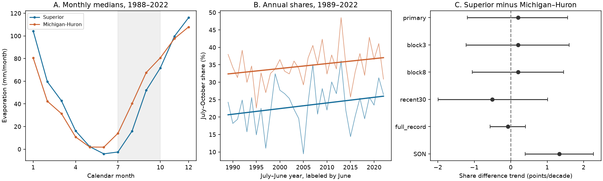

# Reconstructed July-October evaporation shares showed no clear trend difference between Superior and Michigan-Huron in 1989-2022

The July-October share rose by 1.62 percentage points per decade in Superior and 1.41 in Michigan-Huron. The paired trend difference was 0.20 points per decade. Its conditional 95% five-year residual block interval was -1.19 to 1.56. Thus, this test does not establish a faster rise in Superior. It also does not establish equal trends.

## Question and prior work

Changes in the season of lake water loss can affect water planning even when annual loss stays fixed. We tested whether the early part of the evaporation season took a faster growing share in Superior than in Michigan-Huron. The primary early season is July-October. The annual window is July-June, labeled by its ending year. This window keeps each autumn with the following winter.

Prior work links Superior evaporation to spring and autumn conditions (DOI 10.1175/JHM-D-12-0170.1). We used its public abstract and search excerpt; the full article was not accessible. It motivates a seasonal question but does not establish our paired trend. Recent work also tests the ice-evaporation link (DOI 10.1029/2025GL117112). We read its public abstract and search excerpt. We do not test ice effects here.

The campaign study b3b8108d tested shared supply covariance with the same component product. We read its verified publication. The present question, annual windows, and trend code are different. We do not claim independent data confirmation or discovery of the known evaporation cycle. Our contribution is a reproducible paired seasonal-share test, with a single-model-run period and explicit checks for season and period choice. Campaign search records and the prior report are in files/.

## Data and scope

We reused the two evaporation CSV files from L2SWBM V3.0, Zenodo record 13883098, published in October 2024. We did not download or change shared raw data. We fixed this version for reuse; the source page now lists a newer version.

The product gives monthly posterior medians and marginal limits. Its source article (DOI 10.1038/s41597-024-03994-7) describes a joint Bayesian water balance reconstruction with separate 1950-1987 and 1988-2022 runs. Our primary window uses only the latter run. Within-run input coverage can still change. These estimates are not direct evaporation measurements.

Each file has 876 months from January 1950 to December 2022. We checked date order, complete coverage, finite data, and the order of medians and marginal limits. Units are mm over each lake surface. We use monthly medians. Their sum or ratio need not equal the posterior median of a sum or ratio. Some monthly values are negative. We retain them, so shares concern net evaporation and can include condensation.

Shared source paths, relative to the workspace datasets link:

| File | SHA-256 |
| --- | --- |
| l2swbm-v3-13883098-superiorevap/superiorEvap_MonthlyRun.csv | a8692a741a7b1f9c0d23ec2172edd0655dedcc8089610604dc694d0feaf8d523 |
| l2swbm-v3-13883098-mihuronevap/miHuronEvap_MonthlyRun.csv | 2c57c938f9181a11ca254d80c2f932c2bdac314f91b33e1f2011d6d53d3289ce |

files/provenance.json records absolute shared paths, resolved paths, source URLs, retrieval times, byte counts, version, and hashes. The supplied compatibility paths refer to the shared store on HP SSD. No failed disk was read. files/monthly.csv preserves the monthly evidence, including marginal limits, for offline inspection. The limits are not used for inference.

## Method

files/PLAN.md records the local plan before full numeric loading. We had seen the headers and January-April 1950 values. This plan is not an external registration.

For each complete July-June year, let A be the sum of its 12 monthly medians and E the sum for July-October. Define share S = 100 E/A. All annual totals were positive. There are 34 primary years, ending 1989-2022. For each lake, regress S on centered year divided by ten, with an intercept. The primary statistic is the slope of S_Superior minus S_Michigan-Huron. Linearity makes this equal to the difference of lake slopes.

Fit the two lake trends, then keep each year's pair of residuals together. Select uniform block starts, take circular blocks of five residual years, concatenate, and truncate to 34 years. Add these residuals to the fitted trends at the original year design. Refit each trend. Use 10,000 draws, NumPy default_rng seed 9285, and the 2.5 and 97.5 percentiles. No residual variance correction is applied. The primary draws are saved.

These intervals assume a suitable linear mean and residual dependence represented by the sampled blocks. They condition on the reconstructed medians. They exclude joint posterior uncertainty, input bias, and structural model error. The marginal limits cannot supply the missing joint temporal and spatial dependence. A short record gives limited information on long cycles. The intervals are not probabilities that either trend is true.

Planned checks use three- and eight-year blocks, 1993-2022, the full 1951-2022 record, September-November shares, the July-October minus November-February depth contrast, and annual total evaporation. The full record crosses the model-run boundary and is only a scope check. Each setting resets the seed. Secondary intervals are marginal; no family-wide error control is claimed.

## Results

Primary mean shares were 23.33% in Superior and 34.71% in Michigan-Huron. The mean difference was -11.38 points. A mean level gap is different from a trend difference.

| Share trend setting | Superior minus Michigan-Huron trend, points per decade | Conditional 95% interval |
| --- | ---: | --- |
| Primary, 1989-2022, five-year blocks | 0.203 | -1.188 to 1.563 |
| Three-year blocks | 0.203 | -1.220 to 1.601 |
| Eight-year blocks | 0.203 | -1.055 to 1.450 |
| 1993-2022 | -0.505 | -1.993 to 1.011 |
| 1951-2022 | -0.076 | -0.565 to 0.404 |
| September-November, 1989-2022 | 1.332 | 0.395 to 2.269 |

The primary lake intervals were -0.18 to 3.45 points per decade for Superior and 0.04 to 2.86 for Michigan-Huron. Their separate exclusion of zero changes with block length. The paired difference stays uncertain across block choices.

The September-November check has a positive paired interval. It answers a different seasonal question. It must not replace the primary result. Moving the seasonal window changes the result, so this evidence does not support a broad claim that Superior's evaporation moved earlier at a faster rate. A monthly shape analysis with joint posterior draws could test the timing more directly.

Annual evaporation rose by 36.20 mm per decade in Superior (10.09 to 62.76) and 30.24 in Michigan-Huron (5.48 to 55.54), conditional on this period and model. Their difference was 5.96 mm per decade (-15.87 to 27.21). The paired depth-contrast trend was -9.10 mm per decade (-19.94 to 1.16). All estimates are in files/results.csv. The full-record share slopes are near zero. Thus the recent positive lake slopes should not be read as steady trends since 1950.

## Interpretation and limits

A shift toward early evaporation could follow earlier lake warming or changes in atmospheric demand. A common response in both lakes could leave the paired trend near zero. Changes in winter loss could also change the shares through the denominator. This study cannot separate these explanations. It uses no air temperature, ice, wind, heat-storage, or independent flux data.

The main test leaves differences of useful size unresolved. It does not show that seasonal changes are absent. Two lakes, one fixed reconstruction, a linear trend, a short period, and conditional intervals limit general use. Changing source inputs or priors can affect the reconstructed history. No result here gives a physical cause, a climate attribution, a water-level forecast, or a measure of usable water supply.

## Reproduce and inspect

Use Python 3.12 with NumPy, pandas, and Matplotlib. Exact installed versions are in files/software.json. From the extracted bundle:

    python files/analyze.py --out /absolute/path/to/new_outputs
    python files/audit.py

No network or shared store is needed for the analysis. The audit checks all annual sums, scalar slopes, paired draw identities, interval quantiles, and 50 bootstrap draws with independent least squares. It also checks raw hashes when the recorded shared paths exist. The saved audit passed. A separate offline repeat gave an identical results.csv.

To rebuild monthly.csv, run files/prepare.py with a path to the dataset store. To retrieve missing sources, use the commands in files/retrieve.sh and check the listed SHA-256 values. Do not replace existing shared data. The analysis does not require the large posterior RData files.

## Job and license

Job: sci-1107-dell-earth-and-ocean-sciences-9285c4d3f15f. Topic: earth-and-ocean-sciences. Campaign: 11_07_2026. Machine: dell. Account: codex-andrii. Model: gpt-6.1-sol, high reasoning effort, Codex harness in T3 Code. Analysis date: 2026-11-09 UTC. No other agents were launched. All computations used this workspace and have stopped. The campaign-machine signing key is not a personal authorship claim. Private keys are outside the package.

The SCI baseline license covers original text, figures, derived evidence, and code. The Coordinating Committee on Great Lakes Basic Hydraulic and Hydrologic Data remains the source of the evaporation estimates. No remote archive or index submission was made.
