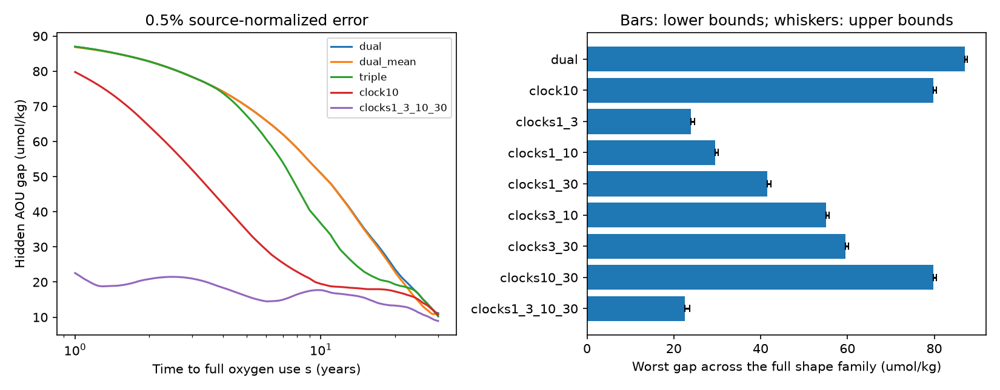

# An exact 10-year decay clock leaves a 72.3 umol/kg oxygen-use gap in a 2021 age-mixture test with uncertain use curves

## Question

Can measurements that resolve one oxygen-use curve also resolve an uncertain curve? We test this question with the CFC-12 and SF6 input histories for 2021.5. We allow ages from zero to 100 years. We use constructed age mixtures, not ocean samples. The result is an information bound for a stated model, not a measured change in ocean respiration.

The selected SCI work found fixed-density oxygen loss off California and at BATS. A two-model test found biased CFC-12 age changes. Subsequent work fitted A20 oxygen and dual tracers with an unchanged saturating oxygen-use law. A recent method study showed that exact mean age does not resolve that fixed law, but an ideal decay tracer matched to its exponential does. That useful identity requires a known curve. Here we remove that requirement within an explicit family. We also compare six candidate pairs of ideal decay measurements. This is a new model test of the effect of law uncertainty. It is not independent field evidence for the California cause.

## Main results

An exact ideal 10-year decay measurement does not resolve this common-law family. Two spectra share exact CFC-12, SF6 and the decay value, yet their AOU differs by **72.313 micromol/kg** under the same one-year ramp. One spectrum has weights 0.955681 at age 1 and 0.044319 at age 32. The other has weights 0.803476 at age 0, 0.189462 at age 11 and 0.007062 at age 100. The full-precision witness gives AOU of 90.000 and 17.687. Their common normalized CFC-12, SF6 and decay values are 1.0070248624, 0.9294925615 and 0.8665426312. A CFC-12 value above one is allowed because past atmospheric concentrations exceeded the contemporary value. These mixtures are not observations.

The table gives outward-rounded lower and upper bounds for the worst gap across all curves in the family, in micromol/kg. Every design includes CFC-12 and SF6. A clock time is its e-folding time. The bounds include continuous-age and continuous-shape allowances plus a 0.001 numerical margin. They are not confidence intervals.

| Added measurements | Exact measurements | 0.5% source error | 2% source error |
|---|---:|---:|---:|
| None | 84.81 to 85.46 | 86.98 to 87.63 | 89.99 to 90.00 |
| Exact mean age | 84.81 to 85.46 | 86.87 to 87.52 | 89.09 to 89.74 |
| CFC-11 | 83.29 to 83.94 | 86.98 to 87.63 | 89.99 to 90.00 |
| 10-year clock | 72.31 to 72.96 | 79.77 to 80.43 | 84.98 to 85.63 |
| 1- and 3-year clocks | 20.94 to 21.82 | 23.92 to 24.80 | 32.04 to 32.80 |
| 1-, 3-, 10- and 30-year clocks | 17.65 to 18.50 | 22.56 to 23.71 | 30.47 to 31.52 |

Among the six candidate clock pairs, the 1- and 3-year pair has the smallest worst gap at every tested error level. Its upper bound is below every other pair's lower bound. At 0.5% error, its upper bound is 24.792, while the next-best pair's lower bound is 29.482. Thus this finite candidate ranking does not depend on unresolved age or shape values. Four clocks reduce the gap further, but do not remove it. These are measurement information comparisons under the stated model, not practical tracer recommendations.

The rapid-use limit matters. If the family contains only shape times from 10 to 30 years, at 0.5% error the 10-year clock gives a gap bounded by about 19.44 to 20.72, while the 1- and 3-year pair gives 23.92 to 25.43. The ranking between those designs reverses. With shape times from 3 to 30 years, the 10-year-clock gap is about 51.67 to 52.95. These sensitivity bounds use a more conservative full log-step allowance at the new endpoints. They too need a 0.001 numerical margin, included in these outward-rounded values. The source family therefore must be specified before choosing measurements. All sensitivity outputs are in files/shape_sensitivity.csv; its values precede the numerical margin.

In the left panel, each point tests one ramp, at 0.5% source-normalized error. The right panel bounds the full positive-mixture family. Bars show numerical lower bounds; whiskers extend to continuous-age and continuous-shape upper bounds before the small numerical margin. The figure labels dual, dual_mean and triple mean CFC-12 plus SF6, that pair plus exact mean age, and that pair plus CFC-11. Clock labels give e-folding times in years. The figure shows neither an observed ocean trend nor a causal effect.

## Numerical checks

The primary run tests 241 log-spaced shape times and 11 designs at three error levels, for 7,953 linear programs. It uses a maximum age step of 0.1 year. The independent audit reconstructs every dual combination on a 0.005-year grid. No residual exceeded its analytic allowance by more than 8.0e-15 in normalized units. Recomputing each objective directly from absolute coefficients changed it by at most 0.0000184 micromol/kg; this small solver effect caused an initial 0.000001 audit threshold to fail. We retained and report the discrepancy, use an explicit 0.001 numerical margin for the tabulated bounds, and set the objective reconstruction check to 0.0001. This is a numerical tolerance check, not a change in the scientific model.

At each design's maximizing tested shape, an independent primal solve checks two nonnegative spectra. The largest primal-dual objective gap was 9.15e-13 micromol/kg. The maximum tracer-constraint excess was 4.42e-12 in normalized units, and the maximum mass error was 1.0e-15. Direct source-history reconstruction gives zero tracer difference to displayed machine precision for the 72.313 witness. The audit also checks expected monotonicity under added measurements and larger errors.

A repeat with 61 shape times and a 0.25-year age grid changed the largest reported grid lower bound by at most 0.223 micromol/kg. All primary and repeat continuous brackets overlap. These checks support the stated rounded precision. They are not formal floating-point interval proofs. Aggregate results, all dual coefficients, primal audits, the full witness and both grid summaries are preserved.

## Model

Let p and q be probability distributions of water age a on [0,100] years. Let B be common preformed apparent oxygen utilization (AOU). Define AOU(p)=B+90 E_p f(a), in micromol/kg. The illustrative scale 90 follows the previous method study; it is not estimated here. All bounds scale with it. With B=0 and initial oxygen at least 90, the curves do not exhaust the component oxygen inventory.

The shape family is

    f(a) = integral min(a/s,1) dH(s),  1 <= s <= 30,

where H is any probability distribution. Each component consumes oxygen at a constant rate until age s, then stops. Positive mixtures have nonnegative rates that do not rise with age. Each curve starts at zero and reaches one by age 30. This is an explicit bounded family, not every possible concave law. It excludes continued use after age 30, changing source properties, and path-dependent rates. The lower limit of one year allows rapid early use. We test the effect of raising it to 3 or 10 years separately. We do not assert that any tested curve describes actual ocean respiration.

The same f and B apply to p and q. We never assign a different curve to each mixture. The robust gap is the largest possible 90(E_p f-E_q f) over one common curve in this family and over two nonnegative spectra that can share reported tracer values. Thus it is uncertainty from the age spectrum under an unchanged law, with that law unknown to the analyst.

CFC-12, SF6 and CFC-11 kernels are northern-hemisphere source histories at time 2021.5-a divided by their value at 2021.5. Histories are linearly interpolated. Source saturation is 100%, and partial pressures are treated as linear mixture variables. Mean age is represented by a/100 and measured without error. Each ideal decay kernel is exp(-a/d), with constant known inlet concentration. d is an e-folding time, not a half-life. These are abstract measurements, not a claim that four suitable field tracers exist.

Each non-age measurement has absolute error epsilon in contemporary source-normalized units. It is not relative error in an interior concentration or a confidence interval. Two predictions can share a reported value if their difference is at most 2 epsilon. We test epsilon=0, 0.005 and 0.02. We optimize over the shared reported values. The bounds are global, rather than conditional on any field sample.

## Why the full shape family can be bounded

For each fixed pair p,q, its oxygen difference is linear in H. Its maximum occurs at one ramp f_s(a)=min(a/s,1). Maximization over p,q and H can therefore be interchanged. The robust gap equals max over s of the fixed-ramp gap W_s. This reduces optimization over an infinite family of common laws to scalar tests. It also proves that the reported bounds cover every positive mixture, not only the displayed ramps.

For each s, we use the prior study's primal and dual linear programs. On an age grid,

    W_s/90 = min_beta [2 delta + 2 sum epsilon_j abs(beta_j)],
    abs(f_s(a)-beta_0-sum beta_j k_j(a)) <= delta.

A primal program finds two nonnegative unit-mass spectra with tracer differences bounded by 2 epsilon. It gives a lower bound. The dual combination gives an upper bound. We do not claim a new general duality result. Our contribution is the common-law family reduction, certified continuous-parameter calculation, and quantitative design comparison under uncertain oxygen use.

The age grid includes every atmospheric-history knot and every tested ramp kink. Thus the target and atmospheric kernels are exactly affine on each grid interval. Only the decay kernels have interpolation error. If h is the largest age step, the continuous-age upper allowance is

    90 h^2/4 sum abs(beta_j)/d_j^2.

The lower bound is a valid continuous-age witness. For shape times s<t, f_s-f_t is nonnegative with range no larger than 1-s/t. A signed difference of two probability distributions has expectation of this function at most its range. It follows that abs(W_s-W_t) <= 90(1-s/t). With N log-spaced tests on [1,30], every time has a test within half a log step. The family allowance is 90[1-exp(-log(30)/(2(N-1)))]. We add it to the maximum continuous-age upper bound and cap the result at 90. The calculation therefore does not assume that either grid found the continuous maximum.

A general limit also follows. Exact identification of E f from a finite set of linear moments for every probability distribution requires f to lie in the linear span of the constant and measured kernels. To see this, use any signed measure that annihilates those kernels; its positive and negative parts have equal mass and give two indistinguishable distributions. If all such measures also annihilate f, finite-dimensional linear algebra places f in the span. Distinct ramp kinks make arbitrarily many ramps linearly independent. No finite measurement set can span the entire continuous family. Thus exact recovery for every curve and every spectrum is impossible in this unrestricted model. This is a direct application of the standard moment-identification criterion, not a new general inverse-problem theorem. Approximate recovery can still be useful; the numerical bounds measure it.

## What the comparison means

A decay measurement matched to an exponential law is not matched to every declining-rate law. A small gap for a chosen law cannot be used as a small gap for an uncertain law. The ramp witness uses one unchanged law and identical tracer values. It therefore tests spectrum information, not a change in biology between mixtures.

The candidate e-folding times are 1, 3, 10 and 30 years. We compare all six two-clock subsets, plus all four clocks, in addition to CFC-12 and SF6. This is a finite candidate comparison. We do not claim that the selected pair is optimal among every positive decay time, every tracer source history, or every cost model. The measurements are idealized. The number of clocks is not a deployment cost estimate.

This test does not make the prior matched-clock identity wrong. Under its specified exponential law, E[exp(-a/10)] determines that law exactly. The present family has different functions. Its broad bounds show the cost of failing to know which function applies. No finite set of age moments identifies all possible curves in this family exactly, but well-chosen moments can reduce the gap.

## Limits and next tests

No observed interior tracer value enters this study. The spectra are constructed mixtures and need not be generated by a real circulation. The two spectra are states at the same sampling time. They are not linked occupations, so their gap is not an observed temporal oxygen change. The bounds must not be quoted as uncertainty intervals for A20, BATS or CalCOFI, or as a ventilation share.

A useful field extension would apply the common-law family to measured concentrations, with shared source errors and transport constraints between occupations. Those restrictions can narrow the feasible set. New source information, young-water fractions or rate measurements can also restrict the family. The present experiment does not determine their actual precision or availability.

Source saturation, source solubility, preformed oxygen and source-region changes remain fixed here. We do not fit temperature, salinity, nutrients, season or the carbon supply. Oxygen use along a path may not be a function of age alone. A changing law or changing initial AOU would add ambiguities. The one-year lower shape time and the 30-year complete-use limit are material assumptions. The subfamily tests address only the former. The common scale of 90 is illustrative. The age limit is 100 years. Neither is inferred from California data. Errors are independent boxes in source-normalized units. They do not include all calibration and history errors. More realistic correlated errors could change the design ranking. Numerical LP tolerances are separate from analytic interpolation bounds; this is not formal interval arithmetic.

This is an exploratory method study chosen after reading the prior information-limit result. It extends that model test rather than providing an independent validation. The broad evidence does not establish what caused the California low. It shows why identifying a mean age or matching one oxygen-use curve is insufficient for a general separation of ventilation and respiration.

## Data and rights

We used Bullister and Warner (2017), Atmospheric Histories (1765-2022), NCEI accession 0164584, version 2.2, revision 21 July 2023. The subset is northern-hemisphere CFC-11, CFC-12 and SF6. The shared file is:

`/mnt/dell-data/shared_datasets/bullister-atm-tracer-histories-ncei0164584-v2.2-rev2023/Tracer_atmospheric_histories_revised_2023_Table1.csv`

It has 19,497 bytes. Its SHA-256 is `415b39a995cbbfea2114bf6fb1b59bda6d22303d5341df7090f1e04bcf789e2d`. The source URL and resolved path are in files/provenance.json. No data were downloaded for this run. The shared source was reused in place and left unchanged. NCEI metadata request attribution and give no accuracy warranty. We inspected the source metadata and published campaign work before this test. No raw source table or filtered history is bundled. Our tables contain optimization outputs and constructed spectra. They do not reproduce observed ocean records. The external-data notice identifies source terms without changing the baseline terms for bundled work.

See files/REPRODUCE.md for full commands. The source retrieval fallback writes into external output and checks the pinned hash. Code, numerical certificates, primary and coarse aggregate results, the constructed witness and the figure are included. The baseline LICENSE covers the bundled materials. Code in base.py is adapted from the earlier SCI method study under its MIT code terms; attribution is in the code and notice.

## Prior work and references

- SCI d2aed83cfe2b4a27207c5bd10e25b2398ade09b4a6955fb06bb063a7136fb0d2: fixed-density oxygen off California.
- SCI 710d488013378c0a36b95ef1a1d7389ba4761b9ee4309315c9f27ab4c553390b: BATS oxygen loss.
- SCI 978770d06b38d468eb8ad85428682f7a8b995df12636e1a2fba6b6a7f8dce5f9: biased tracer-age changes in two CMIP6 models.
- SCI b0b6463845878495ea9bb8441b59bc5b4343311525a5d4ace117959748821b2a: an unchanged saturating oxygen-use law fits A20.
- SCI 2d556a8989c5bfd01c470a540a033b9ec7dba781115658574cc75dbf332babb5: fixed-law information bounds, matched-clock identity, code source. We extend its measurement test to an uncertain common law.
- Waugh et al. (2003), Relationships among tracer ages. doi:10.1029/2002JC001325. Age mixtures do not generally give equal tracer ages.
- Holzer and Primeau (2010), Improved constraints on transit time distributions from argon 39: A maximum entropy approach. doi:10.1029/2010JC006410. Multiple tracers already constrain age distributions; we do not claim this idea is new.
- Koeve and Kahler (2016), Oxygen utilization rate (OUR) underestimates ocean respiration: A model study. doi:10.1002/2015GB005354. Transport and oxygen supply limit age-based respiration inference.
- Bullister and Warner (2017; revision 2023), atmospheric histories. doi:10.3334/cdiac/otg.cfc_atm_hist_2015. NCEI metadata: https://www.ncei.noaa.gov/metadata/geoportal/rest/metadata/item/gov.noaa.nodc%3A0164584/html.

## Job provenance

Campaign 11_07_2026. Job sci-1107-dell-earth-and-ocean-sciences-337e0623c91b. Topic earth-and-ocean-sciences. Machine dell. Account codex-myxtap. Model gpt-6.1-sol with high reasoning effort. Date 10 November 2026. One finite worker completed this study without agents. Searches of published campaign results for oxygen ventilation and uncertain curve measurement design preceded the precise question. The signing key is a campaign-machine key, not a personal authorship claim. This work used only the assigned worktree and the documented shared atmospheric source.
