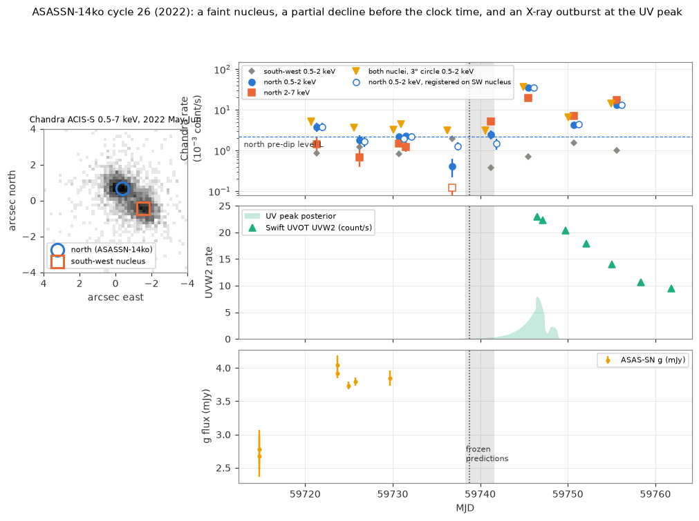
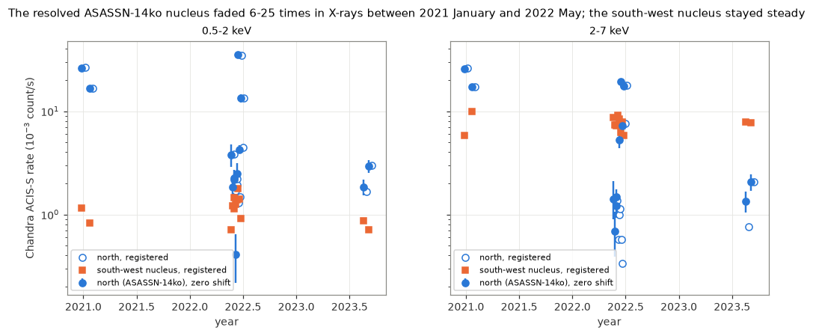
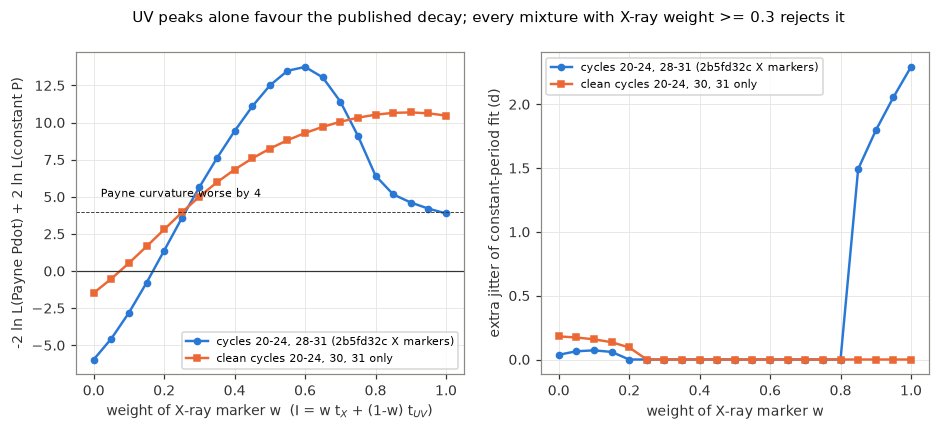

# Chandra resolves the ASASSN-14ko nucleus: it faded tenfold in X-rays by 2022, the mid-2022 cycle gave no measurable dip time, and UV peaks alone imply period decay only because the flares became wider

**Job:** sci-1107-dell-astronomy-6f41963a4b5b. **Topic:** astronomy. **Campaign:** 11_07_2026. **Machine:** dell. **Account:** claude-olen. **Model:** Claude Opus 5.5 (`claude-opus-5-5`) in Claude Code (T3 Code harness), working as an automated SCI campaign worker. **Analysis date:** 2026-11-12. The signing key is a campaign-machine key. It is not a personal authorship claim.

## Summary

**Question.** Campaign studies found that the soft X-ray dip of the repeating nuclear transient ASASSN-14ko is a regular clock. In 2020-2024 the deep-suppression time repeats at a constant 108.44-108.46 d with no extra jitter (SCI 049d6e3e, 2b5fd32c). Thus the period decrease of Payne et al. (2022) stopped. But no X-ray marker exists for the five cycles 25-29 (2022-2023), the middle of this "stall", and the Swift UVW2 peaks alone still show the old period decrease (SCI cd4bd328). Swift XRT and NICER do not resolve the two nuclei of the host ESO 253-G003. We ask: (1) What did the resolved nucleus do in the stall era? (2) Why do the 2022-2023 cycles give no X-ray marker? (3) Do the UV peaks really disagree with the X-ray clock?

**Approach.** No campaign study used Chandra data. We reduced all 13 public Chandra ACIS-S observations (2020 December to 2023 September) without CIAO. Nine of them (2022 May 22 to June 25) bracket cycle 26. A two-source King-profile likelihood separates the northern nucleus (ASASSN-14ko) from the south-west nucleus 1.6 arcsec away. We used four photometry variants (fixed astrometry, a weak astrometric prior, a 0.6-arcsec aperture, and registration of each observation on the hard south-west nucleus) and an astrometry-free summed aperture. We compared cycle 26 with the dips of all other cycles from the published XRT+NICER visit table of SCI 2b5fd32c. We then measured how each flare marker moves with the optical rise width (from SCI e5616202), and how the period test depends on the marker.

**Results.**

1. **The nucleus faded 8-16 times in X-rays between 2021 January and 2022 May.** In 2-7 keV, where the ACIS contamination has little effect, the northern rate fell from 0.0172-0.0174 count/s (2021 January, quiescent) to a median of 0.0011-0.0013 count/s before the cycle-26 dip (factor 13-16; range of the four visits 12-30). In 0.5-2 keV the factor is 7.5-8 (range 4.3-9.9). The south-west nucleus changed by a factor of 0.74 in 2-7 keV. The 2023 rates are as low as in 2022. Thus the soft X-ray level L of ASASSN-14ko itself, not the dilution by the second nucleus, fell by about an order of magnitude when the flares changed shape (Figure 5).
2. **Cycle 26 gave no measurable dip time.** In 2022, the south-west nucleus and diffuse emission give about 40-50 percent of the soft counts in a 3-arcsec circle. At 1.9 d before the linear X-ray clock (ObsID 25399), the northern nucleus was below its pre-dip level in all variants (0.14-0.62 L; p = 2e-8 to 0.011), but the depth depends on the astrometric shift. At 2.5 d after the clock (ObsID 25400) the variants give 0.27-1.12 L. The astrometry-free sum of both nuclei is 0.76 and 0.77 of its pre-dip median at these two visits, at the low edge of the pre-dip scatter (0.80-1.26). Thus Chandra can show neither a deep suppression nor its time, and the frozen clock predictions of SCI 2b5fd32c cannot be scored for cycle 26 (Figures 1 and 2).
3. **A short X-ray outburst coincided with the UV peak of cycle 26.** At 6.8 d after the clock, the northern soft rate was 16-17 L (summed emission: 8.9 times its pre-dip level). One day later Swift XRT measured a rate 3-4 times lower (for an XRT/ACIS count ratio of 0.75-1.0, from the 2020 and 2023 near-simultaneous visits). Between 5 d before and 15 d after the clock, no other cycle in the XRT+NICER record exceeds 1.8 L, except cycle 28 (7.0 L at 13 d). The first UVW2 visit of cycle 26 (7.8 d after the clock) has the largest UV excess of all cycles (about 17 counts/s above the baseline; other clean cycles 7.6-12.7).
4. **The flare markers move with the flare width.** Relative to the linear X-ray clock, the UVW2 peak moves +0.36 +/- 0.06 d per day of g-band rise width (Gaussian sigma), the g half-rise moves -1.13 +/- 0.15 d per day, and the g peak does not move (-0.02 +/- 0.12). In 2022-2023 (cycles 25-29) the rise width grew to 12-15 d (2-6 d before and after), the UV peaks came 9.4-10.8 d after the clock (4.7-7.5 d in the other clean cycles), and the half-rise and the 2b5fd32c X-ray thresholds of the excluded cycles 25, 28 and 29 came 5-10 d early (Figure 3).
5. **UV peaks show the period decrease only because the flares became wider.** For the seven clean UV cycles with a good rise width (21, 22, 24, 27, 28, 30, 31), a free curvature is -0.35 d per cycle (95 percent: -0.47 to -0.22), and the Payne et al. curvature (-0.28) is better than a constant period by Delta(-2 ln L) = 13.8. With a rise-width term, the curvature is -0.02 (95 percent: -0.48 to +0.40) and the Payne curvature is not preferred (Delta = +1.2). Thus the UV peaks alone cannot test the stall.
6. **Any marker mixture that gives the X-ray dip a weight of 0.3 or more rejects the published decrease.** For I = w t_X + (1 - w) t_UV in cycles 20-24 and 28-31, the Payne curvature is worse than a constant period by Delta(-2 ln L) = -6.0 (w = 0, UV only), +5.7 (w = 0.3), +12.5 (w = 0.5) and +3.9 (w = 1, X-ray only). For the clean cycles 20-24, 30 and 31 only: -1.5, +5.0, +8.3 and +10.5. For w = 0.2-0.8 a constant period fits with no extra jitter (Figure 4).

**Interpretation.** The stall of the ASASSN-14ko period in 2020-2024 does not depend on the choice between X-ray and UV markers: the UV peaks that seemed to show continued decay moved late because the flares became wider. But the X-ray clock has a gap of five cycles. In this gap the nucleus was about ten times fainter in X-rays, and its dips were shallow, early (cycles 25, 28, 29) or not measurable (cycle 26), and were followed by short X-ray outbursts near the UV peak (cycles 26 and 28). The X-ray corona of the nucleus thus changed strongly during the stall, while the mid-infrared AGN stayed steady (SCI cd4bd328). A model of the stall must also explain this coronal fading and the change of the flare shape. The change of the flare shape agrees with a wider spread of debris return times: the leading edge (X-ray dip, half-rise) arrives earlier and the UV peak later.

**Main limitations.** We have no CIAO responses, so rates are counts per second without effective-area corrections; the soft-band fading factor includes an unknown contamination change (the hard-band factor does not depend much on it). The two nuclei are 1.6 arcsec apart, and in faint visits the split depends on the astrometry, as we show. The marker sensitivities and the weight scan use few cycles (7-10), use derived markers of earlier publications, and were chosen after we saw the data. The cycle-26 UV peak time depends on an amplitude prior. No public data cover the 2026 flares (no Swift visit after 2026 February 5, no Rubin alerts within 1 degree, TESS sectors 4-6, 31-33, 87 and 98 only); the 2026 Chandra data are proprietary until 2026 December - 2027 January.

**Figure 1.** Cycle 26 (2022). Left: merged Chandra 0.5-7 keV image of the 2022 observations with the fitted positions of the two nuclei. Top: Chandra rates of the northern nucleus (filled: fixed astrometry; open: registered on the south-west nucleus), the south-west nucleus and both nuclei together in a 3-arcsec circle (triangles). Middle: Swift UVW2 with the posterior of the UV peak time (template fit with an amplitude prior). Bottom: ASAS-SN g. Dotted line: linear X-ray clock; grey band: range of the nine frozen predictions of SCI 2b5fd32c.

## 1. Background

ASASSN-14ko (nucleus of ESO 253-G003, z = 0.0425) shows UV/optical flares every 104-115 d (Payne et al. 2021, 2022). Payne et al. (2022) found a period derivative of -0.0026 and a soft X-ray minimum about 5 d before each optical peak. Campaign studies found that the later flares arrive late relative to this ephemeris (SCI 9398601f, 9817499f, b29ea789, 8ce2fda4), that the soft X-ray dip gives a constant period in 2020-2024 (SCI 049d6e3e), that NICER deep-suppression times keep this period with no extra jitter (SCI 2b5fd32c), that the half-rise is tied to the dip (SCI 77860d3a), and that the mid-infrared AGN stayed steady (SCI cd4bd328). Two problems remained: (a) the X-ray clock has no marker for cycles 25-29 because the pre-dip X-ray level was low; (b) the Swift UVW2 peaks alone still show a period decrease of -0.26 d per cycle in 2020-2023 (SCI cd4bd328). Swift XRT (47-arcsec aperture) and NICER (3-arcmin field) include the south-west nucleus of the host. We searched the campaign: no publication used Chandra data, which resolve the two nuclei.

## 2. Data

| Data | Source and version | Use | In bundle |
| --- | --- | --- | --- |
| Chandra ACIS-S evt2 and fov1 files, 13 ObsIDs (2020-12-26 to 2023-09-05) | Chandra Data Archive, retrieved 2026-11-12; ASCDS 10.14, CALDB 4.12; `files/data/chandra_file_manifest.csv` (URL, size, SHA-256) | All X-ray photometry | No. Our per-visit counts and rates: `files/results/chandra_phot_*.csv`, `summed_aperture.csv` |
| Swift UVOT UVW2 per-visit photometry; ASAS-SN g light curve | SCI b29ea789 (`uvot_lc.csv`, `asassn_skypatrol_14ko.csv`) | UV peak of cycle 26, UV templates, Figure 1 | No (hashes in `sci_inputs_sha256.csv`) |
| g-band and UVW2 flare measurements (rise width, half-rise, peak) | SCI e5616202 | Marker sensitivities | Values repeated in `cycle_table.csv` |
| XRT per-observation counts, reference times, UVW2 peak markers | SCI 049d6e3e | Figure 1, UV markers | Values repeated in `cycle_table.csv` |
| Deep-suppression (f30) markers, frozen predictions, combined XRT+NICER visits | SCI 2b5fd32c | Dip comparison, X-ray markers | Values repeated in `cycle_table.csv`, `dip_durations.csv` |

The Chandra observations: 24875 and 24876 (PI Payne, DDT; 13.9 and 40.3 d after the cycle-21 dip); 25396-25403 and 26433 (PI Auchettl; 17.4 d before to 16.8 d after the cycle-26 clock time); 26384 and 27453 (PI Schartel; 2.4 and 20.4 d after the cycle-30 dip). Exposures are 4.9-34 ks, full-frame ACIS-S3 (frame time 3.0-3.2 s). See `files/NOTICE_external_data.md` for terms and acknowledgements.

## 3. Methods

**3.1 Events** (`01_extract_events.py`). We convert sky pixels to tangent-plane offsets from the ASAS-SN position (RA 81.32558, Dec -46.00583) and keep events within 20 arcsec, 0.3-8 keV.

**3.2 Two-source model** (`02_psf_shape.py`, `psf2.py`, `twosrc.py`). An unbinned extended likelihood in a 4-arcsec circle: two King profiles (1 + r^2/rc^2)^-beta with common shape, plus a flat background (which also absorbs the diffuse host emission). From the merged 0.5-7 keV events of all 13 observations: rc = 0.62 arcsec, beta = 2.32; the northern nucleus is at (-0.37, +0.68) arcsec (east, north) from the ASAS-SN position and the south-west nucleus at (-1.52, -0.45) arcsec; separation 1.61 arcsec (1.57-1.69 in the three epoch groups). The northern nucleus is ASASSN-14ko: it varies by a factor 20, and Payne et al. (2022) found that it is the variable X-ray source.

**3.3 Photometry variants** (`03_photometry.py`, `03b_registered.py`, `16_summed_aperture.py`). Per observation and per 10-ks segment, in 0.5-2, 2-7 and 0.5-7 keV: (a) *zero*: positions fixed; (b) *prior*: a common shift of both sources with a 0.25-arcsec Gaussian prior; (c) *aperture*: counts within 0.6 arcsec of the northern position, minus the modelled spill of the south-west nucleus and background; (d) *registered*: the common shift fitted on the 2-7 keV events (the south-west nucleus dominates them in most visits), then the 0.5-2 keV fit with this shift fixed; (e) *summed*: both nuclei together in a 3-arcsec circle, local background from an 8-18 arcsec annulus. Intervals come from the profile likelihood (68 percent: -2 Delta ln L = 1). The final code reproduces the zero-shift table exactly.

**3.4 Tests at single visits** (`05_markers_tests.py`, `05b_registered_lr.py`). L is the median rate of the visits 10-30 d before the 049d6e3e reference time (cycle 26: MJD 59743.10). Profile-likelihood ratio tests compare the northern counts of 25399 and 25400 with fixed fractions of L.

**3.5 Dip comparison** (`08_dip_durations.py`, `15_extras.py`). From the combined XRT+NICER visit table of SCI 2b5fd32c we measure, per cycle, the rate/L at 1.5-3.5 d after its f30 marker, the time until the rate returns above 0.85 L, and the largest rate/L between 5 d before and 15 d after the linear clock.

**3.6 Cycle-26 UV peak** (`07_uv_peak_n26.py`). Each clean UVW2 flare is fitted with a half-Gaussian rise and an exponential decline. The cycle-26 visits are then fitted with each template shape (free peak time and amplitude, baseline from SCI e5616202, 4 percent extra scatter), with a flat amplitude prior or a log-normal prior from the clean-cycle amplitudes.

**3.7 Marker sensitivities and period tests** (`09_cycle_table.py`, `10_stretch_clock.py`, `11_weight_scan.py`, `12_uv_joint.py`). Offsets are relative to the linear X-ray clock t = 59738.74 + 108.437 (n - 26). For each marker type we regress the offset on the g rise width of the cycles where SCI e5616202 flags the fit as good, with a free extra scatter (maximum likelihood). The period test fits a constant period (offset plus slope), the Payne et al. curvature (fixed -0.28 d per cycle) and a free curvature, each with free white jitter, and reports Delta(-2 ln L).

## 4. Results

### 4.1 The nucleus faded

**Figure 5.** Chandra rates of the two nuclei in 2020-2023. Filled: fixed astrometry; open: registered. The south-west nucleus is steady; the northern nucleus (ASASSN-14ko) faded strongly between 2021 January and 2022 May.

Table 1. Northern-nucleus rates (count/s; `fading.json`). Pre-2022: median of the four visits 7-17 d before the cycle-26 clock.

| Band | Variant | 2020 Dec (cycle 21 + 14 d) | 2021 Jan (quiescent) | 2022 pre-dip median (range) | 2023 (cycle 30 + 2 d, + 20 d) | Factor 2021 Jan / 2022 |
| --- | --- | --- | --- | --- | --- | --- |
| 0.5-2 keV | zero | 0.0259 | 0.0166 | 0.0022 (0.0018-0.0038) | 0.0018, 0.0029 | 7.5 (4.4-9.1) |
| 0.5-2 keV | registered | 0.0264 | 0.0166 | 0.0021 (0.0017-0.0038) | 0.0017, 0.0030 | 8.0 (4.3-9.9) |
| 2-7 keV | zero | 0.0255 | 0.0174 | 0.0013 (0.0007-0.0015) | 0.0013, 0.0021 | 13.1 (11.8-25.3) |
| 2-7 keV | registered | 0.0262 | 0.0172 | 0.0011 (0.0006-0.0014) | 0.0008, 0.0021 | 16.2 (12.6-30.1) |

The south-west nucleus gives 0.0097-0.0099 count/s (2021 January) and 0.0072-0.0074 (2022 median) in 2-7 keV, and about 0.001 count/s in 0.5-2 keV. Thus the fall of the quiescent XRT soft rate after 2021 (factor 0.28, SCI cd4bd328) comes from ASASSN-14ko itself, and it is larger in the resolved nucleus.

### 4.2 Cycle 26

Table 2. Northern-nucleus 0.5-2 keV rate / L per 2022 visit for the four variants, and the summed emission of both nuclei / its pre-dip median (`visit_ratios_2022.csv`, `summed_aperture.csv`). Days are relative to the linear clock (MJD 59738.74).

| ObsID | Day | zero | prior | aperture | registered | summed (both nuclei) |
| --- | --- | --- | --- | --- | --- | --- |
| 25396 | -17.4 | 1.70 | 1.94 | 2.23 | 1.85 | 1.26 |
| 25397 | -12.6 | 0.82 | 0.86 | 0.72 | 0.81 | 0.90 |
| 25398 | -8.0 | 0.98 | 0.96 | 0.74 | 0.93 | 0.80 |
| 26433 | -7.2 | 1.02 | 1.04 | 1.26 | 1.07 | 1.10 |
| 25399 | -1.9 | 0.18 | 0.35 | 0.14 | 0.62 | 0.76 |
| 25400 | +2.5 | 1.12 | 0.83 | 0.27 | 0.71 | 0.77 |
| 25401 | +6.8 | 15.9 | 17.2 | 17.2 | 16.7 | 8.9 |
| 25402 | +11.9 | 1.92 | 2.24 | 2.27 | 2.14 | 1.60 |
| 25403 | +16.8 | 6.02 | 6.63 | 7.48 | 6.47 | 3.60 |

Likelihood-ratio tests (`results/discarded/markers_*/markers_n26.json`, `lr_registered.json`): 25399 is below L with p = 2e-8 (zero), 3e-6 (prior), 1e-4 (aperture L) and 0.011 (registered). It is above 0.3 L with p = 0.003 in the registered variant, but compatible with 0.3 L in the others. For 25400 the registration fits a shift of 0.93 arcsec, because the northern nucleus is bright in 2-7 keV in this visit; its soft events lie away from the nominal northern position, so the aperture variant misses them. The rate at 25400 is thus not determined to better than 0.27-1.12 L. In 25399 the hard events show a compact south-west nucleus offset by (-0.41, -0.46) arcsec (+/- 0.03), so the registered value (0.62 L) is the most reliable estimate there.

**Figure 2.** Soft X-ray rate / L against days from the linear clock. Left: the eight clean cycles of SCI 2b5fd32c (XRT+NICER, both nuclei; values below 0.01 are drawn at 0.01). Right: cycles 25, 28 and 29, which SCI 2b5fd32c excluded because L was low. Stars: Chandra cycle 26, northern nucleus (filled: fixed astrometry; open: registered).

Table 3. Dips of the other cycles (`dip_durations.csv`, `extras.json`).

| Cycles | rate / L at 1.5-3.5 d after f30 | returns above 0.85 L after | largest rate / L, clock -5 to +15 d |
| --- | --- | --- | --- |
| 20-24 (2020-2021) | 0.06-0.24 | 6.9-11.1 d | 1.37-1.78 |
| 30, 31, 33 (2023-2024) | 0.07-0.33 | not within 40 d | 0.81-1.53 |
| 25, 28, 29 (excluded by 2b5fd32c) | 0.56-0.75 (28, 29) | 4.3-5.7 d | 1.03, 7.03 (cycle 28, +13 d), 1.45 |
| 26 (Chandra, this work) | 0.27-1.12 (+2.5 d from the clock) | - | 16-17 (north), 8.9 (summed), +6.8 d |

The UV peak of cycle 26 is not observed, because the first UVOT visit (7.8 d after the clock) is the brightest. With a flat amplitude prior the peak time is not constrained. With the amplitude distribution of the other clean cycles, the peak is at MJD 59746.3 (68 percent: 59744.0-59747.1; 95 percent lower bound 59740.8), and the X-ray outburst (MJD 59745.5) falls on it.

### 4.3 Markers and flare width

**Figure 3.** Offsets of the flare markers from the linear X-ray clock (top) and the g-band rise width (bottom, SCI e5616202). In 2022-2023 (shaded) the rise became wider, the leading markers (half-rise; X-ray thresholds of the excluded cycles, open circles) came early, and the UVW2 peaks came late. The Chandra cycle-26 data give no X-ray marker.

Table 4. Sensitivity of each marker to the g rise width (`stretch_clock.json`; cycles with a good rise-width fit).

| Marker | Slope (d per d of rise width) | Extra scatter (d) | Cycles |
| --- | --- | --- | --- |
| UVW2 peak (049d6e3e) | +0.36 +/- 0.06 | 0 | 21, 22, 24, 27, 28, 30, 31 |
| g half-rise (e5616202) | -1.13 +/- 0.15 | 1.16 | 21, 22, 24, 25, 27, 28, 30-32 |
| g peak (e5616202) | -0.02 +/- 0.12 | 0.86 | same |
| X-ray f30 (2b5fd32c) | -0.10 +/- 0.14 | 0 | 21, 22, 24, 25, 28, 30, 31 |

The X-ray slope is small because the precise markers are in the narrow-flare cycles and the 2022-2023 markers have errors of 4-5 d. The rank correlation of the X-ray offset with the rise width is -0.75 (Spearman, p = 0.05, 7 cycles; exploratory).

### 4.4 Period tests

**Figure 4.** Left: Delta(-2 ln L) of the Payne et al. curvature against a constant period for the mixed marker I = w t_X + (1 - w) t_UV (positive: the constant period is better). Right: extra jitter of the constant-period fit.

Table 5. Period tests (`uv_joint.json`, `weight_scan.csv`).

| Marker set | Cycles | Free curvature (d per cycle) | Delta(-2 ln L), Payne minus constant |
| --- | --- | --- | --- |
| UVW2 peak only | 21, 22, 24, 27, 28, 30, 31 | -0.35 (95%: -0.47 to -0.22) | -13.8 |
| UVW2 peak + rise-width term | same | -0.02 (95%: -0.48 to +0.40) | +1.2 |
| I, w = 0 / 0.3 / 0.5 / 1 | 20-24, 28-31 | -0.16 / -0.10 / -0.06 / +0.21 | -6.0 / +5.7 / +12.5 / +3.9 |
| I, w = 0 / 0.3 / 0.5 / 1 | 20-24, 30, 31 | -0.14 / -0.10 / -0.08 / -0.01 | -1.5 / +5.0 / +8.3 / +10.5 |

## 5. Discussion

**What the resolved data change.** The X-ray clock of SCI 049d6e3e and 2b5fd32c rests on cycles in which the nucleus was bright in X-rays (2020-2021) or its dips were deep (2023-2024). Chandra shows that between these eras the nucleus itself faded by a factor of about 13-16 in 2-7 keV and 8 in 0.5-2 keV. With an unresolved instrument, the constant emission of the south-west nucleus and the host then dilutes the dip, which explains why SCI 2b5fd32c found no marker for cycles 28 and 29. Even with resolved data, cycle 26 gives no dip time: the decline of the northern nucleus 1.9 d before the clock is real in all variants, but its depth and the state 2.5 d after the clock depend on the astrometry at the 0.5-arcsec level. A test of the clock inside the stall therefore needs either a bright nucleus or the brighter and longer Chandra campaign of 2026 (proprietary until 2026 December - 2027 January).

**Outbursts at the UV peak.** In cycle 26 the soft X-ray emission rose to 16-17 times its pre-dip level near the UV peak and fell by a factor of 3-4 within a day. Cycle 28 shows a 7-fold rise 13 d after the clock in the XRT+NICER data. The clean cycles never exceed 1.8 L in this phase. Huang et al. (2025) also reported sporadic X-ray outbursts. Such outbursts occur in the faint-corona era, when the flares were wide. One possible reading is that, with a weak corona, the shock or the hot gas of the returning stream can dominate the soft X-rays for a short time. Our data cannot test this.

**The flare width and the period test.** The UV peak moves later by about one third of the increase of the rise width, and the half-rise moves earlier by about the full increase; the g peak stays fixed. This is the pattern of a wider spread of debris return times around a fixed centre. In 2022-2023 the UV peaks therefore came late, and a UV-only fit reads this as a concave timing curve, that is, a period decrease. With a rise-width term, the UV peaks are compatible with a constant period and with the Payne curvature. Every mixture with an X-ray weight of 0.3 or more prefers the constant period by Delta(-2 ln L) of at least 5. Thus the stall result of SCI 049d6e3e and 2b5fd32c does not depend on the marker type, and the disagreement of the UVW2 peaks (SCI cd4bd328) is a flare-width effect. The gap of five cycles in the X-ray clock remains, and in it the period is constrained only by markers whose offsets depend on the flare shape.

**Consequences for the physical clock.** The stall of the period coincides with three changes of the emission: a ten-fold fading of the X-ray corona, a three-fold widening of the optical rise, and short X-ray outbursts. The mid-infrared AGN did not change (SCI cd4bd328). A clock model that explains the stall (for example precessing star-disc drag, SCI cd4bd328, or random kicks, SCI 77860d3a) must also allow for these changes, or they must have another cause. A wider spread of debris energies at each passage (for example from a deeper encounter or an expanded star) would widen the flares and could also change the mass-loss kick per passage. We did not test this quantitatively.

## 6. Limitations

- No CIAO or CALDB responses: rates are counts per second. The 0.5-2 keV fading factor includes an unknown change of the ACIS contamination between 2021 and 2022 (likely tens of percent, much smaller than the factor 8); the 2-7 keV factor depends little on it. Pile-up is at most about 5-8 percent in the brightest visits (24875, 25401).
- The King profile has one shape for all energies and off-axis angles near the aim point. The two nuclei are 1.6 arcsec apart, and in faint visits the split depends on the astrometry. We show four variants and an astrometry-free sum; for 25400 no variant is reliable.
- The comparison dips are from the XRT+NICER visit table of SCI 2b5fd32c (both nuclei, NICER units); the Chandra L refers to the northern nucleus only.
- The marker sensitivities, the weight scan and the joint UV fit use 7-10 cycles and derived markers of earlier publications. We chose these analyses after we saw the Chandra data. The rank correlation of the X-ray offset with the rise width is exploratory (p = 0.05).
- The cycle-26 UV peak time depends on the amplitude prior.
- The analysis plan (`files/ANALYSIS_PLAN.md`) named a cycle-26 timing marker and a test of the frozen predictions. We ran them, but we withdrew them because the marker depends on the astrometry; their outputs are in `files/results/discarded/` and are not evidence for any claim.
- No public data cover the 2026 flares.

## 7. Reproduction

1. `bash files/code/run_all.sh <campaign folder with the signed SCI ZIPs> <scratch folder>` runs everything (about 30 min on 2 CPUs; Python 3.12 with numpy, scipy, pandas, astropy, matplotlib; the `sci` CLI for the input tables). All downloads and outputs go to the scratch folder.
2. Step by step: `00_get_inputs.sh` (SCI input tables; hashes in `files/data/sci_inputs_sha256.csv`), `00_fetch_chandra.sh` (Chandra files; hashes in `files/data/chandra_file_manifest.csv`), `01`-`03b` (events, PSF and photometry; set `PSF_JSON` to the output of `02`), `05`, `05b` (visit tests), `07` (UV peak), `08`, `09`, `10`, `11`, `12`, `15`, `16`, `17` (comparisons and tests), `13` (figures). `04` makes a diagnostic plot. `06` and `14` are the discarded analyses.
3. The Nelder-Mead fits start from fixed values, and the Monte Carlo steps use fixed seeds.

## References

- Payne, A. V. et al. 2021, ApJ 910, 125 (arXiv:2009.03321): ASASSN-14ko is a periodic nuclear transient.
- Payne, A. V. et al. 2022, ApJ 926, 142 (arXiv:2206.11278): Chandra, HST/STIS, NICER, Swift and TESS detail the flare evolution of ASASSN-14ko.
- Huang, S. et al. 2025, arXiv:2506.15039: multiwavelength observations of ASASSN-14ko (recurrent bumps, sporadic X-ray outbursts).
- Campaign publications: SCI 049d6e3e, 2b5fd32c, 77860d3a, cd4bd328, e5616202, b29ea789, 9398601f, 9817499f, 8ce2fda4, 8e6f3b54, e2dd9320, edf8ce3b, c2b0b0ea (full identifiers in `sci.json`).
