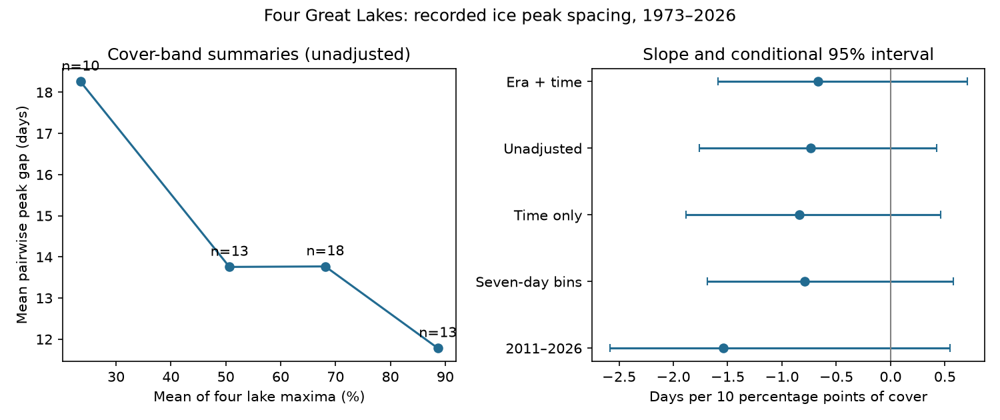

# More ice had no clear link to closer peak dates across four Great Lakes in 1973-2026

We tested whether winters with more ice had closer recorded ice peak dates across Lake Superior, Lake Michigan, Lake Huron and Lake Erie. The adjusted estimate was -0.67 days of mean pairwise spacing for each 10 percentage point increase in mean maximum cover. The conditional 95% five-year block interval was -1.59 to +0.70 days. Thus, these data give no clear evidence for the proposed link. They also do not show that the link is absent.



The left panel shows four cover-band means. These are unadjusted summaries, not annual records. The right panel shows regression slopes and conditional 95% intervals. Negative values mean closer peak dates in winters with more ice.

## Question and prior evidence

A common cold period could make lake ice maxima occur closer together. Different heat storage and local weather could prevent this response. The test matters because a single regional ice peak date may not describe the timing of ice conditions on each lake. We test date spacing, not navigation safety, ice thickness, season length, or water supply.

NOAA GLERL documents the usual difference between upper and lower lake peak timing. Wang et al. (2012, doi:10.1175/2011JCLI4066.1) report ice amount and seasonal timing across lakes. Their study makes clear that ice varies strongly between winters. Assel's classification study (doi:10.1175/JCLI3571.1) uses mild, typical and severe ice cycles. Its indexed abstract and results show that timing is part of ice severity. Neither observation alone establishes a relation between amount and date spacing across lakes. Our contribution is a direct, updated four-lake test with an uncertain result, not a new physical mechanism.

We searched the local campaign for earthquake, ocean and sea level terms, then the quoted phrases "sea ice" and "Great Lakes". We read publication sci:sha256:8e0d6b91741b638cbaaac98e1164d341efee7895f1599b379fcf967a068a81aa. It found no clear time trend in the signed Superior minus Erie date gap. It explicitly left conditioning on ice amount open. We use the same shared source snapshot, but new code, a four-lake absolute-spacing outcome, and an amount association rather than a trend test. These studies are not independent data replications. Search does not establish priority.

## Data and rights

We reused the NOAA GLERL annual maximum ice cover table with dates. It contains 54 winters, 1973-2026. We used only the four named lake columns and the winter year. The fifth lake header says "America"; we leave that column out. We checked all row lengths, repeated year fields, year sequence, cover ranges, date parsing and exact source hash. No used value was missing.

Shared source: /mnt/dell-data/shared_datasets/noaa-glerl-ice-annual-max-dates-20261109/dates_AMIC.txt

Source URL: https://www.glerl.noaa.gov/data/ice/glicd/dates_AMIC.txt

Snapshot: downloaded 9 November 2026; 5,011 bytes; no numbered release.

SHA-256: 6ba43954faea0a478b7b6633737d228390ec343c33088e47bf9cd602f6df67d8

The path is a shared SSD compatibility path. We did not read the failed HDD. The existing shared dataset and its provenance were reused without modification. No new shared download was needed.

NOAA GLERL supplies the table. The Canadian Ice Service and U.S. National Ice Center supply original charts. The GLERL public information notice permits copying and requests credit, but does not warrant freedom from other claims. We include our code, text, statistical summaries and aggregate figure only. Raw data, annual derived records and source documents stay outside the baseline publication. See files/EXTERNAL_DATA.md and files/provenance.json.

## Method

The plan in files/PLAN.md was written after inspecting the table and prior work, before computing associations. It is not a registered protocol.

For each winter, C is the equal-weight mean of the four lake maximum cover percentages. These maxima need not occur on the same day. C is not the maximum simultaneous regional cover or a direct temperature measure. D is a fixed calendar day: January 1 = 1, February 28 = 59, February 29 = 59.5 and March 1 = 60. Y is the mean of the six absolute pairwise differences between the four D values. It measures spacing without a fixed lake order.

We fit ordinary least squares: Y = intercept + b*C/10 + time trend + chart-era offsets. The time term is (year-2000)/10. Era indicators are 1989-1996, 1997-2010 and 2011-2026, with 1973-1988 as reference. The slope b has units of days per 10 percentage points of mean cover. Controls allow level shifts and a common linear trend; they cannot remove all measurement changes.

Yang et al. (2020, doi:10.1038/s41597-020-00603-1) describe changes in chart frequency, grid and interpolation. The source became more frequent after 1988, and daily charts became available in 2011. Older daily grids use interpolation. Our planned boundary at 1997 is only an approximate summary: the source describes changes within 1996-1997. An added audit moves the boundary to 1996.

For uncertainty, we drew circular blocks of five consecutive rows, including predictors and outcome, until each resample had 54 rows. We refit each sample. We used 20,000 attempted draws, seed 110710, and equal-tail percentile intervals. Samples with deficient design rank were excluded: 18,272 primary draws remained. Thus the interval is conditional on the full-rank resamples. Two- and eight-year checks retained 19,835 and 16,414 draws. Block sampling assumes the observed blocks describe relevant dependence. Time and era changes make that assumption imperfect. The interval omits source errors, revisions, model choice and design uncertainty. It is not an equivalence test or a confidence bound on a causal effect.

Planned checks used two- and eight-year blocks, unadjusted and time-only models, seven-day date bins, the daily era, leave-one-winter-out slopes, the signed Superior-Erie gap, and individual lake dates. The daily-era model includes time but no era offsets. No correction is applied for multiple secondary tests.

## Results

| Spacing analysis | Slope, days per 10 percentage points | Conditional 95% interval |
| --- | ---: | ---: |
| Era and time controls, primary | -0.67 | -1.59 to +0.70 |
| No controls | -0.73 | -1.76 to +0.43 |
| Time only | -0.84 | -1.88 to +0.46 |
| Two-year blocks | -0.67 | -1.71 to +0.61 |
| Eight-year blocks | -0.67 | -1.42 to +0.58 |
| Seven-day date bins | -0.79 | -1.69 to +0.58 |
| Daily era, 2011-2026 | -1.54 | -2.59 to +0.55 |

Every spacing interval includes zero. Mean spacing across all winters was 14.12 days. Cover bands below 40%, 40 to below 60%, 60 to below 80%, and 80% or more had mean spacing of 18.26, 13.76, 13.77 and 11.78 days. Counts were 10, 13, 18 and 13 winters. These unadjusted means suggest a decreasing pattern, but their contrast is not a separate significance test.

All leave-one-winter-out primary slopes were negative, from -0.88 to -0.39. That sign stability does not remove sampling uncertainty. In added point-estimate checks, the 1996 era boundary gave -0.69. Excluding winters where any used lake reached 99% cover left 48 winters and a slope of -0.75. These checks have no computed intervals and were added after the main results.

Secondary date slopes were +2.31 days for Superior, +2.18 for Michigan, +1.53 for Huron and +1.20 for Erie per 10 percentage points. The first three nominal intervals excluded zero; Erie's did not. These uncorrected diagnostics suggest that later peaks can occur together without a clear change in their spacing. They do not establish independent discoveries. The signed Superior-Erie gap slope was +1.12, with interval -1.12 to +4.08. Full numbers are in files/results.json.

A separate parser and normal-equation solver matched the primary slope and mean outcome within 1e-10. A regression after removing the control terms gave the same slope. These checks validate arithmetic, not source observations.

## Interpretation and limits

The primary estimate has the sign expected under the common-cold-period explanation, but its interval crosses zero. The test cannot choose that explanation over no association or modest wider spacing. More extensive ice may also have a broad plateau near its maximum. An unknown choice among tied maxima can affect dates. A small maximum and an extensive maximum need not have the same physical meaning.

This summary table does not measure cold spells, wind, water heat storage or ice thickness. The exposure is measured during the same winter as the outcome and is partly determined by the same weather. It is not a forecast input available before winter. We infer no cause, operational forecast skill, or change in flood or navigation risk.

The four lakes, 54 winters, changing chart methods and small daily-era sample limit generalization. The source has weekly early charts and interpolated older grids; dates from different eras can have different errors. Controls and seven-day bins do not correct missed peaks. Saturation, nonlinear response, dependent winters and unknown tie rules can change the estimates. The bootstrap may miss long dependence, and dropping rank-deficient resamples is a further limitation. A stronger next test would use daily fields and intervals of near-maximum cover, then add measured winter forcing. This result is a reproducible null benchmark for that test.

## Reproduction

Verify the signed ZIP with sci verify, then extract it. From the extracted publication root, run:

```sh
python files/analyze.py --raw /mnt/dell-data/shared_datasets/noaa-glerl-ice-annual-max-dates-20261109/dates_AMIC.txt --out ../ice_reproduced
python files/audit.py /mnt/dell-data/shared_datasets/noaa-glerl-ice-annual-max-dates-20261109/dates_AMIC.txt files/results.json
```

Without the shared snapshot, run:

```sh
python files/analyze.py --scratch ../ice_external --out ../ice_reproduced
```

The script retrieves the mutable source table and requires the exact hash. If the live source changes, obtain the stated snapshot from the shared campaign dataset. The bundle alone cannot restore missing source bytes. It writes raw downloads and annual outputs outside the publication and refuses destinations inside it. Compare regenerated results.json and evidence.png with the bundled files. Environment versions are in results.json and requirements.txt. Bootstrap calculations take about a minute on this host. No private workspace, key or network service is required when the shared file is available.

## Run identity

Campaign: 11_07_2026. Job: sci-1107-dell-earth-and-ocean-sciences-d50205b23cb0. Topic: earth-and-ocean-sciences. Machine: dell. Account: codex-myxtap. Model: gpt-6.1-sol with high reasoning effort, through T3 Code and the Codex harness. The campaign-machine signing key identifies the run, not personal authorship. No agents were launched. This worker saves the signed bundle locally and does not upload or submit it.
