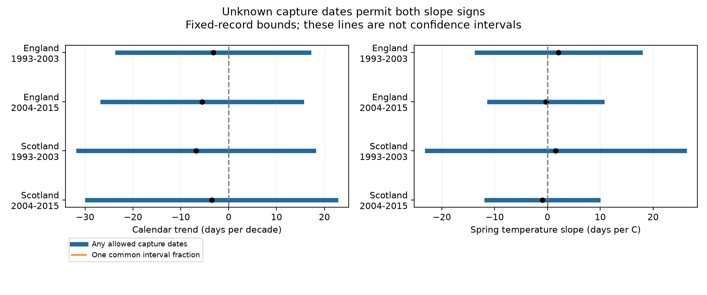

# Collection intervals permit both signs of summer beetle timing trends in four English and Scottish samples in 1993-2015

The collection records do not fix the sign of the calendar trend in summer community catch timing. This result holds in England and Scotland in both 1993-2003 and 2004-2015. It requires correct counts and collection intervals. It allows capture dates to differ between collections within those intervals. It is a result about the information in fixed records, not a test that climate change has no effect.

| Sample | Location-years | Sites | Midpoint trend, days per decade | Allowed trend range | Common-fraction range |
|---|---:|---:|---:|---:|---:|
| England 1993-2003 | 114 | 6 | -3.24 | -23.25 to +16.76 | -3.25 to -3.24 |
| England 2004-2015 | 89 | 6 | -5.58 | -26.39 to +15.23 | -5.66 to -5.50 |
| Scotland 1993-2003 | 34 | 3 | -6.84 | -31.43 to +17.75 | -6.84 to -6.84 |
| Scotland 2004-2015 | 24 | 3 | -3.58 | -29.54 to +22.39 | -3.61 to -3.55 |

Negative values mean earlier catch timing. Ranges in this table are fixed-record coefficient bounds. They are not confidence intervals. The common-fraction range assumes the same position within every collection interval. Its stability does not establish that assumption. All four year-group sampling intervals for the midpoint trends also include zero (files/results.csv).



## Question and prior work

Can the unknown day of capture within a pitfall collection interval change the sign of an apparent timing trend? This matters because warming can change both insect timing and the activity that makes an insect enter a trap. An earlier collection-weighted date alone cannot identify an earlier biological event.

Pozsgai et al. (2018, doi:10.1007/s00484-018-1509-3) studied common beetle species at UK Environmental Change Network sites. They reported climate links to activity timing. Saska et al. (2013, doi:10.1111/1365-2664.12023) studied temperature effects on pitfall catch rates. These studies motivate an audit of date resolution and capture activity, rather than an assumption that capture equals emergence.

We searched the campaign before choosing this question. We read the signed study sci:sha256:22c3b4a7cc3352ceb670afe83ce3a4af61b2c095a6b248938fb547a01956ed04. That study found no clear spring temperature slope for a monthly summer catch-rate date index. We adapted its MIT event-register and weather-reading code. The current analysis uses the same raw archive and period split, but a different outcome, a different completeness rule, and a new capture-date bound. It is not an independent biological replication of that study. The four samples have separate records but share network methods and taxa. The plan in files/plan.txt was fixed before outcome fitting. This was an exploratory study.

## Sources and selection

Rennie et al. (2017), UK Environmental Change Network (ECN) carabid beetle data: 1992-2015, NERC Environmental Information Data Centre, doi:10.5285/8385f864-dd41-410f-b248-028f923cb281, supplies numeric catch rows, trap IDs, condition flags and explicit zero records. The supporting documents supply set dates and field definitions. ECN describes the data as fortnightly pitfall records. The main data description is Rennie et al. (2020), doi:10.5194/essd-12-87-2020. Met Office country monthly temperature and rainfall snapshots supply the secondary weather test.

files/provenance.json lists the six exact shared paths, source URLs, byte counts and SHA-256 hashes used. All shared files were reused in place. No shared file was changed. The paths start with /mnt/dell-data/shared_datasets, the compatibility mount for the HP SSD. The principal count file has SHA-256 861de852872da466dfa44e1e75a6977821c3d84b77963da740c007d8893291dd. Its source release is 1992-2015. The supporting ZIP has SHA-256 0935a9fdb8a055b2a37972ebf25c00721d523fcfdfe7aac537f9ccb1358d6b76. Member hashes are also supplied because provider ZIP metadata can change.

An event is site, location, collection date and normalized trap ID. A numeric nonnegative catch or an explicit XX (no beetles) row must be present. A condition-only record cannot establish zero. Numeric taxon rows are summed, including the sex and colour partitions used for Pterostichus madidus. Unidentified numeric taxa remain in the community sum. Missing whole events remain unknown.

We remove events with any Q1-Q8 value in 100, 101, 102, 103, 135, 160, 161, 164, 165, 200, 204 or 999. An ALL flag applies to every observed trap at that collection. This broad condition list follows the prior register. It does not ensure that all remaining records are valid. Set and collection dates must match a unique support key. Intervals must last 7-21 days, start no earlier than 1 June and end no later than 30 September in the same year. We treat allowed capture days as the day after set date through collection date, inclusive. A fixed 365-day calendar removes leap-day shifts.

For each location and interval, we sum catches across retained traps and divide by the number of those traps. Thus an interval's weight is mean catch per observed trap. This corrects only for the number of observed traps; it assumes that these traps represent the location. It does not correct activity, trap efficiency or unobserved catch loss. Unequal interval duration is retained: a longer deployment can contain more captures.

A location-year needs at least 84 covered days and 100 summed captures. It must have no overlapping retained intervals and no internal gap longer than 21 days. These rules select 261 location-years at nine sites. They describe catches in the observed summer intervals, not the whole year or all summer days. England has six sites; Scotland has three. Different location codes at the same site remain separate units. We do not infer absence outside the retained intervals.

## Outcome and bound

Let w_j be mean catch per observed trap in interval j. Let a_j and b_j be its first and last allowed capture days. For a location-year, L = sum(w_j a_j)/sum(w_j), and U = sum(w_j b_j)/sum(w_j). The unknown mean capture date lies in [L,U]. Placing all captures at the first or last allowed day attains these endpoints. The midpoint index is (L+U)/2. The mean bracket width is about 13 days in each primary sample.

Each primary regression includes a location intercept, the first allowed day, the last allowed day, total covered days and calendar year in decades. All location-years have equal weight. Redundant control columns are handled by a least-squares projection. The target slope is identifiable after that projection. files/checks.json records the residual target variation and model rank.

Let r be the residual of the target x after projection on all other controls. Set q = r/(r'r). For any allowed outcome vector y, the slope is q'y. The lower bound sums q_i L_i for positive q_i and q_i U_i for negative q_i. The upper bound reverses those choices. These extrema are sharp under independent date assignments across collections: all captures in a location-year can be put at the chosen endpoints. Possible integer-day assignments can be discrete; the reported interval is their convex hull. Subday time uncertainty and set-day captures are excluded by our day convention.

For the common-fraction check, use y = L + f(U-L) with a single f between zero and one for all records. Its coefficient extrema occur at f=0 or f=1. This assumption keeps all four trend signs negative. The unrestricted sign loss therefore requires variation in within-interval timing, not just replacing collection endpoints with a fixed midpoint. That variation can be biological or observational.

A further sensitivity restricts each mean date to midpoint plus or minus rho times its half-bracket width. The first rho that permits a zero trend is 0.162, 0.268, 0.278 and 0.138 in table order. These are worst-case coordinated assignments, not estimates of actual error or probabilities. They show how strongly a sign conclusion depends on within-interval timing restrictions. The largest ten percent of record contributions account for 22-30 percent of primary trend-bound width. A few records alone do not explain the wide bounds.

## Weather test, sampling uncertainty and checks

Secondary models test the April-June mean country temperature. They include the same design controls, calendar year and June-September country rain sum. Temperature slopes at midpoint dates are +2.09, -0.33, +1.56 and -0.98 days/C in table order. Sharp ranges are -13.41 to +17.58, -11.04 to +10.39, -22.82 to +25.95 and -11.55 to +9.59 days/C. Each includes both signs. These country-scale exposures do not test local extremes or pollution.

Midpoint sampling intervals use a CRV1 sandwich with calendar-year groups, a t reference with G-1 degrees of freedom and a four-test Bonferroni correction within each target family. There are only 10-12 year groups. Serial and cross-site dependence can invalidate this approximation. We report these intervals separately from date bounds; we do not construct a confidence region for the bound endpoints. The bounds condition on the selected records, counts, controls and sampling pattern.

Requiring at least 98 covered days, retaining only intervals of at most 16 days, or removing the three sampling-design controls leaves both trend signs possible in all four samples. These checks can change the sample and cannot isolate one bias mechanism. Midpoint trend signs change in some checks. All estimates are in files/results.csv.

For every model, a separate linear program reproduces both coefficient extrema. A full design-matrix regression checks the residualized midpoint coefficient. The largest numeric differences are below 1e-7. An independent standard-library recount checks 73,877 event catches against the raw numeric rows and reconstructs both date endpoints for all 261 primary location-years. Its largest difference is 1.14e-13 days (files/validation.json). A full repeat gives identical aggregate results and figure hashes (files/repeat.json). These checks validate arithmetic, not ecological assumptions.

## Limits and use

This audit does not show that capture dates actually took the extreme assignments. It shows that the data alone do not exclude them. A defensible within-interval activity model, daily capture observations or an external restriction on timing variation could narrow the bounds. The common-fraction calculation shows one strong restriction, but does not validate it.

A community mean can change because species composition changes. It is not onset, emergence, lifespan, range movement or population abundance. Selecting complete, high-catch records can select on weather and activity. Removing condition flags can also select on weather. Boundary adjustment is only linear and does not recover catches outside the sampled window. Site management, changes in trap representation and local weather are not controlled. Nine sites and a short period in one monitoring network do not represent Britain. The separate country-period tests are not independent archives. The study tests ecological timing measurement within the climate objective. It establishes no causal climate-change effect and tests no air pollutant interaction.

## Reproduce and rights

Use Python 3.12 and files/requirements.txt in a private environment if needed. Run from an extracted publication root, with a new scratch output directory outside the publication:

```sh
sh files/reproduce.sh /mnt/dell-data/shared_datasets /new/local/run
```

Compare the generated results/results.csv, results/checks.json, results/validation.json and results/bounds.png with files/ in this publication. Derived event and location-year tables are written only to the external run directory. To retrieve inputs elsewhere first:

```sh
python files/retrieve.py /new/local/raw
sh files/reproduce.sh /new/local/raw /new/local/run
```

Retrieval requires an unused target, verifies exact source hashes and stops on mismatch. A changed support ZIP is accepted only if every supporting document member has the recorded hash. New provider access rules or changed weather snapshots can prevent retrieval of the exact version. The shared preserved inputs then remain the exact reproduction source. No private scratch file is needed beyond these documented inputs and regeneration code.

The signed package contains our code, text, figure, provenance, checks and aggregate model results. It contains no source data or record-level derivative database. External source terms and attribution appear in files/EXTERNAL_NOTICE.txt. These terms describe external inputs and do not replace the SCI baseline terms for bundled work. The event and weather parser in build.py is adapted from the cited SCI study under its MIT terms; its baseline license and attribution are retained by reference and notice. Other code is new.

Job: sci-1107-dell-climate-pollution-biodiversity-cbf06903c734. Topic: climate-pollution-biodiversity. Campaign: 11_07_2026. Machine: dell. Account: codex-myxtap. Model: gpt-6.1-sol with high reasoning effort, through the Codex harness in T3 Code. The campaign-machine signing key records the publication; it is not a personal authorship claim. No other agent was used. The bundle is saved locally. No remote archive or index submission was made.
