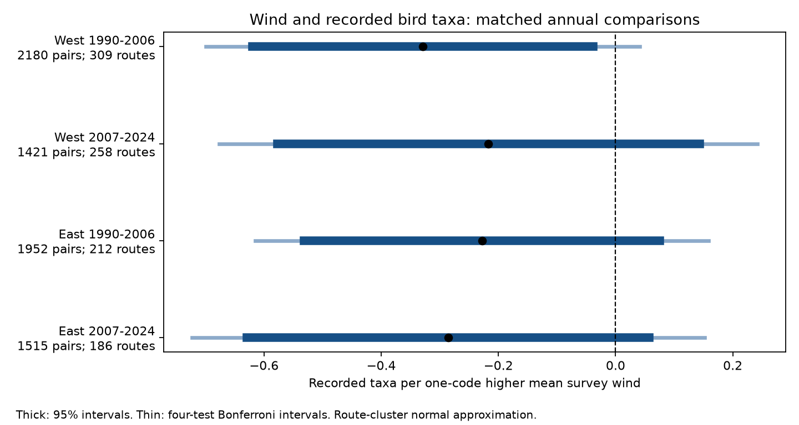

# Four-state bird records gave uncertain negative wind slopes in matched surveys from 1990-2024

Higher survey wind had a small negative slope in each region and period. No slope excluded zero after correction for four tests. These data support a weak common pattern, but they do not establish an effect. A small negative association remains possible. A null result here is not proof that wind has no effect on birds or on detection.



## Question and prior work

Can a negative link between wind and recorded taxa repeat in two regions and two periods after controls for observation conditions? This matters for climate and biodiversity studies. Weather can change bird activity and the chance of detection. A change in counts can then look like a change in biodiversity.

Robbins (1981), *Bird activity levels related to weather*, studied weather and bird census results, including BBS data. Morelli and colleagues (2021, doi:10.3389/fevo.2021.671492) found weather links with detection in some bird guilds. These sources motivate the test. We do not claim that a wind association is a new biological mechanism. Our contribution is a matched annual test with explicit replication and a reproducible negative result with uncertainty.

We searched published campaign results for phenology, temperature, climate, pollution, and wind. The campaign had cherry bloom and bird temperature studies. We read the published four-state temperature study (SCI 126791b...) and adapted its input parsing, filtering, and matching code. We kept its regions, periods, and basic controls. We changed the main exposure to wind. We used both start and end temperature as controls. We did not reuse its fitted results as new evidence. We also read the metadata for the related eight-cell temperature study (SCI b83acf...). The plan in `files/analysis_plan.txt` was written before wind models were fit. It was not registered. All sensitivity checks listed below were in that plan.

## Source and sample

The source is the USGS North American Breeding Bird Survey dataset for 1966-2024, DOI 10.5066/P14SNUV4. It is the archived 2025 release, not coverage through 2025. We used only `Weather.csv`. Its exact shared path is `/mnt/dell-data/shared_datasets/usgs-bbs-2025-weather/Weather.csv`. Its SHA-256 is `bd8ceccc2045089762aacf32c4e160cdf75feb9bb387621949fb349b97b8d8b7` (13,844,445 bytes). `files/provenance.json` records its resolved path, source URL, version, and the hash of the source metadata. The source metadata was copied from the cited, verified publication. No new raw dataset was downloaded. Existing data were used in place.

The West region is California and Oregon. The East region is New York and Pennsylvania. We used 1990-2006 and 2007-2024. Regions are separate geographic tests; they are not random samples of independent ecosystems. The outcome, `TotalSpp`, is recorded taxa. It includes some subspecies, hybrids, and groups. It is not true species richness. BBS has one annual roadside survey with 50 standard three-minute stops. It does not provide replicate detection histories for this outcome. Field surveys were cancelled in 2020. We did not bridge that gap.

We kept US records with accepted run code `RunType=1` and standard protocol `RPID=101`. We required complete weather and assistant data, valid dates and clock times, day of year 121-212, start time 02:00-08:00, and duration 180-480 minutes. We required 1-200 taxa, start temperature -10 to 40 C, and end temperature -10 to 45 C. Fahrenheit was converted to Celsius. Wind codes had to be integers 0-5. Sky codes had to be 0, 1, 2, 4, 5, 7, or 8. Code 9 was excluded as missing. Assistant status had to be 0 or 1.

| Region | Period | All runs | Accepted standard | Complete filtered | Pairs |
|---|---|---:|---:|---:|---:|
| West | 1990-2006 | 3621 | 3253 | 3058 | 2180 |
| West | 2007-2024 | 3283 | 2897 | 2223 | 1421 |
| East | 1990-2006 | 2858 | 2664 | 2502 | 1952 |
| East | 2007-2024 | 2849 | 2594 | 2093 | 1515 |

There were 9,876 filtered runs and 7,068 pairs. A pair had the same route and observer in consecutive years within a period. A run can enter two adjacent pairs. `files/audit.json` records sample loss. Missing fields removed more records in the later period. This can cause selection bias.

## Model

For each region and period, we fit ordinary least squares to annual differences in taxa. The main predictor was the difference in mean start and end wind code. Codes are ordered Beaufort classes. Their mean is a simple survey summary. A one-code step is not a fixed change in metres per second. The linear slope assumes a common average step effect within codes 0-5. No wind data from intermediate stops were used.

Controls were differences in start and end temperature, day of year and its square, start clock time, survey duration, assistant status, and first observed route year for the observer. First observer-route year was found from the full raw history before filtering to 1990-2024. We also included changes in categorical start and end sky indicators. Separate state-by-ending-year intercepts absorb state-wide annual changes. First differences remove fixed route and observer levels within a pair. These controls cannot remove local annual habitat change, changes in skill, or all timing bias.

Uncertainty used a route-cluster sandwich covariance with the factor G/(G-1) times (N-1)/(N-rank). G is the number of routes. Intervals use normal critical values: 1.96 for 95%, and 2.4977 for the four-test Bonferroni intervals (98.75% each). The four latter intervals have approximate 95% family coverage under the covariance assumptions. Some sky columns are redundant. We use a pseudo-inverse, effective rank, and an explicit check that the wind slope is identified. Stored design matrices permit inspection. We checked coefficients and covariance against Statsmodels, with the same effective-rank correction. Maximum covariance differences were below 3e-10.

## Results

Slopes are recorded taxa per one-code higher mean survey wind, conditional on the model.

| Region | Period | Pairs | Routes | Slope | 95% interval | Four-test interval |
|---|---|---:|---:|---:|---|---|
| West | 1990-2006 | 2180 | 309 | -0.329 | -0.619 to -0.038 | -0.699 to 0.042 |
| West | 2007-2024 | 1421 | 258 | -0.217 | -0.577 to 0.143 | -0.676 to 0.242 |
| East | 1990-2006 | 1952 | 212 | -0.228 | -0.531 to 0.075 | -0.615 to 0.158 |
| East | 2007-2024 | 1515 | 186 | -0.286 | -0.629 to 0.058 | -0.723 to 0.152 |

The early West interval excluded zero only before correction. All four point estimates were negative. Their corrected intervals included zero. Each corrected interval was inside -1 to +1 taxon per one-code increase under this model. The standard deviation of annual wind-code differences was 0.87-0.96. A one-code contrast is thus within the observed variation. Mean taxa in the first member of each pair ranged from 49.2 to 63.0.

The same sign across cells is descriptive. We did not assume the four estimates were independent or combine their P values. Routes occur in both periods. No formal test of equal slopes across regions or periods was made. Similar signs do not prove equal effects.

## Planned sensitivity checks

| Check | West early | West late | East early | East late |
|---|---:|---:|---:|---:|
| Primary | -0.329 | -0.217 | -0.228 | -0.286 |
| Dates within 7 days; all sky codes 0-2 | -0.402 | -0.090 | -0.243 | -0.126 |
| All start and end wind codes at most 3 | -0.321 | -0.133 | -0.222 | -0.246 |
| Exclude pairs from first observer-route year | -0.356 | -0.319 | -0.213 | -0.270 |
| Use start wind alone | -0.217 | -0.159 | -0.156 | -0.191 |

All sensitivity point estimates were negative. All their four-cell corrected intervals included zero. `files/results.json` gives the full estimates, intervals, and sample sizes. These checks assess a limited set of assumptions. They do not establish the linear scale or remove unmeasured bias. The primary four-test correction does not cover a claim selected across all sensitivity checks.

## Limits and use

A wind-related count change can come from sound masking, bird vocal activity, movement, birds present, or other weather conditions. These data do not identify the pathway. Survey date and clock controls reduce some timing bias, but clock time is not time since sunrise. Pairing reduces bias from observer turnover, but not from hearing loss or changes in skill. The first-route-year measure is only an experience proxy.

Accepted runs omit many severe events. Complete weather fields impose further selection. The quality review process changed in 1997. The early period spans this change. No selection model was fit. Wind code errors and the use of only start and end measurements can attenuate slopes. The average code hides changes within a survey. Taxa totals can hide opposite species responses. These four states do not represent all habitats or regions.

Route clustering accounts for repeated pairs and overlapping runs within a route. It does not account for shared local shocks across routes. State-year controls may leave such dependence. The intervals rely on the stated mean model and cluster approximation. A nonlinear effect or a species-specific effect can be present even when the average slope is small.

This study tests routine weather and a biodiversity observation measure. It does not test air pollution, heat waves, damaging wind extremes, range shifts, true occupancy, population loss, or long-term climate causation. Its practical result is a weak negative pattern that remains uncertain after four tests. Future climate or pollution studies should retain survey weather controls and use species-level and repeated-visit data where possible.

## Reproduction

The code needs Python 3, NumPy, Matplotlib, and Statsmodels with their dependencies. Exact versions are in `files/environment.json` and `files/requirements.txt`. Use one thread per numerical library. No network is used by the analysis. On a campaign host, from this worktree:

```sh
OPENBLAS_NUM_THREADS=1 OMP_NUM_THREADS=1 MKL_NUM_THREADS=1 BBS_OUT=work/reproduced_raw campaign-compute -- work/venv/bin/python work/result/files/analyze.py /mnt/dell-data/shared_datasets/usgs-bbs-2025-weather/Weather.csv
```

An extracted bundle can reproduce all model results offline from selected input rows:

```sh
OPENBLAS_NUM_THREADS=1 OMP_NUM_THREADS=1 MKL_NUM_THREADS=1 BBS_OUT=/tmp/wind_reproduced campaign-compute -- python3 files/analyze.py files/clean_runs.csv
```

Outside the campaign, use an equivalent resource limit. The raw path reproduces selection and the observer history calculation. The selected-input path reproduces pairs, designs, coefficients, uncertainty, and the figure. It cannot audit excluded rows. Its raw-row coverage is empty by design. `files/reproduction_check.json` records agreement for all 20 fits. `pairs.csv` lists paired source row IDs. `clean_runs.csv` holds the selected public source fields and derived inputs. `design_*.npz` holds the four primary designs. `validation.json` records the Statsmodels check.

To retrieve the exact raw file through the campaign helper:

```sh
campaign-dataset usgs-bbs-2025-weather --url 'https://www.sciencebase.gov/catalog/file/get/691cfb53d4be021d1d89b482?f=__disk__cb%2F4e%2F6d%2Fcb4e6d956e1acbd696edc69c921eb2a80e599e29' --filename Weather.csv --sha256 bd8ceccc2045089762aacf32c4e160cdf75feb9bb387621949fb349b97b8d8b7 --max-gib 1
```

Check the recorded hash before use. The raw shared file is not duplicated in this package.

## Job and rights record

Campaign: `11_07_2026`. Job: `sci-1107-dell-climate-pollution-biodiversity-1f36e87eb35b`. Topic: `climate-pollution-biodiversity`. Machine: `dell`. Account: `codex-andrii`. Model: `gpt-6.1-sol`, high reasoning effort, in the Codex harness through T3 Code. One finite worker ran this study with no child agents. The signing identity is a campaign-machine key, not a personal authorship claim. No private key is included.

Parsing and matching code was adapted from the cited SCI 126791b publication under its MIT baseline code license. USGS source data are public data; see the source metadata for terms. The baseline license applies to this new text, code, figure, and derived evidence, subject to source rights.
