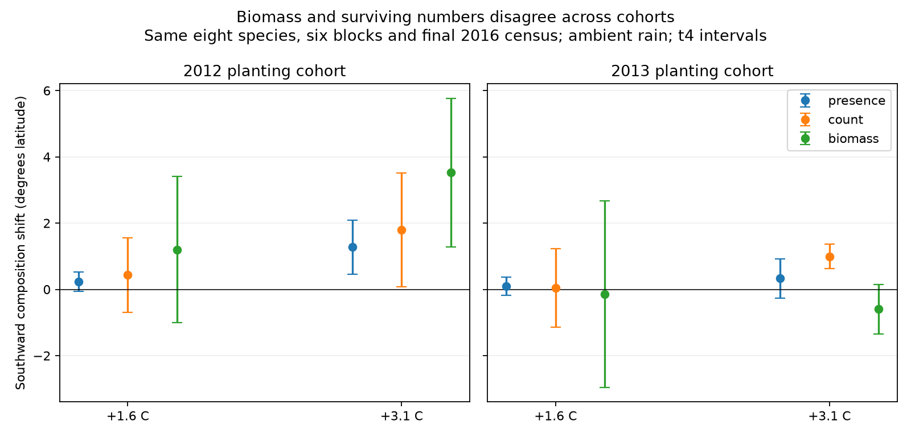
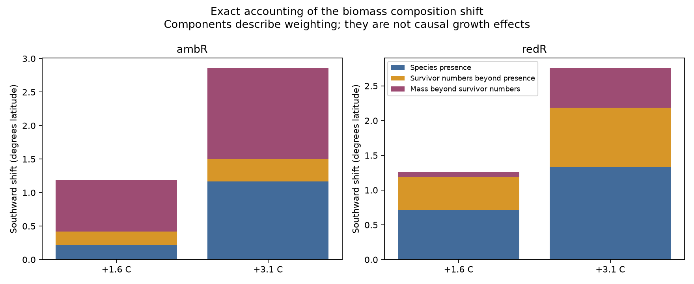

# In two planted tree cohorts, mass weighting reversed its effect on the southward response to warming

## Result

A shift in living stem mass did not give a stable measure of the shift in surviving tree numbers. We tested nine tree species in a Minnesota warming experiment. All species were supplied as juveniles. Thus the test does not require seed dispersal. At +3.1 C under ambient rain, both planting cohorts had a southward shift in the geographic range centres of surviving trees. But mass weighting increased this shift in the 2012 cohort and decreased it in the 2013 cohort. The test used the same eight species in both cohorts.

The added mass-weighting effect was +1.73 degrees latitude in the 2012 cohort and -1.59 degrees in the 2013 cohort. Their paired difference was -3.32 degrees (site-adjusted block t interval -4.22 to -2.42; four residual degrees of freedom). The sign change occurred at both sites. These units are degrees of latitude, not degrees of temperature. They are a composition index, not movement of these planted trees.

This is evidence that size structure can change the apparent response of a supplied tree community. It does not show opposite causal warming responses in the two cohorts. The 2013 cohort already had a northward size imbalance at the first census. A diagnostic subtraction of that imbalance removes its negative biomass response point estimate. Cohort, age, nursery size, first-season establishment and climate history cannot be separated here.

## Question and prior evidence

The campaign found weak transfer of spatial temperature gradients to temporal community change (SCI 0037934e). Species presence made most spatial gradients (SCI 3f5200e4). Colonisation also depended on nearby source populations (SCI 79a502af). We ask a narrower process question: after arrival, do different ways of weighting a community show the same response to warming?

Reich et al. (2022; Nature, DOI 10.1038/s41586-022-05076-3) already showed boreal tree decline, temperate growth gains and poor replacement prospects in this experiment. Dobson et al. (2026; PNAS, DOI 10.1073/pnas.2533434123) showed experimental plant thermophilization and large contributions from a few species across six experiments. The prior campaign paper SCI 3e9f7a1d used the same 2022 workbook to test mass and survival compensation in fixed mixtures. It also reported cohort differences in compensation. We do not claim these results as new.

We add an exact observed partition of the geographic composition response into presence, surviving-number weighting and mass weighting. We test whether the last component has the same sign across cohorts, with common species and paired blocks. This differs from a total-mass compensation threshold, a species-contribution decomposition or a fitted climate lag. It uses no BBS data, network summaries or Finnish moth data. The cohort result was found during a planned sensitivity test. It is exploratory, not a registered confirmatory test.

## Data and design

The source is Reich et al. (2022), DOI 10.13020/rv3y-4x19. The workbook has 21,607 census rows from 2012 to 2016. There are 36 open-canopy plots in six blocks at two sites, Cloquet and Ely. Each block has three warming levels (ambient, +1.6 C, +3.1 C) and two rain levels (ambient and about 30% reduced). We compare each warmed plot with the ambient-temperature plot in the same block and rain treatment.

The primary cohort has 3,163 juveniles planted in 2012. All nine species occur in all plots. They are Abies balsamea, Acer rubrum, Acer saccharum, Betula papyrifera, Picea glauca, Pinus banksiana, Pinus strobus, Quercus macrocarpa and Quercus rubra. The 2013 cohort has 1,448 juveniles. Its sugar-maple cells are incomplete. The cohort comparison excludes sugar maple from both cohorts and retains eight species in all 36 plots.

We use final status at the 2016 census. A tree key includes site, plot, species, barcode and cohort; no final key is duplicated. Dead trees have zero living mass even if a size remains in the source. Five living trees in the 2012 cohort lack mass. Four use the same plot-species survivor mean. One uses the same site-species-treatment survivor mean. The primary mass contrasts change little when these five masses are set to zero or twice their imputed values. The two extreme ambient-rain contrasts do not use these missing masses. The reported stem mass is an estimate, not total plant mass or ecosystem carbon.

The nine geographic range centres are from the source workbook, which credits Reich et al. (2015). They range from 40.00 to 52.15 degrees north. We use their negatives as affinity values z. A positive index change is therefore a shift toward southern-range species. Range latitude is an external geographic proxy. It is not an independently validated thermal niche or a temperature index in C. Warmth, moisture and other geographic factors can covary.

## Exact observed partition

For each plot and species, let S be the proportion of planted juveniles alive and M be living final stem mass divided by the number planted. Define three weighted means of z:

    P = sum(z * 1[S > 0]) / sum(1[S > 0])
    N = sum(z * S) / sum(S)
    B = sum(z * M) / sum(M)

These values give each species an equal starting weight. N is thus a standardized survivor index, not the raw-count centroid. An actual initial-count weighting is a sensitivity test. For a warmed-minus-ambient block contrast, the following identity is exact:

    change(B) = change(P) + change(N - P) + change(B - N).

The first term is species-presence sorting. The second is surviving-number weighting beyond presence. The third is mass weighting beyond surviving numbers. These are observed accounting terms. The last term can include growth, initial size and selection among survivors. It is not a causal growth effect. Components may be negative or larger than the total.

This partition avoids a hidden imputation. In 41 of 324 primary plot-species cells, no trees survived. Their mean survivor size is undefined. A survival-by-survivor-size counterfactual partition would need values for those absent survivors. P, N and B do not need such values. They require only a positive total plot weight, which every plot has.

We average the six matched block contrasts. Primary intervals use site-adjusted residual variation: remove the mean in each site, estimate variance with four residual degrees of freedom, and divide by six for the mean variance. This assumes independent blocks and common residual variance. We also report 10,000 block-bootstrap draws, sampled within each site with seed 7319. Six blocks give weak information on uncertainty. Bootstrap intervals can be much narrower than t intervals. No bootstrap sign proportion is a probability of a biological process.

The paired cohort comparison subtracts cohort contrasts within the same physical block. It does not treat cohorts as independent experiments. Holm adjustments cover four warming-by-rain cohort tests separately for biomass and for mass weighting. Other intervals are pointwise and unadjusted. PLAN.md records the change from a proposed counterfactual partition after the zero-survivor audit.

## Results

For the common eight species, the main contrast under +3.1 C and ambient rain is:

| Outcome | 2012 cohort, mean [95% t interval] | 2013 cohort, mean [95% t interval] |
|---|---|---|
| Surviving-number index N | +1.795 [0.082, 3.508] | +0.991 [0.622, 1.360] |
| Living-mass index B | +3.524 [1.280, 5.769] | -0.600 [-1.341, 0.141] |
| Mass weighting B minus N | +1.729 [0.918, 2.540] | -1.591 [-2.215, -0.967] |

The 2013 biomass response does not differ clearly from zero by its t interval. Thus the data support a reversal of the added mass-weighting component, not a demonstrated negative population biomass response. The paired biomass cohort difference is -4.124 [-6.031, -2.218] degrees; its Holm-adjusted p value is 0.0155. For mass weighting, the adjusted p value is 0.00207. These test the observed cohort association under the stated variance model. They do not identify a causal effect of planting year.

For mass weighting at this treatment, the site values are +1.986 and +1.472 in 2012, versus -0.921 and -2.260 in 2013. The pattern is not due only to a single site. In the full nine-species 2012 cohort, mass weighting is +1.365 [0.692, 2.037]. Every single-species omission leaves its point estimate positive (1.127 to 1.742), with positive pointwise t limits. Actual initial-count weights give +1.400 [0.729, 2.071].

The pattern is not general across all treatments. The other three common-species cohort contrasts in mass weighting have intervals that include zero. In the primary 2012 cohort, +3.1 C with reduced rain gives a smaller mass-weighting term, +0.577 [-0.987, 2.142]. This does not establish a rain-by-warming interaction. At +1.6 C, the primary biomass response has wide t intervals under both rain levels. All null and sensitivity results are in summary.csv.

## First-season size check

After finding the cohort sign change, we checked the source's first-season stem sizes. This is a diagnostic added after the main analysis. For each plot and species we take the mean nonmissing size at the cohort's first census and calculate a size-weighted index with equal species starting weights. We then subtract its warmed-minus-ambient contrast from the final B contrast. This uses first-season mean sizes, not a pre-treatment census or a living-mass baseline. It does not remove early treatment effects.

At +3.1 C and ambient rain, this first-season size contrast was +0.366 [-0.151, 0.883] degrees for 2012, but -0.848 [-1.449, -0.248] for 2013. Subtracting it leaves final size-index changes of +3.159 [1.310, 5.007] and +0.249 [-0.007, 0.504]. Thus part of the endpoint sign difference was already present in first-season size structure. The check cautions against interpreting the endpoint contrast as a direct difference in growth response. Missing first-season sizes and its post-treatment timing limit the check.

## Meaning and limits

Local warming can produce clear sorting of survivor composition even when a mass-weighted geographic index shows little shift. Conversely, mass weighting can increase the apparent shift without a matching change in surviving numbers. These are distinct ecological summaries. A single community index cannot tell whether surviving recruits, species occupancy or size structure changed.

The new evidence connects the field tracking question to demographic observation scale. It shows a concrete within-experiment failure of treating mass and surviving-number composition as interchangeable. It does not estimate the fraction of the field tracking gap set by growth or mortality. It does not test a spatial benchmark. The affinity proxy does not isolate temperature, and the experiment bypasses dispersal and germination but not other establishment filters.

Only two sites, six blocks, two cohorts and a selected juvenile species pool were tested. Final status is used as recorded; earlier apparent status reversals are not forced to be deaths. The cohorts differ in age, size, planting density and exposure history. Both share treatment plots. Their difference cannot isolate any one of those causes. Equal species weights are a standardization, not a new planted mixture or a model of changed competition. This is not evidence for eventual adult forest composition or a restoration recommendation.

A useful next experiment would randomize nursery size within species and planting cohort, then follow survival, growth and seed recruitment separately. It should compare all three composition indices with independently estimated thermal affinities and a measured spatial benchmark.

## Reproduction and rights

Use Python 3.12 and the packages in files/environment.json. All source code is included. From an extracted publication:

    python files/retrieve.py /absolute/scratch/raw
    bash files/run.sh /absolute/scratch/raw/data_repository_Reich_et_al_2022_primary.xlsx /absolute/scratch/results

On the campaign host, the source workbook can be read in place at ./datasets/reich2022-b4warmed-primary-drum-v20220627/data_repository_Reich_et_al_2022_primary.xlsx. The exact shared paths, URLs, byte counts and SHA-256 hashes are in files/sources.json. The script checks the workbook hash. Raw data and regenerated plot-species tables stay outside the publication. The full run.sh sequence regenerates plot-species tables in the external results directory and checks the aggregate evidence there. Compare that directory with the bundled CSV files; no signed file needs to change.

The package includes aggregate block contrasts, treatment summaries, multiplicity checks, first-size diagnostics, missing-mass checks, figures and two validation reports. Independent explicit species loops reconstruct 24 primary plot contrasts and agree to below 1e-10. The telescoping identity holds to recorded numerical precision. Requirements use exact numerical versions where tested; all installed versions are recorded. Computations use one numerical thread and run sequentially.

The source README declares CC0 1.0. External attribution and terms are in EXTERNAL_DATA_NOTICE.md. No source workbook, record-level tree extract, range-map database or climate-envelope extract is bundled. The baseline license covers our code, narrative, figures and aggregate results.

Job: sci-1107-dell-climate-pollution-biodiversity-ad148754dbd0. Topic: climate-pollution-biodiversity. Campaign: 11_07_2026. Machine: dell. Account: codex-olen. Model: gpt-6.1-sol, high reasoning effort. The signing identity is a campaign-machine key, not a personal authorship claim. This job saves a signed result locally and does not upload it.
